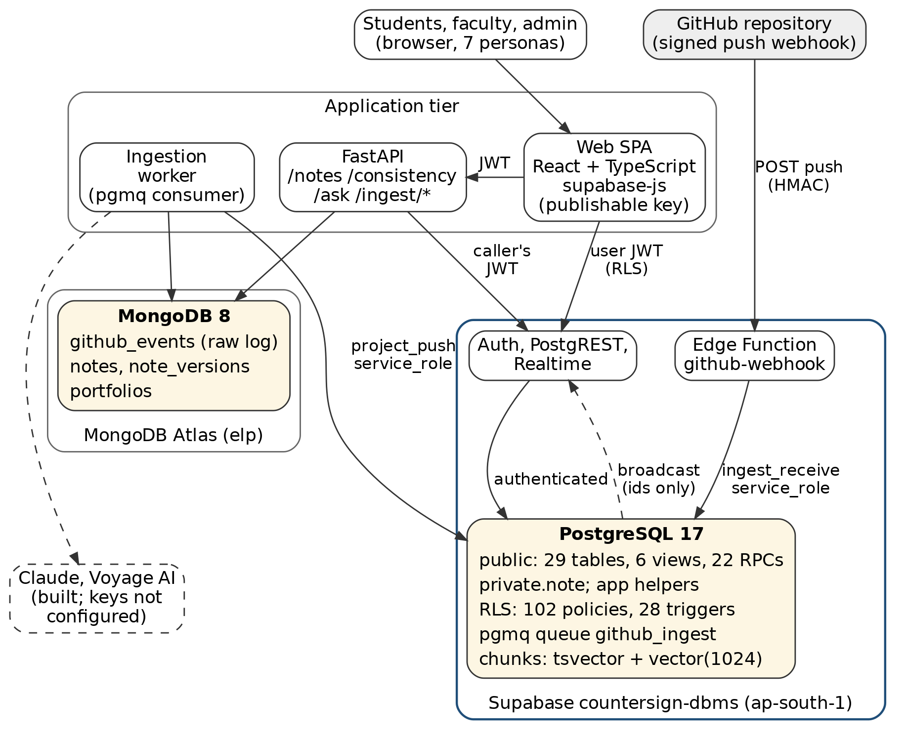

::: cover
**RV College of Engineering®, Bengaluru – 59**

**Department of Computer Science and Engineering**

**DATABASE MANAGEMENT SYSTEMS (CD252IA)**

**Lab Component 11: CIE Project Demo and Final Report**

&nbsp;

**FINAL PROJECT REPORT**

**Unified Experiential Learning and Project Intelligence Platform**

(product name: Countersign)

&nbsp;

| USN | Name |
|:--|:--|
| 1RV24CY047 | S Arun Sanjay |

&nbsp;

Semester V, 2026-27

Skeleton 1.0, 19 November 2026
:::

::: toc
:::

# Document control

| Item | Value |
|:--|:--|
| Component | 11, CIE Project Demo and Final Report Submission (10 marks, not reduced) |
| Version | Skeleton 1.0, 19 November 2026: a solo project (one author; team T00 has one member, and the countersign is shown on T06), migration 0007, the Race arena page and the test counts of 19 November 2026. Skeleton 0.95 (5 November 2026) was corrected after the read-only rehearsal and the lab panel's review |
| Author | S Arun Sanjay (1RV24CY047) |
| Extends | C9 Demo and Draft Report (`C9_Demo_and_Draft_Report.md`): the demo script, the architecture and the description of every module |
| Adds | evaluation against the SRS, limitations, future work, conclusion; Appendix A (full schema listing generated from the database catalog), Appendix B (test inventory), Appendix C (user manual), Appendix D (rebuilding this report) |

**How to read this skeleton.** Every section is written from the system as it stands on 19 November 2026, with measured numbers. Text in a box marked **To complete** is a placeholder for facts that only exist after the demo (the evaluators' questions, the live timings on the cloud, the final marks). Chapters 4 and 5 summarise C9 Part II and point to it for detail; the final submission merges the two.

# Abstract

Countersign is a database-driven experiential-learning platform for RVCE course projects. Its thesis is "every mark has a receipt": the lab's paper evaluation sheet is normalized into the schema, and every rubric cell links to student claims, the evidence behind each claim and the teammates who countersigned it; in a solo team there is no teammate to countersign, so the claim rests on its evidence and the faculty review. The system of record is PostgreSQL 17 on Supabase: 30 tables with row-level security on every one, six `security_invoker` views and 22 RPCs. Fourteen of the RPCs are SECURITY INVOKER and run as the caller; three private-note RPCs are SECURITY DEFINER with an explicit owner check; and five pipeline RPCs are SECURITY DEFINER and executable by the service role only (C2 NFR-SEC-5). So the browser and the API never bypass the access rules for a user request. MongoDB 8 on Atlas keeps the raw GitHub push log, immutable note versions and student portfolios; an inbox → log → projection pipeline with idempotent steps keeps the two databases consistent and is checked by a consistency report. Search fuses a rarity-weighted keyword list and an optional vector list by reciprocal rank fusion in one SQL statement under RLS. The Innovative Experiment measured six ways of enforcing a team's capacity under concurrency over 72,000 races and showed that the fixture's lock-then-count trigger over-admits in every race at REPEATABLE READ, while the product's write-the-parent trigger and a declarative seat-key design never do. The Race arena page brings the experiment into the product: it replays the recorded races and runs single live races in a separate container. The build is verified by 710 pgTAP tests, the unchanged graded Test fixture (37/37 SQL, 25/25 MongoDB), 66 API tests and 44 browser tests.

# 1. Introduction

## 1.1 Problem

RVCE's experiential-learning projects are graded on a paper sheet signed on trust. Work is spread over chat groups, shared drives and personal repositories; the faculty cannot see who did what; teammates are found through friends; and the record disappears at the end of the semester (C1 Synopsis; C2 SRS §1).

## 1.2 Objectives

1. Make the rubric the schema, so that every mark can be traced to claims, evidence and countersigns.
2. Enforce privacy and integrity in the database, not in the user interface.
3. Measure integrity under concurrency (Component 10).
4. Use MongoDB for what it is good at (append-only documents and aggregates) with an explicit consistency contract with PostgreSQL.
5. Keep the graded Test fixture (Q1–Q37, M1–M25) running unchanged on the final schema.

## 1.3 Scope and non-goals

AI-generated-work detection is a non-goal (C2 §2.7): AI assistance is *declared* per claim and per version, never detected. The faculty reads, for the projects it oversees, contribution metadata, claim statements, evidence, dispute comments and submitted content, never drafts, private artifacts or private notes.

# 2. Existing systems

See C2 §2.1.1. Summary:

| System | What it records | Gap that Countersign addresses |
|:--|:--|:--|
| Paper lab evaluation sheet | one mark and a signature per component | no record of who did the work |
| Google Classroom, Moodle | submissions per assignment | no per-student contribution inside a team |
| GitHub Classroom, GitHub Insights | commits per account | commit counts are gameable; non-code work is invisible; author e-mail is self-asserted |
| CATME, WebPA | peer ratings | ratings, not evidence; no link to artifacts |

# 3. Requirements (summary)

Functional requirements FR1–FR11 and the non-functional requirements are specified in C2 §3.2 and §3.5. Chapter 7 evaluates each of them against the build.

# 4. Design

* **ER model:** C3 (16 entity types, 34 relationship types; weak entities MILESTONE, ARTIFACT_VERSION, CLAIM_EVIDENCE; one ternary relationship, ASSESSES, with STUDENT : MILESTONE : FACULTY = M : N : 1; CONTRIBUTION and CLAIM are entity types, not relationships; recursive SUBSKILL_OF on SKILL).
* **Data flow:** C5 (Level 0, Level 1 with eight processes, Level 2 for claims and assessment).
* **Normalization:** C6 (the paper sheet from UNF to BCNF with a lossless-join proof; USN, Project → Team is not preserved and is enforced by a trigger; every implemented table checked; five tables are deliberately below 3NF, each copy pinned by a composite FK: `project`, `artifact`, `claim` and `skill_evidence` in 2NF, `submission` in 1NF; C6 B.1, B.2).
* **Architecture:** Figure 1 and C9 §9.

{width=100%}

# 5. Implementation

The modules are described in C9 §10: core schema (10.1), security (10.2), RPCs (10.3), claims and countersign (10.4), rubric sheet and Lab CIE marks (10.5), teams and skills (10.6), ingestion (10.7), search and Ask (10.8), MongoDB (10.9), the web application (10.10) and the experiment harness (10.11). The complete schema, as the database itself reports it, is Appendix A.

| Layer | Size on 19 Nov 2026 |
|:--|:--|
| SQL migrations 0001–0007 | 4,133 lines; 30 tables, 6 views, 74 functions, 102 policies, 29 triggers |
| pgTAP tests | 7 files, 710 assertions |
| Web application | 15 pages (including the Race arena, `/race`); a "Show the SQL" registry of 46 panels |
| API and worker | 10 endpoints (including `POST /race/run`); 66 tests |
| MongoDB | 4 collections with `$jsonSchema` validators |
| Experiment | 6 strategies × 3 isolation levels × 4 values of N × 1000 trials; single live races from the Race arena |

# 6. Testing

C9 §11 gives the counts per suite; Appendix B lists what each test file covers. All suites pass on the local stack after `scripts/reset_local.sh` (verified 19 November 2026): pgTAP 710 (7 files), fixture Q1–Q37 37/37 and M1–M25 25/25, API 66 (with the race lab `elp-race-pg` running), web e2e 44 (11 specs), and the webhook replay 16 of 16 deliveries as expected.

# 7. Evaluation

## 7.1 Functional requirements

| FR | Requirement (C2 §3.2) | Status | Evidence |
|:--|:--|:--|:--|
| FR1 | Academic records (students, faculty, courses, terms) | Met in the database; the admin UI is read-only (records are loaded by migration and seed) | `01_constraints.sql` §A, `02_rls_matrix.sql` §A |
| FR2 | Projects and rubric components | Met for P06's 11 components (marks, lock, max); no form yet to create a project | `03_rpc.sql` §H, `04_abuse_cases.sql` §2 |
| FR3 | Semester hub | Met | `semester_hub()`; e2e 02 |
| FR4 | Team formation with skill-based recommendations | Met: join/leave with capacity, complementary finder, full cover (division), skill gap, skill tree | `03_rpc.sql` §D, §E; e2e 04; C10 |
| FR5 | Capture of work as artifacts | Met through the signed webhook and the notes API: replayed fixtures on the cloud project, and a fresh signed push end to end on the local stack (e2e spec 10). No live push has been sent to the cloud yet (that is the demo), and a real `git push` with file contents is untested | `05_ingest.sql`; e2e 10; §8.2 |
| FR6 | Attribution: contributions, claims, evidence, countersigns | Met | `03_rpc.sql` §G; `04_abuse_cases.sql` §2–§4; e2e 02, 03 |
| FR7 | Submission, assessment and the rubric view | Met | `03_rpc.sql` §F, §H; e2e 05, 06, 07 |
| FR8 | Evidence-backed skills | Partly met: *verified* levels read `skill_evidence`, but its rows are seeded; the automatic derivation from confirmed claims is not built | `skill_gap()`; C5 marks S43/S44 as planned |
| FR9 | Permission-aware cited assistant | Partly met: retrieval under RLS and extractive cited answers; the generative and embedding paths are built but never run against the real services | `05_ingest.sql` §F; `test_worker.py` (`/ask`) |
| FR10 | Permanent record and portfolio | Partly met: RESTRICT foreign keys, so recorded history cannot be deleted through the app (the only user-level delete is a claimant withdrawing their own **pending** claim, policy `claim_delete`); portfolios are built by `$merge`; no student-facing export | `01_constraints.sql` §B; `mongo/portfolio_merge.js` |
| FR11 | Polyglot persistence | Met, with the consistency contract | `GET /consistency`; `test_worker.py` |

## 7.2 Non-functional requirements

| NFR | Result | How it was measured |
|:--|:--|:--|
| Security | Met: RLS on every table; anon reads nothing; faculty see only the projects they oversee: there they read contribution metadata, claim statements, evidence, dispute comments and *submitted* text, but never drafts, private artifacts or private notes (C2 §3.4.1, C8 B.2); the API never uses the service key for a user | 301-assertion RLS matrix; 53 abuse cases; C9 §3.6 live attempts |
| Integrity | Met: every cross-row rule is a trigger with a failing test; since migration 0007 a mark with a second decimal is refused on every write path, never rounded | 48-assertion constraint gallery; 129 RPC assertions; 43 strict-marks assertions (`07_strict_marks.sql`) |
| Concurrency | Met for capacity, one-team-per-project, membership and countersign revisions at RC, RR and SERIALIZABLE | C10 (72,000 races); `membership_skew_check.sh` |
| Reliability | Met for ingestion: at-least-once delivery, idempotent steps, dead letters, repair from the log | `06_ingest_worker.sql`; `test_worker.py` |
| Privacy | Met: private notes in a non-exposed schema; Realtime payloads carry ids only; e-mails hashed in the raw log | `02_rls_matrix.sql` §C; `05_ingest.sql` §G |
| Performance | Not measured beyond the race latencies (p95 at N = 100 from 6.0 ms to 31.9 ms per attempt, local) | Read-only cloud rehearsal, 5 Nov 2026 (web app on a laptop against the ap-south-1 project): each persona signs in and lands in 3.2 to 4.7 s; the Live chip connects in about 1.6 s. **To complete:** live-push latency on the cloud (needs the demo push) |
| Scalability | Not measured; designed for one college (§8.3) | |
| Usability | Not user-tested | **To complete:** evaluators' feedback |
| Explainability | Met: the SQL drawer shows the verbatim SQL, algebra and policies of every panel; answers cite chunk ids | e2e 08, 10 |

## 7.3 The Innovative Experiment

| Strategy | READ COMMITTED | REPEATABLE READ | SERIALIZABLE |
|:--|:-:|:-:|:-:|
| S1 naive check-then-insert | 100 % | 100 % | 0 % |
| S2 fixture trigger Q35 | 0 % | **100 %** (worst 103/4) | 0 % |
| S3 conditional counter | 0 % | 0 % | 0 % |
| S4 naive + retry | 100 % | 100 % | 0 % |
| S6 declarative seat keys | 0 % | 0 % | 0 % |
| S7 write-the-parent (product) | 0 % | 0 % | 0 % |

Over-admission rate, 1000 races per cell and N. The lesson for the design: a rule that counts rows is safe only if the conflict becomes a write on one row (S3, S7) or a key (S6); SERIALIZABLE fixes even the naive strategy, but only with a retry loop does a loser get a clean refusal. The precedence graphs built in SQL agree with the outcomes (a cycle T1 → T2 → T1 in exactly the over-admitting two-client races); this is a consistency check of the model, not independent evidence (`experiments/race/README.md`). The Race arena page (`/race`, C10 §12.4) shows these results in the product and lets faculty and admins run one live race in the throwaway container.

## 7.4 The demo

> **To complete after the demo:** date, which live moments ran on the cloud and which on the fallback; measured toast latency of the live push on the cloud; the evaluators' questions and the answers given; anything that failed and why.

# 8. Limitations

## 8.1 AI keys not configured

No `ANTHROPIC_API_KEY` or `VOYAGE_API_KEY` is set. `/ask` therefore answers extractively (quoted sentences with citations) and search uses the keyword list only. The generative path (citations checked on the server, uncited text dropped) and the embedding path (1024 dimensions, HNSW) are unit-tested with stubs and have never run against the real services. `ai_query_log` does not exist yet, so questions are not logged.

## 8.2 GitHub App not used

The design dropped the GitHub App for a plain repository webhook (PLAN §2 item 9). Consequences:

* The evidence in the demo comes from signed replays of captured and generated payloads, not from a live repository push. A real push gives versions and contributions, but searchable text only with `GITHUB_FETCH_CONTENTS=1` and a token, which was tested against a mocked API only.
* Identity verification (`student_identity.verified_at`) is stamped by an admin; GitHub OAuth would stamp it for real. A GitHub login with no `student_identity` row is logged but never credited: in the replay fixtures, commit a4c0452 by the unlinked login `outside-dev` inside a T01 push gets no contribution row.
* A teammate who merges someone else's branch gives and gets no credit for it: credit follows the authenticated pusher.

## 8.3 Single-college tenancy

There is no `college` entity and no college key on any table: the schema, the RLS helpers and the MongoDB documents assume one institution. A second college would currently need a second project.

## 8.4 Other limitations

* **Deployment:** the web app and the API run locally against the cloud database; the Vercel deployment needs an interactive login and has not been done. The Supabase free tier pauses idle projects.
* **CI:** the workflow file exists but is not pushed (the token lacks the `workflow` scope), so the fixture regression runs by hand.
* **MongoDB access:** the prototype connects with the Atlas admin user, locally only; a least-privilege user with insert-only rights on `note_versions` is still to be created.
* **Data:** the marks and T06's work are illustrative; the 120 → 30 rounding rule is an assumption until the course faculty confirms it.
* **Solo teams:** the project's own team T00 has one member, so its claims cannot be countersigned and stay *pending*; they rest on their evidence and the faculty review. This is the existing rule, not a schema change, and the UI says so; the countersign is demonstrated on T06.
* **Not built from the plan:** viva practice, the hash-chained audit log and consent ledger, the EXPLAIN before/after benchmark, embeddings against the real service (§8.1), hosting, Realtime for events other than contributions (the rubric sheet refetches on window focus instead), live co-editing. The Race arena page promised in C7 §11 is built (C10 §12.4); it shows the precedence graph of a live race, while PostgreSQL's wait-for graph is still printed in the terminal by `demo_locks.sh`. Migration 0007 (strict marks) is built: `assessment.marks` is NUMERIC with a one-decimal CHECK, which closes the NUMERIC(4,1) rounding gap of C8 B.10. The C2 defects D1 (duplicate `commit`, `url` or `file` evidence in one claim), D2 (an admin's direct `assessment` write may name any `assessed_by`) and D4 (`v_semester_hub` may show a locked component as next) are not part of 0007 and stay open.
* **Measurement:** the race results come from one machine with client and server sharing the CPU; latencies are relative.

# 9. Future work

## 9.1 Retrieval-augmented answers with embeddings

Configure Voyage (`voyage-4`, 1024 dimensions) and run `python -m app.worker --embed-missing`; `search_chunks` already fuses the vector list by RRF, with `hnsw.iterative_scan = relaxed_order` so that RLS filtering after the index does not starve the result. Then enable Claude for generative answers, keep the server-side citation check, add `ai_query_log`, and measure retrieval quality on a labelled question set per persona, including the prompt-injection notes.

## 9.2 Live co-editing with Yjs

Add Tiptap with Yjs and a Hocuspocus server for reports written in the platform. Each Yjs update carries its client id, so per-user edits can be summarised into `artifact_version` rows (one version per save or per session) with `created_by`, and become evidence like a commit. The current editor path (versioned saves with optimistic locking) stays as the fallback.

## 9.3 Project genealogy

Embed every project's abstract and topic title and use pgvector k-nearest-neighbour search over past years' projects to show where an idea came from and to flag recycled projects, with the same RLS so that a student sees only public metadata of other teams' work.

## 9.4 Sharding by college

Make the college the tenant key: a `college` table, `college_id` in the key of every top-level entity, RLS helpers that also check the caller's college, and the MongoDB shard key `{college_id, team_id}` (already planned for `github_events`). In PostgreSQL, the options are schema-per-college, a distributed extension (Citus) with `college_id` as the distribution column, or one project per large college; every query in the product already filters by team or project, which keeps queries on one shard.

## 9.5 Other directions

GitHub OAuth for identity, viva practice generated from a student's confirmed claims, the audit hash chain and consent ledger, deployment on Vercel with CI, and a portfolio export at graduation.

# 10. Conclusion

> **To complete after the demo**, in about 200 words: what the project set out to do (every mark has a receipt), what was built and verified (the counts of §6 and the race result of §7.3), what the demo showed, and the main limitation (§8.1–8.3).

# References

1. R. Elmasri and S. B. Navathe, *Fundamentals of Database Systems*, 7th ed., Pearson, 2016.
2. PostgreSQL Global Development Group, *PostgreSQL 17 Documentation*: Concurrency Control; Row Security Policies; Text Search.
3. D. R. K. Ports and K. Grittner, "Serializable Snapshot Isolation in PostgreSQL", *Proc. VLDB Endowment* 5(12), 2012.
4. G. V. Cormack, C. L. A. Clarke and S. Büttcher, "Reciprocal Rank Fusion outperforms Condorcet and individual rank learning methods", *SIGIR*, 2009.
5. Supabase documentation: Row Level Security, Realtime Authorization, Edge Functions, Queues (pgmq).
6. MongoDB 8.0 Manual: Schema Validation, Transactions, Aggregation (`$merge`, `$unionWith`).
7. Project documents: C1 Synopsis, C2 SRS rev. 1.2, C3 ER, C5 DFD, C6 Normalization, C9 Demo and Draft Report, `docs/INGESTION.md`, `experiments/race/`.

# Appendix A. Full schema listing

<!-- BEGIN generated: c11/schema_listing.md -->
<!-- generated by docs/lab/c11/gen_schema_listing.py from the local database catalog; do not edit -->

Generated from the catalog of the local Supabase database (PostgreSQL 17.11), migrations 20261104000001, 20261104000002, 20261104000003, 20261104000004, 20261105000005, 20261105000006, 20261105000007, the same set that is applied to the cloud project. 30 base tables, 6 views and 74 functions in the schemas `public`, `private` and `app`. Per table: the columns, then every constraint, extra index, trigger and RLS policy, as PostgreSQL prints them (`pg_get_constraintdef`, `pg_get_indexdef`, `pg_get_triggerdef`, `pg_policies`). Long column defaults are shortened with an ellipsis in the column table.

### A.1 `public.academic_term`

Row-level security on; 4 columns; 3 constraints; 4 policies; 0 triggers.

| Column | Type | Nullable | Default |
|:--|:--|:-:|:--|
| term\_id | character varying(10) | no |  |
| name | character varying(40) | no |  |
| start\_date | date | no |  |
| end\_date | date | no |  |

```text
PRIMARY KEY academic_term_pkey: PRIMARY KEY (term_id)
EXCLUDE academic_term_no_overlap: EXCLUDE USING gist (daterange(start_date,
      end_date, '[]'::text) WITH &&)
CHECK academic_term_check: CHECK (end_date > start_date)
POLICY academic_term_delete: FOR DELETE TO authenticated
POLICY academic_term_insert: FOR INSERT TO authenticated
POLICY academic_term_select: FOR SELECT TO authenticated
POLICY academic_term_update: FOR UPDATE TO authenticated
```

### A.2 `public.app_user`

Row-level security on; 5 columns; 8 constraints; 4 policies; 0 triggers.

| Column | Type | Nullable | Default |
|:--|:--|:-:|:--|
| user\_id | uuid | no |  |
| role | character varying(10) | no |  |
| usn | character varying(10) | yes |  |
| faculty\_id | character varying(6) | yes |  |
| created\_at | timestamp with time zone | no | now() |

```text
PRIMARY KEY app_user_pkey: PRIMARY KEY (user_id)
UNIQUE app_user_faculty_id_key: UNIQUE (faculty_id)
UNIQUE app_user_usn_key: UNIQUE (usn)
FOREIGN KEY app_user_faculty_id_fkey: FOREIGN KEY (faculty_id) REFERENCES
      faculty(faculty_id) ON DELETE RESTRICT
FOREIGN KEY app_user_user_id_fkey: FOREIGN KEY (user_id) REFERENCES auth.users(id)
      ON DELETE CASCADE
FOREIGN KEY app_user_usn_fkey: FOREIGN KEY (usn) REFERENCES student(usn) ON DELETE
      RESTRICT
CHECK app_user_role_check: CHECK (role::text = ANY (ARRAY['student'::character
      varying, 'faculty'::character varying, 'admin'::character varying]::text[]))
CHECK app_user_role_consistency: CHECK (role::text = 'student'::text AND usn IS NOT
      NULL AND faculty_id IS NULL OR role::text = 'faculty'::text AND faculty_id IS
      NOT NULL AND usn IS NULL OR role::text = 'admin'::text AND usn IS NULL AND
      faculty_id IS NULL)
POLICY app_user_delete: FOR DELETE TO authenticated
POLICY app_user_insert: FOR INSERT TO authenticated
POLICY app_user_select: FOR SELECT TO authenticated
POLICY app_user_update: FOR UPDATE TO authenticated
```

### A.3 `public.artifact`

Row-level security on; 11 columns; 9 constraints; 3 policies; 3 triggers.

| Column | Type | Nullable | Default |
|:--|:--|:-:|:--|
| artifact\_id | character varying(5) | no |  |
| team\_id | character varying(5) | no |  |
| project\_id | character varying(5) | no |  |
| milestone\_no | integer | no |  |
| title | character varying(60) | no |  |
| type | character varying(10) | no |  |
| source | character varying(10) | no |  |
| created\_at | date | no | CURRENT\_DATE |
| visibility | character varying(10) | no | 'team'::character varying |
| owner\_usn | character varying(10) | yes |  |
| external\_ref | text | yes |  |

```text
PRIMARY KEY artifact_pkey: PRIMARY KEY (artifact_id)
FOREIGN KEY artifact_owner_usn_fkey: FOREIGN KEY (owner_usn) REFERENCES student(usn)
      ON DELETE RESTRICT
FOREIGN KEY artifact_project_id_milestone_no_fkey: FOREIGN KEY (project_id,
      milestone_no) REFERENCES milestone(project_id, milestone_no)
FOREIGN KEY artifact_team_id_fkey: FOREIGN KEY (team_id) REFERENCES team(team_id) ON
      DELETE RESTRICT
FOREIGN KEY artifact_team_project_fkey: FOREIGN KEY (team_id, project_id) REFERENCES
      team(team_id, project_id) ON DELETE RESTRICT
CHECK artifact_private_needs_owner: CHECK (visibility::text <> 'private'::text OR
      owner_usn IS NOT NULL)
CHECK artifact_source_check: CHECK (source::text = ANY (ARRAY['github'::character
      varying, 'obsidian'::character varying, 'editor'::character varying]::text[]))
CHECK artifact_type_check: CHECK (type::text = ANY (ARRAY['code'::character varying,
      'note'::character varying, 'report'::character varying, 'diagram'::character
      varying, 'slides'::character varying]::text[]))
CHECK artifact_visibility_check: CHECK (visibility::text = ANY
      (ARRAY['private'::character varying, 'team'::character varying,
      'submitted'::character varying]::text[]))
INDEX artifact_milestone_idx: USING btree (project_id, milestone_no)
INDEX artifact_owner_usn_idx: USING btree (owner_usn)
INDEX artifact_repo_path_key: USING btree (team_id, external_ref) WHERE
      (((source)::text = ANY ((ARRAY['github'::character varying,
      'obsidian'::character varying])::text[])) AND (external_ref IS NOT NULL))
INDEX artifact_team_project_idx: USING btree (team_id, project_id)
TRIGGER trg_artifact_chunk_visibility_sync: AFTER UPDATE OF visibility ON artifact
      FOR EACH ROW WHEN (new.visibility::text = 'submitted'::text AND
      old.visibility::text <> 'submitted'::text) EXECUTE FUNCTION
      private.sync_chunk_visibility()
TRIGGER trg_artifact_guard: BEFORE INSERT OR UPDATE ON artifact FOR EACH ROW EXECUTE
      FUNCTION private.guard_artifact_write()
TRIGGER trg_artifact_owner_member_required: BEFORE INSERT OR UPDATE OF owner_usn,
      team_id ON artifact FOR EACH ROW EXECUTE FUNCTION
      private.require_team_member('owner_usn')
POLICY artifact_insert: FOR INSERT TO authenticated
POLICY artifact_select: FOR SELECT TO authenticated
POLICY artifact_update: FOR UPDATE TO authenticated
```

### A.4 `public.artifact_chunk`

Row-level security on; 12 columns; 8 constraints; 2 policies; 1 trigger.

| Column | Type | Nullable | Default |
|:--|:--|:-:|:--|
| chunk\_id | integer | no | identity (by default) |
| artifact\_id | character varying(5) | no |  |
| version\_no | integer | no |  |
| author\_usn | character varying(10) | no |  |
| content | text | no |  |
| created\_at | date | no | CURRENT\_DATE |
| embedding | vector(1024) | yes |  |
| embedding\_model | character varying(40) | yes |  |
| content\_hash | character(64) | yes |  |
| visibility | character varying(10) | no | 'team'::character varying |
| tsv | tsvector | yes | generated (see below) |
| chunk\_no | integer | yes |  |

```text
GENERATED tsv = to_tsvector('english'::regconfig, content) STORED
PRIMARY KEY artifact_chunk_pkey: PRIMARY KEY (chunk_id)
FOREIGN KEY artifact_chunk_artifact_id_fkey: FOREIGN KEY (artifact_id) REFERENCES
      artifact(artifact_id) ON DELETE CASCADE
FOREIGN KEY artifact_chunk_author_usn_fkey: FOREIGN KEY (author_usn) REFERENCES
      student(usn) ON DELETE RESTRICT
CHECK artifact_chunk_chunk_no_check: CHECK (chunk_no > 0)
CHECK artifact_chunk_content_hash_check: CHECK (content_hash ~
      '^[0-9a-f]{64}$'::text)
CHECK artifact_chunk_embedding_model_required: CHECK (embedding IS NULL OR
      embedding_model IS NOT NULL)
CHECK artifact_chunk_version_no_check: CHECK (version_no > 0)
CHECK artifact_chunk_visibility_check: CHECK (visibility::text = ANY
      (ARRAY['private'::character varying, 'team'::character varying,
      'submitted'::character varying]::text[]))
INDEX artifact_chunk_artifact_id_idx: USING btree (artifact_id)
INDEX artifact_chunk_author_usn_idx: USING btree (author_usn)
INDEX artifact_chunk_embedding_idx: USING hnsw (embedding vector_cosine_ops)
INDEX artifact_chunk_tsv_idx: USING gin (tsv)
INDEX artifact_chunk_version_chunk_key: USING btree (artifact_id, version_no,
      chunk_no) WHERE (chunk_no IS NOT NULL)
TRIGGER trg_artifact_chunk_member_required: BEFORE INSERT OR UPDATE OF author_usn,
      artifact_id ON artifact_chunk FOR EACH ROW EXECUTE FUNCTION
      private.require_artifact_team_member('author_usn')
POLICY artifact_chunk_insert: FOR INSERT TO authenticated
POLICY artifact_chunk_select: FOR SELECT TO authenticated
```

### A.5 `public.artifact_version`

Row-level security on; 8 columns; 7 constraints; 2 policies; 1 trigger.

| Column | Type | Nullable | Default |
|:--|:--|:-:|:--|
| artifact\_id | character varying(5) | no |  |
| version\_no | integer | no |  |
| created\_by | character varying(10) | no |  |
| created\_at | timestamp with time zone | no | now() |
| content\_hash | character(64) | yes |  |
| mongo\_ref | text | yes |  |
| ai\_assistance | character varying(10) | no | 'none'::character varying |
| source\_ref | text | yes |  |

```text
PRIMARY KEY artifact_version_pkey: PRIMARY KEY (artifact_id, version_no)
FOREIGN KEY artifact_version_artifact_id_fkey: FOREIGN KEY (artifact_id) REFERENCES
      artifact(artifact_id) ON DELETE CASCADE
FOREIGN KEY artifact_version_created_by_fkey: FOREIGN KEY (created_by) REFERENCES
      student(usn) ON DELETE RESTRICT
CHECK artifact_version_ai_assistance_check: CHECK (ai_assistance::text = ANY
      (ARRAY['none'::character varying, 'assisted'::character varying,
      'generated'::character varying]::text[]))
CHECK artifact_version_content_hash_check: CHECK (content_hash ~
      '^[0-9a-f]{64}$'::text)
CHECK artifact_version_source_ref_check: CHECK (source_ref IS NULL OR source_ref ~
      '^[0-9a-f]{40}$'::text)
CHECK artifact_version_version_no_check: CHECK (version_no > 0)
INDEX artifact_version_created_by_idx: USING btree (created_by)
INDEX artifact_version_source_ref_key: USING btree (artifact_id, source_ref) WHERE
      (source_ref IS NOT NULL)
TRIGGER trg_artifact_version_member_required: BEFORE INSERT OR UPDATE OF created_by,
      artifact_id ON artifact_version FOR EACH ROW EXECUTE FUNCTION
      private.require_artifact_team_member('created_by')
POLICY artifact_version_insert: FOR INSERT TO authenticated
POLICY artifact_version_select: FOR SELECT TO authenticated
```

### A.6 `public.assessment`

Row-level security on; 7 columns; 7 constraints; 4 policies; 2 triggers.

| Column | Type | Nullable | Default |
|:--|:--|:-:|:--|
| usn | character varying(10) | no |  |
| project\_id | character varying(5) | no |  |
| milestone\_no | integer | no |  |
| marks | numeric | no |  |
| assessed\_by | character varying(6) | no |  |
| assessed\_at | timestamp with time zone | no | now() |
| remarks | character varying(200) | yes |  |

```text
PRIMARY KEY assessment_pkey: PRIMARY KEY (usn, project_id, milestone_no)
FOREIGN KEY assessment_assessed_by_fkey: FOREIGN KEY (assessed_by) REFERENCES
      faculty(faculty_id) ON DELETE RESTRICT
FOREIGN KEY assessment_project_id_milestone_no_fkey: FOREIGN KEY (project_id,
      milestone_no) REFERENCES milestone(project_id, milestone_no) ON DELETE
      RESTRICT
FOREIGN KEY assessment_usn_fkey: FOREIGN KEY (usn) REFERENCES student(usn) ON DELETE
      RESTRICT
CHECK assessment_marks_check: CHECK (marks >= 0::numeric)
CHECK assessment_marks_one_decimal: CHECK (marks = round(marks, 1))
CHECK assessment_marks_precision: CHECK (marks < 1000::numeric)
INDEX assessment_assessed_by_idx: USING btree (assessed_by)
INDEX assessment_milestone_idx: USING btree (project_id, milestone_no)
TRIGGER trg_assessment_canonical_marks: BEFORE INSERT OR UPDATE OF marks ON
      assessment FOR EACH ROW EXECUTE FUNCTION private.canonical_marks()
TRIGGER trg_assessment_check: BEFORE INSERT OR DELETE OR UPDATE ON assessment FOR
      EACH ROW EXECUTE FUNCTION private.check_assessment()
POLICY assessment_delete: FOR DELETE TO authenticated
POLICY assessment_insert: FOR INSERT TO authenticated
POLICY assessment_select: FOR SELECT TO authenticated
POLICY assessment_update: FOR UPDATE TO authenticated
```

### A.7 `public.claim`

Row-level security on; 11 columns; 10 constraints; 4 policies; 3 triggers.

| Column | Type | Nullable | Default |
|:--|:--|:-:|:--|
| claim\_id | integer | no | identity (by default) |
| usn | character varying(10) | no |  |
| team\_id | character varying(5) | no |  |
| project\_id | character varying(5) | no |  |
| milestone\_no | integer | no |  |
| statement | character varying(500) | no |  |
| contribution\_type | character varying(15) | yes |  |
| ai\_assistance | character varying(10) | no | 'none'::character varying |
| status | character varying(10) | no | 'pending'::character varying |
| revision | integer | no | 1 |
| created\_at | timestamp with time zone | no | now() |

```text
PRIMARY KEY claim_pkey: PRIMARY KEY (claim_id)
UNIQUE claim_id_usn_key: UNIQUE (claim_id, usn)
FOREIGN KEY claim_project_id_milestone_no_fkey: FOREIGN KEY (project_id,
      milestone_no) REFERENCES milestone(project_id, milestone_no) ON DELETE
      RESTRICT
FOREIGN KEY claim_team_id_project_id_fkey: FOREIGN KEY (team_id, project_id)
      REFERENCES team(team_id, project_id) ON DELETE RESTRICT
FOREIGN KEY claim_usn_fkey: FOREIGN KEY (usn) REFERENCES student(usn) ON DELETE
      RESTRICT
CHECK claim_ai_assistance_check: CHECK (ai_assistance::text = ANY
      (ARRAY['none'::character varying, 'assisted'::character varying,
      'generated'::character varying]::text[]))
CHECK claim_contribution_type_check: CHECK (contribution_type::text = ANY
      (ARRAY['research'::character varying, 'design'::character varying,
      'code'::character varying, 'documentation'::character varying,
      'review'::character varying]::text[]))
CHECK claim_revision_check: CHECK (revision > 0)
CHECK claim_statement_check: CHECK (length(btrim(statement::text)) >= 10)
CHECK claim_status_check: CHECK (status::text = ANY (ARRAY['pending'::character
      varying, 'confirmed'::character varying, 'contested'::character
      varying]::text[]))
INDEX claim_milestone_idx: USING btree (project_id, milestone_no)
INDEX claim_status_idx: USING btree (status) WHERE ((status)::text <>
      'confirmed'::text)
INDEX claim_team_project_idx: USING btree (team_id, project_id)
INDEX claim_usn_idx: USING btree (usn)
TRIGGER trg_claim_guard: BEFORE INSERT OR DELETE OR UPDATE ON claim FOR EACH ROW
      EXECUTE FUNCTION private.guard_claim()
TRIGGER trg_claim_member_required: BEFORE INSERT OR UPDATE OF usn, team_id ON claim
      FOR EACH ROW EXECUTE FUNCTION private.require_team_member('usn')
TRIGGER trg_claim_status_derived: BEFORE INSERT OR UPDATE ON claim FOR EACH ROW
      EXECUTE FUNCTION private.derive_claim_status()
POLICY claim_delete: FOR DELETE TO authenticated
POLICY claim_insert: FOR INSERT TO authenticated
POLICY claim_select: FOR SELECT TO authenticated
POLICY claim_update: FOR UPDATE TO authenticated
```

### A.8 `public.claim_evidence`

Row-level security on; 9 columns; 8 constraints; 3 policies; 2 triggers.

| Column | Type | Nullable | Default |
|:--|:--|:-:|:--|
| claim\_id | integer | no |  |
| evidence\_no | integer | no |  |
| kind | character varying(16) | no |  |
| contribution\_id | integer | yes |  |
| artifact\_id | character varying(5) | yes |  |
| version\_no | integer | yes |  |
| ref | text | yes |  |
| note | character varying(200) | yes |  |
| added\_at | timestamp with time zone | no | now() |

```text
PRIMARY KEY claim_evidence_pkey: PRIMARY KEY (claim_id, evidence_no)
FOREIGN KEY claim_evidence_artifact_id_version_no_fkey: FOREIGN KEY (artifact_id,
      version_no) REFERENCES artifact_version(artifact_id, version_no) ON DELETE
      RESTRICT
FOREIGN KEY claim_evidence_claim_id_fkey: FOREIGN KEY (claim_id) REFERENCES
      claim(claim_id) ON DELETE CASCADE
FOREIGN KEY claim_evidence_contribution_id_fkey: FOREIGN KEY (contribution_id)
      REFERENCES contribution(contribution_id) ON DELETE RESTRICT
CHECK claim_evidence_evidence_no_check: CHECK (evidence_no > 0)
CHECK claim_evidence_kind_check: CHECK (kind::text = ANY
      (ARRAY['contribution'::character varying, 'artifact_version'::character
      varying, 'commit'::character varying, 'url'::character varying,
      'file'::character varying]::text[]))
CHECK claim_evidence_kind_matches: CHECK ( CASE kind     WHEN 'contribution'::text
      THEN contribution_id IS NOT NULL AND num_nulls(artifact_id, version_no, ref) =
      3     WHEN 'artifact_version'::text THEN num_nonnulls(artifact_id, version_no)
      = 2 AND num_nulls(contribution_id, ref) = 2     ELSE ref IS NOT NULL AND
      num_nulls(contribution_id, artifact_id, version_no) = 3 END)
CHECK claim_evidence_ref_format: CHECK ( CASE kind     WHEN 'commit'::text THEN ref
      ~ '^[0-9a-f]{7,40}$'::text     WHEN 'url'::text THEN ref ~*
      '^https?://\S+$'::text     ELSE true END)
INDEX claim_evidence_contribution_idx: USING btree (contribution_id)
INDEX claim_evidence_once_contribution: USING btree (claim_id, contribution_id)
      WHERE (contribution_id IS NOT NULL)
INDEX claim_evidence_once_version: USING btree (claim_id, artifact_id, version_no)
      WHERE (artifact_id IS NOT NULL)
INDEX claim_evidence_version_idx: USING btree (artifact_id, version_no)
TRIGGER trg_claim_evidence_check: BEFORE INSERT OR DELETE OR UPDATE ON
      claim_evidence FOR EACH ROW EXECUTE FUNCTION private.check_claim_evidence()
TRIGGER trg_claim_evidence_revision: AFTER INSERT OR DELETE ON claim_evidence FOR
      EACH ROW EXECUTE FUNCTION private.bump_claim_revision()
POLICY claim_evidence_delete: FOR DELETE TO authenticated
POLICY claim_evidence_insert: FOR INSERT TO authenticated
POLICY claim_evidence_select: FOR SELECT TO authenticated
```

### A.9 `public.contribution`

Row-level security on; 10 columns; 6 constraints; 2 policies; 2 triggers.

| Column | Type | Nullable | Default |
|:--|:--|:-:|:--|
| contribution\_id | integer | no | identity (by default) |
| usn | character varying(10) | no |  |
| artifact\_id | character varying(5) | no |  |
| contribution\_type | character varying(15) | no |  |
| description | character varying(120) | yes |  |
| created\_at | date | no | CURRENT\_DATE |
| source | character varying(10) | no | 'manual'::character varying |
| source\_ref | text | yes |  |
| occurred\_at | timestamp with time zone | yes |  |
| ai\_assisted | boolean | no | false |

```text
PRIMARY KEY contribution_pkey: PRIMARY KEY (contribution_id)
UNIQUE contribution_id_usn_key: UNIQUE (contribution_id, usn)
FOREIGN KEY contribution_artifact_id_fkey: FOREIGN KEY (artifact_id) REFERENCES
      artifact(artifact_id) ON DELETE RESTRICT
FOREIGN KEY contribution_usn_fkey: FOREIGN KEY (usn) REFERENCES student(usn) ON
      DELETE RESTRICT
CHECK contribution_contribution_type_check: CHECK (contribution_type::text = ANY
      (ARRAY['research'::character varying, 'design'::character varying,
      'code'::character varying, 'documentation'::character varying,
      'review'::character varying]::text[]))
CHECK contribution_source_check: CHECK (source::text = ANY
      (ARRAY['manual'::character varying, 'github'::character varying,
      'obsidian'::character varying, 'editor'::character varying]::text[]))
INDEX contribution_artifact_id_idx: USING btree (artifact_id)
INDEX contribution_idempotency_key: USING btree (source, source_ref, usn,
      artifact_id) WHERE (source_ref IS NOT NULL)
INDEX contribution_usn_idx: USING btree (usn)
TRIGGER trg_contribution_broadcast: AFTER INSERT ON contribution FOR EACH ROW
      EXECUTE FUNCTION private.broadcast_contribution()
TRIGGER trg_contribution_member_required: BEFORE INSERT OR UPDATE OF usn,
      artifact_id ON contribution FOR EACH ROW EXECUTE FUNCTION
      private.require_artifact_team_member('usn')
POLICY contribution_insert: FOR INSERT TO authenticated
POLICY contribution_select: FOR SELECT TO authenticated
```

### A.10 `public.countersign`

Row-level security on; 6 columns; 5 constraints; 4 policies; 2 triggers.

| Column | Type | Nullable | Default |
|:--|:--|:-:|:--|
| claim\_id | integer | no |  |
| endorser\_usn | character varying(10) | no |  |
| verdict | character varying(8) | no |  |
| comment | character varying(300) | yes |  |
| claim\_revision | integer | no |  |
| signed\_at | timestamp with time zone | no | now() |

```text
PRIMARY KEY countersign_pkey: PRIMARY KEY (claim_id, endorser_usn)
FOREIGN KEY countersign_claim_id_fkey: FOREIGN KEY (claim_id) REFERENCES
      claim(claim_id) ON DELETE CASCADE
FOREIGN KEY countersign_endorser_usn_fkey: FOREIGN KEY (endorser_usn) REFERENCES
      student(usn) ON DELETE RESTRICT
CHECK countersign_dispute_needs_comment: CHECK (verdict::text = 'confirm'::text OR
      comment IS NOT NULL)
CHECK countersign_verdict_check: CHECK (verdict::text = ANY
      (ARRAY['confirm'::character varying, 'dispute'::character varying]::text[]))
INDEX countersign_endorser_usn_idx: USING btree (endorser_usn)
TRIGGER trg_countersign_check: BEFORE INSERT OR DELETE OR UPDATE ON countersign FOR
      EACH ROW EXECUTE FUNCTION private.check_countersign()
TRIGGER trg_countersign_sync_status: AFTER INSERT OR DELETE OR UPDATE ON countersign
      FOR EACH ROW EXECUTE FUNCTION private.sync_claim_status()
POLICY countersign_delete: FOR DELETE TO authenticated
POLICY countersign_insert: FOR INSERT TO authenticated
POLICY countersign_select: FOR SELECT TO authenticated
POLICY countersign_update: FOR UPDATE TO authenticated
```

### A.11 `public.course`

Row-level security on; 5 columns; 4 constraints; 4 policies; 0 triggers.

| Column | Type | Nullable | Default |
|:--|:--|:-:|:--|
| course\_code | character varying(10) | no |  |
| title | character varying(80) | no |  |
| semester | integer | no |  |
| credits | integer | no |  |
| faculty\_id | character varying(6) | yes |  |

```text
PRIMARY KEY course_pkey: PRIMARY KEY (course_code)
FOREIGN KEY course_faculty_id_fkey: FOREIGN KEY (faculty_id) REFERENCES
      faculty(faculty_id) ON DELETE SET NULL
CHECK course_credits_check: CHECK (credits > 0)
CHECK course_semester_check: CHECK (semester >= 1 AND semester <= 8)
INDEX course_faculty_id_idx: USING btree (faculty_id)
POLICY course_delete: FOR DELETE TO authenticated
POLICY course_insert: FOR INSERT TO authenticated
POLICY course_select: FOR SELECT TO authenticated
POLICY course_update: FOR UPDATE TO authenticated
```

### A.12 `public.course_offering`

Row-level security on; 5 columns; 6 constraints; 4 policies; 0 triggers.

| Column | Type | Nullable | Default |
|:--|:--|:-:|:--|
| offering\_id | integer | no | identity (by default) |
| course\_code | character varying(10) | no |  |
| term\_id | character varying(10) | no |  |
| section | character(1) | no |  |
| faculty\_id | character varying(6) | no |  |

```text
PRIMARY KEY course_offering_pkey: PRIMARY KEY (offering_id)
UNIQUE course_offering_id_course_key: UNIQUE (offering_id, course_code)
UNIQUE course_offering_natural_key: UNIQUE (course_code, term_id, section)
FOREIGN KEY course_offering_course_code_fkey: FOREIGN KEY (course_code) REFERENCES
      course(course_code) ON DELETE RESTRICT
FOREIGN KEY course_offering_faculty_id_fkey: FOREIGN KEY (faculty_id) REFERENCES
      faculty(faculty_id) ON DELETE RESTRICT
FOREIGN KEY course_offering_term_id_fkey: FOREIGN KEY (term_id) REFERENCES
      academic_term(term_id) ON DELETE RESTRICT
INDEX course_offering_faculty_id_idx: USING btree (faculty_id)
INDEX course_offering_term_id_idx: USING btree (term_id)
POLICY course_offering_delete: FOR DELETE TO authenticated
POLICY course_offering_insert: FOR INSERT TO authenticated
POLICY course_offering_select: FOR SELECT TO authenticated
POLICY course_offering_update: FOR UPDATE TO authenticated
```

### A.13 `public.course_skill`

Row-level security on; 2 columns; 3 constraints; 4 policies; 0 triggers.

| Column | Type | Nullable | Default |
|:--|:--|:-:|:--|
| course\_code | character varying(10) | no |  |
| skill\_id | character varying(5) | no |  |

```text
PRIMARY KEY course_skill_pkey: PRIMARY KEY (course_code, skill_id)
FOREIGN KEY course_skill_course_code_fkey: FOREIGN KEY (course_code) REFERENCES
      course(course_code) ON DELETE CASCADE
FOREIGN KEY course_skill_skill_id_fkey: FOREIGN KEY (skill_id) REFERENCES
      skill(skill_id) ON DELETE RESTRICT
INDEX course_skill_skill_id_idx: USING btree (skill_id)
POLICY course_skill_delete: FOR DELETE TO authenticated
POLICY course_skill_insert: FOR INSERT TO authenticated
POLICY course_skill_select: FOR SELECT TO authenticated
POLICY course_skill_update: FOR UPDATE TO authenticated
```

### A.14 `public.enrollment`

Row-level security on; 3 columns; 3 constraints; 4 policies; 0 triggers.

| Column | Type | Nullable | Default |
|:--|:--|:-:|:--|
| usn | character varying(10) | no |  |
| offering\_id | integer | no |  |
| enrolled\_on | date | no | CURRENT\_DATE |

```text
PRIMARY KEY enrollment_pkey: PRIMARY KEY (usn, offering_id)
FOREIGN KEY enrollment_offering_id_fkey: FOREIGN KEY (offering_id) REFERENCES
      course_offering(offering_id) ON DELETE RESTRICT
FOREIGN KEY enrollment_usn_fkey: FOREIGN KEY (usn) REFERENCES student(usn) ON DELETE
      RESTRICT
INDEX enrollment_offering_id_idx: USING btree (offering_id)
POLICY enrollment_delete: FOR DELETE TO authenticated
POLICY enrollment_insert: FOR INSERT TO authenticated
POLICY enrollment_select: FOR SELECT TO authenticated
POLICY enrollment_update: FOR UPDATE TO authenticated
```

### A.15 `public.faculty`

Row-level security on; 5 columns; 2 constraints; 4 policies; 0 triggers.

| Column | Type | Nullable | Default |
|:--|:--|:-:|:--|
| faculty\_id | character varying(6) | no |  |
| name | character varying(60) | no |  |
| email | character varying(80) | no |  |
| department | character varying(10) | no |  |
| designation | character varying(30) | no |  |

```text
PRIMARY KEY faculty_pkey: PRIMARY KEY (faculty_id)
UNIQUE faculty_email_key: UNIQUE (email)
POLICY faculty_delete: FOR DELETE TO authenticated
POLICY faculty_insert: FOR INSERT TO authenticated
POLICY faculty_select: FOR SELECT TO authenticated
POLICY faculty_update: FOR UPDATE TO authenticated
```

### A.16 `public.ingest_event`

Row-level security on; 18 columns; 11 constraints; 1 policy; 0 triggers.

| Column | Type | Nullable | Default |
|:--|:--|:-:|:--|
| delivery\_id | character varying(100) | no |  |
| source | character varying(10) | no | 'github'::character varying |
| event\_type | character varying(40) | no |  |
| repo\_full\_name | character varying(140) | yes |  |
| team\_id | character varying(5) | yes |  |
| received\_at | timestamp with time zone | no | now() |
| status | character varying(12) | no | 'queued'::character varying |
| attempts | integer | no | 0 |
| error | text | yes |  |
| mongo\_id | text | yes |  |
| msg\_id | bigint | yes |  |
| commit\_count | integer | yes |  |
| contribution\_count | integer | yes |  |
| projected\_at | timestamp with time zone | yes |  |
| push\_ref | character varying(255) | yes |  |
| push\_after | character varying(40) | yes |  |
| sender\_login | character varying(39) | yes |  |
| followups\_at | timestamp with time zone | yes |  |

```text
PRIMARY KEY ingest_event_pkey: PRIMARY KEY (delivery_id)
FOREIGN KEY ingest_event_team_id_fkey: FOREIGN KEY (team_id) REFERENCES
      team(team_id) ON DELETE RESTRICT
CHECK ingest_event_attempts_check: CHECK (attempts >= 0)
CHECK ingest_event_commit_count_check: CHECK (commit_count >= 0)
CHECK ingest_event_contribution_count_check: CHECK (contribution_count >= 0)
CHECK ingest_event_delivery_id_check: CHECK (delivery_id::text ~
      '^[A-Za-z0-9._:-]{1,100}$'::text)
CHECK ingest_event_projected_at: CHECK ((status::text = 'projected'::text) =
      (projected_at IS NOT NULL))
CHECK ingest_event_push_after_check: CHECK (push_after::text ~
      '^[0-9a-f]{40}$'::text)
CHECK ingest_event_raw_has_mongo: CHECK (status::text <> 'raw_stored'::text OR
      mongo_id IS NOT NULL)
CHECK ingest_event_source_check: CHECK (source::text = 'github'::text)
CHECK ingest_event_status_check: CHECK (status::text = ANY
      (ARRAY['queued'::character varying, 'raw_stored'::character varying,
      'projected'::character varying, 'failed'::character varying,
      'ignored'::character varying]::text[]))
INDEX ingest_event_followups_idx: USING btree (projected_at) WHERE (((status)::text
      = 'projected'::text) AND (followups_at IS NULL))
INDEX ingest_event_pending_idx: USING btree (received_at) WHERE ((status)::text =
      ANY ((ARRAY['queued'::character varying, 'raw_stored'::character varying,
      'failed'::character varying])::text[]))
INDEX ingest_event_push_key: USING btree (repo_full_name, push_ref, push_after)
      WHERE (push_after IS NOT NULL)
INDEX ingest_event_team_id_idx: USING btree (team_id)
POLICY ingest_event_select: FOR SELECT TO authenticated
```

### A.17 `public.milestone`

Row-level security on; 8 columns; 6 constraints; 4 policies; 2 triggers.

| Column | Type | Nullable | Default |
|:--|:--|:-:|:--|
| project\_id | character varying(5) | no |  |
| milestone\_no | integer | no |  |
| title | character varying(60) | no |  |
| max\_marks | integer | no |  |
| deadline | date | no |  |
| cie\_part | character varying(10) | no | 'reduced'::character varying |
| counts\_in\_reduced | boolean | yes | generated (see below) |
| locked\_at | timestamp with time zone | yes |  |

```text
GENERATED counts_in_reduced = ((cie_part)::text = 'reduced'::text) STORED
PRIMARY KEY milestone_pkey: PRIMARY KEY (project_id, milestone_no)
FOREIGN KEY milestone_project_id_fkey: FOREIGN KEY (project_id) REFERENCES
      project(project_id) ON DELETE CASCADE
CHECK milestone_cie_part_check: CHECK (cie_part::text = ANY
      (ARRAY['reduced'::character varying, 'innovative'::character varying,
      'final'::character varying]::text[]))
CHECK milestone_cie_part_out_of_10: CHECK (cie_part::text = 'reduced'::text OR
      max_marks = 10)
CHECK milestone_max_marks_check: CHECK (max_marks > 0)
CHECK milestone_milestone_no_check: CHECK (milestone_no > 0)
INDEX milestone_one_cie_part: USING btree (project_id, cie_part) WHERE
      ((cie_part)::text <> 'reduced'::text)
TRIGGER trg_milestone_faculty_lock_only: BEFORE UPDATE ON milestone FOR EACH ROW
      EXECUTE FUNCTION private.guard_milestone_faculty_update()
TRIGGER trg_milestone_max_marks_guard: BEFORE UPDATE OF max_marks ON milestone FOR
      EACH ROW EXECUTE FUNCTION private.guard_milestone_max_marks()
POLICY milestone_delete: FOR DELETE TO authenticated
POLICY milestone_insert: FOR INSERT TO authenticated
POLICY milestone_select: FOR SELECT TO authenticated
POLICY milestone_update: FOR UPDATE TO authenticated
```

### A.18 `public.project`

Row-level security on; 8 columns; 5 constraints; 4 policies; 0 triggers.

| Column | Type | Nullable | Default |
|:--|:--|:-:|:--|
| project\_id | character varying(5) | no |  |
| course\_code | character varying(10) | no |  |
| title | character varying(80) | no |  |
| description | text | yes |  |
| start\_date | date | no |  |
| end\_date | date | no |  |
| status | character varying(10) | no | 'active'::character varying |
| offering\_id | integer | yes |  |

```text
PRIMARY KEY project_pkey: PRIMARY KEY (project_id)
FOREIGN KEY project_course_code_fkey: FOREIGN KEY (course_code) REFERENCES
      course(course_code) ON DELETE RESTRICT
FOREIGN KEY project_offering_fkey: FOREIGN KEY (offering_id, course_code) REFERENCES
      course_offering(offering_id, course_code) ON DELETE RESTRICT
CHECK project_check: CHECK (end_date > start_date)
CHECK project_status_check: CHECK (status::text = ANY (ARRAY['planned'::character
      varying, 'active'::character varying, 'completed'::character
      varying]::text[]))
INDEX project_course_code_idx: USING btree (course_code)
INDEX project_offering_idx: USING btree (offering_id, course_code)
POLICY project_delete: FOR DELETE TO authenticated
POLICY project_insert: FOR INSERT TO authenticated
POLICY project_select: FOR SELECT TO authenticated
POLICY project_update: FOR UPDATE TO authenticated
```

### A.19 `public.project_skill`

Row-level security on; 3 columns; 4 constraints; 4 policies; 0 triggers.

| Column | Type | Nullable | Default |
|:--|:--|:-:|:--|
| project\_id | character varying(5) | no |  |
| skill\_id | character varying(5) | no |  |
| min\_level | integer | no | 1 |

```text
PRIMARY KEY project_skill_pkey: PRIMARY KEY (project_id, skill_id)
FOREIGN KEY project_skill_project_id_fkey: FOREIGN KEY (project_id) REFERENCES
      project(project_id) ON DELETE CASCADE
FOREIGN KEY project_skill_skill_id_fkey: FOREIGN KEY (skill_id) REFERENCES
      skill(skill_id)
CHECK project_skill_min_level_check: CHECK (min_level >= 1 AND min_level <= 5)
INDEX project_skill_skill_id_idx: USING btree (skill_id)
POLICY project_skill_delete: FOR DELETE TO authenticated
POLICY project_skill_insert: FOR INSERT TO authenticated
POLICY project_skill_select: FOR SELECT TO authenticated
POLICY project_skill_update: FOR UPDATE TO authenticated
```

### A.20 `public.skill`

Row-level security on; 4 columns; 3 constraints; 4 policies; 0 triggers.

| Column | Type | Nullable | Default |
|:--|:--|:-:|:--|
| skill\_id | character varying(5) | no |  |
| name | character varying(40) | no |  |
| category | character varying(20) | no |  |
| parent\_skill\_id | character varying(5) | yes |  |

```text
PRIMARY KEY skill_pkey: PRIMARY KEY (skill_id)
UNIQUE skill_name_key: UNIQUE (name)
FOREIGN KEY skill_parent_skill_id_fkey: FOREIGN KEY (parent_skill_id) REFERENCES
      skill(skill_id)
INDEX skill_parent_skill_id_idx: USING btree (parent_skill_id)
POLICY skill_delete: FOR DELETE TO authenticated
POLICY skill_insert: FOR INSERT TO authenticated
POLICY skill_select: FOR SELECT TO authenticated
POLICY skill_update: FOR UPDATE TO authenticated
```

### A.21 `public.skill_evidence`

Row-level security on; 7 columns; 7 constraints; 4 policies; 0 triggers.

| Column | Type | Nullable | Default |
|:--|:--|:-:|:--|
| evidence\_id | integer | no | identity (by default) |
| usn | character varying(10) | no |  |
| skill\_id | character varying(5) | no |  |
| claim\_id | integer | yes |  |
| contribution\_id | integer | yes |  |
| level | integer | no |  |
| created\_at | timestamp with time zone | no | now() |

```text
PRIMARY KEY skill_evidence_pkey: PRIMARY KEY (evidence_id)
FOREIGN KEY skill_evidence_claim_fkey: FOREIGN KEY (claim_id, usn) REFERENCES
      claim(claim_id, usn) ON DELETE CASCADE
FOREIGN KEY skill_evidence_contribution_fkey: FOREIGN KEY (contribution_id, usn)
      REFERENCES contribution(contribution_id, usn) ON DELETE CASCADE
FOREIGN KEY skill_evidence_skill_id_fkey: FOREIGN KEY (skill_id) REFERENCES
      skill(skill_id) ON DELETE RESTRICT
FOREIGN KEY skill_evidence_usn_fkey: FOREIGN KEY (usn) REFERENCES student(usn) ON
      DELETE CASCADE
CHECK skill_evidence_has_source: CHECK (num_nonnulls(claim_id, contribution_id) >=
      1)
CHECK skill_evidence_level_check: CHECK (level >= 1 AND level <= 5)
INDEX skill_evidence_claim_usn_idx: USING btree (claim_id, usn)
INDEX skill_evidence_contribution_usn_idx: USING btree (contribution_id, usn)
INDEX skill_evidence_skill_id_idx: USING btree (skill_id)
INDEX skill_evidence_usn_idx: USING btree (usn)
POLICY skill_evidence_delete: FOR DELETE TO authenticated
POLICY skill_evidence_insert: FOR INSERT TO authenticated
POLICY skill_evidence_select: FOR SELECT TO authenticated
POLICY skill_evidence_update: FOR UPDATE TO authenticated
```

### A.22 `public.student`

Row-level security on; 7 columns; 3 constraints; 4 policies; 0 triggers.

| Column | Type | Nullable | Default |
|:--|:--|:-:|:--|
| usn | character varying(10) | no |  |
| name | character varying(60) | no |  |
| email | character varying(80) | no |  |
| department | character varying(10) | no |  |
| section | character(1) | no |  |
| semester | integer | no |  |
| joined\_at | date | no |  |

```text
PRIMARY KEY student_pkey: PRIMARY KEY (usn)
UNIQUE student_email_key: UNIQUE (email)
CHECK student_semester_check: CHECK (semester >= 1 AND semester <= 8)
POLICY student_delete: FOR DELETE TO authenticated
POLICY student_insert: FOR INSERT TO authenticated
POLICY student_select: FOR SELECT TO authenticated
POLICY student_update: FOR UPDATE TO authenticated
```

### A.23 `public.student_identity`

Row-level security on; 6 columns; 6 constraints; 4 policies; 0 triggers.

| Column | Type | Nullable | Default |
|:--|:--|:-:|:--|
| provider | character varying(12) | no |  |
| provider\_login | character varying(254) | no |  |
| provider\_user\_id | bigint | yes |  |
| usn | character varying(10) | no |  |
| verified\_at | timestamp with time zone | yes |  |
| created\_at | timestamp with time zone | no | now() |

```text
PRIMARY KEY student_identity_pkey: PRIMARY KEY (provider, provider_login)
FOREIGN KEY student_identity_usn_fkey: FOREIGN KEY (usn) REFERENCES student(usn) ON
      DELETE CASCADE
CHECK student_identity_login_format: CHECK ( CASE provider     WHEN 'github'::text
      THEN provider_login::text ~ '^[a-z0-9][a-z0-9-]{0,38}$'::text     ELSE
      provider_login::text ~ '^[^@\s]+@[^@\s]+$'::text END)
CHECK student_identity_login_lower: CHECK (provider_login::text =
      lower(provider_login::text))
CHECK student_identity_provider_check: CHECK (provider::text = ANY
      (ARRAY['github'::character varying, 'email'::character varying]::text[]))
CHECK student_identity_user_id_github: CHECK (provider::text = 'github'::text OR
      provider_user_id IS NULL)
INDEX student_identity_user_id_key: USING btree (provider, provider_user_id) WHERE
      (provider_user_id IS NOT NULL)
INDEX student_identity_usn_idx: USING btree (usn)
POLICY student_identity_delete: FOR DELETE TO authenticated
POLICY student_identity_insert: FOR INSERT TO authenticated
POLICY student_identity_select: FOR SELECT TO authenticated
POLICY student_identity_update: FOR UPDATE TO authenticated
```

### A.24 `public.student_skill`

Row-level security on; 3 columns; 4 constraints; 4 policies; 0 triggers.

| Column | Type | Nullable | Default |
|:--|:--|:-:|:--|
| usn | character varying(10) | no |  |
| skill\_id | character varying(5) | no |  |
| level | integer | no |  |

```text
PRIMARY KEY student_skill_pkey: PRIMARY KEY (usn, skill_id)
FOREIGN KEY student_skill_skill_id_fkey: FOREIGN KEY (skill_id) REFERENCES
      skill(skill_id)
FOREIGN KEY student_skill_usn_fkey: FOREIGN KEY (usn) REFERENCES student(usn) ON
      DELETE CASCADE
CHECK student_skill_level_check: CHECK (level >= 1 AND level <= 5)
INDEX student_skill_skill_id_idx: USING btree (skill_id)
POLICY student_skill_delete: FOR DELETE TO authenticated
POLICY student_skill_insert: FOR INSERT TO authenticated
POLICY student_skill_select: FOR SELECT TO authenticated
POLICY student_skill_update: FOR UPDATE TO authenticated
```

### A.25 `public.submission`

Row-level security on; 7 columns; 6 constraints; 2 policies; 2 triggers.

| Column | Type | Nullable | Default |
|:--|:--|:-:|:--|
| submission\_id | integer | no | identity (by default) |
| team\_id | character varying(5) | no |  |
| project\_id | character varying(5) | no |  |
| milestone\_no | integer | no |  |
| submitted\_by | character varying(10) | no |  |
| submitted\_at | timestamp with time zone | no | now() |
| attempt\_no | integer | no | 1 |

```text
PRIMARY KEY submission_pkey: PRIMARY KEY (submission_id)
UNIQUE submission_attempt_key: UNIQUE (team_id, project_id, milestone_no,
      attempt_no)
FOREIGN KEY submission_project_id_milestone_no_fkey: FOREIGN KEY (project_id,
      milestone_no) REFERENCES milestone(project_id, milestone_no) ON DELETE
      RESTRICT
FOREIGN KEY submission_submitted_by_fkey: FOREIGN KEY (submitted_by) REFERENCES
      student(usn) ON DELETE RESTRICT
FOREIGN KEY submission_team_id_project_id_fkey: FOREIGN KEY (team_id, project_id)
      REFERENCES team(team_id, project_id) ON DELETE RESTRICT
CHECK submission_attempt_no_check: CHECK (attempt_no > 0)
INDEX submission_milestone_idx: USING btree (project_id, milestone_no)
INDEX submission_submitted_by_idx: USING btree (submitted_by)
TRIGGER trg_submission_member_required: BEFORE INSERT OR UPDATE OF submitted_by,
      team_id ON submission FOR EACH ROW EXECUTE FUNCTION
      private.require_team_member('submitted_by')
TRIGGER trg_submission_open: BEFORE INSERT ON submission FOR EACH ROW EXECUTE
      FUNCTION private.check_submission_open()
POLICY submission_insert: FOR INSERT TO authenticated
POLICY submission_select: FOR SELECT TO authenticated
```

### A.26 `public.submission_artifact`

Row-level security on; 3 columns; 3 constraints; 2 policies; 2 triggers.

| Column | Type | Nullable | Default |
|:--|:--|:-:|:--|
| submission\_id | integer | no |  |
| artifact\_id | character varying(5) | no |  |
| version\_no | integer | no |  |

```text
PRIMARY KEY submission_artifact_pkey: PRIMARY KEY (submission_id, artifact_id)
FOREIGN KEY submission_artifact_artifact_id_version_no_fkey: FOREIGN KEY
      (artifact_id, version_no) REFERENCES artifact_version(artifact_id, version_no)
      ON DELETE RESTRICT
FOREIGN KEY submission_artifact_submission_id_fkey: FOREIGN KEY (submission_id)
      REFERENCES submission(submission_id) ON DELETE CASCADE
INDEX submission_artifact_version_idx: USING btree (artifact_id, version_no)
TRIGGER trg_submission_artifact_check: BEFORE INSERT OR UPDATE ON
      submission_artifact FOR EACH ROW EXECUTE FUNCTION
      private.check_submission_artifact()
TRIGGER trg_submission_artifact_same_txn: BEFORE INSERT OR UPDATE ON
      submission_artifact FOR EACH ROW EXECUTE FUNCTION
      private.submission_artifact_same_txn()
POLICY submission_artifact_insert: FOR INSERT TO authenticated
POLICY submission_artifact_select: FOR SELECT TO authenticated
```

### A.27 `public.team`

Row-level security on; 7 columns; 4 constraints; 4 policies; 2 triggers.

| Column | Type | Nullable | Default |
|:--|:--|:-:|:--|
| team\_id | character varying(5) | no |  |
| project\_id | character varying(5) | no |  |
| team\_name | character varying(40) | no |  |
| max\_size | integer | no |  |
| created\_at | date | no | CURRENT\_DATE |
| topic\_title | character varying(120) | yes |  |
| abstract | text | yes |  |

```text
PRIMARY KEY team_pkey: PRIMARY KEY (team_id)
UNIQUE team_id_project_key: UNIQUE (team_id, project_id)
FOREIGN KEY team_project_id_fkey: FOREIGN KEY (project_id) REFERENCES
      project(project_id) ON DELETE RESTRICT
CHECK team_max_size_check: CHECK (max_size >= 1 AND max_size <= 6)
INDEX team_project_id_idx: USING btree (project_id)
TRIGGER trg_team_project_guard: BEFORE UPDATE OF project_id ON team FOR EACH ROW
      EXECUTE FUNCTION private.guard_team_project()
TRIGGER trg_team_shrink_guard: BEFORE UPDATE OF max_size ON team FOR EACH ROW
      EXECUTE FUNCTION private.guard_team_shrink()
POLICY team_delete: FOR DELETE TO authenticated
POLICY team_insert: FOR INSERT TO authenticated
POLICY team_select: FOR SELECT TO authenticated
POLICY team_update: FOR UPDATE TO authenticated
```

### A.28 `public.team_member`

Row-level security on; 4 columns; 4 constraints; 4 policies; 4 triggers.

| Column | Type | Nullable | Default |
|:--|:--|:-:|:--|
| team\_id | character varying(5) | no |  |
| usn | character varying(10) | no |  |
| role | character varying(20) | no | 'member'::character varying |
| joined\_at | date | no | CURRENT\_DATE |

```text
PRIMARY KEY team_member_pkey: PRIMARY KEY (team_id, usn)
FOREIGN KEY team_member_team_id_fkey: FOREIGN KEY (team_id) REFERENCES team(team_id)
      ON DELETE CASCADE
FOREIGN KEY team_member_usn_fkey: FOREIGN KEY (usn) REFERENCES student(usn) ON
      DELETE CASCADE
CHECK team_member_role_check: CHECK (role::text = ANY (ARRAY['lead'::character
      varying, 'member'::character varying]::text[]))
INDEX team_member_one_lead: USING btree (team_id) WHERE ((role)::text =
      'lead'::text)
INDEX team_member_usn_idx: USING btree (usn)
TRIGGER trg_team_capacity_v2: BEFORE INSERT OR UPDATE OF team_id ON team_member FOR
      EACH ROW EXECUTE FUNCTION private.enforce_team_capacity_v2()
TRIGGER trg_team_member_history_guard: BEFORE DELETE OR UPDATE OF team_id, usn ON
      team_member FOR EACH ROW EXECUTE FUNCTION private.guard_member_history()
TRIGGER trg_team_member_role: BEFORE INSERT ON team_member FOR EACH ROW EXECUTE
      FUNCTION private.member_role_for_caller()
TRIGGER trg_team_one_per_project: BEFORE INSERT OR UPDATE OF team_id, usn ON
      team_member FOR EACH ROW EXECUTE FUNCTION
      private.enforce_one_team_per_project()
POLICY team_member_delete: FOR DELETE TO authenticated
POLICY team_member_insert: FOR INSERT TO authenticated
POLICY team_member_select: FOR SELECT TO authenticated
POLICY team_member_update: FOR UPDATE TO authenticated
```

### A.29 `public.team_repo`

Row-level security on; 7 columns; 5 constraints; 4 policies; 1 trigger.

| Column | Type | Nullable | Default |
|:--|:--|:-:|:--|
| repo\_full\_name | character varying(140) | no |  |
| team\_id | character varying(5) | no |  |
| project\_id | character varying(5) | no |  |
| purpose | character varying(120) | yes |  |
| default\_milestone\_no | integer | yes |  |
| track\_paths | text\[\] | yes |  |
| added\_at | timestamp with time zone | no | now() |

```text
PRIMARY KEY team_repo_pkey: PRIMARY KEY (repo_full_name)
FOREIGN KEY team_repo_milestone_fkey: FOREIGN KEY (project_id, default_milestone_no)
      REFERENCES milestone(project_id, milestone_no) ON DELETE RESTRICT
FOREIGN KEY team_repo_team_fkey: FOREIGN KEY (team_id, project_id) REFERENCES
      team(team_id, project_id) ON DELETE RESTRICT
CHECK team_repo_name_format: CHECK (repo_full_name::text =
      lower(repo_full_name::text) AND repo_full_name::text ~
      '^[a-z0-9][a-z0-9-]*/[a-z0-9._-]+$'::text)
CHECK team_repo_track_paths_check: CHECK (track_paths IS NULL OR
      cardinality(track_paths) >= 1 AND cardinality(track_paths) <= 50)
INDEX team_repo_milestone_idx: USING btree (project_id, default_milestone_no)
INDEX team_repo_team_project_idx: USING btree (team_id, project_id)
TRIGGER trg_team_repo_fill_project: BEFORE INSERT OR UPDATE OF team_id, project_id,
      repo_full_name ON team_repo FOR EACH ROW EXECUTE FUNCTION
      private.fill_team_repo_project()
POLICY team_repo_delete: FOR DELETE TO authenticated
POLICY team_repo_insert: FOR INSERT TO authenticated
POLICY team_repo_select: FOR SELECT TO authenticated
POLICY team_repo_update: FOR UPDATE TO authenticated
```

### A.30 `private.note`

Row-level security on; 7 columns; 3 constraints; 0 policies; 0 triggers.

| Column | Type | Nullable | Default |
|:--|:--|:-:|:--|
| note\_id | integer | no | identity (by default) |
| owner\_usn | character varying(10) | no |  |
| team\_id | character varying(5) | yes |  |
| title | character varying(120) | no |  |
| body | text | no | ''::text |
| created\_at | timestamp with time zone | no | now() |
| updated\_at | timestamp with time zone | no | now() |

```text
PRIMARY KEY note_pkey: PRIMARY KEY (note_id)
FOREIGN KEY note_owner_usn_fkey: FOREIGN KEY (owner_usn) REFERENCES student(usn) ON
      DELETE CASCADE
FOREIGN KEY note_team_id_fkey: FOREIGN KEY (team_id) REFERENCES team(team_id) ON
      DELETE SET NULL
INDEX note_owner_usn_idx: USING btree (owner_usn)
INDEX note_team_id_idx: USING btree (team_id)
```

### A.31 Views

| View | Columns | Options |
|:--|--:|:--|
| `public.v_contested_claims` | 14 | security\_invoker=true |
| `public.v_faculty_team_progress` | 13 | security\_invoker=true |
| `public.v_lab_cie_marks` | 11 | security\_invoker=true |
| `public.v_rubric_sheet` | 16 | security\_invoker=true |
| `public.v_semester_hub` | 20 | security\_invoker=true |
| `public.v_what_faculty_sees` | 9 | security\_invoker=true |

### A.32 Functions

Security: *definer* functions run with the owner's rights and set `search_path = ''`; *invoker* functions run as the caller, so RLS applies inside them.

```text
app.can_watch_topic(p_topic text) -> boolean  [sql, stable, DEFINER]
app.current_app_role() -> character varying  [sql, stable, DEFINER]
app.current_faculty_id() -> character varying  [sql, stable, DEFINER]
app.current_usn() -> character varying  [sql, stable, DEFINER]
app.is_admin() -> boolean  [sql, stable, DEFINER]
app.is_eligible_for_project(p_usn character varying, p_project_id character varying)
      -> boolean  [sql, stable, DEFINER]
app.is_project_member(p_project_id character varying) -> boolean  [sql, stable,
      DEFINER]
app.is_team_member(p_team_id character varying) -> boolean  [sql, stable, DEFINER]
app.oversees_project(p_project_id character varying) -> boolean  [sql, stable,
      DEFINER]
app.teaches_project(p_project_id character varying) -> boolean  [sql, stable,
      DEFINER]
private.assert_milestone_open(p_project_id character varying, p_milestone_no
      integer, p_what text) -> void  [plpgsql, volatile, DEFINER]
private.assert_team_member(p_team_id character varying, p_usn character varying,
      p_rule text) -> void  [plpgsql, volatile, DEFINER]
private.broadcast_contribution() -> trigger  [plpgsql, volatile, DEFINER]
private.bump_claim_revision() -> trigger  [plpgsql, volatile, DEFINER]
private.canonical_marks() -> trigger  [plpgsql, volatile, invoker]
private.check_assessment() -> trigger  [plpgsql, volatile, DEFINER]
private.check_claim_evidence() -> trigger  [plpgsql, volatile, DEFINER]
private.check_countersign() -> trigger  [plpgsql, volatile, DEFINER]
private.check_submission_artifact() -> trigger  [plpgsql, volatile, DEFINER]
private.check_submission_open() -> trigger  [plpgsql, volatile, DEFINER]
private.chunk_markdown(p_text text, p_max integer DEFAULT 1200) -> TABLE(chunk_no
      integer, content text)  [plpgsql, immutable, invoker]
private.claim_status(p_claim_id integer) -> character varying  [sql, stable,
      DEFINER]
private.derive_claim_status() -> trigger  [plpgsql, volatile, DEFINER]
private.enforce_one_team_per_project() -> trigger  [plpgsql, volatile, DEFINER]
private.enforce_team_capacity_v2() -> trigger  [plpgsql, volatile, DEFINER]
private.fill_team_repo_project() -> trigger  [plpgsql, volatile, DEFINER]
private.guard_artifact_write() -> trigger  [plpgsql, volatile, DEFINER]
private.guard_claim() -> trigger  [plpgsql, volatile, DEFINER]
private.guard_member_history() -> trigger  [plpgsql, volatile, DEFINER]
private.guard_milestone_faculty_update() -> trigger  [plpgsql, volatile, DEFINER]
private.guard_milestone_max_marks() -> trigger  [plpgsql, volatile, DEFINER]
private.guard_team_project() -> trigger  [plpgsql, volatile, DEFINER]
private.guard_team_shrink() -> trigger  [plpgsql, volatile, DEFINER]
private.ingest_actor(p_payload jsonb) -> character varying  [sql, stable, DEFINER]
private.ingest_ai_declared(p_message text) -> boolean  [sql, immutable, invoker]
private.ingest_archive(p_msg_id bigint) -> void  [plpgsql, volatile, DEFINER]
private.ingest_artifact_type(p_path text) -> character varying  [sql, immutable,
      invoker]
private.ingest_contribution_type(p_artifact_type character varying) -> character
      varying  [sql, immutable, invoker]
private.ingest_credit(p_author jsonb, p_actor character varying, p_team_id character
      varying) -> character varying  [sql, stable, DEFINER]
private.ingest_milestone(p_project_id character varying, p_default integer, p_day
      date) -> integer  [sql, stable, DEFINER]
private.ingest_path_allowed(p_path text, p_prefixes text[]) -> boolean  [sql,
      immutable, invoker]
private.ingest_title(p_path text, p_type character varying) -> character varying
      [sql, immutable, invoker]
private.ingest_who(p_author jsonb) -> text  [sql, immutable, invoker]
private.is_restricted_caller() -> boolean  [sql, stable, DEFINER]
private.member_role_for_caller() -> trigger  [plpgsql, volatile, DEFINER]
private.next_github_artifact_id() -> character varying  [plpgsql, volatile, DEFINER]
private.require_artifact_team_member() -> trigger  [plpgsql, volatile, DEFINER]
private.require_team_member() -> trigger  [plpgsql, volatile, DEFINER]
private.resolve_author(p_author jsonb) -> character varying  [sql, stable, DEFINER]
private.submission_artifact_same_txn() -> trigger  [plpgsql, volatile, DEFINER]
private.sync_chunk_visibility() -> trigger  [plpgsql, volatile, DEFINER]
private.sync_claim_status() -> trigger  [plpgsql, volatile, DEFINER]
public.add_claim_evidence(p_claim_id integer, p_kind character varying, p_ref text,
      p_note character varying DEFAULT NULL::character varying) -> jsonb  [plpgsql,
      volatile, invoker]
public.countersign_claim(p_claim_id integer, p_verdict character varying, p_comment
      character varying DEFAULT NULL::character varying, p_claim_revision integer
      DEFAULT NULL::integer) -> jsonb  [plpgsql, volatile, invoker]
public.delete_private_note(p_note_id integer) -> jsonb  [plpgsql, volatile, DEFINER]
public.file_claim(p_project_id character varying, p_milestone_no integer,
      p_contribution_type character varying, p_description text, p_ai_assistance
      character varying DEFAULT 'none'::character varying, p_artifact_id character
      varying DEFAULT NULL::character varying) -> jsonb  [plpgsql, volatile,
      invoker]
public.find_full_cover(p_project_id character varying) -> jsonb  [plpgsql, stable,
      invoker]
public.find_teammates(p_project_id character varying) -> jsonb  [plpgsql, stable,
      invoker]
public.ingest_fail(p_delivery_id text, p_error text, p_max_attempts integer DEFAULT
      5) -> jsonb  [plpgsql, volatile, DEFINER]
public.ingest_mark_raw(p_delivery_id text, p_mongo_id text) -> jsonb  [plpgsql,
      volatile, DEFINER]
public.ingest_read(p_qty integer DEFAULT 10, p_vt integer DEFAULT 60) ->
      TABLE(msg_id bigint, read_ct integer, delivery_id text, event_type text,
      team_id character varying, payload jsonb, commit_authors jsonb)  [sql,
      volatile, DEFINER]
public.ingest_receive(p_delivery_id text, p_event_type text, p_payload jsonb) ->
      jsonb  [plpgsql, volatile, DEFINER]
public.join_team(p_team_id character varying) -> jsonb  [plpgsql, volatile, invoker]
public.leave_team(p_team_id character varying) -> jsonb  [plpgsql, volatile,
      invoker]
public.lock_milestone(p_project_id character varying, p_milestone_no integer) ->
      jsonb  [plpgsql, volatile, invoker]
public.my_private_notes() -> jsonb  [plpgsql, stable, DEFINER]
public.project_push(p_delivery_id text, p_payload jsonb, p_mongo_id text DEFAULT
      NULL::text) -> jsonb  [plpgsql, volatile, DEFINER]
public.record_assessment(p_usn character varying, p_project_id character varying,
      p_milestone_no integer, p_marks numeric, p_remarks character varying DEFAULT
      NULL::character varying) -> jsonb  [plpgsql, volatile, invoker]
public.save_private_note(p_title character varying, p_body text, p_note_id integer
      DEFAULT NULL::integer, p_team_id character varying DEFAULT NULL::character
      varying) -> jsonb  [plpgsql, volatile, DEFINER]
public.search_chunks(p_query text, p_team_id text DEFAULT NULL::text, p_author_usn
      text DEFAULT NULL::text, p_since timestamp with time zone DEFAULT
      NULL::timestamp with time zone, p_limit integer DEFAULT 10, p_query_embedding
      vector DEFAULT NULL::vector) -> TABLE(chunk_id integer, artifact_id character
      varying, artifact_title character varying, artifact_type character varying,
      version_no integer, chunk_no integer, author_usn character varying,
      author_name character varying, team_id character varying, project_id character
      varying, visibility character varying, created_at date, snippet text, score
      double precision, rank_fts integer, rank_vec integer)  [plpgsql, volatile,
      invoker]
public.semester_hub() -> jsonb  [plpgsql, stable, invoker]
public.skill_gap(p_project_id character varying, p_usn character varying DEFAULT
      NULL::character varying) -> jsonb  [plpgsql, stable, invoker]
public.skill_subtree(p_skill_id character varying) -> jsonb  [plpgsql, stable,
      invoker]
public.submit_milestone(p_team_id character varying, p_milestone_no integer,
      p_artifact_ids text[]) -> jsonb  [plpgsql, volatile, invoker]
```
<!-- END generated -->

# Appendix B. Test inventory

## B.1 pgTAP

Files in `supabase/tests/`; run with `npx -y supabase@latest test db` on a freshly reset local database.

| File | Assertions | Sections |
|:--|--:|:--|
| `01_constraints.sql` | 48 | A. declarative CHECK constraints; B. foreign keys and delete actions; C. uniqueness and idempotency; D. trigger rules (cross-row, cross-table); E. happy paths. Each violating statement must fail with the expected SQLSTATE (23514, 23503, 23505, 23P01, 55000). |
| `02_rls_matrix.sql` | 301 | A. the matrix: persona × relation → visible rows, or `denied` (42501); B. catalog guarantees (RLS on, no default privileges); C. privacy: private artifacts, private notes, other students' marks; D. write permissions. |
| `03_rpc.sql` | 129 | A. who may call what; B. not signed in; C. `semester_hub`; D. skills RPCs; E. `join_team` and `leave_team`; F. `submit_milestone`; G. claims, evidence, countersign; H. `record_assessment`, `lock_milestone`; I. private notes; J. `skill_subtree` survives a cycle. |
| `04_abuse_cases.sql` | 53 | review findings replayed as direct table writes: 1. team membership; 2. locked components; 3. countersign bound to the revision read; 4. evidence ownership; 5. artifact hijacking and un-submitting; 6. frozen and never-backdated submissions; 7. directory, default privileges, CIE layout, history FKs. |
| `05_ingest.sql` | 120 | A. catalog; B. inbox idempotency per delivery id and per push; C. projection of a sample push; D. projection idempotency; E. unknown-author push and failure atomicity; F. `search_chunks` under RLS (latest version, rarity weighting, RRF); G. Realtime topics and their policy; H. RLS on the new tables. |
| `06_ingest_worker.sql` | 16 | `ingest_fail`: privileges, an attempt that failed before the projection, retry success, dead letter after the limit. |
| `07_strict_marks.sql` | 43 | migration 0007: A. schema; B. the table owner (the path that used to round); C. the CHECKs alone with the triggers off; D. teaching faculty under RLS (direct table, upsert, RPC); E. the admin; F. the re-created views (same options, grants and output). A mark with a second decimal is refused on every path, never rounded. |
| **Total** | **710** | 7 files |

## B.2 Graded Test fixture

| Script | Checks | Result |
|:--|:--|:--|
| `scripts/test_fixture.sh` | a fresh `postgres:17` container (C collation) runs `01_schema.sql`, `02_seed.sql`, `03_queries.sql`; the outputs of Q1–Q37 are diffed against master Appendix H | 37/37 |
| `scripts/test_mongo_fixture.sh` | `mongo/04_mongo.js` on a fresh `mongo:8` container; M1–M25 outputs checked (`scripts/check_mongo_output.py`) | 25/25 |
| `scripts/check_mongo_validators.sh` | the validators accept the fixture's own M1–M3 inserts and M15–M17 updates and reject six malformed writes | pass |

## B.3 API and worker

Files in `api/tests/`; run with `cd api && SUPABASE_TARGET=local MONGO_TARGET=local uv run pytest -q` (66 tests). Start the local stack, `scripts/mongo_local.sh` and the race lab (`experiments/race/setup.sh`) first; without the race lab 65 pass and 1 is skipped. The tests start `mongosh@2.14.1` through npx (override with `MONGOSH_NPX`), because the npm release 2.14.2 fails at start.

**`test_api.py` (24):** health; CORS for the web app; notes require a token; garbage and tampered tokens rejected; HS256 token with a wrong secret rejected; every endpoint needs auth; a student without a team, a student of another team and a faculty member of another course are forbidden; unknown and malformed team ids; versions of an invisible note look missing; a member sees final notes and their own drafts; a teammate does not see others' drafts; faculty see metadata only; another faculty member sees their own course; the versions endpoint; create, update and history; a new note gets an id; writes forbidden outside the team and for faculty; payload validation; consistency for a student, for faculty and the teamless; consistency never returns commit messages; concurrent saves from one base have one winner.

**`test_worker.py` (29):** the Python path rule matches the SQL rule; processing a message twice changes nothing; a Mongo failure is counted and retried; a projection failure is retried, then dead-lettered; consistency classification; `/ingest/drain` requires an admin, and drains as admin; `/ask` requires auth and team access; another course's faculty gets no P06 chunks; teaching faculty see only submitted text; student answers are scoped and cited; extractive answers quote whole sentences; generative citations are checked against the retrieved chunks; uncited generative text is dropped; bracketed numbers in quoted text are not citations; e-mails are hashed and no-reply addresses kept; markdown contents are fetched from the GitHub API (mocked); a crash after the projection is repaired by the follow-up pass; a message read too often is dead-lettered before any work; a team's pushes stay in order after a failure; a late older commit never becomes the current note; `--reproject-from-log` rebuilds the projection; the trace is staff-only and RLS-scoped; `make_store` and `/ingest/drain` without credentials name both settings; `--loop` backs off on Postgres and MongoDB outages and keeps going, but does not hide bugs; `recover_followups` stops quietly when MongoDB is down; a `SqlStore` reopens a connection lost in an outage.

**`test_race.py` (13, with parametrised cases):** `/race/run` requires a token and is staff-only (arun and meera refused, ramesh and admin allowed); the body is validated; an offline race lab gives 503 with the command that starts it; the DSN target never shows credentials; the counts of a live race add up; a busy request never resets the lab; the owner resets the lab before and after the race.

## B.4 Web end-to-end

Specs in `web/e2e/` (Playwright with the installed Chrome); run with `cd web && npm run e2e`.

| Spec | Tests | What it checks |
|:--|--:|:--|
| `01-login` | 9 | product page; a wrong password gives a friendly error; each of the 6 personas signs in and lands on their home; signed-out visitors are redirected with a return link |
| `02-arun-claim` | 2 | the hub shows CD252IA; arun files a C3 claim with two pieces of evidence, the database agrees, and the card stays pending with the solo-team note |
| `03-meera-countersign` | 3 | meera confirms Aditi Rao's seeded pending C4 claim on T06 (status derived by trigger) and ramesh's open sheet updates on window focus without a reload; arun's solo team T00 has one member, his P06 claims are all pending with the solo-team note, and his queue shows the solo empty state; ramesh's drawer on arun's C3 cell shows the solo-team note |
| `04-nikhil-team` | 3 | a full team gives "team full"; nikhil joins T02; joining a project he is not enrolled for gives the enrolment error |
| `05-ramesh-sheet` | 5 | the sheet with every student, the totals and "No recorded evidence yet"; at 1440 × 1000 the grid does not overflow and the header chip is visible; marks within and above the max (form, entry mode and the database); locking C2 shades the column |
| `06-lakshmi-rls` | 3 | `/sheet/P06` shows no rows; her landing lists only P02; RLS returns nothing for P06 |
| `07-privacy` | 6 | arun's two private notes and his private artifact A18 are not on `/faculty-view` and are listed under "Never shown to faculty" (1); arun cannot reach each of four faculty routes (4, one test per route in a loop); arun cannot reach `/admin` (1) |
| `08-sql-drawer` | 2 | the drawer shows real SQL on student and faculty panels |
| `09-notes` | 2 | team notes from the API, and the offline state |
| `10-ingest-live` | 4 | a signed push through the Edge Function and the worker gives a live toast, feed entry and trace sheet; search and the Activity tab find it; lakshmi finds nothing in P06; the admin consistency table explains why unequal counts can be consistent |
| `11-race` | 5 | the Race arena as faculty (matrix, latency, strategies, precedence graphs, SQL drawer); the live panel against a mocked API: race lab offline (503), API offline, and one result with its live precedence graph; a student sees the page but cannot run a race |
| **Total** | **44** | 11 specs, all passing on 19 November 2026 |

## B.5 Experiment checks

Scripts in `experiments/race/`:

`rr_trigger_check.sh` (day-1 finding), `capacity_v2_check.sh` (v2 never above max at RC/RR/SER), `membership_skew_check.sh` (membership and countersign races; the countersign race uses a T06 claim by 1RV24CY011 countersigned by 1RV24CY033), `harness.py` (72,000 races), `analysis_selftest.sql` (precedence-graph SQL on six hand-solved schedules, all PASS).

# Appendix C. User manual

## C.1 Signing in

Open the web app (`http://localhost:5173` when run locally). On the login page, either type an e-mail and password or click a persona button. Demo accounts (password `Countersign@2026`): students `arun` (lead of the solo team T00), `nikhil`, `meera` (T06, the teammate-countersign persona); faculty `ramesh` (teaches CD252IA) and `lakshmi` (teaches the AIML course); `admin`; all `@example.edu`. Sign-ups are disabled: accounts are created by the administrator. To sign out, open the menu under your name at the bottom of the sidebar and choose **Sign out**. The badge in the top bar says whether the app talks to the local database (*Local*) or the cloud project (*Cloud*).

## C.2 Students

| Task | Where | Steps |
|:--|:--|:--|
| See this semester | **Semester hub** (`/hub`) | your courses, your team per project, what is due next, your countersign queue |
| Join a team | **Team & skills** (`/team`) | pick the project at the top right; click **Join** on a team with space. The database refuses a full team, a second team in the same project, or a project you are not enrolled for, and the message says which. |
| Find teammates | **Team & skills** → Teammate finder | lists students outside any team of the project who hold the skills you are missing; *Full cover* lists those who hold all of them |
| See your skill gap | **Team & skills** → Skill gap | *Declared* is what you said; *Verified* is the highest level recorded for you in `skill_evidence` (seeded rows today; derivation from confirmed claims is planned, FR8) |
| File a claim | project page → **File a claim** | choose the component and kind of work, describe what you did (at least 10 characters), declare AI assistance, cite an artifact and add more evidence (links, files, commits); **File claim** |
| Add evidence later | project page → **My claims** → Add evidence | only while the claim is pending |
| Countersign | project page → **Countersign queue** tab | read the claim and its evidence; **Confirm**, or **Dispute** with a reason. You sign the revision shown; if it changes first, the database refuses and you read it again. In a solo team the queue is always empty, and your own claims stay pending: with no teammate to countersign, they rest on their evidence and the faculty review |
| See the Innovative Experiment | **Race arena** (`/race`) | the recorded results of the 72,000 races: matrix, latency, each strategy's SQL and worked precedence graphs; running a live race is for faculty and admins |
| Submit a component | project page → **Components** → **Submit** on the component | choose the artifacts; their current versions are frozen into the submission |
| Watch activity | project page → **Activity** | new evidence from your team's pushes appears live |
| Search and ask | **Search** (`/search`) | type words, filter by team, author or date; **Ask** answers with citations to the result cards |
| Keep private notes | **Private notes** (`/notes`) | visible only to you, never to teammates or faculty |
| Check what faculty see | **What my faculty sees** (`/faculty-view`) | the exact rows your teacher can read, and what is never shown |

## C.3 Faculty

| Task | Where | Steps |
|:--|:--|:--|
| Open your projects | **My projects** (`/teaching`) | the projects you teach, with counts of teams, pending and contested claims |
| Read the rubric sheet | **Rubric sheet** (`/sheet/:project`) | one row per student, one column per component; under each mark a tick (confirmed claim), a clock (pending countersign) or a triangle (contested), or a red "no claim" marker; hatched columns are locked. At 100 % zoom the grid fits a 1440-pixel window. The sheet refetches when its window gets focus, so a countersign given elsewhere shows without a reload |
| See the receipts behind a mark | click a cell | the drawer shows the mark, who signed it, and the claims, evidence and countersigns; for a solo team it says that no teammate could countersign, so the claim rests on its evidence and your review |
| Enter marks | **Enter marks** on the sheet | type marks per cell; above the component's maximum is refused by the form and by the database |
| Lock a component | the lock control of the component on the sheet, then confirm | marks become final; only an admin can unlock |
| Review disputes | **Contested claims** (`/contested`) | claims a teammate disputed, with counts and reasons |
| Lab CIE totals | **Lab CIE marks** (`/marks/:project`) | the /50 total, derived on every read; **Export CSV** |
| Run a live race | **Race arena** (`/race`) → **Run a live race** | choose a strategy, an isolation level and N, then **Run**: one race in the local race lab `elp-race-pg`, never the product database. One race at a time; if the lab is not running the panel says how to start it |
| Follow live evidence | the sheet's **Live activity** panel (below the sheet; the chip in the page header and on the panel says *Live* when connected; click the header chip to jump to the panel) | a toast and a feed row per new contribution; click the **underlined file name** of a GitHub item to open the trace sheet (the rest of the row is not a link) |

For the projects they teach, faculty see contribution metadata, claim statements, evidence, dispute comments and *submitted* text; never drafts, private artifacts or private notes. Every panel has an **SQL** button that shows the query, its relational algebra and the row-level-security policies that applied.

## C.4 Administrator

**Directory** (`/admin`): row counts per table and the persona mapping. Further down the same page, the **Ingestion** panel (not a separate tab): the webhook inbox (`ingest_event`) with status chips; **Sync now**, which drains the queue only if the API was started with the service key (otherwise it answers 503 `worker_unconfigured`, and the worker is run from a terminal instead, C.5); and the MongoDB ↔ PostgreSQL consistency table. An administrator passes every staff policy but still cannot read private notes or private artifacts.

## C.5 Operator: running the system

| Task | Command (repository root) |
|:--|:--|
| Local database, personas, local Mongo | `npx -y supabase@latest start`; `scripts/reset_local.sh`; `scripts/mongo_local.sh` |
| Webhook function (local) | `npx -y supabase@latest functions serve` |
| API, local stack | `cd api && SUPABASE_TARGET=local MONGO_TARGET=local uv run uvicorn app.main:app --port 8000` |
| Worker, local stack | `cd api && SUPABASE_TARGET=local MONGO_TARGET=local uv run python -m app.worker --loop --interval 1` (the service key comes from `supabase status`); the loop logs `drain_failed` and retries with a backoff of 1 s to 30 s when Postgres or MongoDB is down |
| Race lab for the Race arena | `experiments/race/setup.sh` (container `elp-race-pg`, port 55433, about 5 s); the API reaches it through `RACE_DSN` (default `localhost:55433/race`) |
| API, cloud | `cd api && SUPABASE_TARGET=remote MONGO_TARGET=atlas uv run uvicorn app.main:app --port 8000` (no service key; user requests run as the caller) |
| Worker, cloud | in its own shell, first load the service key without writing or printing it (`docs/RUNBOOK.md` §1.2), then `cd api && SUPABASE_TARGET=remote MONGO_TARGET=atlas uv run python -m app.worker --loop --interval 1` |
| Web | `cd web && npm run dev` (local) or `npm run dev:remote` (cloud) |
| Replay the webhook fixtures | `uv run --python 3.12 python scripts/replay_webhooks.py [--url <function URL>]` |
| Rebuild the projection from the Mongo log | `cd api && SUPABASE_TARGET=<local or remote> MONGO_TARGET=<local or atlas> uv run python -m app.worker --reproject-from-log` (on the cloud, with the service key loaded as for the worker) |
| Tests | see Appendix B |
| Apply migrations to the cloud | `set -a; . supabase/.env; set +a; npx supabase db push --remote --yes` |

**Always set both targets.** `MONGO_TARGET` defaults to `atlas` (`api/app/config.py`), so an API or worker started for the local stack without `MONGO_TARGET=local` would write raw events to Atlas; `SUPABASE_TARGET` defaults to `local`. Secrets live only in git-ignored `*.env` files, and the cloud service key is never written to disk; none is ever printed. Never run `supabase/fixture/03_queries.sql` against the cloud project: Q30–Q37 write data (`docs/FIXTURE_ON_SUPABASE.md`).

# Appendix D. Rebuilding this report

`docs/lab/build_c9_c11.sh` renders the Graphviz figures (`diagrams/c9/*.dot`), crops the screenshots (`diagrams/c9/crop_screens.py`), regenerates Appendix A from the local database catalog with a read-only session (`c11/gen_schema_listing.py`, `c11/catalog.sql`), checks figure legibility and glyph coverage, and builds the PDF and DOCX of both C9 and C11 with the same toolchain and styling as C2 (`c2_rvce.lua`, `c2_make_reference_docx.py`). It needs Docker and uv.
