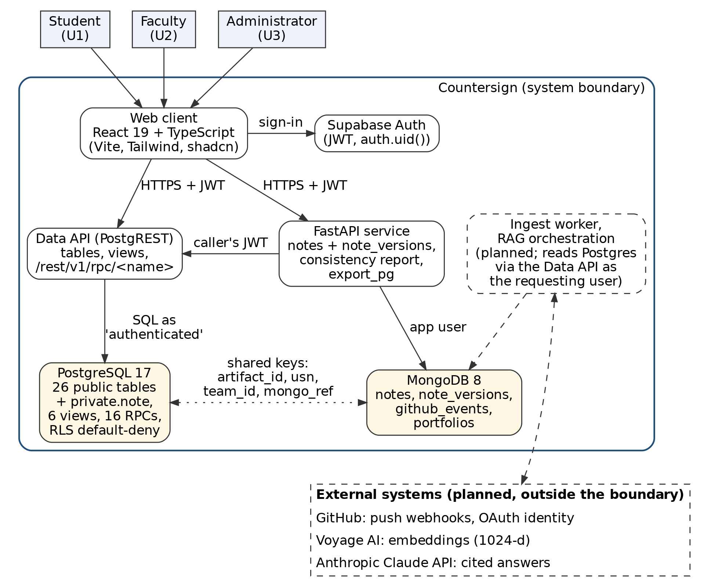
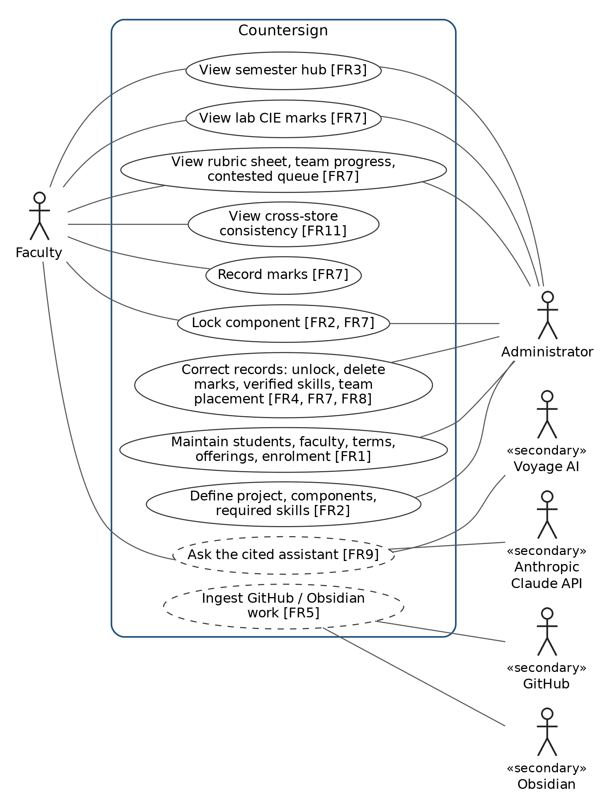
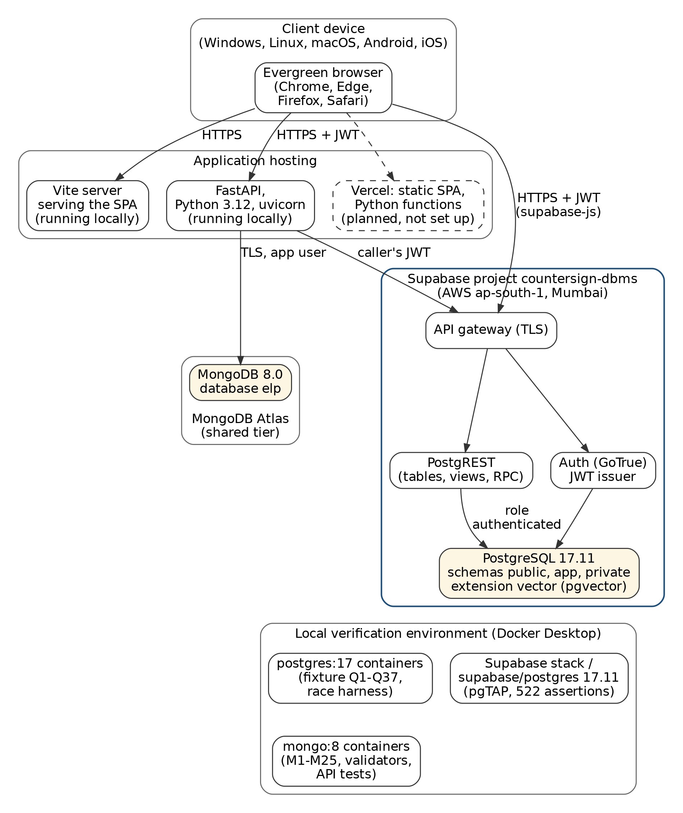

::: cover
**RV College of Engineering®, Bengaluru – 59**

**Department of Computer Science and Engineering**

**DATABASE MANAGEMENT SYSTEMS (CD252IA)**

**Lab Component 2: Requirement Specification**

&nbsp;

**SOFTWARE REQUIREMENTS SPECIFICATION**

**Unified Experiential Learning and Project Intelligence Platform**

(product name: Countersign)

&nbsp;

| USN | Name |
|:--|:--|
| 1RV24CY047 | S Arun Sanjay |
| 1RV24CY051 | Sanvid Razdan |

&nbsp;

Version 1.1, 4 November 2026

Requirement status frozen as of 4 November 2026, 23:55 IST (see §1.5)
:::

::: toc
:::

# Document control

| | |
|:--|:----------|
| **Institution** | RV College of Engineering, Bengaluru 560059. Department of Computer Science and Engineering |
| **Course** | Database Management Systems (CD252IA), Semester V. Lab Component 2: Requirement Specification (5 marks) |
| **Official title** | Unified Experiential Learning and Project Intelligence Platform |
| **Product name** | Countersign |
| **Authors** | S Arun Sanjay (1RV24CY047); Sanvid Razdan (1RV24CY051) |
| **Standard** | ISO/IEC/IEEE 29148:2018, *Systems and software engineering: Life cycle processes: Requirements engineering* (SRS content). IEEE Std 830-1998, which 29148 superseded, is kept only as the source of the familiar section layout (1 Introduction, 2 Overall description, 3 Specific requirements). |
| **Format** | RVCE report conventions as used in the Synopsis (Component 1): the RVCE header block on the cover, the official title, team table by USN, A4. The official RVCE template file is not in the repository (open item in `docs/PLAN.md` §8), so the body styles (Times New Roman, 11 pt PDF / 12 pt DOCX) follow the Synopsis as far as it is known. |

**Revision history**

| Version | Date | Author(s) | Change |
|:--|:--|:--|:----------|
| 0.1 | Oct 2026 | S Arun Sanjay, Sanvid Razdan | Requirements as stated in the Synopsis (Component 1): FR1–FR11, seven NFR headings, software and hardware list. |
| 1.0 | 4 Nov 2026 | S Arun Sanjay, Sanvid Razdan | Requirements refined to the built data layer (migrations 0001–0004). Added: comparison with existing systems, explicit non-goals, privacy tiers, sub-requirements FRx.y, FR → database object → test traceability, measurable NFR targets, versioned software and hardware requirements. |
| 1.1 | 4 Nov 2026 | S Arun Sanjay, Sanvid Razdan | Examiner review (21 items, Appendix B). Corrected: data independence and the three-schema table; FK delete actions (FR10); faculty and administrator privileges (U2, U3, C6, FR7, §3.4); claim and visibility state machines; performance figures; verification claims. Re-derived every status against the repository and re-ran every test suite (§4). Recorded the Synopsis requirements that were deferred or descoped (§2.8). Redrawn Figures 1–5 (Figure 2 split into 2a and 2b) for legibility. Added the known-defects register (§3.8). |

# 1. Introduction

## 1.1 Purpose

This document specifies the requirements of **Countersign**, the database system behind the *Unified Experiential Learning and Project Intelligence Platform*. It states what the system shall do (functional requirements), how well it shall do it (non-functional requirements), and the software and hardware it needs. Every functional requirement is traced to the database objects that implement it and to the automated test that verifies it.

The intended readers are:

- the lab evaluators of CD252IA, who assess this document as Component 2;
- the two team members, who use it as the acceptance baseline for Components 3 to 11.

## 1.2 Scope

Every Experiential Learning (EL) course at RVCE ends in a team project. The project is assessed on a paper marks sheet (Appendix F of the project master file) that the faculty signs **on trust**. Faculty cannot see which student did which part of the work.

Countersign replaces that trust with records. Its thesis is **"every mark has a receipt"**:

1. The rubric is the schema. Each component of the lab marks sheet (Synopsis, Requirement Specification, ER Diagram, and so on) is a row of `milestone`, and each mark is a row of `assessment` at the grain *student × component*.
2. A student files a **claim** ("I designed the ER diagram") against a component.
3. The claim is backed by **evidence** rows: a recorded contribution, a frozen artifact version, a commit SHA, a URL or a file path.
4. A teammate **countersigns** the claim (confirm or dispute). A disputed claim is surfaced to the faculty.
5. The faculty reads the rubric sheet. Behind every cell it can follow claims → evidence → countersigns. This requires the faculty to read claim statements, evidence pointers and dispute comments; §3.4.1 states exactly what the faculty can read.

Around this core, the system provides a semester hub, team formation by complementary skills, an evidence-backed skill profile, permission-aware retrieval over project text, and a lifetime portfolio.

**Benefits.** Individual contribution becomes visible and verifiable. Students are protected by privacy tiers. The marks computation (120 raw → 30, plus 10 and 10, giving 50) is derived by a view rather than typed by hand.

**What the product is not** is stated in §2.7 (non-goals).

## 1.3 Definitions, acronyms and abbreviations

| Term | Meaning in this document |
|:--|:----------|
| Artifact | A unit of project work (code, note, report, diagram, slides) owned by a team and filed under one component. Table `artifact`; its `source` is `github`, `obsidian` or `editor`. |
| Artifact version | An immutable, numbered state of an artifact. Weak entity `artifact_version`, identified by (artifact_id, version_no). |
| Assessment | The mark given to one student for one component. Table `assessment`, key (usn, project_id, milestone_no). |
| CIE | Continuous Internal Evaluation. Lab CIE = reduced 30 + Innovative Experiment 10 + Final demo 10 = 50. |
| Claim | A student's statement of work done for one component. Table `claim`. |
| Component | One row of the lab marks sheet (C1–C11). Stored as a `milestone` of the lab project P06. |
| Contribution | A recorded act of work by one student on one artifact. Table `contribution`; its `source` is `manual`, `github`, `obsidian` or `editor`. |
| Countersign | A teammate's verdict (`confirm` / `dispute`) on a claim. Table `countersign`. |
| Evidence | A typed pointer that supports a claim. Weak entity `claim_evidence`, identified by (claim_id, evidence_no). |
| Fixture | The frozen schema, data and 37 SQL + 25 MongoDB queries used in Component 4 (Test). Never modified. |
| Lock | Setting `milestone.locked_at`. While it is set, the component's marks, claims, evidence, countersigns and submissions cannot change. Only an administrator can clear it (§3.2, FR7.4). |
| MVCC | Multiversion concurrency control (PostgreSQL's concurrency model). |
| OCC | Optimistic concurrency control. Here, a countersign carries the claim revision the signer read. |
| Persona | A test identity (student, faculty, admin, anonymous) used in automated tests. |
| pgTAP | Unit-testing framework for PostgreSQL; tests in `supabase/tests/*.sql`. |
| pgvector, HNSW | PostgreSQL vector type and its approximate nearest-neighbour index (Hierarchical Navigable Small World). |
| PostgREST | The HTTP layer that exposes tables, views and functions (`/rest/v1/rpc/<name>`). |
| RAG | Retrieval-augmented generation: an LLM answers from retrieved database rows and cites them. |
| RC, RR, SER | Isolation levels READ COMMITTED, REPEATABLE READ, SERIALIZABLE. |
| RLS | Row-level security: per-row access predicates (policies) enforced by PostgreSQL. |
| RPC | A PostgreSQL function called over HTTP through PostgREST. |
| `security_invoker` view | A view that runs with the caller's privileges, so RLS of the base tables applies. A default view runs as its owner and bypasses RLS. |
| SECURITY DEFINER | A function that runs with its owner's privileges. Used only for integrity triggers, RLS helper functions and the private-note RPCs. |
| SQLSTATE | The five-character standard error code (e.g. 23514 check_violation, 40001 serialization_failure). |
| Submission | A team's frozen hand-in for one component; records the exact artifact versions submitted. |
| USN | University Seat Number, the student identifier. |
| Visibility tier | `private`, `team` or `submitted`: who may read an artifact or text chunk (§3.4). |
| Write skew | An anomaly in which two transactions each read an overlapping set, then write disjoint rows, jointly violating an invariant. |

## 1.4 References

1. ISO/IEC/IEEE 29148:2018, *Systems and software engineering: Life cycle processes: Requirements engineering*. (Supersedes IEEE Std 830-1998, *IEEE Recommended Practice for Software Requirements Specifications*.)
2. R. Elmasri and S. B. Navathe, *Fundamentals of Database Systems*, 7th ed., Pearson. Ch. 2 (three-schema architecture, data independence), Ch. 3 and 9 (ER model and mapping), Ch. 5–8 (relational model, algebra, SQL), Ch. 14–15 (normalization), Ch. 20–21 (transactions, concurrency control).
3. PostgreSQL 17 Documentation: Row Security Policies; Transaction Isolation; Explicit Locking.
4. Supabase Documentation: Row Level Security; Database Functions; Testing (pgTAP); Database Advisors.
5. Team documents: *DBMS Synopsis* (Component 1); `PROJECT_MASTER.md` (vision, fixture schema, marks sheet); `docs/PLAN.md` (sharpened thesis, comparison, non-goals, privacy tiers, tiering).
6. Implementation (repository paths):
    - migrations `supabase/migrations/20261104000001_core_schema.sql` to `20261104000004_rpc.sql`;
    - fixture `supabase/fixture/01_schema.sql`; demo seed `supabase/seed/demo.sql`;
    - tests `supabase/tests/01_constraints.sql` to `04_abuse_cases.sql`; `api/tests/test_api.py`; `web/e2e/*.spec.ts`;
    - MongoDB `mongo/validators.js`, `mongo/portfolio_merge.js`, `scripts/check_mongo_validators.sh`;
    - concurrency findings `experiments/race/FINDINGS.md` and `experiments/race/results/results.md`.
7. Digital Personal Data Protection Act, 2023 (India).
8. Vendor documentation used for §2.1.1 (product behaviour as documented, not independently tested): GitHub Docs, *GitHub Classroom* (individual and group assignments); GitHub Docs, *Viewing a repository's contributors*; Moodle Docs, *Assignment settings* (group submissions) and *Workshop activity*; Google for Education Help, *Google Classroom* (assignments); CATME (catme.org), *Team-Maker* and *Peer Evaluation*; WebPA (Loughborough University), *Online peer assessment*.

## 1.5 Overview and status convention

- Section 2 describes the product in context: its users, environment, constraints, assumptions, existing systems, non-goals, and the disposition of every Synopsis requirement that was not built as stated.
- Section 3 states the specific requirements: external interfaces; functional requirements FR1–FR11 with their traceability matrix; privacy tiers and the exact faculty projection; non-functional requirements with measurable targets; software and hardware requirements; and the known-defects register.
- Section 4 lists how each requirement class is verified, with the result of each run.

Requirements use **shall** for mandatory behaviour and **should** for desirable behaviour.

**Status freeze.** Every status in this document describes the repository as it stood on **4 November 2026 at 23:55 IST**: migrations 0001–0004 (no later migration exists), `mongo/`, `api/`, `web/src/` and `scripts/` as present on that date. All test suites were re-run between 23:36 and 23:52 IST that day (§4). Each requirement carries one status:

| Status | Meaning |
|:--|:----------|
| **Implemented** | Built, and covered by an automated test that was run and passed on 4 Nov 2026 (§4). |
| **Built, not verified** | The code exists, but no automated test covers it yet. Not counted as implemented. |
| **Partial** | Some sub-requirements are Implemented; the others are Built, not verified, or Planned. The sub-requirements say which. |
| **Planned** | Specified; not built. |
| **Stretch** / **Descoped** | Deferred to the stretch phase / removed from scope, with a reason (§2.8). |

# 2. Overall description

## 2.1 Product perspective

Countersign is a new, self-contained system. It sits beside (not inside) the institution's existing tools.

- It does not replace the learning management system or the results portal.
- It is the **system of record for project work and its assessment evidence**.

{width=100%}

The relational part of the design follows the **three-schema architecture** (Elmasri & Navathe, Ch. 2):

| Level | Realisation in Countersign |
|:--|:----------|
| External level (external schemas) | Six role-specific views, each a `security_invoker` view whose rows are further filtered per user by RLS: `v_semester_hub` (student), `v_what_faculty_sees` (student), `v_rubric_sheet`, `v_faculty_team_progress`, `v_contested_claims`, `v_lab_cie_marks`. |
| External interfaces (not schemas) | The 16 RPCs of migration 0004. They are *operations* on the conceptual schema, comparable to application programs, not user views of it. |
| Conceptual level | One relational schema: 26 tables in schema `public`, plus `private.note`, with their keys, foreign keys, CHECK constraints and integrity triggers. The conceptual ER model is Component 3. |
| Internal level | PostgreSQL 17 storage structures: heap files, TOAST storage of long values, B-tree indexes on every foreign-key column, a GIN index on `artifact_chunk.tsv` (full-text) and an HNSW index on `artifact_chunk.embedding` (vector). |

MongoDB (database `elp`) is **not** a level of this architecture. It is a second store with its own (document) data model, linked to the relational schema only by shared key values (FR11).

**Logical data independence** is the capacity to change the conceptual schema without having to change the external schemas or the application programs (Elmasri & Navathe, §2.2). Worked example from this project: migration 0002 changed the conceptual schema of the 13 fixture tables by appending columns (`artifact.visibility`, `owner_usn`, `external_ref`; `contribution.source`, `source_ref`, `occurred_at`, `ai_assisted`; `milestone.cie_part`, `locked_at`; `artifact_chunk.embedding`, `visibility`, `tsv`) and by adding 13 new tables in `public` (plus `private.note`). The application programs written against the original schema, the 37 SQL queries Q1–Q37 of the Test, were not changed, and on 4 Nov 2026 they still produced the verified outputs of Appendix H (gate G1, 37/37). For the same reason a later migration that appends a column to, say, `claim` would leave the six `v_*` views and the 16 RPC signatures unchanged, because each of them names the columns it uses.

**Physical data independence** is the capacity to change the internal schema without having to change the conceptual schema (Elmasri & Navathe, §2.2). Worked example: migration 0002 added 38 B-tree indexes, chiefly on foreign-key columns (§10), and the GIN and HNSW indexes on `artifact_chunk` (§9). No relation, attribute or constraint of the conceptual schema changed, and therefore neither did any view, RPC or query; only the access paths chosen by the optimizer changed.

### 2.1.1 Relation to existing systems

The cells describe each product's documented, default behaviour (reference 8); configurations and plug-ins can differ.

| Capability | GitHub Classroom | GitHub Insights (Contributors) | Google Classroom / Moodle | CATME | WebPA | **Countersign** |
|:--|:--|:--|:--|:--|:--|:--|
| Unit of record | A repository per student or per team | Commits per author | A submission per assignment (Moodle also supports group submissions) | A peer-evaluation survey | A peer-assessment score sheet | A claim per student per rubric component |
| Individual attribution | Git history of the repository; in group assignments students create or join teams | Commit and line counts, attributed through the commit author e-mail, which is self-asserted | A group submission is typically graded as one; Moodle allows a teacher to override an individual student's grade | Peer ratings | Peer scores weight a group mark into individual marks | Claim + typed evidence + teammate countersign |
| Non-code work (reports, ER, slides) | Only if committed as files | Only as commits | Uploaded as files, not attributed to a team member by default | Indirect (ratings) | Indirect (scores) | Yes: version, URL and file evidence |
| Peer verification | Not built in | Not built in | Moodle Workshop peer-grades submissions, not contributions | Yes, behavioural ratings | Yes, numerical ratings | Yes, bound to one claim and one claim revision |
| Rubric / marks sheet as data | Autograding tests | Not built in | Rubrics attached to assignment grades | Not built in | Group mark → individual marks | Rubric = schema; 120 → 30 + 10 + 10 = 50 computed by a view |
| Evidence linked to each mark | Not by default | Not built in | Not by default | Not built in | Not built in | Yes (rubric cell → claims → evidence) |
| Privacy enforced in the database | Repository visibility | Repository visibility | Course roles | The instructor sees all ratings | The tutor sees all scores | `private` / `team` / `submitted`, enforced by RLS |
| Team formation | Students create or join teams in group assignments | Not built in | Groups made by the teacher (Moodle also allows self-selection plug-ins) | Team-Maker (survey criteria) | Not built in | Complementary-skill finder (relational division) |
| Permission-aware AI assistant | Not built in | Not built in | Not built in by default | Not built in | Not built in | Planned: retrieval runs as the requesting user (FR9) |

Countersign borrows peer verification from CATME and WebPA, but attaches it to *specific, evidenced claims* rather than to general ratings. It borrows submission and rubric handling from learning management systems, but stores the rubric at component grain so that marks are derivable and auditable.

## 2.2 Product functions (summary)

1. Maintain academic records: students, faculty, courses, terms, offerings and enrolments (FR1).
2. Define projects whose milestones are the rubric components (FR2).
3. Give each student a semester hub of their projects, teams, next deadlines and claim counts (FR3).
4. Form teams under capacity and enrolment rules; suggest complementary teammates (FR4).
5. Record artifacts, versions, contributions and notes, from the editor today and from GitHub and Obsidian later (FR5).
6. File claims with evidence; collect teammate countersigns (FR6).
7. Freeze submissions, record marks, lock components, and compute the lab CIE (FR7).
8. Maintain declared and verified skill levels; report skill gaps; navigate the skill hierarchy (FR8).
9. Answer questions over project text with citations, under the asker's permissions (FR9).
10. Retain every project permanently and build an exportable portfolio (FR10).
11. Store structured data in PostgreSQL and semi-structured data in MongoDB, linked by shared keys (FR11).

The use cases are shown in UML notation in Figures 2a (student) and 2b (faculty, administrator and the external systems). A use case may appear in both diagrams.

{width=90%}

{width=90%}

## 2.3 User classes and characteristics

| ID | User class | Characteristics | Privileges (enforced by RLS, column grants and triggers) |
|:--|:--|:----------|:----------|
| U1 | Student | Semester-V undergraduate; frequent use around deadlines; mobile or laptop browser. | Reads the directory (students, courses, projects, teams, skills). Reads and writes their own team's content. Reads only their own marks. Their `private` items and private notes are visible to no one else. |
| U2 | Faculty | Teaches one or more course offerings; uses the system at assessment time. | For the projects they teach, reads the full rows of claims, evidence, countersigns, contributions, non-private artifacts and versions, submissions and marks; reads chunk text only once it is `submitted` (exact projection: §3.4.1). Records marks for those projects only, in their own name. May lock a component but not otherwise edit it, and cannot unlock it. Never sees `private` items or private notes. |
| U3 | College administrator | Maintains academic records; few users. | Everything U2 can read, on every project; all `app_user` and `enrollment` rows. Writes the directory tables, terms, offerings, enrolments, projects, components and `app_user`. **Beyond faculty**, only an administrator can: unlock a component (set `locked_at` back to NULL); delete marks (of an unlocked component); write `skill_evidence` (verified skill levels); insert, move or delete other students' `team_member` rows, with any role (still subject to the capacity, one-team-per-project, one-lead and history rules). An administrator has no `faculty_id`, so cannot record marks through `record_assessment` (42501 `faculty_required`); a direct INSERT into `assessment` by an administrator may name any faculty member in `assessed_by` (defect D2, §3.8). |
| X1 | Anonymous (not signed in) | Any HTTP client. | **No** table, view or function privilege at all. |
| X2 | External systems | GitHub (push events, OAuth identity), Voyage AI (embeddings), Anthropic Claude API (answers). | Planned. They will interact only through the service layer, never with database credentials of their own. |

Identity mapping: a login (`auth.users`) has exactly one `app_user` row.

- The row's role is `student`, `faculty` or `admin`.
- A student carries a USN, faculty carries a faculty_id, and an admin carries neither (CHECK `app_user_role_consistency`).
- Self sign-up is disabled. A login without an `app_user` row reads nothing.

## 2.4 Operating environment

{width=100%}

| Tier | Environment | Status (4 Nov 2026) |
|:--|:----------|:--|
| Client | Any evergreen browser (Chrome, Edge, Firefox, Safari; current and previous major version) on Windows, Linux, macOS, Android or iOS. | Chrome on macOS exercised by Playwright (G8). Other browsers and mobile: not yet tested. |
| Web application | Single-page application in React 19.3 and TypeScript 7.0, built with Vite 8.3, styled with Tailwind CSS 4.3 and shadcn/ui. Uses `supabase-js` with the publishable key only. Pages: login, semester hub, team, project, notes, "what my faculty sees", rubric sheet, contested queue, marks, faculty home, admin. | Built; served locally by the Vite server. Static hosting on Vercel: **planned, not set up**. |
| Database server | Supabase-managed PostgreSQL 17.11, project `countersign-dbms`, region ap-south-1 (Mumbai). Data API: PostgREST. Authentication: Supabase Auth (JWT). Extension: `vector` (pgvector). | **Verified 4 Nov 2026** through the Supabase Management API: status ACTIVE_HEALTHY, PostgreSQL 17.11, migrations 20261104000001–…0004 applied (gate G7). |
| Document store | MongoDB 8.0 on MongoDB Atlas, database `elp`. | Atlas: configured (`CLAUDE.md`); applying `mongo/validators.js` to Atlas is **to be verified**. All MongoDB tests of this revision ran on local `mongo:8` containers. |
| Service layer | FastAPI on Python 3.12 (`api/`): team notes with immutable `note_versions` (`notes.py`), the cross-store consistency report (`consistency.py`), the relational half of the portfolio (`export_pg.py`). Reads PostgreSQL only through PostgREST with the caller's JWT. | Built; runs locally under uvicorn; 24 pytest tests pass (G9). Cloud hosting: **planned** (PLAN §5 proposes Vercel Python functions); ingest worker and RAG orchestration: **planned**. |
| Verification environment | Docker Desktop: the Supabase CLI local stack; disposable `supabase/postgres:17.11` and `postgres:17` containers (pgTAP, fixture regression, race harness); `mongo:8` containers (MongoDB regression, validators, API tests). | In use (§4). |

## 2.5 Design and implementation constraints

| ID | Constraint | Source |
|:--|:----------|:--|
| C1 | The Component 4 fixture (`supabase/fixture/01_schema.sql`, `02_seed.sql`, `03_queries.sql`, `mongo/04_mongo.js`) is frozen. Q1–Q37 and M1–M25 shall keep producing the verified outputs. | Course (graded artifact) |
| C2 | Schema evolution is **append-only**: later migrations add tables, columns, constraints and indexes, and never drop or rename a fixture column. | C1 |
| C3 | PostgreSQL syntax only (no MySQL). | Team decision |
| C4 | Vectors stay in PostgreSQL (pgvector): no separate vector database, no LangChain. Retrieval is explicit SQL. | Thesis: permissions must apply to retrieval |
| C5 | MongoDB is a real component (raw events, notes and their versions, portfolios), not JSONB inside PostgreSQL. | Syllabus Unit V; lab Test NoSQL marks |
| C6 | Faculty and administrators never read `private` items, private notes, or chunk text that is not `submitted`. The faculty dashboard view `v_faculty_team_progress` exposes metadata only (counts and timestamps). The base-table policies deliberately let the teaching faculty read claim statements, evidence pointers, contribution descriptions, artifact links and dispute comments, because grading requires following claims → evidence → countersigns (§1.2, item 5); the exact projection is §3.4.1. All of this is enforced by RLS and `security_invoker` views. The AI layer shall query **as the requesting user**, never with the service role. | Privacy model (refined in §3.4) |
| C7 | Free tiers: Supabase (500 MB database, project pauses when idle) and Atlas shared tier (512 MB). Large experiments run on local Docker. | Budget |
| C8 | AI spend under USD 10 for the whole project. | Budget |
| C9 | Secrets live only in git-ignored `*.env` files and are never committed or printed. | Security |
| C10 | Personal data handling follows the DPDP Act 2023: purpose limitation, consent for non-grading uses, and erasure as a procedure. | Law |
| C11 | Documents follow the RVCE report format; the official title is used on all submissions. This document applies it as described under *Format* in the document control table. | Course |

## 2.6 Assumptions and dependencies

| ID | Assumption or dependency |
|:--|:----------|
| A1 | The college mandates the platform for component submission, so every student has an account. |
| A2 | Marks are awarded **per student at component grain**, as on the paper sheet. |
| A3 | **Rounding rule (to be confirmed with the course faculty):** the reduced mark is `round(raw × 30 / 120, 1)` (one decimal, half away from zero), and the /50 total adds the rounded value. |
| A4 | In the lab project P06, `milestone_no` equals the component number. C10 and C11 are out of 10 and are not reduced. |
| A5 | Accounts are provisioned by the administrator (sign-up disabled). Students later bind a GitHub identity through OAuth for commit attribution. |
| A6 | Each course offering (course × term × section) has exactly one teaching faculty member. |
| D1 | Availability of Supabase and MongoDB Atlas (and, once set up, Vercel). A local Docker stack is the offline fallback. |
| D2 | GitHub webhooks, Voyage AI and the Anthropic API for FR5 ingestion and FR9. Each shall have a replay or fixture fallback. |

## 2.7 Non-goals (explicitly out of scope)

| ID | Non-goal | Reason |
|:--|:----------|:----------|
| NG1 | **Detecting AI-generated text.** | Detectors are unreliable and biased against non-native writers. Instead, each claim and version carries a declared `ai_assistance` (`none` / `assisted` / `generated`), version history is kept neutrally, and viva practice is student-facing. |
| NG2 | **Replacing WhatsApp, Google Docs, draw.io or other communication and authoring tools.** | Students keep their tools. The mandatory touchpoint is the component submission and its claims. External work enters as URL or file evidence (`claim_evidence.kind`). |
| NG3 | Automatic grading. | Marks remain the faculty's judgement (`assessment.assessed_by`); the system only computes totals. |
| NG4 | Leaderboards or contribution rankings for faculty. | Counts reward commit spam and discourage collaboration. "No recorded evidence yet" opens the claim flow; it is never a verdict. |
| NG5 | Activity surveillance (keystrokes, screen time, location). | Disproportionate under the DPDP Act; not needed for the thesis. |
| NG6 | Replacing the learning management system or the results portal. | Countersign holds evidence of project work, not course content or final grades. |

## 2.8 Disposition of Synopsis requirements not built as stated

The Synopsis (Component 1) named the following technologies and requirements. Each is recorded here so that no requirement disappears silently between versions.

| Synopsis item | Disposition | Reason and where it now lives |
|:--|:--|:----------|
| Tiptap + Yjs real-time co-editing (Hocuspocus server) | **Stretch** | `docs/PLAN.md` §1 re-tiers live co-editing to Stretch (Phase 5) and §2.9 moves Hocuspocus to stretch: it is a risky integration that earns few marks. The default editor saves numbered versions with optimistic locking instead (FR5.6). |
| Supabase Realtime for the live faculty dashboard | **Planned** (PLAN phase P2) | Not built. `postgres_changes` would push row content past the privacy tiers, so the design is `realtime.broadcast_changes()` with metadata-only payloads and RLS on `realtime.messages` (PLAN §2.2). Until then the dashboard refreshes on request. |
| Supabase Queues (pgmq) for ingestion | **Planned** (with FR5.5) | Not built. The ingestion design is inbox → log → projection: one RPC writes the inbox row and enqueues in one transaction (PLAN §2.8). |
| NFR "Concurrency: simultaneous edits" | **Refined** | Concurrent saves of one note are serialised by optimistic concurrency: a save based on a stale version is refused with HTTP 409 `version_conflict` (tested: `test_concurrent_saves_from_one_base_have_one_winner`). Simultaneous character-level co-editing goes with Tiptap + Yjs to Stretch. Concurrent team joins remain NFR-CON-1. |
| GitHub App and webhooks | **Descoped → replaced** | A plain repository webhook plus GitHub OAuth for identity (PLAN §2.9): an App adds installation management without adding evidence. Planned under FR5.5. |
| Obsidian with the Obsidian Git plugin | **Planned** (FR5.5) | Notes under `shared/**` of the team repository will be ingested as note artifacts. |
| "Metadata-only faculty view" | **Refined** | Contradicted grading of submitted work; replaced by the three tiers of §3.4. |
| React with TypeScript **and Tailwind CSS** | **Built** | Tailwind CSS 4.3 with shadcn/ui (`web/package.json`); listed in §3.6. |
| OS list Windows / Linux / macOS | **Extended** | The client tier adds Android and iOS browsers (§2.4); the development tier keeps the Synopsis list. |

# 3. Specific requirements

## 3.1 External interface requirements

### 3.1.1 User interfaces

| ID | Requirement | Status |
|:--|:----------|:--|
| UI-1 | The rubric sheet shall render one row per student and one column per component, mirroring the paper marks sheet. Each cell opens that student's claims → evidence → countersigns for the component. | Implemented (`web/e2e/05-ramesh-sheet.spec.ts`) |
| UI-2 | Every form shall validate input with the same rules as the database CHECK constraints. Every database error shall be shown against the field it concerns, using the stable rule key in the error DETAIL. | Partial: marks form verified (spec 05: the form and the database both refuse a mark above the maximum); other forms built, not verified. |
| UI-3 | Each data panel should offer a "Show the SQL" drawer listing the query, its relational-algebra form and the RLS policies applied. | Partial: the drawer with real SQL is verified (spec 08); the relational-algebra and policy parts are built, not verified. |
| UI-4 | A student shall be able to open a "what my faculty sees" page (FR7.8). | Implemented (spec 07: a private note does not appear there) |

### 3.1.2 Software interfaces

| Interface | Protocol and format | Direction | Status |
|:--|:----------|:--|:--|
| Data API (PostgREST) | HTTPS, JSON. Tables and views at `/rest/v1/<relation>`; functions at `/rest/v1/rpc/<name>`; every RPC returns `jsonb`. Errors carry `code` (SQLSTATE) and `details` (rule key). | Web, service ↔ PostgreSQL | Implemented |
| Supabase Auth | E-mail login (GitHub OAuth planned); issues a JWT whose `sub` is `auth.uid()`. | Web ↔ Auth | Implemented |
| Countersign API (FastAPI) | HTTPS, JSON: `GET /health`, `GET /notes`, `GET /notes/{id}/versions`, `POST /notes`, `GET /consistency`. Bearer JWT of the caller; errors `{"detail": {"code", "message"}}`. | Web → service | Implemented (pytest, 24 tests) |
| MongoDB driver | MongoDB wire protocol (TLS on Atlas); application user with `readWrite` on `elp` only. | Service ↔ MongoDB | Implemented locally; Atlas to be verified |
| GitHub | Repository `push` webhook (HMAC-signed JSON); GitHub OAuth for identity. | GitHub → service | Planned |
| Voyage AI, Anthropic | HTTPS JSON APIs; embeddings of 1024 dimensions; cited answers. | Service → provider | Planned |

Error contract of the RPCs (migration 0004):

| SQLSTATE | Name | Raised when |
|:--|:--|:----------|
| 42501 | insufficient_privilege | Wrong role, not your team, not your claim; RLS rejects a row. |
| P0002 | no_data_found | Unknown or invisible team, claim, project, milestone, note. |
| 22023 | invalid_parameter_value | Bad input (mirrors the form rules). |
| 55000 | object_not_in_prerequisite_state | Component locked, claim no longer pending, stale claim revision, artifact private or already submitted. |
| 23505 / 23514 / 23503 / 23P01 | unique / check / foreign-key / exclusion violation | Declarative constraints and the cross-table trigger rules. |
| 40001 | serialization_failure | Concurrent conflict under REPEATABLE READ or SERIALIZABLE; the client retries. |

### 3.1.3 Communication interfaces

All traffic shall use HTTPS (TLS 1.2 or later) outside the developer's machine. Requests are authorised by a bearer JWT. The publishable (anonymous) key confers no data access.

## 3.2 Functional requirements

Each requirement below gives the requirement as stated in the Synopsis, its refinement to the built system, its sub-requirements, its tier (Core / Supporting / Stretch, from `docs/PLAN.md`) and its status under the convention of §1.5.

### FR1. Academic records

*Synopsis:* Manage student, faculty, course and semester records.
*Refined:* Semesters are modelled as `academic_term`, and the teaching of a course as a `course_offering` (course × term × section, with its faculty member). Students are linked to offerings by `enrollment`. This replaces the fixed `course.faculty_id`, which would mean "one teacher forever". Tier: Core. **Status: Implemented.**

- FR1.1 The administrator shall create, update and delete students, faculty, courses, terms, offerings and enrolments. All other roles shall only read the directory.
- FR1.2 Academic terms shall not overlap in time (exclusion constraint).
- FR1.3 An offering shall be unique per (course, term, section).
- FR1.4 Each login shall map to exactly one role and exactly the identifier that role requires.
- FR1.5 A student shall see only their own enrolments; a faculty member shall see the rolls of the offerings they teach.

### FR2. Projects and rubric components

*Synopsis:* Faculty create EL projects with milestones, deadlines and rubric marks.
*Refined:* Projects and components are created by the administrator for institutional control. The teaching faculty member may only **lock** a component, and cannot unlock it. Each component declares how it enters the lab CIE: `cie_part` is `reduced`, `innovative` or `final`. Tier: Core. **Status: Implemented.**

- FR2.1 A project shall belong to a course and optionally to one offering *of that same course* (composite foreign key).
- FR2.2 A component (milestone) shall be identified by (project_id, milestone_no) as a weak entity of its project. It has a title, `max_marks` > 0 and a deadline.
- FR2.3 Components with `cie_part` `innovative` or `final` shall be out of 10. A project shall have at most one of each.
- FR2.4 A project shall list its required skills with a minimum level 1–5.
- FR2.5 Lowering `max_marks` below an already recorded mark shall be refused.
- FR2.6 Faculty may change only `locked_at` of a component they teach, and only from NULL to a time (`trg_milestone_faculty_lock_only`). This trigger restricts faculty only; the administrator may change any column, including clearing `locked_at` (FR7.4).

### FR3. Semester hub

*Synopsis:* Semester dashboard of all EL projects per student.
*Refined:* The hub is driven by **enrolment**, so a student who has no team yet still sees every project they must complete. Tier: Supporting. **Status: Implemented.**

- FR3.1 For the signed-in student, the system shall list each enrolled offering and its projects, with:
  - the student's team and role;
  - the **next upcoming component**: the component with the earliest deadline on or after the current date (ties broken by component number). The choice is by deadline alone: `v_semester_hub` does not exclude a locked component (defect D4);
  - counts of the student's pending, confirmed and contested claims.
- FR3.2 For faculty, the hub shall list the offerings and projects they teach. For the administrator, it shall list institution-wide counts.
- FR3.3 The hub shall flag whether each term is current, and shall show the student's countersign queue (claims awaiting their verdict).

### FR4. Team formation

*Synopsis:* Team formation with skill-based teammate recommendations.
*Refined:* Recommendations return **complements**, not clones. Let $ProjectSkill_P = \sigma_{project\_id = P}(ProjectSkill)$, and say a student *holds* a required skill when $level \ge min\_level$. Then:

- Missing(me, P) = the required skills of P that the caller does not hold.
- Candidates are ranked by how many of Missing they hold (a partial division).
- Classical relational division is kept as a separate function (FR4.6).

Tier: Supporting. **Status: Implemented.**

- FR4.1 A student shall join a team only as themselves.
  - The first member becomes lead; a team has at most one lead.
  - A team shall never exceed `max_size` (1–6), **under any isolation level and any number of concurrent joiners**.
- FR4.2 A student shall be in at most one team per project, and only in projects of offerings they are enrolled in.
- FR4.3 A student who has recorded any work in a team cannot leave it: claims, countersigns, contributions, versions, chunks, owned artifacts, submissions or marks.
- FR4.4 A team's `max_size` cannot be reduced below its current size. A staffed team cannot move to another project.
- FR4.5 `find_teammates(P)` shall return Missing(me, P), and candidates who meet all three conditions: not already in a team of P; eligible for P; holding at least one missing skill at the required level. Candidates are ordered by skills covered, then total level.
- FR4.6 `find_full_cover(P)` shall return the students who hold **every** required skill of P **at its minimum level**. Because of the level threshold this is not a plain division of `student_skill` by `project_skill`; it is

  $$\pi_{usn,\,skill\_id}\big(\sigma_{level \ge min\_level}(StudentSkill \bowtie ProjectSkill_P)\big) \div \pi_{skill\_id}(ProjectSkill_P)$$

  written in SQL as a double NOT EXISTS over `student`. One difference from the algebra: for a project with no required skills the SQL returns every student (vacuous truth), whereas the division of an empty relation returns no tuples.

### FR5. Capture of work as artifacts

*Synopsis:* Integrate GitHub repositories and Obsidian vaults to capture code, notes and documents as artifacts.
*Refined:* Work enters as artifacts whose `source` is one of three values, `editor`, `github` or `obsidian` (CHECK in the fixture, unchanged). Each artifact may carry an optional `external_ref` (a Google Docs revision link, a draw.io export). Work done on an artifact is recorded as a contribution, whose `source` is one of four values: the same three plus `manual`. Ingestion is idempotent. Personal notes live in a private vault; team notes live in MongoDB with immutable versions. Tier: Core (artifacts, versions, notes); Supporting (GitHub and Obsidian ingestion). **Status: Partial** (FR5.1–FR5.4 and FR5.6 Implemented; FR5.5 Planned).

- FR5.1 A team member shall create artifacts for their team under a component of the team's own project (composite FK `(team_id, project_id) → team`).
- FR5.2 Each saved state shall be recorded as an immutable `artifact_version`. Required: its author `created_by` (a team member) and a declared `ai_assistance` (default `none`). Optional: a SHA-256 `content_hash` (nullable; when present it must be 64 lowercase hex digits, CHECK) and a `mongo_ref` to the full body in MongoDB (nullable).
- FR5.3 A contribution shall record `source` and, when it comes from an external event, `source_ref` (commit SHA or note version). A redelivered event with the same key shall create **no duplicate** (partial UNIQUE index `contribution_idempotency_key`).
- FR5.4 A student shall keep private notes that no other user, including faculty and teammates, can read. They are stored in schema `private`, which is not exposed through the API, and accessed only through owner-checked RPCs.
- FR5.5 (Planned) Push events from a team repository shall be received by a webhook, stored raw in MongoDB (`github_events`, `_id` = delivery id), and projected into `contribution` rows. Obsidian notes under `shared/**` shall be ingested as note artifacts.
- FR5.6 A team member shall create and update team notes through the API. Every save shall append one immutable `note_versions` document (author, time, SHA-256 of the content) and bump the note's version in one multi-document transaction; a save based on a stale version shall be refused (409 `version_conflict`). Only the note's author may save a new version.

### FR6. Attribution: contributions, claims, evidence, countersigns

*Synopsis:* Record and attribute every contribution with full version history.
*Refined:* Contribution data from commits alone is gameable: author e-mail is self-asserted, line counts reward spam, and whiteboard work leaves no trace. The **claim** is therefore the unit of attribution, and commits and versions are its *evidence*. Tier: Core. **Status: Implemented.**

- FR6.1 A student shall file a claim only for their own team and only for an open component. A claim records the statement (at least 10 characters), the contribution type and the declared `ai_assistance`.
- FR6.2 Evidence shall be one of five kinds, each with exactly its matching pointer (CHECK `claim_evidence_kind_matches`):
  - `contribution`: one of the claimant's **own** contributions;
  - `artifact_version`: any version of the team's artifacts;
  - `commit`: a hexadecimal SHA of 7–40 characters;
  - `url`: `http(s)` only;
  - `file`: a path.

  The same contribution, and the same artifact version, cannot be cited twice in one claim (partial UNIQUE indexes `claim_evidence_once_contribution` and `claim_evidence_once_version`). The same `commit`, `url` or `file` reference *can* currently be cited more than once in one claim; this is a schema gap (defect D1).
- FR6.3 A countersign shall be given only by a **teammate who is not the claimant**. A dispute requires a comment.
- FR6.4 `claim.status` is a derived attribute recomputed by trigger: `contested` if any dispute exists; otherwise `confirmed` if any confirm exists; otherwise `pending`. It cannot be set by a client.
- FR6.5 Every change to a claim's statement or evidence increments `claim.revision`. A countersign records the revision it endorses, and is refused if the claim changed after the signer read it (OCC).
- FR6.6 Once a claim has any countersign (status `confirmed` or `contested`), its content and evidence are frozen. A claim may be withdrawn (deleted) only by its claimant and only while it is `pending`.
- FR6.7 A countersign may be revised or withdrawn by its endorser while the component is open; the claim's status is then recomputed (it returns to `pending` when no countersign remains).

The life cycle is the UML state machine of Figure 4. Its transitions are:

| Id | Source → target | Trigger | Guard (besides [in Open]) | Enforced by |
|:--|:--|:----------|:----------|:----------|
| t1 | initial → pending | `file_claim()` or INSERT | claimant is a member of the team | `claim_insert` policy, `trg_claim_member_required`, `trg_claim_guard` |
| t2 | pending → pending | edit statement; add or delete evidence | caller is the claimant | `claim_update`, `claim_evidence_*` policies; `trg_claim_guard` and `trg_claim_evidence_revision` add 1 to `revision` |
| t3 | pending → confirmed | countersign `confirm` | teammate ≠ claimant; signed revision = current revision | `trg_countersign_check`, `trg_countersign_sync_status` |
| t4 | pending → contested | countersign `dispute` | as t3; comment given | as t3; CHECK `countersign_dispute_needs_comment` |
| t5 | confirmed → contested | a teammate disputes (new countersign or revised verdict) | as t4 | as t4 |
| t6 | contested → confirmed | a dispute is revised to confirm, or withdrawn | no dispute remains and at least one confirm remains | `trg_countersign_sync_status` |
| t7 | contested → contested | a dispute is added, revised or withdrawn | at least one dispute remains | `trg_countersign_sync_status` |
| t8 | confirmed → pending | a countersign is withdrawn (`countersign_delete`) | no countersign remains | `countersign_delete` policy, `trg_countersign_sync_status` |
| t9 | contested → pending | a countersign is withdrawn | no countersign remains | as t8 |
| t10 | pending → final | the claimant withdraws the claim (`claim_delete`) | status = `pending` | `claim_delete` policy, `trg_claim_guard` |
| l1 | Open → Locked | `lock_milestone()` | caller teaches the project, or is an admin | `lock_milestone`, `milestone_update` policy |
| l2 | Locked → Open | UPDATE `locked_at := NULL` | caller is an admin | `milestone_update` policy; `trg_milestone_faculty_lock_only` refuses it for faculty |

![Figure 4. UML state machine of a claim. Region 1 is claim.status (derived); region 2 is the lock of the claim's component, which is not a value of claim.status. Every status transition t1–t10 carries the guard [in Open]. The bull's-eye is the final state (claim withdrawn).](diagrams/c2_fig4_claim.png){width=100%}

### FR7. Submission, assessment and the rubric view

*Synopsis:* Faculty live rubric-wise view of team progress and individual contributions.
*Refined:* The view is the paper marks sheet rebuilt as live tables. Submission and marking are part of the same requirement, because the sheet is meaningless without them. Tier: Core. **Status: Implemented** (data layer, and the web pages for the rubric sheet, marks, contested queue and faculty preview). Live push to the dashboard (Supabase Realtime) is Planned (§2.8).

- FR7.1 `submit_milestone(team, component, artifacts)` shall, **in one transaction**: validate every artifact; allocate the next attempt number; insert the submission; freeze the latest version of each artifact; publish the artifacts (`team` → `submitted`).
- FR7.2 A submission is frozen once its transaction commits: no artifact may be added later, and `submitted_at` is set by the server only.
- FR7.3 Only the teaching faculty member of a project shall record a mark, through `record_assessment()`, which signs it with the caller's own `faculty_id`. The mark is between 0 and `max_marks` with at most one decimal, for a student who is in a team of that project. An administrator cannot use `record_assessment()` (no `faculty_id`: 42501 `faculty_required`, `03_rpc.sql` §H). For corrections, an administrator may INSERT, UPDATE or DELETE `assessment` rows directly (an unlocked component only); such a row is not forced to name the administrator (defect D2).
- FR7.4 `lock_milestone()` (teaching faculty or administrator) shall make a component final **for students and faculty**: while `locked_at` is set, its marks, claims, evidence, countersigns and submissions cannot change by any path open to them (55000 `milestone_locked`). Only an administrator can unlock a component, by setting `locked_at` back to NULL (`milestone_update` policy; `trg_milestone_faculty_lock_only` restricts faculty only). This is intended, so that a wrongly locked component can be corrected; it is recorded here because it bounds NFR-REL-2.
- FR7.5 The lab CIE shall be **derived, never stored**: reduced_30 = round(raw_total × 30 / raw_max, 1); total_50 = reduced_30 + C10 + C11 (assumption A3).
- FR7.6 The rubric sheet shall show, per (student, component): max marks, lock state, mark (where visible) and counts of pending, confirmed and contested claims.
- FR7.7 Faculty shall see, for the projects they teach:
  - team progress through `v_faculty_team_progress`, which is **metadata only**: member, artifact, contribution, submission and claim counts, and last activity;
  - a queue of contested claims (`v_contested_claims`), which includes each claim's statement;
  - for grading, the full rows listed in §3.4.1 (claim statements, evidence pointers, dispute comments, contribution descriptions, artifact links). This is not metadata only, and is intended.
- FR7.8 A student shall be able to list every item of theirs that falls inside the faculty projection, and none that falls outside it (`v_what_faculty_sees`: item kind, label, visibility, time; their marks). The view is an inventory, not a copy: the content columns that the faculty can read for each kind of item are listed in §3.4.1.

### FR8. Evidence-backed skills

*Synopsis:* Build and update each student's skill graph from evidence; identify gaps.
*Refined:* Each skill carries two levels, **declared** (self-reported, `student_skill`) and **verified** (backed by `skill_evidence` from claims or contributions), shown side by side, for example "Declared 4 · Verified 2". Tier: Supporting. **Status: Partial** (FR8.1–FR8.4 Implemented; automatic derivation of verified levels from confirmed claims, and FR8.5, Planned).

- FR8.1 A student shall declare their own skills at levels 1–5.
- FR8.2 A verified level shall reference the claim or contribution that supports it. The copied `usn` is forced consistent by composite foreign keys onto the superkeys `(claim_id, usn)` and `(contribution_id, usn)`. Only the administrator writes `skill_evidence` today.
- FR8.3 `skill_gap(P, usn)` shall classify each required skill of P as `met`, `below` or `missing` **from the declared level only** (`student_skill.level` against `min_level`). The verified level is returned alongside for display and does not affect the classification.
- FR8.4 Skills form a hierarchy (`parent_skill_id`, a recursive relationship). `skill_subtree(skill)` shall return the subtree in depth-first order and terminate even if bad data forms a cycle.
- FR8.5 (Planned) The concepts each course teaches (`course_skill`) shall be intersected across a student's courses to propose cross-course projects.

### FR9. Permission-aware cited assistant

*Synopsis:* RAG assistant with cited sources, restricted by permissions.
*Refined:* Retrieval is one SQL statement that combines relational filters, full-text rank and vector similarity (reciprocal rank fusion). It runs **as the requesting user**, so RLS decides what can be retrieved. Questions that SQL already answers go to whitelisted SQL templates, not the LLM. Tier: Supporting. **Status: Partial** (FR9.1–FR9.2 Implemented; FR9.3 and `search_chunks()` Planned).

- FR9.1 Each text chunk shall carry, always: its author, its artifact, a `version_no`, its visibility and a generated `tsvector`. Optionally: a 1024-dimension `embedding` (nullable; when present, `embedding_model` is required by CHECK) and a SHA-256 `content_hash` (nullable). `artifact_chunk.version_no` is the fixture's own counter and has **no** foreign key to `artifact_version` (documented in migration 0002 §9: the frozen fixture chunks cite versions that exist only in the fixture), so the version of a chunk is recorded, not linked (defect D5).
- FR9.2 A chunk shall be retrievable by a team member (and, if `private`, by its author only), and by the teaching faculty and the administrator only once `submitted`.
- FR9.3 (Planned) Every sentence of an answer shall cite chunk ids. The server shall verify that the cited set is a subset of the retrieved set, and log each query.

### FR10. Permanent record and portfolio

*Synopsis:* Permanent portfolio, exportable at graduation.
*Refined:* Permanence is enforced by two mechanisms, and neither alone is sufficient:

1. **RESTRICT foreign keys.** Every foreign key from a history row to the *independent* entity it is about is `ON DELETE RESTRICT`, so deleting a student, faculty member, course, term, offering, project, team or component that has recorded work fails (23503).
2. **No DELETE policy.** Several history tables are owners of existence-dependent rows that reference them with `ON DELETE CASCADE` (below). Such a cascade would remove history if the owner were deleted, so the owners themselves are protected by RLS: `artifact`, `artifact_version`, `contribution`, `submission` and `submission_artifact` have **no DELETE policy**, so no API user can delete them (default deny; the DELETE silently affects 0 rows). Example: an artifact that has versions but no contribution, citation or submission would be cascade-deleted with its versions and chunks if the database owner deleted it; through the API it cannot be deleted at all.

The portfolio is a per-student aggregate document in MongoDB. Tier: Supporting. **Status: Partial** (FR10.1 Implemented for the RESTRICT keys; the no-DELETE rule is in place but covered only by a manual check; FR10.2 Built, not verified; FR10.3 Planned).

Foreign-key delete actions after migrations 0001–0004:

| Action | Foreign keys (referencing → referenced) |
|:--|:----------|
| RESTRICT (history protects its parent) | `contribution` → `student`, → `artifact`; `claim` → `student`, → `team`, → `milestone`; `countersign.endorser_usn` → `student`; `claim_evidence` → `contribution`, → `artifact_version`; `submission` → `student`, → `team`, → `milestone`; `submission_artifact` → `artifact_version`; `assessment` → `student`, → `faculty`, → `milestone`; `artifact` → `team` (both keys), `artifact.owner_usn` → `student`; `artifact_version.created_by` → `student`; `artifact_chunk.author_usn` → `student`; `team` → `project`; `project` → `course`, → `course_offering`; `course_offering` → `course`, `academic_term`, `faculty`; `enrollment` → `student`, `course_offering`; `app_user` → `student`, `faculty`; `course_skill`, `skill_evidence` → `skill` |
| CASCADE (existence-dependent rows go with their owner) | `artifact_version` → `artifact`; `artifact_chunk` → `artifact` (fixture); `claim_evidence` → `claim`; `countersign` → `claim`; `submission_artifact` → `submission`; `skill_evidence` → `student`, → `claim` (`claim_id, usn`), → `contribution` (`contribution_id, usn`); `team_member` → `team`, → `student` (fixture; a membership with recorded work is still pinned by `trg_team_member_history_guard`); `milestone` → `project` (fixture); `student_skill` → `student`, `project_skill` → `project` (fixture); `course_skill` → `course`; `private.note` → `student` (erasure); `app_user` → `auth.users` |
| SET NULL | `course.faculty_id` → `faculty` (fixture); `private.note.team_id` → `team` |
| NO ACTION (default) | `artifact (project_id, milestone_no)` → `milestone`; `skill.parent_skill_id` → `skill`; `student_skill`, `project_skill` → `skill` (fixture) |

- FR10.1 Deleting an independent parent of recorded work (student, faculty member, course, term, offering, project, team or component with claims, contributions, versions, submissions or marks) shall be refused by a RESTRICT foreign key. No API user shall be able to delete an artifact, version, contribution, submission or submission line (no DELETE policy); a claim can be deleted only by its claimant while it is pending (FR6.6); marks only by the administrator while the component is unlocked.
- FR10.2 A per-student portfolio document shall be rebuilt by an aggregation pipeline ending in `$merge`, stamped `generated_at`, and exportable by the student. *Built, not verified:* `mongo/portfolio_merge.js` (`$unionWith` over `notes`, `note_versions`, `github_events` and the optional relational export; `$group` per student, `$merge` into `portfolios`) and `api/app/export_pg.py`; no automated test covers them yet, and the student-facing export is not built.
- FR10.3 (Planned) Erasure of a student's personal data under the DPDP Act shall be a documented procedure, not a cascade. Private notes are the exception: they are deleted with their owner (CASCADE).

### FR11. Polyglot persistence

*Synopsis:* Structured data in PostgreSQL; unstructured notes, events and history in MongoDB.
*Refined:* The two stores are linked by shared keys (`artifact_id`, `usn`, `team_id`, `artifact_version.mongo_ref`). Ingestion follows inbox → log → projection, so that a redelivery or a crash leaves the stores reconcilable. Tier: Core. **Status: Implemented**, except that the immutability of `note_versions` (FR11.3) holds by API contract and a unique `_id`, not against a direct database write (defect D7).

- FR11.1 PostgreSQL shall hold all entities, relationships, marks and permissions.
- FR11.2 MongoDB shall hold `notes` (markdown and front matter), `note_versions` (one immutable receipt per save, `_id` = `<note_id>:<version>`), `github_events` (raw webhook payloads) and `portfolios` (per-student aggregates), with the indexes `{team_id: 1, created_at: -1}`, a text index on notes, unique `note_id`, unique `{note_id: 1, version: -1}` on `note_versions`, unique `event_id` and unique `portfolios.usn`.
- FR11.3 Every collection shall have a `$jsonSchema` validator (`validationLevel: strict`, `validationAction: error`) that accepts every document shape the frozen fixture writes and rejects malformed documents. Note versions shall be append-only.
- FR11.4 A consistency report shall compare, per team and author, the push events in MongoDB with the `contribution` rows (source `github`) in PostgreSQL, read as the caller, and shall never return commit messages.

## 3.3 Traceability matrix: FR → database objects → tests

Test files are under `supabase/tests/` unless a path is given; section letters and numbers refer to the test file's own headings. Every file named in the last column was run on 4 Nov 2026 and passed (§4).

| FR | Tables | Views and RPCs | Constraints, triggers and policies | MongoDB and service objects | Verified by |
|:--|:--------|:--------|:----------|:--------|:--------|
| FR1 | `student`, `faculty`, `course`, `academic_term`, `course_offering`, `enrollment`, `app_user` | none (helpers `app.current_usn()`, `app.current_faculty_id()`, `app.current_app_role()`, `app.is_admin()`) | `academic_term_no_overlap` (EXCLUDE), `course_offering_natural_key`, `app_user_role_consistency`, CHECK semester 1–8; directory policies | none | `01_constraints.sql` §A; `02_rls_matrix.sql` §A (directory, `app_user`, `enrollment` per persona) |
| FR2 | `project`, `milestone`, `project_skill` | `lock_milestone()` | `project_offering_fkey` (composite), `milestone_cie_part_out_of_10`, `milestone_one_cie_part` (partial UNIQUE), `trg_milestone_max_marks_guard`, `trg_milestone_faculty_lock_only`, `milestone_update` policy | none | `03_rpc.sql` §H; `04_abuse_cases.sql` §2, §7; `01_constraints.sql` §A, §D |
| FR3 | `enrollment`, `course_offering`, `academic_term`, `team_member`, `milestone`, `claim` | `v_semester_hub`, `semester_hub()` | RLS on all inputs | none | `03_rpc.sql` §C; `02_rls_matrix.sql` §A (`v_semester_hub`); `web/e2e/02-arun-claim.spec.ts` |
| FR4 | `team`, `team_member`, `student_skill`, `project_skill` | `join_team()`, `leave_team()`, `find_teammates()`, `find_full_cover()`; helper `app.is_eligible_for_project()` | `trg_team_capacity_v2`, `trg_team_one_per_project` (incl. enrolment), `trg_team_member_history_guard`, `trg_team_shrink_guard`, `trg_team_project_guard`, `team_member_one_lead`, `trg_team_member_role` | none | `03_rpc.sql` §D, §E; `01_constraints.sql` §D; `04_abuse_cases.sql` §1; `experiments/race/` (G5); `web/e2e/04-nikhil-team.spec.ts` |
| FR5 | `artifact`, `artifact_version`, `contribution`, `private.note` | `my_private_notes()`, `save_private_note()`, `delete_private_note()` | `artifact_team_project_fkey`, `artifact_private_needs_owner`, CHECK `artifact.source`, `contribution_idempotency_key`, `trg_*_member_required` (×3), `trg_artifact_guard` | `notes`, `note_versions`; `api/app/notes.py` | `01_constraints.sql` §C; `02_rls_matrix.sql` §C; `03_rpc.sql` §I; `04_abuse_cases.sql` §5; `api/tests/test_api.py` (notes tests); `web/e2e/09-notes.spec.ts` |
| FR6 | `claim`, `claim_evidence`, `countersign`, `contribution`, `artifact_version` | `file_claim()`, `add_claim_evidence()`, `countersign_claim()`, `v_contested_claims` | `claim_evidence_kind_matches`, `claim_evidence_ref_format`, `claim_evidence_once_contribution`, `claim_evidence_once_version`, `countersign_dispute_needs_comment`, `trg_claim_guard`, `trg_claim_evidence_check`, `trg_claim_evidence_revision`, `trg_countersign_check`, `trg_claim_status_derived`, `trg_countersign_sync_status`; `claim_*`, `countersign_*` policies | none | `03_rpc.sql` §G; `04_abuse_cases.sql` §2–§4; `01_constraints.sql` §A, §D; `experiments/race/membership_skew_check.sh` (race 3); `web/e2e/02`, `03` |
| FR7 | `submission`, `submission_artifact`, `assessment`, `milestone` | `submit_milestone()`, `record_assessment()`, `lock_milestone()`, `v_rubric_sheet`, `v_lab_cie_marks`, `v_faculty_team_progress`, `v_contested_claims`, `v_what_faculty_sees` | `submission_attempt_key`, `trg_submission_open`, `trg_submission_artifact_check`, `trg_submission_artifact_same_txn`, `trg_assessment_check`, `trg_artifact_chunk_visibility_sync`; `assessment_*` policies | none | `03_rpc.sql` §F, §H; `04_abuse_cases.sql` §2, §6; `02_rls_matrix.sql` §A (five views), §C (`v_lab_cie_marks` values); `web/e2e/05`, `06`, `07` |
| FR8 | `skill`, `student_skill`, `skill_evidence`, `course_skill`, `project_skill` | `skill_gap()`, `skill_subtree()` | `skill_evidence_has_source`, `skill_evidence_claim_fkey`, `skill_evidence_contribution_fkey` (composite onto superkeys) | none | `03_rpc.sql` §D, §J (cycle); `04_abuse_cases.sql` §4 (composite FK) |
| FR9 | `artifact_chunk` (`embedding`, `tsv`, `visibility`) | none yet (`search_chunks()` planned) | `artifact_chunk_embedding_model_required`, GIN `artifact_chunk_tsv_idx`, HNSW `artifact_chunk_embedding_idx`, `trg_artifact_chunk_member_required`, `artifact_chunk_select` policy | none yet | `02_rls_matrix.sql` §A (`artifact_chunk` per persona); `04_abuse_cases.sql` §6 (chunks follow submission) |
| FR10 | `claim`, `claim_evidence`, `countersign`, `contribution`, `artifact`, `artifact_version`, `artifact_chunk`, `submission`, `submission_artifact`, `assessment`, `team_member` | none | RESTRICT foreign keys of the FR10 table; absence of DELETE policies on `artifact`, `artifact_version`, `contribution`, `submission`, `submission_artifact`; `trg_team_member_history_guard` | `portfolios`; `mongo/portfolio_merge.js` (`$merge`); `api/app/export_pg.py` | `01_constraints.sql` §B (student, course and project deletes refused); `04_abuse_cases.sql` §7; no-DELETE rule: manual check only (§4); portfolio: none yet |
| FR11 | `artifact_version.mongo_ref` (link key) | none | none | `notes`, `note_versions`, `github_events`, `portfolios`; `$jsonSchema` validators and indexes (`mongo/validators.js`); `api/app/consistency.py` | `scripts/check_mongo_validators.sh`; `api/tests/test_api.py` (consistency tests); `scripts/test_mongo_fixture.sh` (M1–M25 still pass); `scripts/test_fixture.sh` (Q1–Q37) |

## 3.4 Data privacy: three visibility tiers

The privacy model of the Synopsis ("faculty see metadata only") contradicted grading: faculty must read what was submitted, and must follow claims to their evidence. It is therefore refined into three tiers, stored in `artifact.visibility` and `artifact_chunk.visibility` and enforced by RLS.

| Tier | Who may read the artifact row (and its versions, contributions, evidence citing it) | Who may read its text (chunks) | How an item enters the tier |
|:--|:----------|:----------|:----------|
| `private` | Its owner only (`owner_usn` required by CHECK) | Its author only | Created private by its owner, or made private by its owner while no other student has a version, contribution or chunk on it |
| `team` (default) | Team members; the teaching faculty and the administrator (full row, including `title` and `external_ref`) | Team members only | Default on creation; the owner may share a private item |
| `submitted` (final) | Team members; the teaching faculty and the administrator | Team members; the teaching faculty and the administrator | An UPDATE to `submitted` is accepted only if a `submission_artifact` row for the artifact exists (`trg_artifact_guard`); in practice through `submit_milestone`. Chunks follow by trigger. Irreversible. |

Private notes (`private.note`) are a fourth, stricter store. The schema is not exposed through the Data API at all, and notes are readable only by their owner through owner-checked RPCs.

![Figure 5. UML state machine of artifact.visibility. Arrows are the transitions that can happen, each with its trigger [guard] and guarding object; refused attempts are notes, not transitions, with the SQLSTATE of each path.](diagrams/c2_fig5_visibility.png){width=100%}

### 3.4.1 Exact faculty projection

What a **teaching faculty member** reads for a project they teach (an administrator reads the same on every project). Derived from the SELECT policies of migration 0003; row counts are checked per persona by `02_rls_matrix.sql` §A.

| Relation | Rows visible | Columns visible, including content |
|:--|:----------|:----------|
| Directory tables (`student`, `faculty`, `course`, `project`, `milestone`, `team`, `team_member`, `skill`, `student_skill`, `project_skill`, `course_skill`, `skill_evidence`, `academic_term`, `course_offering`) | All rows (every signed-in user with a profile) | All columns |
| `enrollment` | The rolls of the offerings they teach | All columns |
| `artifact` | Every non-private artifact (tiers `team` and `submitted`) | All columns: `title`, `type`, `source`, `owner_usn`, **`external_ref`** (e.g. a Google Docs or draw.io link) |
| `artifact_version` | Versions of those artifacts | `created_by`, `created_at`, `content_hash`, `mongo_ref`, `ai_assistance` (the body is in MongoDB; the API withholds note text from staff unless it is submitted) |
| `contribution` | Contributions on those artifacts | All columns, including **`description`**, `source_ref`, `ai_assisted` |
| `artifact_chunk` | **Only chunks with visibility `submitted`** | All columns, including `content` |
| `claim` | Every claim of the project's teams | All columns, including the full **`statement`**, `ai_assistance`, `status`, `revision` |
| `claim_evidence` | Evidence of those claims whose pointed-to artifact and contribution are themselves visible | All columns, including **`ref`** (URL, file path, commit SHA) and `note` |
| `countersign` | Every countersign of those claims | All columns, including `verdict` and the dispute **`comment`** |
| `submission`, `submission_artifact` | All of the project | All columns |
| `assessment` | Every mark of the project | All columns, including **`remarks`** |
| `v_faculty_team_progress` | Teams of the project | **Metadata only**: counts and timestamps |
| `v_contested_claims` | Contested claims of the project | Includes the claim `statement` |
| `app_user` | Their own row | All columns |
| `v_what_faculty_sees`, `v_semester_hub` | None (student views) | none |
| `private.note` | None (no privilege at all) | none |

"Metadata only" therefore holds exactly for `v_faculty_team_progress` and for chunk text that is not yet submitted; it does not hold for the base tables above, by design.

## 3.5 Non-functional requirements

Each requirement has a measurable target and a named verification. The **Result** column gives the outcome of the run on 4 Nov 2026, or says why there is none.

### 3.5.1 Security

| ID | Requirement | Measurable target | Verification | Result |
|:-----|:----------|:--------|:--------|:--|
| NFR-SEC-1 | **Default deny.** Every table is protected by RLS; a table without a policy is unreadable. | 100% of `public` tables have RLS enabled; 100% have ≥ 1 policy; 100% of policies are scoped `TO authenticated`. | `02_rls_matrix.sql` §B | Met |
| NFR-SEC-2 | Each role sees exactly its rows. | 32 relations (26 tables + 6 views) × 8 personas = **256 cells**, each equal to the expected row count or `denied`. | `02_rls_matrix.sql` §A | Met (256/256) |
| NFR-SEC-3 | Anonymous access has no data privileges. | 0 tables or views with anon SELECT or INSERT; 0 RPCs executable by anon. | `02_rls_matrix.sql` §B; `03_rpc.sql` §A, §B | Met |
| NFR-SEC-4 | Views cannot bypass RLS. | 100% of `public` views are `security_invoker`. | `02_rls_matrix.sql` §B | Met |
| NFR-SEC-5 | Functions cannot be hijacked through `search_path`; only the narrowest set runs as definer. | 100% of RPCs pin `search_path = ''`. Exactly 3 RPCs (private notes) are SECURITY DEFINER; the other 13 are SECURITY INVOKER. | `03_rpc.sql` §A | Met |
| NFR-SEC-6 | Direct table writes cannot circumvent the business rules that the RPCs check. | Every replayed attack in `04_abuse_cases.sql` is refused with the expected SQLSTATE (and rule key where one is raised), and leaves no effect. | `04_abuse_cases.sql`: of its 53 assertions, **33** assert a refusal with a specific SQLSTATE, **9** assert that an attempted attack left no effect (e.g. "Arun is still in T00"), and **11** are setup steps or happy-path controls (e.g. "cite A17@v1 once", "Sanvid submits A17"). | Met (53/53 pass) |
| NFR-SEC-7 | Server-owned columns cannot be supplied by clients (ids, `status`, `revision`, timestamps such as `submitted_at`, `signed_at`, `joined_at`). | Column-level GRANTs (migration 0003 §8): an INSERT or UPDATE naming such a column fails with 42501. | Tested: `submission.submitted_at` and `claim.claim_id` (`04_abuse_cases.sql` §6), `team_member.joined_at` (§1), `artifact.team_id`/`project_id` on UPDATE (§5). **Not tested:** `claim.status`, `claim.revision`, `countersign.signed_at`. | Partial: the grants cover all listed columns (inspection); 4 of 7 column groups are tested |
| NFR-SEC-8 | TRUNCATE (which bypasses RLS) is unavailable to API roles. | 0 tables with TRUNCATE for `authenticated`. | `02_rls_matrix.sql` §B | Met |
| NFR-SEC-9 | The service layer, including the future AI layer, never uses the service role. | 0 code paths that read data with service-role credentials. Retrieval tested as 3 personas with 3 different result sets. | Built service (`api/`): code inspection on 4 Nov 2026: only the publishable key is configured (`api/app/config.py`), and every PostgreSQL read goes through PostgREST with the caller's JWT (`auth.py`, `consistency.py`); the API tests run as personas. AI layer: Planned (FR9). | Met for the built service; Planned for the AI layer |
| NFR-SEC-10 | Secrets never reach version control. | 0 `*.env` files tracked; push protection enabled. | `git ls-files` on 4 Nov 2026: 0 tracked `*.env` files; `.gitignore` excludes `*.env`, `*.env.*`. Push protection is a GitHub repository setting: to be verified. | Partial |

### 3.5.2 Integrity

| ID | Requirement | Measurable target | Verification | Result |
|:-----|:----------|:--------|:--------|:--|
| NFR-INT-1 | Every integrity rule is enforced by the database, whatever the client. | One violating statement per rule, each failing with its expected SQLSTATE (23514, 23503, 23505, 23P01, 55000); happy paths succeed. | `01_constraints.sql` (45 assertions) | Met (45/45) |
| NFR-INT-2 | Cross-table rules that a CHECK cannot express are triggers, not application code. | Capacity, one team per project, membership-required, marks ≤ max, lock, countersign-not-self, evidence ownership: each has a failing test. | `01_constraints.sql` §D; `04_abuse_cases.sql` | Met |
| NFR-INT-3 | Derived values are never stored by hand. | `claim.status` is trigger-derived; `milestone.counts_in_reduced` and `artifact_chunk.tsv` are GENERATED; the lab CIE totals exist only in a view. | Schema inspection; `04_abuse_cases.sql` §2–§3 | Met |

### 3.5.3 Concurrency

| ID | Requirement | Measurable target | Verification and evidence | Result |
|:-----|:----------|:--------|:--------|:--|
| NFR-CON-1 | **Capacity v2 never over-admits.** | 0 races ending above `max_size` for N = 2, 8, 32 and 100 simultaneous joiners, at RC, RR and SER, with 1,000 trials per cell. | `experiments/race/harness.py` and `capacity_v2_check.sh`. **Evidence:** strategy S7 (capacity v2) had 0 over-admissions in 12,000 races. The fixture trigger (S2) over-admitted in 100% of RR races. The full matrix covered 72,000 races and 2,556,000 attempts, with no deadlocks (`experiments/race/FINDINGS.md`; `results/results.md`, run 2026-11-04 17:15–17:28 UTC). | Met (recorded run) |
| NFR-CON-2 | No write skew between "record work" and "leave team". | Under RC the conflicting transaction is refused (55000 or 23514). Under RR and SER it fails with 40001. | `experiments/race/membership_skew_check.sh` (races 1–2). Evidence: the control (lock-only) committed a mark for a non-member at RR; the fix refuses it at all three levels. | Met (recorded run) |
| NFR-CON-3 | A countersign never endorses text the signer did not read. | A signature on a stale revision is refused (55000 `countersign_stale_revision` at RC; 40001 at RR and SER). | `membership_skew_check.sh` race 3; `04_abuse_cases.sql` §3 | Met |
| NFR-CON-4 | Concurrent submissions by teammates get distinct attempt numbers. | 0 duplicate (team, component, attempt_no). A transaction-scoped advisory lock serialises the allocation, with `submission_attempt_key` as backstop (23505). | Tested: the UNIQUE backstop (`01_constraints.sql` §C) and sequential attempt numbering (`03_rpc.sql` §F: a resubmission gets attempt 2). **Not tested:** the advisory lock under truly concurrent submissions (a two-session test is to be added to the race harness). | Partial |
| NFR-CON-5 | The client handles serialization failures. | On 40001 or 40P01 the client retries the whole request, at most 2 retries, with back-off. | Code inspection: `web/src/lib/query.ts` retries a mutation only when the error is a serialization failure, at most 2 times (TanStack Query's default exponential back-off). No automated test. | Built, not verified |

### 3.5.4 Reliability and recoverability

| ID | Requirement | Measurable target | Verification | Result |
|:-----|:----------|:--------|:--------|:--|
| NFR-REL-1 | **Atomic submission.** `submit_milestone` either commits all of its effects or none of them: the submission row, the frozen versions and the visibility changes. | After any refused call, 0 new rows in `submission` and `submission_artifact`, and 0 artifacts changed visibility. | **Construction:** `submit_milestone` is one PL/pgSQL function invoked by one SQL statement; PostgreSQL executes a statement atomically, so an exception raised anywhere in it (including by a trigger *after* the submission row was inserted) undoes all of its writes. `03_rpc.sql` §F and `04_abuse_cases.sql` §6 assert the refusals, **not** the row counts. Manual check on 4 Nov 2026 (fresh database): a call with A17 and the C4 artifact A15 was refused with 23514 after inserting its submission row, and left 4 `submission` rows, 6 `submission_artifact` rows and A17 at `team`, as before. An automated row-count assertion is to be added to `03_rpc.sql` §F. | Met by construction; automated assertion pending |
| NFR-REL-2 | Finality. After `lock_milestone`, no path open to a student or faculty member changes the component's marks, claims, evidence, countersigns or submissions. Only an administrator can unlock (FR7.4). | 100% of such attempts by students and faculty refused with 55000 `milestone_locked`. | `04_abuse_cases.sql` §2; `03_rpc.sql` §H. The administrator's unlock path is not covered by a test. | Met for students and faculty |
| NFR-REL-3 | Idempotent ingestion. | Redelivering an event creates 0 duplicate contributions (23505, or `ON CONFLICT DO NOTHING` in the worker). | `01_constraints.sql` §C | Met (database rule; the worker is planned) |
| NFR-REL-4 | The fixture regression holds. | Q1–Q37 match Appendix H 37/37 on plain PostgreSQL 17 (C collation); M1–M25 match on MongoDB 8. | `scripts/test_fixture.sh`, `scripts/test_mongo_fixture.sh` | Met (37/37, 25/25) |
| NFR-REL-5 | Recoverability before each demo. | A `pg_dump` and a `mongodump` taken before every milestone; restore rehearsed once. | Demo checklist | Planned |

### 3.5.5 Privacy

| ID | Requirement | Measurable target | Verification | Result |
|:-----|:----------|:--------|:--------|:--|
| NFR-PRI-1 | The three visibility tiers (§3.4) are enforced in the database. | Faculty and the administrator see 0 `private` artifacts and 0 non-`submitted` chunk text. Teammates see 0 of another student's private artifacts. | `02_rls_matrix.sql` §A (`artifact`, `artifact_chunk` per persona), §C | Met |
| NFR-PRI-2 | Private notes are owner-only. | Direct SELECT on `private.note` fails (42501) for every API role; RPCs return only the caller's notes; another owner's note id is reported as "not found". | `02_rls_matrix.sql` §C; `03_rpc.sql` §I | Met |
| NFR-PRI-3 | Students read only their own marks. | Student personas see only their own `assessment` rows. | `02_rls_matrix.sql` §A, §C | Met |
| NFR-PRI-4 | Transparency to the student. | `v_what_faculty_sees` lists, for the caller, every item of theirs inside the faculty projection and none outside it (a private artifact never appears). | `02_rls_matrix.sql` §A, §C; `web/e2e/07-privacy.spec.ts` | Met |
| NFR-PRI-5 | Consent for non-grading uses (portfolio sharing, analytics). | A consent record exists before any such use. | Consent ledger | Planned |
| NFR-PRI-6 | Staff never read the text of team notes that are not submitted. | Through the API, staff receive note metadata with `content: null`, `content_withheld: true`. | `api/tests/test_api.py::test_faculty_sees_metadata_only` | Met |

### 3.5.6 Performance and scalability

| ID | Requirement | Measurable target | Verification and evidence | Result |
|:-----|:----------|:--------|:--------|:--|
| NFR-PERF-1 | Team join under contention stays fast. | p95 latency per join attempt ≤ 25 ms with 100 concurrent joiners (local PostgreSQL 17). | `harness.py`. **Evidence:** capacity v2 (S7) at N = 100 had p95 = **5.99 ms at RR** and **12.10 ms at RC** (`experiments/race/results/results.md`, lines 196 and 192; rounded to 6.0 and 12.1 ms in `FINDINGS.md`). | Met (recorded run) |
| NFR-PERF-2 | Dashboards respond quickly. | `semester_hub()` and `v_rubric_sheet` execute in ≤ 200 ms server time at demo scale, and ≤ 500 ms on a bench of about 300,000 contribution rows. | `EXPLAIN (ANALYZE, BUFFERS)` bench (build phase P2) | Planned |
| NFR-PERF-3 | Joins and RLS checks use indexes. | 100% of foreign-key columns indexed. Non-correlated RLS helper calls written `(select app.fn())` so that they are evaluated once per statement. Supabase performance advisor: 0 unindexed foreign keys. | Migration 0002 §10; Supabase advisors on `countersign-dbms` (G7, 4 Nov 2026) | **Not met**: the advisor reports 2 INFO `unindexed_foreign_keys`, the composite keys `skill_evidence_claim_fkey (claim_id, usn)` and `skill_evidence_contribution_fkey (contribution_id, usn)`, whose leading column alone is indexed (defect D3) |
| NFR-PERF-4 | Vector retrieval stays inside one SQL statement. | Top-k hybrid search ≤ 300 ms for k = 10 at demo scale. | FR9 bench | Planned |
| NFR-SCAL-1 | Multiple terms, sections, departments and years without schema change. | New terms and offerings are rows, not columns. MongoDB documents carry a shard-key-ready `{college_id, team_id}`. | Schema inspection | Met for PostgreSQL; `college_id` in MongoDB documents: Planned |

### 3.5.7 Usability, explainability and maintainability

| ID | Requirement | Measurable target | Verification | Result |
|:-----|:----------|:--------|:--------|:--|
| NFR-USE-1 | Every refusal is explainable to the user. | 100% of RPC and trigger errors carry a SQLSTATE and a stable rule key (DETAIL or constraint name) that maps to a form field or message. | `03_rpc.sql` and `04_abuse_cases.sql` assert `SQLSTATE:rule` pairs; `web/e2e/01` (friendly wrong-password message), `04` ("team full" message) | Met |
| NFR-USE-2 | The rubric sheet is recognisable to faculty. | Same rows, columns and totals as the paper sheet (Appendix F). | Faculty walkthrough (UI phase) | Planned |
| NFR-EXP-1 | Every mark is traceable. | From any rubric cell, ≤ 2 clicks reach the claims, their evidence and their countersigns. | `web/e2e/05-ramesh-sheet.spec.ts` opens the sheet; the click count is not yet asserted | Built, not verified |
| NFR-EXP-2 | AI answers cite records. | 100% of answer sentences cite chunk ids; cited $\subseteq$ retrieved. | FR9 tests | Planned |
| NFR-MNT-1 | Schema changes are versioned and append-only. | Migrations in timestamp order. No migration drops or renames a fixture column (C2). | Code review; NFR-REL-4 | Met |
| NFR-MNT-2 | The whole database can be rebuilt from source. | Migrations 0001–0004, the fixture seed and the demo seed apply with 0 errors. | Gate G2 | Met |

## 3.6 Software requirements

| Category | Software | Version used | Purpose |
|:--|:--|:--|:----------|
| Operating system (client) | Windows 10+, macOS 13+, Linux, Android, iOS | any current | Browser access |
| Operating system (development) | Windows / Linux / macOS (as in the Synopsis) | any current | Development and verification |
| Browser | Chrome, Edge, Firefox, Safari | current and previous major | Web client |
| RDBMS | PostgreSQL (Supabase-managed) | 17.11 | Relational store, RLS, triggers, RPCs |
| PostgreSQL extensions | pgvector (`vector`); pgTAP (tests only) | bundled with Supabase PostgreSQL 17 | Embeddings and HNSW index; unit tests |
| Backend platform | Supabase: PostgREST, Auth (GoTrue), Supabase CLI via `npx supabase` | cloud and CLI current | Data API, authentication, migrations, local stack |
| NoSQL database | MongoDB (Atlas; local `mongo:8`); `mongosh` via `npx` | 8.0 | Notes, note versions, raw events, portfolios |
| Front end | React, TypeScript, Vite; **Tailwind CSS** with shadcn/ui; react-router, TanStack Query, react-hook-form, zod; `supabase-js`; oxlint | React 19.3, TypeScript 7.0, Vite 8.3, Tailwind CSS 4.3 | Web client, styling, form validation |
| End-to-end testing | Playwright | 1.64 | Persona walkthroughs (G8) |
| Runtime | Node.js | 24 | Tooling and build |
| Service layer | Python via `uv`; FastAPI, uvicorn, pymongo, PyJWT, httpx; pytest | Python 3.12; FastAPI ≥ 0.115 | Notes API, consistency report, portfolio export, tests |
| Experiments | Python 3.12 with asyncpg | 3.12 | Race harness and report generation |
| AI services (planned) | Voyage AI embeddings; Anthropic Claude API | current at build time | Embeddings (1024-d); cited answers and viva questions |
| Integration (planned) | GitHub repository webhooks and OAuth; Obsidian with the Obsidian Git plugin | current | Evidence ingestion and identity binding |
| Stretch (not used now) | Tiptap with Yjs (Hocuspocus) | n/a | Real-time co-editing (§2.8) |
| Containers | Docker Desktop; images `supabase/postgres:17.11`, `postgres:17`, `mongo:8`, Supabase local stack | current | Verification environment |
| Documentation | Graphviz, pandoc (with XeLaTeX), python-docx | Graphviz 2.x (`nshine/dot`), pandoc 3.11 | Diagrams and report generation |

## 3.7 Hardware requirements

| Role | Minimum | Recommended |
|:--|:----------|:----------|
| End-user device | Dual-core CPU, 4 GB RAM, 1280 × 720 display, 2 Mbps connection | Quad-core CPU, 8 GB RAM, 1920 × 1080 display |
| Development machine (as in the Synopsis) | Intel Core i3 / AMD equivalent, 8 GB RAM, 20 GB free storage, Internet connection | 4+ cores (or Apple silicon), **16 GB RAM** to run the local Supabase stack and race harness together, 40 GB free SSD storage |
| Database server | Managed: Supabase free plan (shared CPU, 500 MB database) | Supabase Pro-class instance for multi-department use |
| Document store | Managed: MongoDB Atlas shared tier (512 MB) | Dedicated M10-class cluster with replica set |
| Demo venue | Projector (HDMI), stable Internet or a phone hotspot | A recorded fallback video of every live step |

## 3.8 Known defects and gaps register

Gaps found while verifying this revision. Fixing a schema item needs a new migration (an append-only change, C2); that is outside the scope of this document, so each is recorded with the requirement it affects.

| ID | Defect or gap | Affects | Proposed resolution |
|:--|:----------|:--|:----------|
| D1 | One claim can cite the same `commit`, `url` or `file` reference more than once: only contribution and version pointers have partial UNIQUE indexes. | FR6.2 | Partial UNIQUE index on `(claim_id, kind, ref) WHERE ref IS NOT NULL` |
| D2 | A direct INSERT or UPDATE of `assessment` by an administrator may name any faculty member in `assessed_by`. | FR7.3, NG3 | Require `assessed_by` to be NULL-able with an `entered_by` audit column, or forbid admin INSERT and keep only admin DELETE/UPDATE |
| D3 | The composite foreign keys of `skill_evidence` have no covering index (advisor INFO, 2 findings). | NFR-PERF-3 | Indexes on `(claim_id, usn)` and `(contribution_id, usn)` |
| D4 | `v_semester_hub` picks the next component by deadline only and may show a locked component. | FR3.1 | Add `AND m.locked_at IS NULL` to the view's lateral subquery |
| D5 | `artifact_chunk.version_no` has no foreign key to `artifact_version`. | FR9.1 | Deliberate for the frozen fixture rows (migration 0002 §9); new chunks can be checked by trigger |
| D6 | Leaked-password protection is disabled in the cloud project's Auth settings (security advisor WARN). | NFR-SEC | Enable it in the Supabase dashboard |
| D7 | `note_versions` is append-only by API contract and unique `_id`; a database user with write access could still edit a document. | FR11.3 | Connect the API with an Atlas role that has only `find` and `insert` on `note_versions` |
| D8 | Missing automated tests: row counts after a refused `submit_milestone` (NFR-REL-1); concurrent attempt allocation (NFR-CON-4); `claim.status`, `claim.revision` and `countersign.signed_at` grants (NFR-SEC-7); API DELETE of `artifact` refused (FR10.1); administrator unlock (FR7.4); `mongo/portfolio_merge.js` (FR10.2); pgTAP tests assume the seed state and fail on a database already changed by end-to-end runs. | Several | Add to `03_rpc.sql`, the race harness and a MongoDB test; run pgTAP on a freshly reset database |

# 4. Verification summary

All runs below were made on 4 November 2026 between 23:36 and 23:52 IST, unless a recorded run is cited. The pgTAP files were run on a database built from scratch (migrations 0001–0004, the fixture seed and the demo seed applied with 0 errors to a disposable `supabase/postgres:17.11.0.011` container), because the tests assume the seed state and the shared local stack had already been changed by end-to-end runs (D8).

| Gate | What it verifies | Requirements covered | How | Result (4 Nov 2026) |
|:--|:----------|:--|:----------|:--|
| G1 | Fixture regression | C1, NFR-REL-4, logical data independence (§2.1) | `scripts/test_fixture.sh`, `scripts/test_mongo_fixture.sh` | Q1–Q37: 37 passed, 0 failed. M1–M25: 25 passed, 0 failed |
| G2 | Migrations and seeds apply cleanly | NFR-MNT-2 | `psql -v ON_ERROR_STOP=1` of migrations 0001–0004, `fixture/02_seed.sql`, `seed/demo.sql` on a fresh container | 0 errors |
| G3 | RLS matrix and privacy | NFR-SEC-1 to -4, -8; NFR-PRI-1 to -4; FR1, FR3, FR7 views | `supabase/tests/02_rls_matrix.sql` | 298/298 |
| G4 | Constraint gallery | NFR-INT-1 to -3; FR1, FR2, FR4, FR5, FR10.1 | `supabase/tests/01_constraints.sql` | 45/45 |
| G5 | Concurrency | NFR-CON-1 to -3; NFR-PERF-1 | `experiments/race/` (harness, capacity and skew scripts) | Recorded run 2026-11-04 17:15–17:28 UTC (not re-run for this revision) |
| G6 | RPC behaviour per persona | FR2 to FR8; NFR-SEC-3, -5; NFR-REL-2; NFR-USE-1 | `supabase/tests/03_rpc.sql` | 126/126 |
| G6b | Abuse cases | NFR-SEC-6, -7; FR4 to FR7 | `supabase/tests/04_abuse_cases.sql` | 53/53 |
| G7 | Cloud deployment and Supabase advisors | §2.4; NFR-SEC; NFR-PERF-3 | Supabase Management API on `countersign-dbms`: project status, applied migrations, security and performance advisors | ACTIVE_HEALTHY; PostgreSQL 17.11; migrations 0001–0004 applied. Security: **0 ERROR**, 4 WARN (3 = the intended SECURITY DEFINER private-note RPCs; 1 = leaked-password protection off, D6), 1 INFO (`private.note` has RLS and no policy: intended, RPC-only). Performance: **0 ERROR, 0 WARN**, 36 INFO (2 unindexed composite FKs, D3; 34 unused indexes, expected at demo volume) |
| G8 | Web end-to-end per persona | UI-1, UI-2 (part), UI-3 (part), UI-4; FR3, FR4, FR6, FR7; NFR-PRI-4 | `web/e2e/*.spec.ts` (Playwright) | 35/35 passed (recorded in `web/playwright-report/`, run at 23:36 IST); `tsc`, lint and production build not re-run for this revision |
| G9 | Service layer | FR5.6, FR11.4, NFR-SEC-9, NFR-PRI-6 | `cd api && MONGO_TARGET=local uv run pytest` | 24 passed |
| G10 | MongoDB validators | FR11.3 | `scripts/check_mongo_validators.sh --local` | PASS: fixture writes M1–M3, M15–M17 accepted; 6 malformed writes rejected (code 121) |

The four pgTAP files declare 522 assertions in total (45 + 298 + 126 + 53); all 522 passed. Each file runs in a transaction that is rolled back.

# Appendix A. Mapping to the Component 2 rubric

| Rubric criterion (marks) | Where it is addressed |
|:--|:--|
| Software and hardware requirements: correct, complete, logical sequence (2) | §2.4 operating environment with status; §3.6 software requirements (with versions and purpose); §3.7 hardware requirements (minimum and recommended, per role) |
| Functional and non-functional requirements: all listed correctly and completely (2) | §3.2 FR1–FR11 with sub-requirements and status; §3.3 traceability to database objects and tests; §3.4 privacy tiers and the exact faculty projection; §3.5 NFRs with measurable targets, verification and result; §3.8 known defects |
| File maintenance and updation (1) | Revision history (document control); §2.8 disposition of every Synopsis requirement not built as stated; Appendix B review log; diagram sources kept as `docs/lab/diagrams/c2_*.dot`; this document and its DOCX/PDF generated from `docs/lab/C2_SRS.md` by `docs/lab/build_c2.sh` |

# Appendix B. Review log for revision 1.1

Each examiner item, the action taken, and whether it was accepted in full.

| # | Item | Action in revision 1.1 | Accepted |
|:--|:----------|:----------|:--|
| 1 | Data independence and three-schema table | §2.1 rewritten with the Elmasri & Navathe definitions and worked examples (Q1–Q37 unchanged after 0002; 0002 §10 indexes). MongoDB removed from the internal level; RPCs moved to a separate "external interfaces" row. | Yes |
| 2 | FR10 "every FK is RESTRICT" | FR10 refinement rewritten: full FK delete-action table; the RLS no-DELETE rule named for `artifact`, `artifact_version`, `contribution`, `submission` (and `submission_artifact`); traceability row lists the tables. The cascade example was confirmed by a manual check. | Yes |
| 3 | Stale statuses | All statuses re-derived and frozen at 4 Nov 2026 23:55 IST (§1.5); FR5, FR8, FR10, FR11, NFR-SEC-9 and §2.4 updated; Figures 1 and 3 redrawn. Nothing upgraded to Implemented without a test run on that date. `portfolio_merge.js` stays "Built, not verified". | Yes |
| 4 | Performance figures | NFR-PERF-1 now quotes 5.99 ms (RR) and 12.10 ms (RC), citing `results.md` lines 196 and 192. | Yes |
| 5 | Faculty "metadata only" | U2, C6, §3.4 tier table and FR7.7 corrected; exact per-table faculty projection added (§3.4.1). | Yes |
| 6 | Administrator statements | FR7.3, FR7.4, NFR-REL-2 and U3 corrected; admin-only privileges listed; Administrator removed from "Record marks" (Figure 2b); D2 recorded. | Yes |
| 7 | Artifact sources | FR5 refinement: artifact `source` has three values; `manual` exists only for contributions. | Yes |
| 8 | Duplicate evidence | FR6.2 restricted to the two indexed pointer kinds; both index names added to the FR6 row; the gap recorded as D1 (no schema change in this revision). | Yes |
| 9 | Figures 4 and 5 illegible | Both redrawn top to bottom; every figure is checked by `c2_check_figures.py` to print at ≥ 8 pt (Figures 4 and 5 print at about 9 pt). | Yes |
| 10 | Claim life cycle | Figure 4 redrawn as a UML state machine with the missing transitions (t8–t10), the guard on t6, the lock as an orthogonal region, a final state, and "content frozen" on contested. The return to pending carries the guard [no countersign remains], since withdrawing one countersign while others remain does not return the claim to pending. | Yes, with that precision |
| 11 | Visibility tiers | Figure 5 redrawn: refused attempts are notes with path-specific SQLSTATEs; the guard is "a `submission_artifact` row exists"; admin added as reader; no double border, no false final state. | Yes |
| 12 | Use-case notation | Figures 2a and 2b: stick-figure actors, GitHub and Obsidian as secondary actors of ingestion, Voyage AI and Anthropic as secondary actors of FR9, "View lab CIE marks", Administrator removed from "Record marks". | Yes |
| 13 | Figures 1 and 3 | Client OS includes Android and iOS; FastAPI shown running locally, Vercel dashed as planned; cluster titles no longer clipped; Figure 1 says "26 public tables + private.note". | Yes |
| 14 | Over-claimed verification | NFR-REL-1 cites construction (plus a manual check) and records the missing assertion; NFR-CON-4 and NFR-SEC-6/-7 restated; NFR-SEC-5 credited to `03_rpc.sql` §A only; G6 no longer claims FR1; G7 **verified** through the Management API instead of left "to be verified". | Yes |
| 15 | Dropped Synopsis requirements | §2.8 records Tiptap + Yjs (Stretch), Realtime and Queues (Planned), "simultaneous edits" (Refined), and more; Tailwind CSS and shadcn added to §3.6. | Yes |
| 16 | "shall carry" on nullable columns | FR5.2 and FR9.1 now say what is required, what is optional, and that `artifact_chunk.version_no` is not linked (D5). | Yes |
| 17 | FR4.6 and FR8.3 | FR4.6 states the thresholded division exactly (and the empty-divisor difference); FR8.3 says the classification uses the declared level only. | Yes |
| 18 | FR3.1 "next open component" | Reworded to "next upcoming component"; the view is not changed in this revision (schema changes are out of this document's scope) and the gap is D4. | Yes (rewording option) |
| 19 | Format, authors, standard | RVCE header block on the cover, team table by USN, Times New Roman, header and page numbers in both outputs; authors named in the revision history; ISO/IEC/IEEE 29148:2018 cited as the governing standard. The official RVCE template file is not available in the repository, so body styles approximate the Synopsis. | Partly: template file outstanding |
| 20 | Competitor table | §2.1.1 softened ("by default", "typically", "not built in"), corrected for GitHub Classroom group assignments and Moodle individual grade overrides, and given vendor-documentation sources (reference 8). | Yes |
| 21 | Matrix cells | A "MongoDB and service objects" column added; `mongo/04_mongo.js` M1–M25 moved to the verification column; FR10 lists its tables. | Yes |

No item was rejected.
