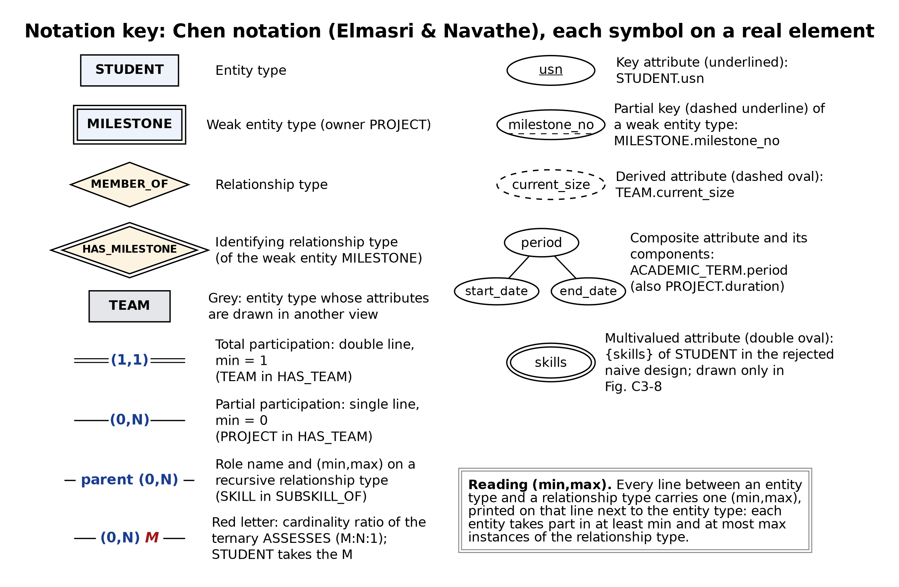
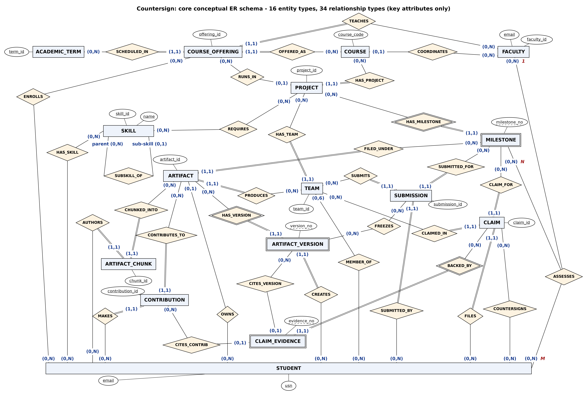
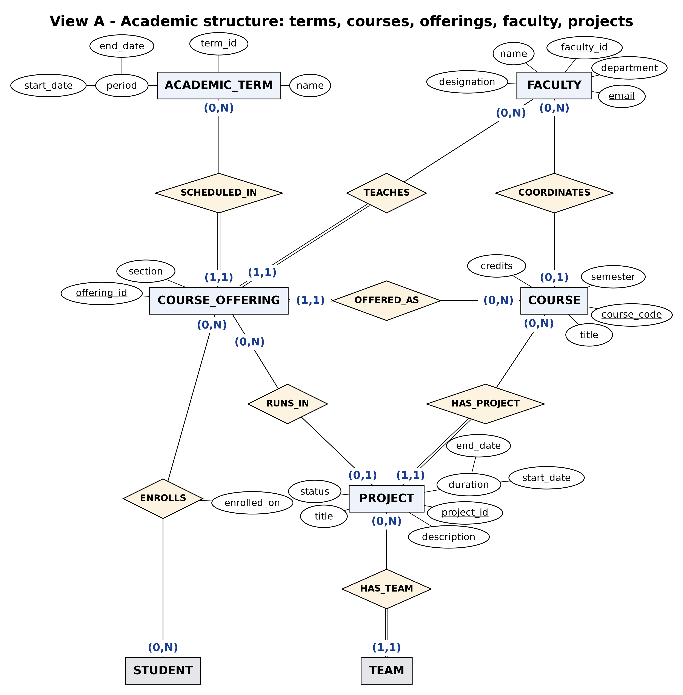
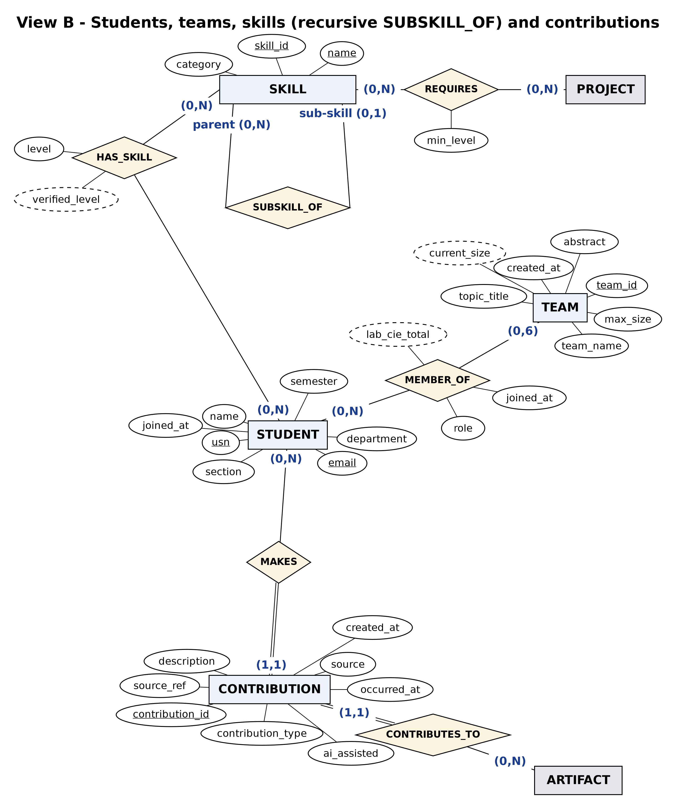
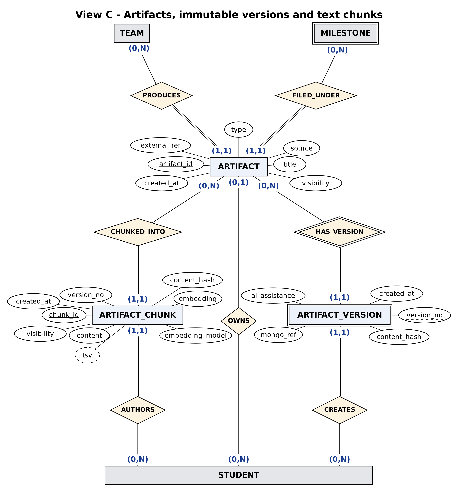
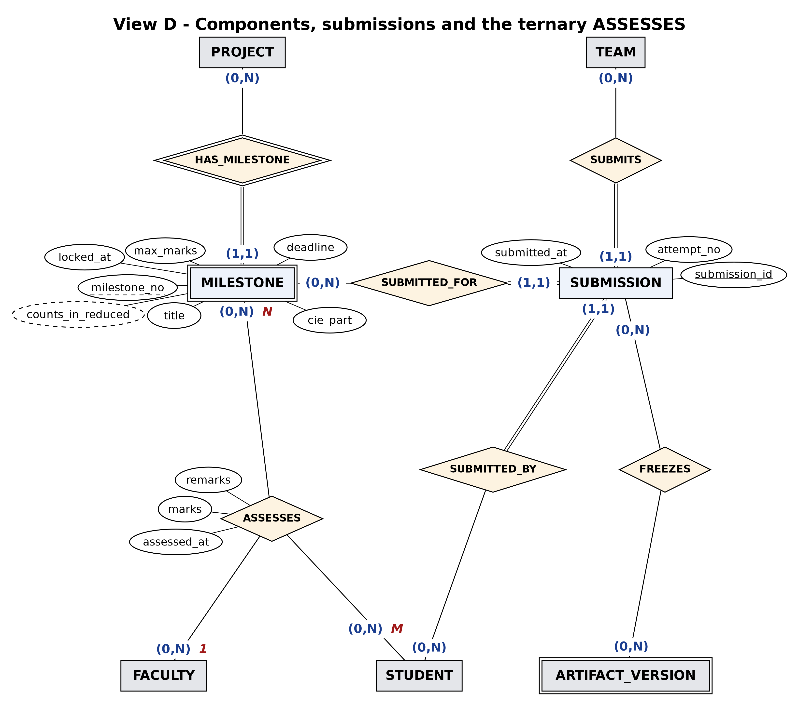
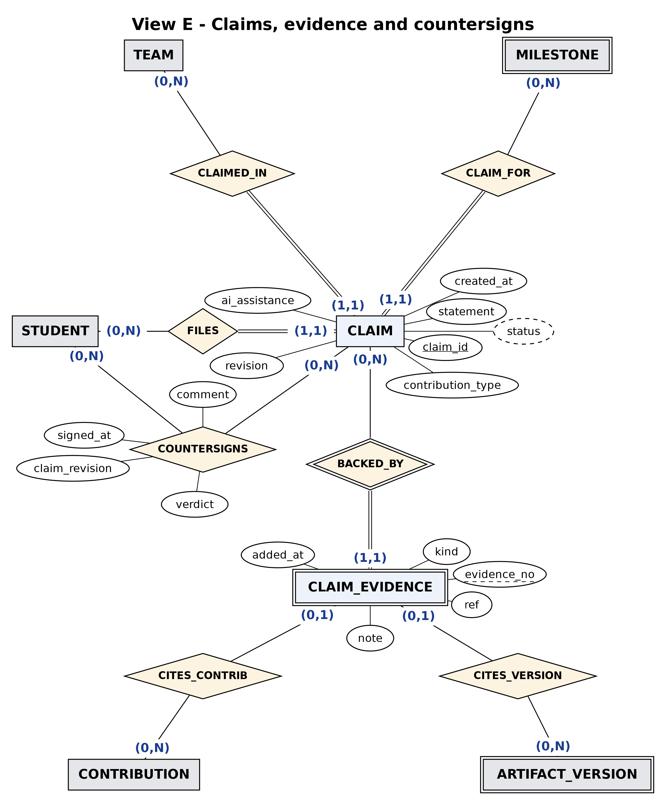
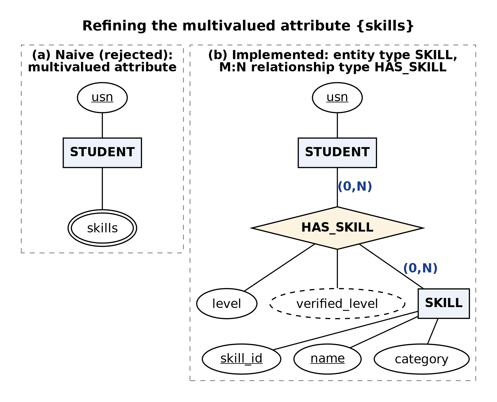
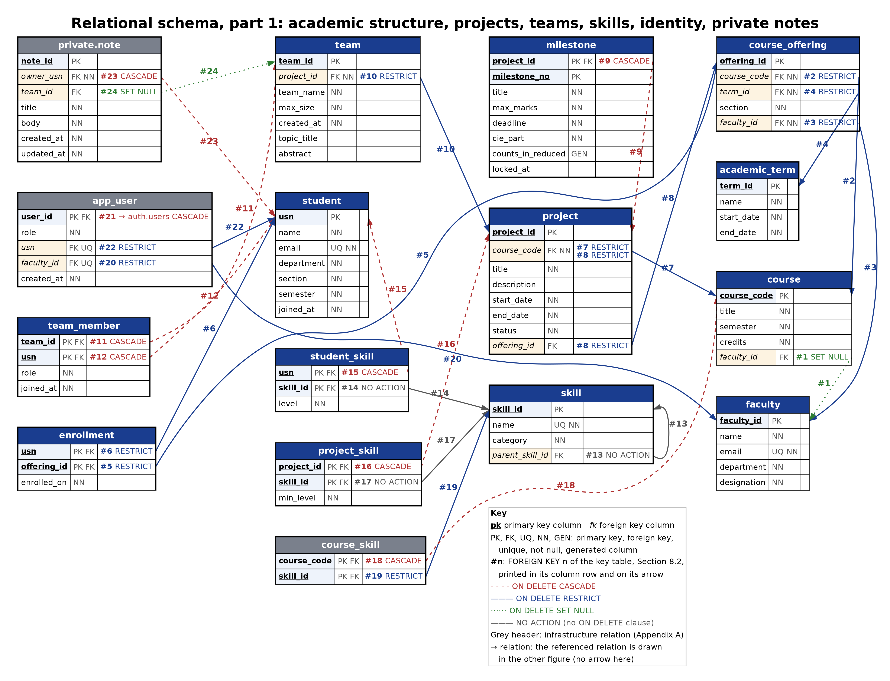
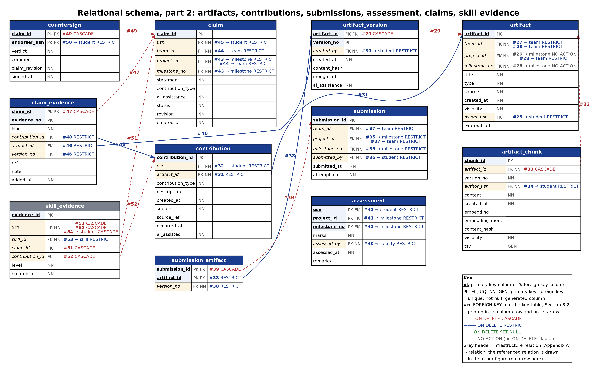

# 1. Scope, sources and conventions

This document gives the conceptual Entity–Relationship (ER) schema of the platform, its mapping to the relational model, and the relational schema diagram. The three are kept consistent with each other and with the database as it is actually built. Revision 2 applies the examiner's corrections; Appendix D lists each one and what was done. Revision 3 (19 November 2026) follows the project becoming a solo project: the worked example of §9 uses the current demo data, and migration 0007 is recorded in the sources and in §5.

**Sources (the real schema, not a design sketch).**

| Source | Role |
|---|---|
| `supabase/fixture/01_schema.sql` | The 13-relation schema used in the graded Test (frozen) |
| `supabase/migrations/20261104000001_core_schema.sql` | The same 13 relations, with row-level security switched on |
| `supabase/migrations/20261104000002_app_core.sql` | Append-only extension: terms, offerings, enrolment, versions, submissions, assessment, claims, evidence, countersigns, skill evidence, private notes, integrity triggers |
| `supabase/migrations/20261104000003_security.sql`, `…0004_rpc.sql` | RLS policies, views, stored procedures (no new base relations) |
| `supabase/migrations/20261105000005_ingest.sql`, `…0006_ingest_worker.sql`, `…0007_strict_marks.sql` | Ingestion infrastructure (outside the core ER diagram) and the strict-marks CHECKs on `assessment.marks`; no new entity types |
| `supabase/seed/demo.sql` | Real demo data (project P06 = the CD252IA lab; solo team T00 and fixture team T06) used for the example in §9 |
| `docs/lab/C2_SRS.md` | Functional requirements FR1–FR11, traced to the ER constructs in §2.2 |

**Conventions.** We use Chen notation as given in Elmasri & Navathe (Ch. 3 and Ch. 9); Fig. C3-1 is the key.

- Foreign keys are not attributes in a conceptual schema. Every foreign-key column in the DDL is shown as a relationship type.
- Each line between an entity type and a relationship type carries the structural constraint **(min, max)**: the number of relationship instances in which one entity takes part. The pair is printed **on that line**, next to the entity type it constrains, so every label belongs to exactly one line.
- The (min, max) values drawn are the ones the database **enforces** (NOT NULL, PRIMARY KEY, UNIQUE, FOREIGN KEY, CHECK or trigger). Where a business rule is stronger than what the DDL enforces, the enforced value is drawn and the difference is stated in §6.
- Total participation (min ≥ 1) is drawn as a double line, and min = 1 holds exactly on the double lines.

**Size.** The core ER schema has

- **16 entity types**: 13 strong and 3 weak;
- **34 relationship types**:
  - 3 identifying,
  - 6 binary M:N,
  - 1 ternary,
  - 1 recursive,
  - 23 other binary 1:N.

It maps to **23 relations**. Four infrastructure relations are added on top of these in Appendix A: identity mapping, course concepts, skill evidence and private notes. That gives the 27 relations and 54 foreign keys of the applied schema.

::: {page=a4l}

:::

# 2. Data requirements and traceability to the SRS

Elmasri & Navathe's design process starts from the data requirements of the miniworld. This section states them, and then traces every functional requirement of the SRS (C2, FR1–FR11) to the ER constructs that support it.

## 2.1 Data requirements (miniworld description)

The miniworld is the experiential-learning (EL) work of a college: who is taught what, who builds what in which team, and who did which part of the work behind each mark.

- **DR1.** The college runs **academic terms**. A term has an identifier, a name and a period (start date, end date). Terms do not overlap.
- **DR2.** A **course** has a code, title, semester and credits. It may have one coordinating faculty member.
- **DR3.** A course is offered in a term as one or more **course offerings** (sections). The combination of course, term and section is unique. Each offering is taught by exactly one faculty member.
- **DR4.** A **faculty member** has an identifier, name, unique e-mail address, department and designation.
- **DR5.** A **student** has a USN, name, unique e-mail address, department, section, semester and joining date. A student enrols in offerings, each enrolment with a date.
- **DR6.** A course defines **projects** (title, description, status, duration). A project may run in one offering, and that offering must be of the project's own course.
- **DR7.** A project is assessed through numbered **components** (milestones; C1–C11 in the lab). A component has a title, maximum marks, deadline, CIE part and lock time. A component number means something only within its project.
- **DR8.** Students form **teams** for a project. A team has a name, a size limit (at most 6), a topic and an abstract. A student is in at most one team per project, and only if enrolled in the project's offering. Membership records a role and a joining date.
- **DR9.** **Skills** form a hierarchy (each skill has at most one parent). Students declare a level for each skill they hold; projects require skills at a minimum level. A verified level is obtained from evidence.
- **DR10.** A team produces **artifacts** (code, notes, reports, diagrams, slides), each filed under one component of the team's own project. A private artifact has an owner. Every saved state of an artifact is an immutable numbered **version**, with its author, a content hash and a pointer to the body stored in MongoDB.
- **DR11.** A **contribution** records that a student did a piece of work (research, design, code, documentation, review) on an artifact, and where the record came from (editor, GitHub, Obsidian).
- **DR12.** Artifact text is split into **chunks** for cited retrieval. Each chunk records its author, version number, embedding, model and a full-text vector.
- **DR13.** A team **submits** a component, possibly in several attempts. Each attempt freezes specific artifact versions.
- **DR14.** A faculty member who teaches the project records **one mark per student per component**.
- **DR15.** A student files **claims** about their own work for a component of their team. A claim is backed by numbered **evidence** items: a contribution, an artifact version, a commit, a URL or a file. Teammates **countersign** a claim (confirm or dispute) at the revision they read. The claim's status is derived from these verdicts.
- **DR16.** History is permanent: contributions, versions, claims, submissions and marks are never removed by deleting a parent.

## 2.2 Traceability: functional requirements → ER constructs

| FR (C2) | Requirement | Entity types | Relationship types | Constraints that carry it |
|---|---|---|---|---|
| FR1 | Academic records | ACADEMIC_TERM, COURSE, COURSE_OFFERING, FACULTY, STUDENT; USER_ACCOUNT (App. A) | SCHEDULED_IN, OFFERED_AS, TEACHES, COORDINATES, ENROLLS | Keys term_id, course_code, offering_id, faculty_id and email, usn and email; composite `period`; EXCLUDE (no overlapping terms); UNIQUE (course, term, section) |
| FR2 | Projects and rubric components | PROJECT, MILESTONE (weak) | HAS_PROJECT, RUNS_IN, HAS_MILESTONE (identifying), REQUIRES | Partial key milestone_no; composite FK (offering_id, course_code); derived `counts_in_reduced` |
| FR3 | Semester hub | no new types: STUDENT, COURSE_OFFERING, PROJECT, TEAM, MILESTONE, CLAIM | ENROLLS, RUNS_IN, MEMBER_OF, CLAIM_FOR, COUNTERSIGNS | A derived view (`v_semester_hub`); nothing stored |
| FR4 | Team formation | TEAM, STUDENT, SKILL | HAS_TEAM, MEMBER_OF (0,6), HAS_SKILL, REQUIRES | Derived `current_size`; triggers: capacity, one team per project, enrolment required |
| FR5 | Capture of work | ARTIFACT, ARTIFACT_VERSION (weak), CONTRIBUTION | PRODUCES, FILED_UNDER, OWNS, HAS_VERSION (identifying), CREATES, MAKES, CONTRIBUTES_TO | Shared `project_id` in two composite FKs (same project); CHECK: a private artifact has an owner |
| FR6 | Claims, evidence, countersigns | CLAIM, CLAIM_EVIDENCE (weak), CONTRIBUTION, ARTIFACT_VERSION | FILES, CLAIMED_IN, CLAIM_FOR, BACKED_BY (identifying), CITES_CONTRIB, CITES_VERSION, COUNTERSIGNS (M:N) | Derived `status`; CHECK `claim_evidence_kind_matches`; trigger `check_countersign` |
| FR7 | Submission and assessment | SUBMISSION, MILESTONE, FACULTY, STUDENT | SUBMITS, SUBMITTED_FOR, SUBMITTED_BY, FREEZES (M:N), **ASSESSES (ternary)** | UNIQUE attempt key; derived `lab_cie_total`; marks ≤ max, locking (§5.1) |
| FR8 | Evidence-backed skills | SKILL | HAS_SKILL, REQUIRES, **SUBSKILL_OF (recursive)** | Derived `verified_level` (source outside the diagram, §4.3); CHECK level 1–5 |
| FR9 | Cited assistant | ARTIFACT_CHUNK | CHUNKED_INTO, AUTHORS | Derived `tsv`; `visibility` |
| FR10 | Permanent record | every history entity type | (all FKs into history) | ON DELETE RESTRICT on history foreign keys (§7.1) |
| FR11 | Polyglot persistence | ARTIFACT_VERSION (`mongo_ref`); keys of ARTIFACT, STUDENT, TEAM | — | Shared keys to the MongoDB collections (App. A) |

Every entity type and every relationship type of the diagrams appears in at least one row, so no construct is unmotivated, and every FR is supported by at least one construct.

# 3. Identifying entity and relationship types

We used this rule to decide between an entity type and a relationship type:

- **Entity type**: a concept with its own identity (a key), its own attributes, and at least one of these properties:
  - it can occur several times between the same participants;
  - it is referenced by other concepts;
  - it owns a weak entity type.
- **Relationship type**: an association whose identity is the combination of its participants.

This rule settles five non-obvious cases.

1. **CONTRIBUTION is an entity type, not an M:N relationship between STUDENT and ARTIFACT.**
   - The same student may record several contributions to the same artifact: there is no `UNIQUE (usn, artifact_id)`, and the key is `contribution_id`. A relationship set cannot contain two instances with the same participating entities, so the concept must be an entity type.
   - Contributions are also referenced by CLAIM_EVIDENCE and by `skill_evidence`.
2. **CLAIM is an entity type, not a ternary relationship STUDENT–TEAM–MILESTONE.**
   - A student may file several claims for one component (key `claim_id`).
   - A claim owns the weak entity type CLAIM_EVIDENCE.
   - A claim takes part in another relationship (COUNTERSIGNS). In the ER model a relationship type cannot take part in another relationship without aggregation.
   - CLAIM is therefore linked to its three participants by the binary relationships FILES, CLAIMED_IN and CLAIM_FOR.
3. **ASSESSES is a genuine ternary relationship FACULTY–STUDENT–MILESTONE.**
   - A mark exists only as the combination "this faculty member gave this student this mark for this component", and the relation `assessment` has no surrogate key. It is analysed in §5.1.
4. **SUBMISSION is a strong entity type.**
   - Its natural key is (team, component, `attempt_no`), so it could have been modelled as a weak entity type identified by TEAM and MILESTONE, with partial key `attempt_no`.
   - The schema gives it a key attribute of its own, the surrogate `submission_id` (an identity column and the primary key). An entity type that has a key attribute of its own is strong by definition; that is the whole reason.
   - The natural key remains a secondary key, enforced as `UNIQUE (team_id, project_id, milestone_no, attempt_no)` (see §7.3 for what this means for normal forms).
5. **STUDENT–ARTIFACT–MILESTONE is not a ternary relationship.** PROJECT_MASTER §5.2 suggests this ternary (via CONTRIBUTION). It is rejected:
   - The milestone is functionally determined by the artifact. Every artifact is filed under exactly one component: `artifact.(project_id, milestone_no)` is NOT NULL, so artifact_id → (project_id, milestone_no). This is FILED_UNDER with ARTIFACT (1,1).
   - In any (student, artifact, milestone) triple the milestone is therefore fixed by the artifact. The third participant adds no information; it would only repeat FILED_UNDER and could disagree with it.
   - The triple reduces to the binary association STUDENT–ARTIFACT, which the schema represents as the entity type CONTRIBUTION (case 1), plus the existing FILED_UNDER. ASSESSES (case 3) remains a ternary: there no participant is determined by any single other participant; the faculty member is determined only by the pair (student, component), and the mark belongs to the triple (§5.1).

# 4. The ER diagrams

## 4.1 How the diagrams are organised

**Fig. C3-2** is the complete conceptual schema on one A3 page: all 16 entity types and all 34 relationship types with every (min,max), and the key attributes. **Figs. C3-3 to C3-7** are five views that together carry every attribute. The views follow one membership rule, which `gen_er.py` checks before it draws anything:

- every **relationship type** is drawn, with its attributes and its (min,max) pairs, in **exactly one view**;
- every **entity type** is drawn with all its attributes in exactly one view, its *home* view. In any other view that needs it as a participant it appears as a grey rectangle without attributes;
- an identifying relationship type is drawn in the home view of its weak entity type, with the owner.

The union of the five views is therefore exactly the core schema, and no relationship type is drawn twice.

| View | Figure | Home entity types (all attributes) | Relationship types drawn (each in this view only) |
|---|---|---|---|
| A. Academic structure | C3-3 | ACADEMIC_TERM, COURSE, FACULTY, COURSE_OFFERING, PROJECT | SCHEDULED_IN, OFFERED_AS, COORDINATES, TEACHES, ENROLLS, HAS_PROJECT, RUNS_IN, HAS_TEAM |
| B. Students, teams, skills, contributions | C3-4 | STUDENT, TEAM, SKILL, CONTRIBUTION | MEMBER_OF, HAS_SKILL, REQUIRES, SUBSKILL_OF, MAKES, CONTRIBUTES_TO |
| C. Artifacts, versions, chunks | C3-5 | ARTIFACT, ARTIFACT_VERSION, ARTIFACT_CHUNK | PRODUCES, FILED_UNDER, OWNS, HAS_VERSION, CREATES, CHUNKED_INTO, AUTHORS |
| D. Components, submissions, assessment | C3-6 | MILESTONE, SUBMISSION | HAS_MILESTONE, SUBMITS, SUBMITTED_FOR, SUBMITTED_BY, FREEZES, ASSESSES |
| E. Claims, evidence, countersigns | C3-7 | CLAIM, CLAIM_EVIDENCE | FILES, CLAIMED_IN, CLAIM_FOR, BACKED_BY, CITES_CONTRIB, CITES_VERSION, COUNTERSIGNS |
| | | **16 entity types** | **34 relationship types** |

**Legibility.** Each figure has a page of its own, sized to the figure: the overview on A3 landscape, the views on A4 portrait. At that size, in the PDF, the (min,max) labels print at 8.1–9.7 pt in the views and at 8.2 pt in the overview, attribute names at 7.2 pt or more, and the schema figures (§8) at 8.1 pt. In the DOCX the same pages are separate Word sections with the same paper size and orientation.

- **One label per line.** An entity–relationship line connects exactly one entity type and one relationship type, so it carries exactly one (min,max). The label is printed on the line itself, in a white box that interrupts it, as close to the entity type as other shapes allow.
- **Lines leave hubs at separate points.** Where several lines meet one side of an entity type, their end points are spread along that side. STUDENT, which takes part in 11 relationship types, is drawn as a long rectangle at the foot of Fig. C3-2, so each of its lines arrives at its own point, with its own label above that point.
- **Recursive relationship.** The two role lines of SUBSKILL_OF leave its diamond at opposite vertices and meet SKILL at opposite ends of its lower side. Each carries its role name and (min,max): "parent (0,N)" on one line, "sub-skill (0,1)" on the other (Figs. C3-2 and C3-4).
- **Crossings.** Fig. C3-2 has 8 line crossings, all away from labels. At least one crossing is unavoidable: STUDENT, TEAM and MILESTONE are each connected to each of ARTIFACT, SUBMISSION and CLAIM (OWNS, SUBMITTED_BY, FILES; PRODUCES, SUBMITS, CLAIMED_IN; FILED_UNDER, SUBMITTED_FOR, CLAIM_FOR). With the diamonds as subdivision points this is a subdivision of K~3,3~, which has no plane drawing (Kuratowski). We do not claim that 8 is the minimum. The five views have no crossings.

**Coverage of the notation asked for in PROJECT_MASTER §5.2.**

- *Composite attribute:* `period` of ACADEMIC_TERM and `duration` of PROJECT (Fig. C3-3), and in the key, Fig. C3-1. Student `name` is not composite, because the DDL stores it as one VARCHAR(60) (§4.2).
- *Multivalued attribute:* none of the final diagrams has one. The only multivalued attribute drawn is the naive {skills} of STUDENT in Fig. C3-8, which shows why the design replaced it; the key, Fig. C3-1, shows the symbol on that same attribute. The reason is given in §4.3. PROJECT_MASTER's example "interests" is not part of the schema.
- *Derived attributes:* `current_size` (TEAM), `verified_level` (HAS_SKILL), `lab_cie_total` (MEMBER_OF), `status` (CLAIM), `counts_in_reduced` (MILESTONE), `tsv` (ARTIFACT_CHUNK), drawn as dashed ovals (§4.3).
- *Weak entity types, identifying relationship types, total participation, (min,max) on every line, ternary, recursive with role names:* as listed in §1 and §5.

::: {page=a3l}

:::

::: {page=a4p}

:::

::: {page=a4p}

:::

::: {page=a4p}

:::

::: {page=a4p}

:::

::: {page=a4p}

:::

## 4.2 Entity types

| Entity type | Kind | Key(s) (underlined) | Other attributes | Notes |
|------|----|-----|---------|----------|
| ACADEMIC_TERM | strong | term_id | name, **period** (start_date, end_date) | `period` is composite: the DDL treats it as one value, `daterange(start_date, end_date)`, in an exclusion constraint (no two terms overlap) |
| COURSE | strong | course_code | title, semester, credits | |
| FACULTY | strong | faculty_id; email | name, department, designation | Two keys, each underlined (`email` is UNIQUE) |
| COURSE_OFFERING | strong | offering_id | section | Natural key (course, term, section) is UNIQUE; it is expressed through relationships, because FKs are not ER attributes |
| STUDENT | strong | usn; email | name, department, section, semester, joined_at | `name` is one VARCHAR(60) in the DDL, so it is drawn as a simple attribute, not a composite (first/last) one |
| PROJECT | strong | project_id | title, description, status, **duration** (start_date, end_date) | `duration` is composite; CHECK (end_date > start_date) constrains it as a unit |
| MILESTONE | **weak** (owner PROJECT) | partial key milestone_no | title, max_marks, deadline, cie_part, locked_at, *counts_in_reduced* (derived) | One lab component (C1–C11 in project P06) |
| TEAM | strong | team_id | team_name, max_size, created_at, topic_title, abstract, *current_size* (derived) | |
| SKILL | strong | skill_id; name | category | |
| ARTIFACT | strong | artifact_id | title, type, source, visibility, external_ref, created_at | |
| ARTIFACT_VERSION | **weak** (owner ARTIFACT) | partial key version_no | created_at, content_hash, mongo_ref, ai_assistance | Immutable version; the body lives in MongoDB (`mongo_ref`) |
| CONTRIBUTION | strong | contribution_id | contribution_type, description, source, source_ref, occurred_at, ai_assisted, created_at | |
| ARTIFACT_CHUNK | strong | chunk_id | version_no, content, embedding, embedding_model, content_hash, visibility, created_at, *tsv* (derived) | RAG unit. `version_no` is a plain attribute: the DDL has no FK to ARTIFACT_VERSION (see §6) |
| SUBMISSION | strong | submission_id | attempt_no, submitted_at | |
| CLAIM | strong | claim_id | statement, contribution_type, ai_assistance, revision, created_at, *status* (derived) | |
| CLAIM_EVIDENCE | **weak** (owner CLAIM) | partial key evidence_no | kind, ref, note, added_at | Must be weak, not a multivalued composite attribute of CLAIM: it takes part in CITES_CONTRIB and CITES_VERSION |

## 4.3 Special attributes

**Derived attributes** are drawn as dashed ovals.

| Derived attribute | Of | Derived from | Where it is computed |
|---|---|---|---|
| current_size | TEAM | COUNT of MEMBER_OF instances of the team | Capacity trigger `enforce_team_capacity_v2`; view `v_faculty_team_progress.members` |
| verified_level | HAS_SKILL | MAX(level) over the student's `skill_evidence` rows for that skill. **The source is outside the conceptual diagram**: SKILL_EVIDENCE is an infrastructure relation (Appendix A), so the diagram shows the attribute as derived without drawing what it is derived from | `skill_gap()` RPC: "Declared 4 · Verified 2" |
| lab_cie_total | MEMBER_OF (a student in a lab team) | (Σ reduced marks) × 30 / Σ max_marks + C10 + C11, over the student's ASSESSES instances | View `v_lab_cie_marks.total_50`. Never stored |
| status | CLAIM | Countersign verdicts: any dispute → contested; else any confirm → confirmed; else pending | Stored but derived: maintained only by triggers `trg_claim_status_derived` / `trg_countersign_sync_status` |
| counts_in_reduced | MILESTONE | `cie_part = 'reduced'` | `GENERATED ALWAYS … STORED` column |
| tsv | ARTIFACT_CHUNK | `to_tsvector('english', content)` | `GENERATED ALWAYS … STORED` column (full-text index) |

**Composite attributes**:

- ACADEMIC_TERM.period;
- PROJECT.duration.

Both are flattened into their components by step 1 of the mapping.

**Multivalued attributes.** The final schema has none, and this is a deliberate design result (Fig. C3-8).

- A naive design would give STUDENT a multivalued attribute {skills}.
- Each skill, however, has attributes of its own (name, category, parent skill).
- The student–skill pair also has attributes (declared `level`, derived `verified_level`).
- Skills are shared with PROJECT (REQUIRES) and COURSE (`course_skill`).

So "skills" becomes the entity type SKILL with the M:N relationship HAS_SKILL. The same reasoning turns "evidence of a claim" into the weak entity type CLAIM_EVIDENCE and "versions of an artifact" into ARTIFACT_VERSION. Step 6 of the mapping is therefore empty.

# 5. Key modelling decisions

## 5.1 The ternary relationship ASSESSES (FACULTY–STUDENT–MILESTONE)

`assessment (usn, project_id, milestone_no, marks, assessed_by, assessed_at, remarks)` has these constraints:

- PRIMARY KEY (usn, project_id, milestone_no);
- `assessed_by` NOT NULL REFERENCES faculty.

The relationship has three participants: STUDENT, MILESTONE (whose key is (project_id, milestone_no)) and FACULTY. Its descriptive attributes are marks, assessed_at and remarks.

**Cardinality ratio M:N:1.** For one (student, milestone) pair there is at most one assessment row, and therefore exactly one faculty member. So FACULTY participates with ratio "1". For a fixed faculty member and component there are many students, and for a fixed faculty member and student there are many components. The ratio is STUDENT : MILESTONE : FACULTY = M : N : 1. Figs. C3-2 and C3-6 show it in red next to each (min,max).

**Why the (min,max) pairs do not show this.** On a ternary, (min,max) says how many relationship instances *one* entity takes part in. FACULTY's (0,N) is correct: one faculty member records many marks, or none. What the "1" expresses is something else, a functional dependency from a *pair* of participants to the third: (usn, project_id, milestone_no) → assessed_by. The (min,max) notation cannot express a dependency of that kind; only the cardinality ratio, and in the relation the primary key, can.

**Why not three binary relationships?** Following Elmasri & Navathe §3.9, consider replacing ASSESSES by three binaries: GRADED_IN (STUDENT–MILESTONE), GRADES (FACULTY–STUDENT) and SETS (FACULTY–MILESTONE).

- The binaries cannot record which faculty member gave which student the mark for which component.
- The marks attribute belongs to the triple, not to any pair.
- (Student, milestone, faculty) triples rebuilt by joining the binaries could pair a student and component with the wrong faculty member.

The ternary is therefore not decomposable without loss.

**Why the primary key excludes `assessed_by`.** Step 7 of Elmasri & Navathe's algorithm forms the primary key of the relation for an n-ary relationship type from the foreign keys of all participants, **except** that a participant whose **cardinality ratio is 1** is left out. In an M:N:1 ternary the key is the foreign keys of the M and N participants. Here that is (usn) and (project_id, milestone_no); `assessed_by` is an ordinary NOT NULL foreign key outside the key. The rule is about the cardinality ratio, not about the (min,max) maximum: FACULTY's (min,max) maximum is N, but its ratio is 1.

**What is enforced outside the ER notation, and where.**

| Rule | Mechanism |
|---|---|
| Only a faculty member who teaches the project may record or change a mark, and only in their own name | RPC `record_assessment` (refuses with `teaches_project_required`; sets `assessed_by` to the caller). Also the RLS policies `assessment_insert` and `assessment_update` (migration 0003): `app.teaches_project(project_id) AND assessed_by = app.current_faculty_id()`, with an administrator bypass (`app.is_admin()`). Deleting a mark is admin-only (`assessment_delete`) |
| The assessed student is in a team of that project | Trigger `check_assessment` (`assessment_member_required`) |
| marks ≤ the component's max_marks, with at most one decimal | Trigger `check_assessment` (`assessment_marks_le_max`); CHECK marks ≥ 0; since migration 0007, CHECK `assessment_marks_one_decimal` (marks = round(marks, 1)) and `assessment_marks_precision` (marks < 1000) on an unconstrained NUMERIC column, so a second decimal is refused on every write path instead of being rounded |
| No change after the component is locked (`milestone.locked_at`) | Trigger `check_assessment` (`milestone_locked`; it reads the milestone row FOR SHARE) |
| max_marks may not be lowered below a recorded mark | Trigger `guard_milestone_max_marks` |

The rejected alternative ternaries are discussed in §3: CLAIM as STUDENT–TEAM–MILESTONE (case 2) and STUDENT–ARTIFACT–MILESTONE (case 5).

## 5.2 Weak entity types and identifying relationships

| Weak entity type | Owner | Identifying relationship | Partial key | Relation key | ON DELETE of owner FK | Why weak |
|---|---|---|---|---|---|---|
| MILESTONE | PROJECT | HAS_MILESTONE | milestone_no | (project_id, milestone_no) | CASCADE (#9) | "Component 3" means nothing without its project; milestone numbers repeat across projects |
| ARTIFACT_VERSION | ARTIFACT | HAS_VERSION | version_no | (artifact_id, version_no) | CASCADE (#29) | Version 2 exists only as a version of one artifact; numbering restarts per artifact |
| CLAIM_EVIDENCE | CLAIM | BACKED_BY | evidence_no | (claim_id, evidence_no) | CASCADE (#47) | Evidence item 1 exists only as evidence for one claim |

In each case the weak entity takes part in its identifying relationship with total participation (1,1), drawn as a double line. The owner foreign key of every weak entity type is ON DELETE CASCADE, because the weak entity is existence-dependent on its owner. The cascade does not erase history: a project, artifact or claim that has recorded work cannot be deleted in the first place, because RESTRICT foreign keys from the history relations block it (§7.1). The numbers #n refer to the foreign-key key table in §8.2.

## 5.3 The recursive relationship SUBSKILL_OF

SKILL participates twice, in two roles:

- **parent** (0,N): a broad skill such as "Databases" has any number of sub-skills;
- **sub-skill** (0,1): a skill has at most one parent, because `parent_skill_id` is a single nullable column.

In Figs. C3-2 and C3-4 each role has its own line: the line from the diamond's left vertex is labelled "parent (0,N)", the one from its right vertex "sub-skill (0,1)". Seed example: SQL → Databases, Transactions → SQL, React → JavaScript → Programming. The `skill_subtree()` RPC walks the hierarchy with `WITH RECURSIVE`.

## 5.4 Semantic constraints that the ER notation cannot express (and how the database enforces them)

| Constraint | Enforcement |
|---|---|
| An artifact's team and its milestone belong to the same project | The shared column `artifact.project_id` sits in two composite FKs: (team_id, project_id) → team and (project_id, milestone_no) → milestone. The same applies to `submission` and `claim` |
| A student is in at most one team per project | Trigger `enforce_one_team_per_project` (row-locks the student) |
| A team never exceeds its own `max_size` (the (0,6) on MEMBER_OF is the CHECK bound; the real bound is per team) | Trigger `enforce_team_capacity_v2` (writes the team row, so it is safe under REPEATABLE READ) |
| Only students enrolled in the project's offering may join its teams | Same trigger, checking `enrollment` |
| Contributor, chunk author, version creator, claimant, submitter and private-artifact owner must be members of the team | `require_artifact_team_member` / `require_team_member` triggers |
| A countersign is by a teammate, never by the claimant, on the revision they read | Trigger `check_countersign` (optimistic concurrency on `claim.revision`) |
| A private artifact has an owner | CHECK `artifact_private_needs_owner` |
| A claim-evidence row points to exactly the object its `kind` names | CHECK `claim_evidence_kind_matches` |
| Marks: teacher only, own name; student in a team of the project; marks ≤ max_marks; no change after locking | RPC `record_assessment` + RLS `assessment_insert` / `assessment_update` (teacher, own name, admin bypass); trigger `check_assessment` (team membership, upper bound, lock); trigger `guard_milestone_max_marks` (§5.1) |
| Claims, evidence, countersigns and submissions do not change after the component is locked | `assert_milestone_open`, called by the claim and submission triggers |

# 6. Structural constraints — every (min,max) with a one-line justification

Read "E (min,max) in R" as: *each E entity takes part in at least min and at most max instances of R*. Column references are to the applied DDL.

| Relationship | Participant | (min,max) | Justification |
|--------|--------|----|-------------------|
| SCHEDULED_IN | ACADEMIC_TERM | (0,N) | A term can have any number of offerings, including none before timetabling |
| | COURSE_OFFERING | (1,1) | `course_offering.term_id` is NOT NULL: every offering runs in exactly one term |
| OFFERED_AS | COURSE | (0,N) | A course is offered in many terms/sections, or not at all this year |
| | COURSE_OFFERING | (1,1) | `course_offering.course_code` NOT NULL: an offering is of exactly one course |
| TEACHES | FACULTY | (0,N) | A faculty member may teach several offerings, or none (e.g. on leave) |
| | COURSE_OFFERING | (1,1) | `course_offering.faculty_id` NOT NULL: each offering (course, term, section) has one teacher |
| COORDINATES | FACULTY | (0,N) | A faculty member may coordinate several courses or none |
| | COURSE | (0,1) | `course.faculty_id` is nullable and ON DELETE SET NULL: at most one coordinator, possibly none |
| ENROLLS | STUDENT | (0,N) | A student enrols in many offerings over the programme; a newly admitted student has none |
| | COURSE_OFFERING | (0,N) | An offering can have any number of students, including none before registration |
| HAS_PROJECT | COURSE | (0,N) | A course may define several EL projects or none (theory-only course) |
| | PROJECT | (1,1) | `project.course_code` NOT NULL: every project belongs to exactly one course |
| RUNS_IN | COURSE_OFFERING | (0,N) | An offering may host several projects or none |
| | PROJECT | (0,1) | `project.offering_id` is nullable (fixture projects predate offerings); when set, the composite FK forces the offering to be of the project's own course |
| HAS_MILESTONE (identifying) | PROJECT | (0,N) | A project has any number of components; the DDL does not force at least one |
| | MILESTONE | (1,1) | Weak entity: `milestone.project_id` is part of the PK, so total and single |
| HAS_TEAM | PROJECT | (0,N) | Fixture project P05 has no team yet; P06 has two |
| | TEAM | (1,1) | `team.project_id` NOT NULL: a team is formed for exactly one project |
| MEMBER_OF | STUDENT | (0,N) | One team per project (trigger) but many projects over time; students without a team exist (seed: Nikhil, Ananya) |
| | TEAM | (0,6) | CHECK `max_size BETWEEN 1 AND 6`, plus the capacity trigger (≤ max_size); a newly created team has 0 members |
| HAS_SKILL | STUDENT | (0,N) | A student declares any number of skills, possibly none |
| | SKILL | (0,N) | A skill may be held by many students or by none |
| REQUIRES | PROJECT | (0,N) | A project lists any number of required skills (with `min_level`), possibly none |
| | SKILL | (0,N) | A skill may be required by many projects or by none |
| SUBSKILL_OF (recursive) | SKILL as parent | (0,N) | A broad skill has any number of sub-skills; a leaf has none |
| | SKILL as sub-skill | (0,1) | `skill.parent_skill_id` is a single nullable column: at most one parent; roots have none |
| PRODUCES | TEAM | (0,N) | A team produces many artifacts; a new team has none |
| | ARTIFACT | (1,1) | `artifact.team_id` NOT NULL: every artifact belongs to one team |
| FILED_UNDER | MILESTONE | (0,N) | A component may collect many artifacts or none yet |
| | ARTIFACT | (1,1) | `(artifact.project_id, milestone_no)` NOT NULL: every artifact is filed under one component of its team's project |
| OWNS | STUDENT | (0,N) | A student may own several private artifacts or none |
| | ARTIFACT | (0,1) | `artifact.owner_usn` nullable; CHECK makes it mandatory only when `visibility = 'private'` |
| HAS_VERSION (identifying) | ARTIFACT | (0,N) | Versions accumulate on save; a just-created artifact has none (`submit_milestone` refuses an artifact without a version) |
| | ARTIFACT_VERSION | (1,1) | Weak entity: `artifact_id` is part of the PK |
| CREATES | STUDENT | (0,N) | A student creates many versions, or none |
| | ARTIFACT_VERSION | (1,1) | `artifact_version.created_by` NOT NULL: every version has exactly one author |
| MAKES | STUDENT | (0,N) | A student may have many recorded contributions; "no recorded evidence yet" is allowed (never a verdict) |
| | CONTRIBUTION | (1,1) | `contribution.usn` NOT NULL |
| CONTRIBUTES_TO | ARTIFACT | (0,N) | An artifact receives any number of contributions |
| | CONTRIBUTION | (1,1) | `contribution.artifact_id` NOT NULL: a contribution is to exactly one artifact |
| CHUNKED_INTO | ARTIFACT | (0,N) | Only embedded artifacts have chunks |
| | ARTIFACT_CHUNK | (1,1) | `artifact_chunk.artifact_id` NOT NULL (CASCADE: a chunk is meaningless without its artifact) |
| AUTHORS | STUDENT | (0,N) | A student authors any number of chunks ("every chunk knows its author") |
| | ARTIFACT_CHUNK | (1,1) | `artifact_chunk.author_usn` NOT NULL |
| SUBMITS | TEAM | (0,N) | A team submits each component, possibly several attempts; or nothing yet |
| | SUBMISSION | (1,1) | `(submission.team_id, project_id)` NOT NULL |
| SUBMITTED_FOR | MILESTONE | (0,N) | Each team may submit once or more per component |
| | SUBMISSION | (1,1) | `(submission.project_id, milestone_no)` NOT NULL |
| SUBMITTED_BY | STUDENT | (0,N) | Any member may submit on the team's behalf |
| | SUBMISSION | (1,1) | `submission.submitted_by` NOT NULL |
| FREEZES (M:N) | SUBMISSION | (0,N) | The DDL allows 0. The only write path, `submit_milestone()`, rejects an empty list, so in practice (1,N); at most one version per artifact (PK) |
| | ARTIFACT_VERSION | (0,N) | A version may be frozen into several attempts, or never submitted |
| ASSESSES (ternary, ratio M:N:1) | STUDENT | (0,N) | A student is assessed on many components, or not yet |
| | MILESTONE | (0,N) | A component carries marks for many students, or none yet |
| | FACULTY | (0,N) | A faculty member records many marks, or none. The ratio 1 (one faculty member per student and component) is a dependency on the pair, not a (min,max) bound (§5.1) |
| FILES | STUDENT | (0,N) | A student files any number of claims |
| | CLAIM | (1,1) | `claim.usn` NOT NULL: exactly one claimant |
| CLAIMED_IN | TEAM | (0,N) | A team's members file many claims |
| | CLAIM | (1,1) | `(claim.team_id, project_id)` NOT NULL |
| CLAIM_FOR | MILESTONE | (0,N) | A component attracts any number of claims |
| | CLAIM | (1,1) | `(claim.project_id, milestone_no)` NOT NULL: a claim is about one rubric cell |
| BACKED_BY (identifying) | CLAIM | (0,N) | `file_claim()` allows a claim to start without evidence; evidence is added until the claim is confirmed |
| | CLAIM_EVIDENCE | (1,1) | Weak entity: `claim_id` is part of the PK |
| CITES_CONTRIB | CLAIM_EVIDENCE | (0,1) | `contribution_id` nullable: set only when `kind = 'contribution'` (CHECK) |
| | CONTRIBUTION | (0,N) | A contribution may be cited by several claims (once per claim: partial UNIQUE index) |
| CITES_VERSION | CLAIM_EVIDENCE | (0,1) | `(artifact_id, version_no)` nullable: set only when `kind = 'artifact_version'` |
| | ARTIFACT_VERSION | (0,N) | A version may support several claims |
| COUNTERSIGNS (M:N) | STUDENT | (0,N) | A student endorses many teammates' claims, or none |
| | CLAIM | (0,N) | A claim receives 0..(team size − 1) signatures; PK (claim_id, endorser_usn) allows one signature per teammate |

# 7. ER-to-relational mapping (Elmasri & Navathe's seven-step algorithm)

## 7.1 Referential actions: the policy, stated against all 54 foreign keys

The numbers #1–#54 are those of the key table in §8.2. The policy is the following, and it accounts for every one of the 54 foreign keys.

- **CASCADE (16 FKs)** where deleting the parent makes the child row meaningless, in three groups:
  - the owner FK of each **weak entity type**: #9 milestone, #29 artifact_version, #47 claim_evidence;
  - the FK from an **M:N relation to the participant whose row it describes**: #11 and #12 team_member, #15 student_skill.usn, #16 project_skill.project_id, #18 course_skill.course_code, #39 submission_artifact.submission_id, #49 countersign.claim_id;
  - **derived or account data** that is rebuilt or must disappear with its owner: #33 artifact_chunk.artifact_id (search chunks, recomputable from the artifact), #51, #52 and #54 skill_evidence (derivation data behind `verified_level`), #21 app_user.user_id (the login mapping follows the Supabase Auth account), #23 private.note.owner_usn (a student's private notes are erased with the student, FR10.3).
- **SET NULL (2 FKs)** for optional (0,1) links where the child outlives the parent: #1 course.faculty_id (a course outlives its coordinator) and #24 private.note.team_id (a note outlives its team context).
- **NO ACTION (4 FKs)**: #13 skill.parent_skill_id, #14 student_skill.skill_id, #17 project_skill.skill_id, #26 artifact (project_id, milestone_no). These are in the frozen fixture without an ON DELETE clause, and the fixture is never edited. For a constraint that is not deferrable, NO ACTION refuses the delete exactly as RESTRICT does; it only checks at the end of the statement instead of immediately.
- **RESTRICT (32 FKs)** everywhere else, and in particular on every foreign key **from a history relation** (contribution, artifact_version.created_by, artifact_chunk.author_usn, submission, assessment, claim, claim_evidence's citations, countersign.endorser_usn), so that the permanent record cannot be erased by a cascade (FR10). Deleting a student, team, project or artifact that has recorded work fails with an FK violation.

**Named exceptions** to the simple reading "M:N rows cascade, history restricts":

- `enrollment` is an M:N relation, but both its FKs are RESTRICT (#5, #6): an enrolment is an academic record.
- The *other* side of several M:N relations does not cascade: #14 and #17 (student_skill.skill_id, project_skill.skill_id) are NO ACTION, #19 (course_skill.skill_id) is RESTRICT, so a skill in use cannot be deleted; #38 submission_artifact (artifact_id, version_no) is RESTRICT, so a frozen version cannot disappear; #50 countersign.endorser_usn is RESTRICT, so a signature stays.
- `artifact_version` is history, but its owner FK #29 is CASCADE because it is a weak entity type. This does not weaken the record: an artifact with contributions (#31), frozen versions (#38) or cited versions (#46) cannot be deleted, because those FKs are RESTRICT.
- `artifact_chunk` is a strong entity type, but #33 is CASCADE because chunks are derived search data; its authorship FK #34 is RESTRICT.

**History of these choices.** In the frozen fixture, six of today's RESTRICT foreign keys were different: #7 project.course_code, #10 team.project_id, #27 artifact.team_id, #31 contribution.artifact_id and #32 contribution.usn were CASCADE, and #34 artifact_chunk.author_usn was NO ACTION. Migration 0002 replaced them with RESTRICT. The relations `claim`, `submission`, `assessment`, `artifact_version`, `claim_evidence`, `countersign`, `enrollment` and the other 0002 relations were created by that migration with the actions listed above.

::: {page=a4l}
## 7.2 The mapping, step by step

| Step | ER construct(s) | Resulting relation(s) | Primary key | Foreign keys (ON DELETE, #n of §8.2) | Why |
|-----|-------|-------|-------|---------|----------|
| **1. Strong entity types** | ACADEMIC_TERM, COURSE, FACULTY, COURSE_OFFERING, STUDENT, PROJECT, TEAM, SKILL, ARTIFACT, CONTRIBUTION, ARTIFACT_CHUNK, SUBMISSION, CLAIM | One relation each: `academic_term`, `course`, `faculty`, `course_offering`, `student`, `project`, `team`, `skill`, `artifact`, `contribution`, `artifact_chunk`, `submission`, `claim` | The key attribute: term_id, course_code, faculty_id, offering_id, usn, project_id, team_id, skill_id, artifact_id, contribution_id, chunk_id, submission_id, claim_id. Secondary keys become UNIQUE: student.email, faculty.email, skill.name | (added in step 4) | Simple attributes become columns. Composite **period** and **duration** are flattened into `start_date, end_date`. Derived attributes are not stored (current_size, verified_level, lab_cie_total), except stored-derived **status** (trigger-maintained) and GENERATED **counts_in_reduced**, **tsv** |
| **2. Weak entity types** | MILESTONE (owner PROJECT), ARTIFACT_VERSION (owner ARTIFACT), CLAIM_EVIDENCE (owner CLAIM) | `milestone`, `artifact_version`, `claim_evidence` | Owner PK + partial key: (project_id, milestone_no), (artifact_id, version_no), (claim_id, evidence_no) | project_id → project **CASCADE** (#9); artifact_id → artifact **CASCADE** (#29); claim_id → claim **CASCADE** (#47) | The identifying relationships HAS_MILESTONE, HAS_VERSION and BACKED_BY are absorbed into the weak relation. CASCADE matches existence dependency (§7.1) |
| **3. Binary 1:1** | None in the core schema | — | — | — | Appendix A, `app_user`: IS_STUDENT and IS_FACULTY (1:1, partial on both sides) use the foreign-key approach. FK `usn` UNIQUE and FK `faculty_id` UNIQUE are placed in `app_user`, so the frozen `student`/`faculty` relations stay unchanged |
| **4. Binary 1:N** (incl. recursive) | SCHEDULED_IN, OFFERED_AS, TEACHES | FKs in `course_offering` | — | term_id → academic_term (#4), course_code → course (#2), faculty_id → faculty (#3); all RESTRICT, NOT NULL | FK goes on the N side; NOT NULL because the N side's participation is total |
| | COORDINATES | FK in `course` | — | faculty_id → faculty **SET NULL** (#1), nullable | Partial (0,1) participation, so nullable FK. SET NULL: a course outlives its coordinator |
| | HAS_PROJECT, RUNS_IN | FKs in `project` | — | course_code → course RESTRICT (#7); (offering_id, course_code) → course_offering (offering_id, course_code) RESTRICT (#8) | The composite FK targets the superkey UNIQUE(offering_id, course_code), so a project's offering is always of its own course |
| | HAS_TEAM | FK in `team` | — | project_id → project RESTRICT (#10) | Teams are history; also adds superkey UNIQUE(team_id, project_id) for the composite FKs below |
| | SUBSKILL_OF (recursive) | FK in `skill` | — | parent_skill_id → skill(skill_id), nullable, NO ACTION (#13) | Recursive 1:N maps to a self-referencing FK on the "sub-skill" role |
| | PRODUCES, FILED_UNDER, OWNS | FKs in `artifact` | — | PRODUCES: (team_id, project_id) → team RESTRICT (#28) **and** team_id → team RESTRICT (#27). FILED_UNDER: (project_id, milestone_no) → milestone NO ACTION (#26). OWNS: owner_usn → student RESTRICT (#25), nullable | FILED_UNDER targets a weak entity, so its FK is the owner's composite key. Sharing `project_id` between #28 and #26 enforces "same project" (§5.4). **#27 is redundant**: any (team_id, project_id) accepted by #28 already has a team_id that exists in `team`. It is the fixture's original FK (CASCADE there), kept because the fixture is frozen and set to RESTRICT by migration 0002 |
| | CREATES | FK in `artifact_version` | — | created_by → student RESTRICT (#30) | Version authorship is permanent history |
| | MAKES, CONTRIBUTES_TO | FKs in `contribution` | — | usn → student RESTRICT (#32); artifact_id → artifact RESTRICT (#31) | Contribution is the N side of both |
| | CHUNKED_INTO, AUTHORS | FKs in `artifact_chunk` | — | artifact_id → artifact CASCADE (#33); author_usn → student RESTRICT (#34) | Chunks are derived search data (CASCADE); the author link is provenance (RESTRICT) |
| | SUBMITS, SUBMITTED_FOR, SUBMITTED_BY | FKs in `submission` | — | (team_id, project_id) → team (#37); (project_id, milestone_no) → milestone (#35); submitted_by → student (#36); all RESTRICT | As for `artifact` |
| | FILES, CLAIMED_IN, CLAIM_FOR | FKs in `claim` | — | usn → student (#45); (team_id, project_id) → team (#44); (project_id, milestone_no) → milestone (#43); all RESTRICT | As for `artifact` |
| | CITES_CONTRIB, CITES_VERSION | FKs in `claim_evidence` | — | contribution_id → contribution (#48); (artifact_id, version_no) → artifact_version (#46); both nullable, RESTRICT | (0,1) participation, so nullable FKs; CHECK `claim_evidence_kind_matches` fixes which one is set |
| **5. Binary M:N** | ENROLLS | `enrollment` | (usn, offering_id) | usn → student (#6), offering_id → course_offering (#5); both **RESTRICT** | Relationship relation; attribute `enrolled_on`. RESTRICT, not CASCADE: an enrolment is an academic record (§7.1) |
| | MEMBER_OF | `team_member` | (team_id, usn) | team_id → team CASCADE (#11), usn → student CASCADE (#12) | Attributes `role` (CHECK lead/member, at most one lead), `joined_at`. A member with recorded work is pinned by trigger `guard_member_history` |
| | HAS_SKILL | `student_skill` | (usn, skill_id) | usn → student CASCADE (#15), skill_id → skill NO ACTION (#14) | Attribute `level` (declared); `verified_level` is derived |
| | REQUIRES | `project_skill` | (project_id, skill_id) | project_id → project CASCADE (#16), skill_id → skill NO ACTION (#17) | Attribute `min_level` |
| | FREEZES | `submission_artifact` | (submission_id, artifact_id) | submission_id → submission CASCADE (#39); (artifact_id, version_no) → artifact_version RESTRICT (#38) | The key is deliberately **narrower** than the default (submission_id, artifact_id, version_no): at most one version of each artifact per submission |
| | COUNTERSIGNS | `countersign` | (claim_id, endorser_usn) | claim_id → claim CASCADE (#49), endorser_usn → student RESTRICT (#50) | Attributes verdict, comment, claim_revision, signed_at |
| **6. Multivalued attributes** | None (see §4.3, Fig. C3-8) | — | — | — | Every candidate (skills, evidence, versions) has its own attributes or relationships, so each was modelled as an entity/relationship, not as a multivalued attribute |
| **7. n-ary relationships** | ASSESSES (FACULTY, STUDENT, MILESTONE), cardinality ratio STUDENT : MILESTONE : FACULTY = M : N : 1 | `assessment` | (usn, project_id, milestone_no) | usn → student (#42), (project_id, milestone_no) → milestone (#41), assessed_by → faculty (#40, NOT NULL); all RESTRICT | FKs to all three participants. The PK is formed from the FKs of the participants whose cardinality ratio is M or N; FACULTY, whose **ratio is 1**, is left out, so `assessed_by` is outside the key. This encodes (usn, project_id, milestone_no) → assessed_by, which (min,max) cannot express (§5.1). Attributes marks, assessed_at, remarks |

**Result.** 13 (step 1) + 3 (step 2) + 6 (step 5) + 1 (step 7) = **23 relations**.
:::

## 7.3 A deliberate, controlled redundancy, and the normal forms it costs

`artifact`, `submission` and `claim` each carry `project_id` although team_id → project_id holds (from `team`). The cost in normal-form terms differs between the three, under the general definitions (with respect to *all* candidate keys):

- **`artifact` and `claim` violate 3NF (transitive dependency).** Their only candidate keys are the surrogates artifact_id and claim_id (claim also has the superkey (claim_id, usn)). project_id is nonprime, and artifact_id → team_id → project_id (likewise claim_id → team_id → project_id) is a transitive dependency through the non-key team_id. Both relations are in 2NF but not in 3NF.
- **`submission` violates 2NF (partial dependency).** Because team_id → project_id, the constraint UNIQUE (team_id, project_id, milestone_no, attempt_no) is a superkey but not a minimal one: **{team_id, milestone_no, attempt_no} is a candidate key**, beside {submission_id}. project_id belongs to no candidate key, so it is nonprime, and it depends on team_id, a proper subset of the candidate key {team_id, milestone_no, attempt_no}. That is a partial dependency, so `submission` is **not in 2NF**. (Measured only against the primary key {submission_id}, the dependency would look merely transitive; the general definition uses every candidate key.)

This agrees with Component 6 (`C6_Normalization.md`, Appendix B.2.1–B.2.3), which records all three as justified exceptions. We accept the redundancy because:

- the column is pinned by composite foreign keys onto the superkeys `team(team_id, project_id)` and `milestone(project_id, milestone_no)`, so it can never disagree with the team's project;
- it lets a plain FK express a cross-relationship constraint ("the component belongs to the team's project") that would otherwise need triggers on three relations.

# 8. The relational schema (generated from the applied DDL)

## 8.1 Schema diagrams

Figs. C3-9 and C3-10 are generated, not drawn. The read-only catalogue query `diagrams/c3/introspect_schema.sql` was run against the database with migrations 0001–0004 applied, and produced `diagrams/c3/schema_introspection.json`. `gen_schema.py` turned that JSON into the two diagrams, the key table of §8.2 and the listing of §8.3. Together they show exactly what the DBMS stores: 27 relations and 54 FOREIGN KEY constraints.

**How to read Figs. C3-9 and C3-10.**

- The 27 relations are split over two A3 figures. Each relation is drawn in full in exactly one of them.
- **Columns**: PK columns are bold and underlined; FK columns are italic. The second column lists PK, FK, UQ (UNIQUE), NN (NOT NULL), GEN (generated).
- **Foreign keys are numbered #1–#54.** The number and the ON DELETE action are printed in the row of the referencing column, so every foreign key can be read off its own row. The number is printed again on its arrow.
- **Arrows**: one arrow per foreign key whose referenced relation is in the same figure, from the referencing column to the referenced key. The ON DELETE action is also the arrow style: CASCADE dashed red, RESTRICT solid blue, SET NULL dotted green, NO ACTION solid grey. If the referenced relation is in the other figure, the FK cell names it ("→ student") and no arrow is drawn, so `student.usn`, which 14 foreign keys reference, receives only the 5 arrows of Fig. C3-9.
- **Headers**: relations with grey headers are the infrastructure relations of Appendix A.

::: {page=a3l}

:::

::: {page=a3l}

:::

::: {page=a4l}
## 8.2 Key table of the 54 foreign keys

Generated from the catalogue (`diagrams/c3/fk_key.md`). Totals: 32 RESTRICT, 16 CASCADE, 4 NO ACTION, 2 SET NULL.

<!-- BEGIN generated: diagrams/c3/fk_key.md -->
| # | Constraint | Referencing relation (columns) | Referenced relation (columns) | ON DELETE | Fig. |
|--:|---|---|---|---|---|
| 1 | `course_faculty_id_fkey` | course (faculty_id) | faculty (faculty_id) | SET NULL | C3-9 |
| 2 | `course_offering_course_code_fkey` | course_offering (course_code) | course (course_code) | RESTRICT | C3-9 |
| 3 | `course_offering_faculty_id_fkey` | course_offering (faculty_id) | faculty (faculty_id) | RESTRICT | C3-9 |
| 4 | `course_offering_term_id_fkey` | course_offering (term_id) | academic_term (term_id) | RESTRICT | C3-9 |
| 5 | `enrollment_offering_id_fkey` | enrollment (offering_id) | course_offering (offering_id) | RESTRICT | C3-9 |
| 6 | `enrollment_usn_fkey` | enrollment (usn) | student (usn) | RESTRICT | C3-9 |
| 7 | `project_course_code_fkey` | project (course_code) | course (course_code) | RESTRICT | C3-9 |
| 8 | `project_offering_fkey` | project (offering_id, course_code) | course_offering (offering_id, course_code) | RESTRICT | C3-9 |
| 9 | `milestone_project_id_fkey` | milestone (project_id) | project (project_id) | CASCADE | C3-9 |
| 10 | `team_project_id_fkey` | team (project_id) | project (project_id) | RESTRICT | C3-9 |
| 11 | `team_member_team_id_fkey` | team_member (team_id) | team (team_id) | CASCADE | C3-9 |
| 12 | `team_member_usn_fkey` | team_member (usn) | student (usn) | CASCADE | C3-9 |
| 13 | `skill_parent_skill_id_fkey` | skill (parent_skill_id) | skill (skill_id) | NO ACTION | C3-9 |
| 14 | `student_skill_skill_id_fkey` | student_skill (skill_id) | skill (skill_id) | NO ACTION | C3-9 |
| 15 | `student_skill_usn_fkey` | student_skill (usn) | student (usn) | CASCADE | C3-9 |
| 16 | `project_skill_project_id_fkey` | project_skill (project_id) | project (project_id) | CASCADE | C3-9 |
| 17 | `project_skill_skill_id_fkey` | project_skill (skill_id) | skill (skill_id) | NO ACTION | C3-9 |
| 18 | `course_skill_course_code_fkey` | course_skill (course_code) | course (course_code) | CASCADE | C3-9 |
| 19 | `course_skill_skill_id_fkey` | course_skill (skill_id) | skill (skill_id) | RESTRICT | C3-9 |
| 20 | `app_user_faculty_id_fkey` | app_user (faculty_id) | faculty (faculty_id) | RESTRICT | C3-9 |
| 21 | `app_user_user_id_fkey` | app_user (user_id) | auth.users (id) | CASCADE | C3-9 |
| 22 | `app_user_usn_fkey` | app_user (usn) | student (usn) | RESTRICT | C3-9 |
| 23 | `note_owner_usn_fkey` | private.note (owner_usn) | student (usn) | CASCADE | C3-9 |
| 24 | `note_team_id_fkey` | private.note (team_id) | team (team_id) | SET NULL | C3-9 |
| 25 | `artifact_owner_usn_fkey` | artifact (owner_usn) | student (usn) | RESTRICT | C3-10 |
| 26 | `artifact_project_id_milestone_no_fkey` | artifact (project_id, milestone_no) | milestone (project_id, milestone_no) | NO ACTION | C3-10 |
| 27 | `artifact_team_id_fkey` | artifact (team_id) | team (team_id) | RESTRICT | C3-10 |
| 28 | `artifact_team_project_fkey` | artifact (team_id, project_id) | team (team_id, project_id) | RESTRICT | C3-10 |
| 29 | `artifact_version_artifact_id_fkey` | artifact_version (artifact_id) | artifact (artifact_id) | CASCADE | C3-10 |
| 30 | `artifact_version_created_by_fkey` | artifact_version (created_by) | student (usn) | RESTRICT | C3-10 |
| 31 | `contribution_artifact_id_fkey` | contribution (artifact_id) | artifact (artifact_id) | RESTRICT | C3-10 |
| 32 | `contribution_usn_fkey` | contribution (usn) | student (usn) | RESTRICT | C3-10 |
| 33 | `artifact_chunk_artifact_id_fkey` | artifact_chunk (artifact_id) | artifact (artifact_id) | CASCADE | C3-10 |
| 34 | `artifact_chunk_author_usn_fkey` | artifact_chunk (author_usn) | student (usn) | RESTRICT | C3-10 |
| 35 | `submission_project_id_milestone_no_fkey` | submission (project_id, milestone_no) | milestone (project_id, milestone_no) | RESTRICT | C3-10 |
| 36 | `submission_submitted_by_fkey` | submission (submitted_by) | student (usn) | RESTRICT | C3-10 |
| 37 | `submission_team_id_project_id_fkey` | submission (team_id, project_id) | team (team_id, project_id) | RESTRICT | C3-10 |
| 38 | `submission_artifact_artifact_id_version_no_fkey` | submission_artifact (artifact_id, version_no) | artifact_version (artifact_id, version_no) | RESTRICT | C3-10 |
| 39 | `submission_artifact_submission_id_fkey` | submission_artifact (submission_id) | submission (submission_id) | CASCADE | C3-10 |
| 40 | `assessment_assessed_by_fkey` | assessment (assessed_by) | faculty (faculty_id) | RESTRICT | C3-10 |
| 41 | `assessment_project_id_milestone_no_fkey` | assessment (project_id, milestone_no) | milestone (project_id, milestone_no) | RESTRICT | C3-10 |
| 42 | `assessment_usn_fkey` | assessment (usn) | student (usn) | RESTRICT | C3-10 |
| 43 | `claim_project_id_milestone_no_fkey` | claim (project_id, milestone_no) | milestone (project_id, milestone_no) | RESTRICT | C3-10 |
| 44 | `claim_team_id_project_id_fkey` | claim (team_id, project_id) | team (team_id, project_id) | RESTRICT | C3-10 |
| 45 | `claim_usn_fkey` | claim (usn) | student (usn) | RESTRICT | C3-10 |
| 46 | `claim_evidence_artifact_id_version_no_fkey` | claim_evidence (artifact_id, version_no) | artifact_version (artifact_id, version_no) | RESTRICT | C3-10 |
| 47 | `claim_evidence_claim_id_fkey` | claim_evidence (claim_id) | claim (claim_id) | CASCADE | C3-10 |
| 48 | `claim_evidence_contribution_id_fkey` | claim_evidence (contribution_id) | contribution (contribution_id) | RESTRICT | C3-10 |
| 49 | `countersign_claim_id_fkey` | countersign (claim_id) | claim (claim_id) | CASCADE | C3-10 |
| 50 | `countersign_endorser_usn_fkey` | countersign (endorser_usn) | student (usn) | RESTRICT | C3-10 |
| 51 | `skill_evidence_claim_fkey` | skill_evidence (claim_id, usn) | claim (claim_id, usn) | CASCADE | C3-10 |
| 52 | `skill_evidence_contribution_fkey` | skill_evidence (contribution_id, usn) | contribution (contribution_id, usn) | CASCADE | C3-10 |
| 53 | `skill_evidence_skill_id_fkey` | skill_evidence (skill_id) | skill (skill_id) | RESTRICT | C3-10 |
| 54 | `skill_evidence_usn_fkey` | skill_evidence (usn) | student (usn) | CASCADE | C3-10 |
<!-- END generated -->
:::

## 8.3 Relation schemas (text notation)

The listing below is also generated from the catalogue. Primary key columns are underlined and foreign key columns are in italics.

<!-- BEGIN generated: diagrams/c3/relations_listing.md -->
- **ACADEMIC_TERM** ([term_id]{.underline}, name, start_date, end_date)
- **COURSE** ([course_code]{.underline}, title, semester, credits, *faculty_id*)
    - FK (faculty_id) → public.faculty(faculty_id) ON DELETE SET NULL
- **FACULTY** ([faculty_id]{.underline}, name, email, department, designation)
- **COURSE_OFFERING** ([offering_id]{.underline}, *course_code*, *term_id*, section, *faculty_id*)
    - FK (course_code) → public.course(course_code) ON DELETE RESTRICT
    - FK (faculty_id) → public.faculty(faculty_id) ON DELETE RESTRICT
    - FK (term_id) → public.academic_term(term_id) ON DELETE RESTRICT
- **STUDENT** ([usn]{.underline}, name, email, department, section, semester, joined_at)
- **ENROLLMENT** (*[usn]{.underline}*, *[offering_id]{.underline}*, enrolled_on)
    - FK (offering_id) → public.course_offering(offering_id) ON DELETE RESTRICT
    - FK (usn) → public.student(usn) ON DELETE RESTRICT
- **PROJECT** ([project_id]{.underline}, *course_code*, title, description, start_date, end_date, status, *offering_id*)
    - FK (course_code) → public.course(course_code) ON DELETE RESTRICT
    - FK (offering_id, course_code) → public.course_offering(offering_id, course_code) ON DELETE RESTRICT
- **MILESTONE** (*[project_id]{.underline}*, [milestone_no]{.underline}, title, max_marks, deadline, cie_part, counts_in_reduced, locked_at)
    - FK (project_id) → public.project(project_id) ON DELETE CASCADE
- **TEAM** ([team_id]{.underline}, *project_id*, team_name, max_size, created_at, topic_title, abstract)
    - FK (project_id) → public.project(project_id) ON DELETE RESTRICT
- **TEAM_MEMBER** (*[team_id]{.underline}*, *[usn]{.underline}*, role, joined_at)
    - FK (team_id) → public.team(team_id) ON DELETE CASCADE
    - FK (usn) → public.student(usn) ON DELETE CASCADE
- **SKILL** ([skill_id]{.underline}, name, category, *parent_skill_id*)
    - FK (parent_skill_id) → public.skill(skill_id) ON DELETE NO ACTION
- **STUDENT_SKILL** (*[usn]{.underline}*, *[skill_id]{.underline}*, level)
    - FK (skill_id) → public.skill(skill_id) ON DELETE NO ACTION
    - FK (usn) → public.student(usn) ON DELETE CASCADE
- **PROJECT_SKILL** (*[project_id]{.underline}*, *[skill_id]{.underline}*, min_level)
    - FK (project_id) → public.project(project_id) ON DELETE CASCADE
    - FK (skill_id) → public.skill(skill_id) ON DELETE NO ACTION
- **ARTIFACT** ([artifact_id]{.underline}, *team_id*, *project_id*, *milestone_no*, title, type, source, created_at, visibility, *owner_usn*, external_ref)
    - FK (owner_usn) → public.student(usn) ON DELETE RESTRICT
    - FK (project_id, milestone_no) → public.milestone(project_id, milestone_no) ON DELETE NO ACTION
    - FK (team_id) → public.team(team_id) ON DELETE RESTRICT
    - FK (team_id, project_id) → public.team(team_id, project_id) ON DELETE RESTRICT
- **ARTIFACT_VERSION** (*[artifact_id]{.underline}*, [version_no]{.underline}, *created_by*, created_at, content_hash, mongo_ref, ai_assistance)
    - FK (artifact_id) → public.artifact(artifact_id) ON DELETE CASCADE
    - FK (created_by) → public.student(usn) ON DELETE RESTRICT
- **CONTRIBUTION** ([contribution_id]{.underline}, *usn*, *artifact_id*, contribution_type, description, created_at, source, source_ref, occurred_at, ai_assisted)
    - FK (artifact_id) → public.artifact(artifact_id) ON DELETE RESTRICT
    - FK (usn) → public.student(usn) ON DELETE RESTRICT
- **ARTIFACT_CHUNK** ([chunk_id]{.underline}, *artifact_id*, version_no, *author_usn*, content, created_at, embedding, embedding_model, content_hash, visibility, tsv)
    - FK (artifact_id) → public.artifact(artifact_id) ON DELETE CASCADE
    - FK (author_usn) → public.student(usn) ON DELETE RESTRICT
- **SUBMISSION** ([submission_id]{.underline}, *team_id*, *project_id*, *milestone_no*, *submitted_by*, submitted_at, attempt_no)
    - FK (project_id, milestone_no) → public.milestone(project_id, milestone_no) ON DELETE RESTRICT
    - FK (submitted_by) → public.student(usn) ON DELETE RESTRICT
    - FK (team_id, project_id) → public.team(team_id, project_id) ON DELETE RESTRICT
- **SUBMISSION_ARTIFACT** (*[submission_id]{.underline}*, *[artifact_id]{.underline}*, *version_no*)
    - FK (artifact_id, version_no) → public.artifact_version(artifact_id, version_no) ON DELETE RESTRICT
    - FK (submission_id) → public.submission(submission_id) ON DELETE CASCADE
- **ASSESSMENT** (*[usn]{.underline}*, *[project_id]{.underline}*, *[milestone_no]{.underline}*, marks, *assessed_by*, assessed_at, remarks)
    - FK (assessed_by) → public.faculty(faculty_id) ON DELETE RESTRICT
    - FK (project_id, milestone_no) → public.milestone(project_id, milestone_no) ON DELETE RESTRICT
    - FK (usn) → public.student(usn) ON DELETE RESTRICT
- **CLAIM** ([claim_id]{.underline}, *usn*, *team_id*, *project_id*, *milestone_no*, statement, contribution_type, ai_assistance, status, revision, created_at)
    - FK (project_id, milestone_no) → public.milestone(project_id, milestone_no) ON DELETE RESTRICT
    - FK (team_id, project_id) → public.team(team_id, project_id) ON DELETE RESTRICT
    - FK (usn) → public.student(usn) ON DELETE RESTRICT
- **CLAIM_EVIDENCE** (*[claim_id]{.underline}*, [evidence_no]{.underline}, kind, *contribution_id*, *artifact_id*, *version_no*, ref, note, added_at)
    - FK (artifact_id, version_no) → public.artifact_version(artifact_id, version_no) ON DELETE RESTRICT
    - FK (claim_id) → public.claim(claim_id) ON DELETE CASCADE
    - FK (contribution_id) → public.contribution(contribution_id) ON DELETE RESTRICT
- **COUNTERSIGN** (*[claim_id]{.underline}*, *[endorser_usn]{.underline}*, verdict, comment, claim_revision, signed_at)
    - FK (claim_id) → public.claim(claim_id) ON DELETE CASCADE
    - FK (endorser_usn) → public.student(usn) ON DELETE RESTRICT
- **APP_USER** (*[user_id]{.underline}*, role, *usn*, *faculty_id*, created_at)
    - FK (faculty_id) → public.faculty(faculty_id) ON DELETE RESTRICT
    - FK (user_id) → auth.users(id) ON DELETE CASCADE
    - FK (usn) → public.student(usn) ON DELETE RESTRICT
- **COURSE_SKILL** (*[course_code]{.underline}*, *[skill_id]{.underline}*)
    - FK (course_code) → public.course(course_code) ON DELETE CASCADE
    - FK (skill_id) → public.skill(skill_id) ON DELETE RESTRICT
- **SKILL_EVIDENCE** ([evidence_id]{.underline}, *usn*, *skill_id*, *claim_id*, *contribution_id*, level, created_at)
    - FK (claim_id, usn) → public.claim(claim_id, usn) ON DELETE CASCADE
    - FK (contribution_id, usn) → public.contribution(contribution_id, usn) ON DELETE CASCADE
    - FK (skill_id) → public.skill(skill_id) ON DELETE RESTRICT
    - FK (usn) → public.student(usn) ON DELETE CASCADE
- **PRIVATE.NOTE** ([note_id]{.underline}, *owner_usn*, *team_id*, title, body, created_at, updated_at)
    - FK (owner_usn) → public.student(usn) ON DELETE CASCADE
    - FK (team_id) → public.team(team_id) ON DELETE SET NULL
<!-- END generated -->

# 9. Worked example from the real demo data

These rows are from `supabase/seed/demo.sql`. One row of the paper marks sheet ("S Arun Sanjay — Test — 19/20 — signed") is stored as follows.

- **The component.** `milestone (P06, 4)` is "Test", out of 20. It is a weak entity identified by project P06.
- **The mark.** `assessment ('1RV24CY047', P06, 4, 19.0, assessed_by 'F01')` is one ASSESSES instance:
  - STUDENT = Arun;
  - MILESTONE = (P06, 4);
  - FACULTY = F01.
- **The receipt behind the mark.**
  - The claim `claim (… '1RV24CY047', T00, P06, 4, 'Wrote and executed the SQL Test queries … and executed the MongoDB Test queries M1-M5 …')` (FILES, CLAIMED_IN, CLAIM_FOR).
  - The claim is backed by three evidence items. Item 3, `claim_evidence (claim, 3, kind 'contribution')`, CITES_CONTRIB the contribution `contribution ('1RV24CY047', A16, 'code', source_ref '8d41e07')`.
  - T00 is a solo team, so no teammate can countersign: the claim takes part in no COUNTERSIGNS instance, and the trigger keeps `claim.status = 'pending'`. The participation of CLAIM in COUNTERSIGNS is (0,N), so this is a legal state; the claim rests on its evidence and the faculty review.
- **What was submitted.** `submission (T00, P06, 4, attempt 1)` FREEZES `artifact_version (A15, 1)` and `artifact_version (A16, 1)`.

The same component on team T06 shows a countersign. `assessment ('1RV24CY024', P06, 4, 17.0, 'F01')` is Karthik M's mark. His claim `claim (… '1RV24CY024', T06, P06, 4, 'Answered the SQL part of the Test.')` CITES_CONTRIB `contribution ('1RV24CY024', A20, 'code', source_ref 'A20@v1')`, and his teammate Aditi Rao countersigned it: `countersign (claim, '1RV24CY011', 'confirm')`. The trigger then derives `claim.status = 'confirmed'`.

# Appendix A — Infrastructure relations (in the physical schema, not in the core ER diagram)

| Relation | ER reading | Mapping | Why it is kept out of the core diagram |
|---|---|---|---|
| `app_user (user_id, role, usn, faculty_id, created_at)` | Entity type USER_ACCOUNT (key user_id) with a **role attribute** (student / faculty / admin), and two **partial 1:1 relationship types**: IS_STUDENT to STUDENT and IS_FACULTY to FACULTY, each (0,1) on both sides. The CHECK `app_user_role_consistency` ties them to the role: a student account has a usn and no faculty_id, a faculty account the reverse, an admin account neither. This is *not* a specialisation: STUDENT and FACULTY rows exist without any account, so they are separate entity types linked by 1:1 relationships, not subclasses of USER_ACCOUNT | Step 1 + step 3 (FK approach: usn UNIQUE, faculty_id UNIQUE, both RESTRICT, #22 and #20); user_id → `auth.users` CASCADE (#21) | Authentication plumbing (maps Supabase Auth users to USN / faculty id for RLS), not part of the miniworld |
| `course_skill (course_code, skill_id)` | M:N TEACHES_CONCEPT between COURSE and SKILL | Step 5; PK (course_code, skill_id); #18 CASCADE, #19 RESTRICT | Supports the cross-course INTERSECT feature only |
| `skill_evidence (evidence_id, usn, skill_id, claim_id, contribution_id, level, created_at)` | Entity type SKILL_EVIDENCE: the data from which the derived attribute `verified_level` of HAS_SKILL is computed (§4.3) | Step 1 + step 4. The composite FKs (claim_id, usn) → claim (#51) and (contribution_id, usn) → contribution (#52) pin the copied `usn` | Derivation data behind `verified_level` |
| `private.note (note_id, owner_usn, team_id, title, body, created_at, updated_at)` | Entity type PRIVATE_NOTE, OWNED_BY STUDENT (1:N), optional context TEAM | Step 1 + step 4: owner_usn → student CASCADE (#23, erasure), team_id → team SET NULL (#24) | Lives in a schema not exposed through the API; content is owner-only by design |

Not relations, and not in the ER diagram:

- **Views** (derived, `security_invoker`): `v_lab_cie_marks`, `v_rubric_sheet`, `v_contested_claims`, `v_faculty_team_progress`, `v_semester_hub`, `v_what_faculty_sees`.
- **MongoDB collections**: `notes`, `github_events`, `portfolios`, `note_versions`. They are linked to the relational data through `artifact_id`, `usn` and `team_id`, and through `artifact_version.mongo_ref`.

# Appendix B — Viva preparation (notation and strategy)

1. **Why is MILESTONE weak and not TEAM?** A milestone has no identity outside its project: "C3" repeats in every project, so its key must borrow `project_id`. A team has its own identifier (`team_id`), and that identifier is unique on its own.
2. **Total vs partial participation, with an example.** ARTIFACT in PRODUCES is total, (1,1): `team_id` is NOT NULL. TEAM in PRODUCES is partial, (0,N): a new team has no artifacts yet.
3. **Why is (min,max) on MEMBER_OF (0,6) and not (1,6)?** The DDL lets a team exist before anyone joins; six is the CHECK bound on `max_size`. The per-team bound is a semantic constraint enforced by a trigger.
4. **Why is ASSESSES ternary and CLAIM not, and why is STUDENT–ARTIFACT–MILESTONE not a ternary?** See §3 and §5.1. A claim has its own identity, can repeat, owns weak entities and takes part in COUNTERSIGNS. An assessment is identified by its participants. In STUDENT–ARTIFACT–MILESTONE the milestone is determined by the artifact, so the third participant adds nothing.
5. **Where would a 1:1 relationship go, and where does its FK go?** `app_user` ↔ `student`. The FK goes on the side whose relation is new (`app_user`), with UNIQUE added, so the frozen `student` relation stays unchanged.
6. **What does step 7 do with a participant whose cardinality ratio is 1?** That participant's FK is excluded from the primary key (`assessed_by`). The test is the ratio (M:N:1), not the (min,max) maximum: FACULTY's (min,max) is (0,N).
7. **How does a recursive relationship map?** It becomes a self-referencing FK with role semantics: `skill.parent_skill_id → skill.skill_id`.
8. **Derived vs stored.** `lab_cie_total` is never stored; it is computed in a view, so the 120 → 30 rule lives in one place. `claim.status` is stored but derived, maintained only by triggers, and kept for the faculty queue's speed.
9. **Is there a multivalued attribute?** Not in the final schema. Fig. C3-8 shows why {skills} was refined into an entity plus an M:N relationship. Step 6 would have produced `student_skills(usn, skill)` and lost `level`, `category` and the hierarchy.
10. **CASCADE or RESTRICT?** CASCADE for weak entities, for the dependent side of most M:N relations, and for derived or account data; RESTRICT for history, with the named exceptions of §7.1 (`enrollment` RESTRICT, the skill side NO ACTION, chunks CASCADE). Deleting a student with recorded work fails with an FK violation, and that is the intended result.
11. **Which normal form do `artifact`, `claim` and `submission` reach?** `artifact` and `claim`: 2NF, not 3NF (transitive). `submission`: not 2NF, because {team_id, milestone_no, attempt_no} is a candidate key and team_id → project_id is a partial dependency on it (§7.3).

# Appendix C — Files and how to regenerate

All under `docs/lab/diagrams/c3/`.

**Figure files.** Every figure ships as `.dot` (Graphviz source), `.svg`, `.png` (200 dpi) and `.pdf` (vector, used by the PDF build); `docx/` holds lower-resolution PNGs sized for the DOCX pages.

- `er_legend.*` (Fig. C3-1), `er_core_overview.*` (C3-2);
- `er_va_academic.*`, `er_vb_students.*`, `er_vc_work.*`, `er_vd_assessment.*`, `er_ve_claims.*` (C3-3 to C3-7);
- `er_refinement_skills.*` (C3-8);
- `schema_part1.*`, `schema_part2.*` (C3-9, C3-10).

**Generators.**

- `er_model.py`: what the ER schema contains, the single source for all ER figures: entity types, attributes, relationship types, (min,max), and the five views with their membership rule.
- `er_layouts.py`: where each shape goes (hand-designed positions; the overview was refined with `layout_anneal.py`, a simulated-annealing helper that is not needed for rebuilding).
- `gen_er.py`: produces the ER `.dot` files. It checks that the views partition the relationship types, spreads line end points on busy entity sides, prints each (min,max) on its own line, places attribute ovals without collisions, and prints a QA report (line crossings, shapes too close, any placement that fell back).
- `introspect_schema.sql` → `schema_introspection.json` → `gen_schema.py`, `gen_relations.py`: the two schema diagrams, `fk_key.md` (§8.2) and `relations_listing.md` (§8.3).
- `render.sh`: runs all generators and renders every format; writes `fig_sizes.txt` for the DOCX layout.

**Rebuild commands.**

- Everything: `FONTS=<dir with DejaVu*.ttf> sh docs/lab/build_c3.sh`. It renders the figures in the `local/graphviz` image (alpine 3.20 + graphviz 9.0 + DejaVu fonts + python3) and builds `C3_ER.pdf` and `C3_ER.docx` with the `pandoc/latex` image. `c3_layout.lua` puts each figure on its own A4 portrait, A4 landscape or A3 landscape page (Word sections in the DOCX); `c3_header.tex` provides the page switch for the PDF.
- To refresh the introspection: `docker exec -i supabase_db_countersign-dbms psql -U postgres -tA < introspect_schema.sql > schema_introspection.json` (read-only).

# Appendix D — Revision record (examiner's corrections)

| # | Correction | What was done |
|---|---|---|
| 1 | Figures unreadable in PDF and DOCX | Every figure has its own page sized to it: overview and both schema figures on A3 landscape, views on A4 portrait, key on A4 landscape; no height cap below the page. Fonts raised in the `.dot` sources; (min,max) labels now print at about 8–10 pt. The single all-attribute sheet (old Fig. C3-3) is replaced by the five views, and the schema figure is split in two. The DOCX uses real A3 / landscape sections and lighter PNGs |
| 2 | (min,max) labels not traceable at busy nodes | New layout engine: each label is printed on its own line; line ends are spread along busy entity sides; STUDENT is a long rectangle with one arrival point per line; SUBSKILL_OF role lines leave opposite vertices with their role labels on them. Schema FKs are numbered #1–#54, with number and ON DELETE in the column's own row and on the arrow, plus the key table of §8.2 |
| 3 | Normal form of `submission` | §7.3: `artifact` and `claim` violate 3NF (transitive); `submission` violates 2NF (partial dependency on the candidate key {team_id, milestone_no, attempt_no}), as in C6 |
| 4 | Step-7 rule stated in (min,max) terms | §5.1 and the step-7 row now use the cardinality ratio; added why (min,max) cannot express (student, milestone) → faculty |
| 5 | Wrong cross-reference; suggested ternary never rejected | Reference corrected; §3 case 5 rejects STUDENT–ARTIFACT–MILESTONE (milestone determined by artifact) |
| 6 | Referential-action policy contradicted the DDL | §7.1 restates it against all 54 FKs, with named exceptions and the correct fixture history; §5.2 and Appendix B #10 follow it |
| 7 | View-membership rule not followed | Rule changed to "each relationship type in exactly one view", enforced by `gen_er.py`; table in §4.1 |
| 8 | ER design not traced to the requirements | New §2: data requirements DR1–DR16 and FR1–FR11 traceability |
| 9 | Wrong mechanisms for the assessment rules | §5.1 table and §5.4 row now name the RPC, the RLS policies (with admin bypass) and the trigger rules, including `assessment_member_required` |
| 10 | PRODUCES row missed `artifact_team_id_fkey` | Added as #27, with the note that #28 already implies it |
| 11 | `app_user` called a specialisation | Appendix A: role attribute on USER_ACCOUNT, two partial 1:1 relationships and a CHECK; not a specialisation |
| 12 | Weak arguments (SUBMISSION, `verified_level`) | SUBMISSION justified by its own key attribute only; `verified_level` stated as derived from data outside the diagram |
| 13 | Notation coverage | Stated in §4.1; the key shows every symbol on a real attribute, including the multivalued {skills} |
| 14 | Overstated crossing claim | Minimality claim removed; only "at least one crossing is unavoidable" (K~3,3~) is kept |
| 15 | Revision 3 (19 Nov 2026): the project is now solo | Author line has one name; §9 worked example rebuilt on Arun's Test mark (a pending claim of solo team T00) and Karthik M's countersigned T06 claim; source table lists migrations 0005–0007; the marks rule of §5 records the 0007 CHECKs |
