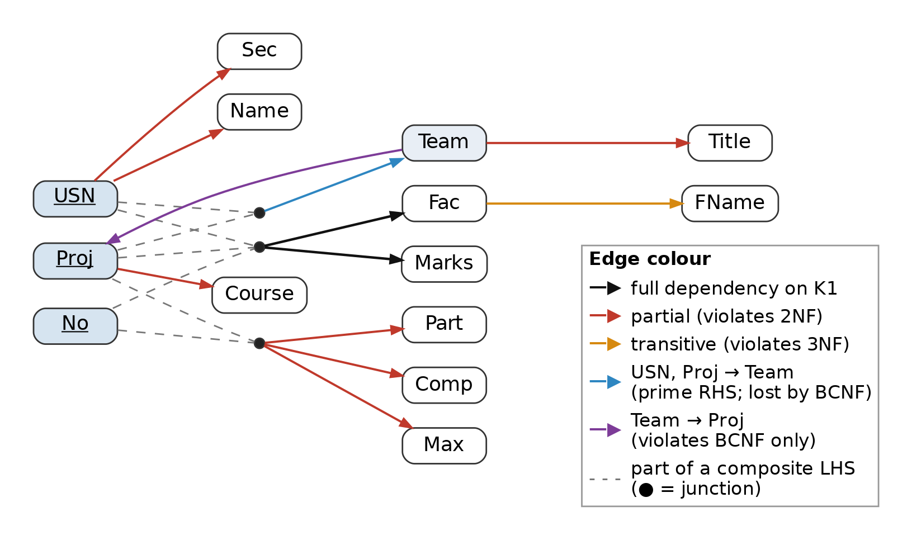
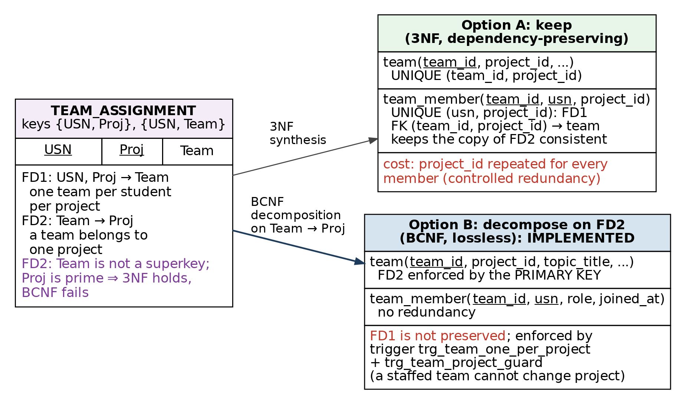
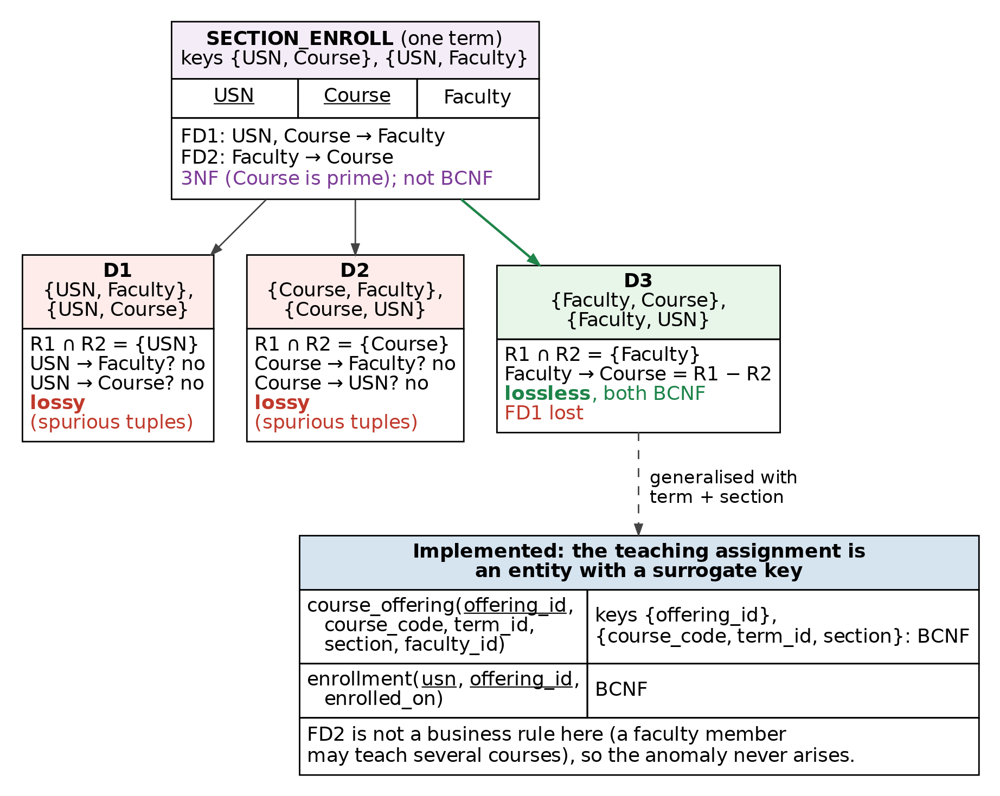

# 0. Scope, notation and definitions

This document is the Component 6 submission (Normalized tables, 10 marks). It has three parts:

* **Part A** takes the RVCE paper lab evaluation sheet (Appendix F of the project master file) as the unnormalized relation. It normalizes the sheet step by step through UNF, 1NF, 2NF, 3NF and BCNF. It gives the functional-dependency (FD) set, attribute closures, candidate keys, the minimal-cover computation, the 3NF synthesis, the BCNF check, a chase-tableau proof of the lossless (nonadditive) join property and a dependency-preservation analysis. It then shows that the result is the set of tables actually implemented in the migrations, and that the totals (120 to 30, and /50) are derived by the view `v_lab_cie_marks` instead of being stored.
* **Part B** checks the normal form of **every** implemented base table (27 tables: 26 in `public`, plus `private.note`). It names each deliberate denormalization and justifies it.
* **Part C** works through a relation that is in 3NF but not in BCNF. The real instance in this schema is team assignment. A textbook version from the enrollment/offering part of the domain follows it.

**Sources (the real schema).** The tables, constraints and triggers are those in `supabase/fixture/01_schema.sql`, `supabase/migrations/20261104000001_core_schema.sql` to `20261104000004_rpc.sql`, and `supabase/seed/demo.sql`. Every instance shown is taken from the fixture seed (`02_seed.sql` in `supabase/fixture/`) or from the demo seed, unless it is marked *illustrative*.

**Status of the sample data.** Two kinds of sample value appear in this document, and neither is a real record:

* **All marks are illustrative.** The demo seed states this in its header (`supabase/seed/demo.sql`, line 5: "Illustrative: ... all marks (sample values, not real grades)"). The values 5.0, 4.5, 19.0, 18.0 and so on, and the totals computed from them, only demonstrate the schema. Every table in this document that shows marks is labelled *illustrative*.
* **Faculty F01, "Dr. Ramesh Babu", is fixture data.** It is a fictional faculty row from the frozen fixture (`02_seed.sql`, table `faculty`), not a member of the RVCE staff. Wherever F01 appears as the signing faculty, the signature is illustrative.

**Terminology** follows Elmasri and Navathe, *Fundamentals of Database Systems*, **7th edition**, Chapters 14 ("Basics of Functional Dependencies and Normalization") and 15 ("Relational Database Design Algorithms and Further Dependencies"). In the 6th edition the same material is in Chapters 15 and 16.

| Term | Definition used here |
|---|---|
| Functional dependency $X \to Y$ | For any two tuples $t_1, t_2$ of every legal state of $R$: $t_1[X] = t_2[X] \Rightarrow t_1[Y] = t_2[Y]$. |
| Closure $X^+$ | The set of all attributes functionally determined by $X$ under $F$. It is computed by the closure algorithm: start with $X$, then repeatedly add $Z$ whenever $Y \to Z \in F$ and $Y \subseteq X^+$. |
| Superkey / candidate key | $K$ is a superkey if $K^+ = R$. A candidate key is a minimal superkey. |
| Prime attribute | An attribute that is a member of some candidate key. |
| 1NF | Every attribute domain is atomic. There are no repeating groups and no composite or multivalued values. |
| 2NF (general definition) | Every nonprime attribute is *fully* functionally dependent on **every** candidate key. |
| 3NF (general definition) | For every nontrivial $X \to A$, either $X$ is a superkey or $A$ is prime. |
| BCNF | For every nontrivial $X \to A$, $X$ is a superkey. |
| Minimal cover | A cover with (1) a single attribute on every right-hand side, (2) no extraneous left-hand-side attribute, and (3) no redundant FD. |
| Nonadditive (lossless) join | $\pi_{R_1}(r) \bowtie \dots \bowtie \pi_{R_m}(r) = r$ for every legal state $r$. |
| Dependency preservation | $(\pi_{R_1}(F) \cup \dots \cup \pi_{R_m}(F))^+ = F^+$. |

**Conventions.**

1. A *derived* column is one whose value the DBMS computes from other data: a `GENERATED` column or a trigger-maintained column. A column $D$ derived as $f(X)$ induces $X \to D$. In Part B, each table's normal form is reported twice: on all stored columns, and with the DBMS-derived columns excluded. A value that the **application** computes and the database does not enforce (for example a hash or an embedding written by client code) is *not* a derived column in this sense. An FD must hold in every *legal* relation state. When Part B checks an implemented table, its legal states are those that the table's declared constraints and triggers admit. If the database accepts a row in which the cached value disagrees with its source, the dependency is an intended property of the application, not a constraint of the schema, so it is left out of the FD set (see B.2.7).
2. FD theory assumes no NULLs. For nullable columns, an FD or key is read over the tuples where the left-hand side is non-NULL. These are the semantics of SQL `UNIQUE` and `FOREIGN KEY ... MATCH SIMPLE`. The universal relation of Part A (SHEET_1NF) is defined so that it contains no NULLs at all (A.4); the chase and the NJB test in A.12 therefore apply to it without qualification.
3. Symbols such as $\to$, $\cup$ and $\bowtie$ are typeset as mathematics so that they render the same way in Markdown, DOCX and PDF.

# Part A - Normalizing the RVCE lab evaluation sheet

## A.1 The paper sheet

The lab evaluation sheet is a single page per student. It carries the following fields (Appendix F of the project master file).

* **Header (once per sheet):** Student Name, USN, Section, Mini Project Title. The page heading carries the course (DBMS, CD252IA).
* **Repeating group (one line per submission):** Sl. No., Submission (with its maximum marks printed beside it, e.g. "Synopsis (5)"), Marks, Signature of Lab Faculty.
* **Submissions:** Synopsis (5), Requirement Specification (5), ER Diagram (10), Test (20), DFD Level 0/1/2 (10), Normalized tables up to 3NF (10), Midterm Report (20), Design of Forms, Security and Validation (10), Demo and Draft Report (30). Then a line "Total 120 reduced to 30", then Innovative Experiment (10), CIE Project Demo and Final Report Submission (10), and finally "Lab CIE Marks (30+10+10)".

## A.2 The universe of attributes

Before any dependency analysis, every fact on the sheet must be named as an attribute. Three facts are **implicit** on paper and must be made explicit:

1. **Proj (the lab).** The sheet is for one lab project of one course. Here this is the CD252IA lab 2026-27, row `P06` of `project`. We normalize the set of *all* sheets of *all* EL labs, because the platform serves every course. Proj therefore varies and cannot be treated as a constant.
2. **Team.** Both teammates' sheets carry the same Mini Project Title. The title is therefore a property of the team, not of the student, and the team is a hidden determinant.
3. **Fac.** The "Signature of Lab Faculty" identifies the faculty member who awarded the mark. The signature is a composite value on paper: it stands for *who* signed, and through that person, their name. The database replaces the handwritten signature with the faculty identifier `assessed_by`. For a **faculty** insert, the RLS policy `assessment_insert` (migration 0003) requires `app.teaches_project(project_id) AND assessed_by = app.current_faculty_id()`, so a faculty member can sign only in their own name. An **admin** is exempt: the policy's first disjunct, `app.is_admin()`, admits an admin insert with any `assessed_by`, for example when entering marks transcribed from a paper sheet.

In the table below, the last three attributes (Total120, Reduced30 and LabCIE50) are derived values; they are not part of the FD universe.

| Attribute | Meaning | On the paper sheet | Implemented column |
|---|---|---|---|
| USN | University seat number | header | `student.usn` |
| Name | student name | header | `student.name` |
| Sec | student section | header | `student.section` |
| Proj | lab project of the course | page heading (course) | `project.project_id` |
| Course | course code | page heading | `project.course_code` |
| Team | project team (implicit) | implied by shared title | `team.team_id` |
| Title | Mini Project Title | header | `team.topic_title` |
| No | Sl. No. = component number | repeating group | `milestone.milestone_no` |
| Comp | component title | repeating group (left part of "Submission (max)") | `milestone.title` |
| Max | maximum marks | repeating group (the "(5)" in "Synopsis (5)") | `milestone.max_marks` |
| Part | which part of the CIE the line feeds: reduced (lines 1-9), innovative (10), final (11) | layout of the sheet | `milestone.cie_part` |
| Marks | marks awarded | repeating group | `assessment.marks` |
| Fac | faculty who signed | repeating group (signature) | `assessment.assessed_by` |
| FName | that faculty member's name | identified by the signature | `faculty.name` |
| Total120, Reduced30, LabCIE50 | totals | summary lines | **not stored**: view `v_lab_cie_marks` |

## A.3 Unnormalized form (UNF)

Each paper sheet is one tuple. Its repeating group is a set-valued attribute, and its "Submission" entry is a composite value (title and maximum marks together):

$$\begin{aligned}\text{MARKS\_SHEET}(&\text{USN}, \text{Name}, \text{Sec}, \text{Proj}, \text{Course}, \text{Title},\\ &\{\text{No}, \text{Submission(Max)}, \text{Marks}, \text{Signature}\},\\ &\text{Total120}, \text{Reduced30}, \text{LabCIE50})\end{aligned}$$

The UNF instance below shows two sheets of project P06, built from the fixture and the demo seed: S Arun Sanjay (solo team T00) and Karthik M (team T06). The braces hold the repeating group. A dash marks a blank cell, i.e. a component that has not yet been assessed.

**Illustrative instance.** The marks are the demo seed's sample values, not real grades, and the signing faculty F01 is a fictional fixture row (Section 0).

| USN | Name | Sec | Proj | Course | Title | {No, Submission(Max), Marks, Signature} | Total 120 to 30 | Lab CIE /50 |
|-----------|--------|---|----|-------|----------|------------------------------|--------|-----|
| 1RV24CY047 | S Arun Sanjay | A | P06 | CD252IA | Countersign: every mark has a receipt | {(1, Synopsis (5), 5.0, F01), (2, Requirement Specification (5), -, -), (3, ER Diagram (10), -, -), (4, Test (20), 19.0, F01), (5, DFD (10), -, -), ..., (11, Final Demo and Report (10), -, -)} | 24.0 to 6.0 | 6.0 |
| 1RV24CY024 | Karthik M | A | P06 | CD252IA | Lab inventory tracker | {(1, Synopsis (5), 4.5, F01), ..., (4, Test (20), 17.0, F01), ...} | 21.5 to 5.4 | 5.4 |

**Why this is not 1NF:**

* The repeating group is a relation nested inside a tuple.
* "Synopsis (5)" packs two facts (title and maximum marks) into one non-atomic value.
* "Signature" is also composite: it identifies the faculty member and, through them, their name.
* The summary lines are not submissions at all. They are computed from the other lines.

## A.4 First normal form (1NF)

The UNF relation is converted to 1NF in three steps:

1. **Flatten the repeating group.** Each *filled-in* sheet line becomes its own tuple: one tuple per (student, lab, assessed component). The header attributes are copied into every tuple. A blank line (a component not yet assessed) is the **absence of a fact**, not a fact with unknown values, so it produces no tuple. SHEET_1NF therefore contains no NULLs. The blank cells of the paper sheet are rebuilt for display by an outer join, exactly as the view `v_rubric_sheet` does (`milestone LEFT JOIN assessment`, A.14).
2. **Split the composite values and make the implicit attributes explicit.** Every attribute of SHEET_1NF is traced back to the UNF relation as follows:
    * "Submission (Max)" becomes the two atomic attributes **Comp** and **Max**.
    * **Part** is recorded from the position of the line on the sheet (lines 1 to 9 feed the reduced total; line 10 is the innovative experiment; line 11 is the final demo).
    * The composite **Signature** is replaced by **Fac**, the identifier of the faculty member who signed. **FName**, the signer's name, follows from Fac (it is the part of the signature that names the person).
    * The implicit attribute **Team** is added. It is not printed on the sheet, but it is the determinant of the shared Mini Project Title (A.2, item 2).
    * USN, Name, Sec, Proj, Course, Title, No and Marks are carried over unchanged.
3. **Remove the derived summary lines.** Total120, Reduced30 and LabCIE50 are functions of *sets* of tuples (sums over a student's lines), not attributes of one line. Storing them would also violate 2NF: (USN, Proj) $\to$ Total is a partial dependency. Section A.15 restores them as a view.

The resulting 1NF relation is:

$$\begin{aligned}\text{SHEET\_1NF}(&\underline{\text{USN}}, \underline{\text{Proj}}, \underline{\text{No}}, \text{Name}, \text{Sec}, \text{Course}, \text{Team},\\ &\text{Title}, \text{Comp}, \text{Max}, \text{Part}, \text{Marks}, \text{Fac}, \text{FName})\end{aligned}$$

Its primary key is (USN, Proj, No); Section A.6 proves this. One tuple is one **assessed** sheet line. Its instance (excerpt; **illustrative marks**, F01 is a fixture faculty row):

```{=latex}
\smalltablestrue
```

| USN | Proj | No | Name | Sec | Course | Team | Title | Comp | Max | Part | Marks | Fac | FName |
|-----------|----|---|--------|---|-------|----|-------------|---------|---|-------|-----|----|----------|
| 1RV24CY047 | P06 | 1 | S Arun Sanjay | A | CD252IA | T00 | Countersign: ... | Synopsis | 5 | reduced | 5.0 | F01 | Dr. Ramesh Babu |
| 1RV24CY047 | P06 | 4 | S Arun Sanjay | A | CD252IA | T00 | Countersign: ... | Test | 20 | reduced | 19.0 | F01 | Dr. Ramesh Babu |
| 1RV24CY024 | P06 | 1 | Karthik M | A | CD252IA | T06 | Lab inventory ... | Synopsis | 5 | reduced | 4.5 | F01 | Dr. Ramesh Babu |
| 1RV24CY024 | P06 | 4 | Karthik M | A | CD252IA | T06 | Lab inventory ... | Test | 20 | reduced | 17.0 | F01 | Dr. Ramesh Babu |

```{=latex}
\smalltablesfalse
```

Component 6 (Normalized Tables) has not been assessed for either student, so it has no tuple.

**Anomalies in SHEET_1NF** (these are what motivate the further steps):

| Anomaly | Example |
|--------|------------------------------|
| Update | Correcting Karthik's section means updating one tuple per assessed line (up to 11). Renaming a team's title means updating every assessed line of every member: up to 11 tuples for the solo team T00, and up to 33 for team T06 (3 students $\times$ 11 components). Renaming component 6 means updating one tuple per student assessed on it. |
| Insertion | A component (e.g. C10, Innovative Experiment, max 10, deadline 12 Dec) cannot be recorded until some student has been assessed on it, so the definition of the rubric depends on marks existing. Likewise, a student, a team or a faculty member cannot be recorded until a mark involving them exists. |
| Deletion | Deleting the only assessed tuple of a component also deletes the fact that the component exists and what it is worth. Deleting a student's last assessed line forgets the student's name and section. |

## A.5 The functional-dependency set $F$

The FDs below come from the meaning of the sheet and of the course rules. The set is written exactly as it was elicited, so it deliberately contains redundant and over-specified dependencies (F5, F9, F10); Section A.7 removes them.

| # | FD | Justification (business rule) | How the implementation enforces it |
|---|---|---|---|
| F1 | USN $\to$ Name, Sec | A USN identifies exactly one student. | `student` PRIMARY KEY (usn) |
| F2 | Proj $\to$ Course | A lab project belongs to one course. | `project` PRIMARY KEY; `course_code NOT NULL` |
| F3 | Team $\to$ Proj, Title | A team is formed for one project and chooses one mini-project title. | `team` PRIMARY KEY (team_id) |
| F4 | USN, Proj $\to$ Team | A student is in at most one team per project. | trigger `trg_team_one_per_project` |
| F5 | USN, Team $\to$ Title | "A student's title is their team's title" (as first written; over-specified) | follows from F3 |
| F6 | Proj, No $\to$ Comp, Max, Part | Component number $n$ of a lab has one title, one maximum and one CIE part. | `milestone` PRIMARY KEY (project_id, milestone_no) |
| F7 | USN, Proj, No $\to$ Marks, Fac | One mark per student per component, signed by one faculty member. | `assessment` PRIMARY KEY (usn, project_id, milestone_no) |
| F8 | Fac $\to$ FName | A signature identifies one faculty member. | `faculty` PRIMARY KEY (faculty_id) |
| F9 | USN, Team, No $\to$ Marks | The same rule as F7, stated through the team (redundant) | follows from F3 and F7 |
| F10 | USN, Proj, No $\to$ Max | "A student's line shows the maximum" (over-specified) | follows from F6 |

The following are **not** FDs, and are deliberately left out:

* No $\to$ Comp does not hold, because component 3 of the AIML lab is not component 3 of the DBMS lab. This is why Proj is part of the universe.
* Course $\to$ Proj does not hold, because a course has several projects: the fixture has P01 and P05 under CD252IA.
* Team, No $\to$ Marks does not hold, because marks are awarded per student, not per team (component grain, as on the paper sheet).
* Comp $\to$ No does not hold, because component titles are not declared unique within a lab.

## A.6 Attribute closures and candidate keys

The closures below use $F$ and the closure algorithm. The first one is shown iteration by iteration:

$\{\text{USN}, \text{Proj}, \text{No}\}^+$:

| Iteration | FD applied | Attributes added | Result so far |
|---|---|---|---|
| 0 | - | - | USN, Proj, No |
| 1 | F1 USN $\to$ Name, Sec | Name, Sec | USN, Proj, No, Name, Sec |
| 2 | F2 Proj $\to$ Course | Course | ... , Course |
| 3 | F4 USN, Proj $\to$ Team | Team | ... , Team |
| 4 | F3 Team $\to$ Proj, Title | Title | ... , Title |
| 5 | F6 Proj, No $\to$ Comp, Max, Part | Comp, Max, Part | ... , Comp, Max, Part |
| 6 | F7 USN, Proj, No $\to$ Marks, Fac | Marks, Fac | ... , Marks, Fac |
| 7 | F8 Fac $\to$ FName | FName | **all 14 attributes** |

Closures of the other relevant sets:

| $X$ | $X^+$ | Superkey of SHEET_1NF? |
|---|---|---|
| {USN} | {USN, Name, Sec} | no |
| {Proj} | {Proj, Course} | no |
| {Team} | {Team, Proj, Title, Course} | no |
| {Fac} | {Fac, FName} | no |
| {USN, No} | {USN, No, Name, Sec} | no |
| {Proj, No} | {Proj, No, Course, Comp, Max, Part} | no |
| {Team, No} | {Team, No, Proj, Title, Course, Comp, Max, Part} | no |
| {USN, Proj} | {USN, Proj, Name, Sec, Course, Team, Title} | no |
| {USN, Team} | {USN, Team, Proj, Name, Sec, Course, Title} | no |
| {USN, No, Fac} | {USN, No, Fac, FName, Name, Sec} | no |
| {USN, Proj, No} | all 14 | **yes (candidate key)** |
| {USN, Team, No} | all 14 (Team $\to$ Proj, then as above) | **yes (candidate key)** |

**Finding all candidate keys.** Classify every attribute by where it appears in $F$:

* **USN and No** appear on no right-hand side. They must be in every key.
* **Name, Sec, Course, Title, Comp, Max, Part, Marks and FName** appear only on right-hand sides. They are in no key.
* **Proj, Team and Fac** appear on both sides.

{USN, No}$^+$ is not the whole relation, so at least one of Proj, Team or Fac must be added:

* Adding Proj gives a superkey. Adding Team gives a superkey.
* Adding Fac does not give a superkey. Any further attribute that would make it one is Proj or Team, so a key containing Fac is never minimal.
* Each of the two superkeys is minimal. Removing any one attribute leaves a set whose closure is in the table above and is not the whole relation:
    * from $K_1$ = {USN, Proj, No}: {Proj, No}, {USN, No} and {USN, Proj};
    * from $K_2$ = {USN, Team, No}: {Team, No}, {USN, No} and {USN, Team}.

The candidate keys of SHEET_1NF are therefore **exactly**:

$$K_1 = \{\text{USN}, \text{Proj}, \text{No}\} \quad\text{(chosen as primary key)}, \qquad K_2 = \{\text{USN}, \text{Team}, \text{No}\}$$

* **Prime attributes:** USN, Proj, Team, No.
* **Nonprime attributes:** Name, Sec, Course, Title, Comp, Max, Part, Marks, Fac, FName.

## A.7 Minimal cover of $F$

The computation follows the three steps of the minimal-cover algorithm.

**Step 1: make every right-hand side a single attribute.** Splitting the right-hand sides turns the 10 FDs of $F$ into 15:

* F1: USN $\to$ Name; USN $\to$ Sec
* F2: Proj $\to$ Course
* F3: Team $\to$ Proj; Team $\to$ Title
* F4: USN, Proj $\to$ Team
* F5: USN, Team $\to$ Title
* F6: Proj, No $\to$ Comp; Proj, No $\to$ Max; Proj, No $\to$ Part
* F7: USN, Proj, No $\to$ Marks; USN, Proj, No $\to$ Fac
* F8: Fac $\to$ FName
* F9: USN, Team, No $\to$ Marks
* F10: USN, Proj, No $\to$ Max

**Step 2: remove extraneous left-hand-side attributes.** For an FD $X \to A$, an attribute $B \in X$ is extraneous if $A \in (X - \{B\})^+$.

| FD | Test | Result |
|---|---|---|
| USN, Proj $\to$ Team | {USN}$^+$ and {Proj}$^+$ do not contain Team | no extraneous attribute; kept |
| USN, Team $\to$ Title | {Team}$^+ \ni$ Title | USN is extraneous; becomes Team $\to$ Title, a duplicate, so it is dropped |
| Proj, No $\to$ Comp / Max / Part | {Proj}$^+$ and {No}$^+$ contain none of them | kept |
| USN, Proj, No $\to$ Marks / Fac | {Proj, No}$^+$, {USN, No}$^+$ and {USN, Proj}$^+$ contain neither | kept |
| USN, Team, No $\to$ Marks | {Team, No}$^+$, {USN, No}$^+$ and {USN, Team}$^+$ do not contain Marks | no extraneous attribute; kept for now |
| USN, Proj, No $\to$ Max | {Proj, No}$^+ \ni$ Max | USN is extraneous; becomes Proj, No $\to$ Max, a duplicate, so it is dropped |

Thirteen FDs remain.

**Step 3: remove redundant FDs.** An FD $X \to A$ is redundant if $A \in X^+$ computed under the *other* FDs.

* USN, Team, No $\to$ Marks: without it, {USN, Team, No}$^+$ gains Proj (from Team $\to$ Proj) and then Marks (from USN, Proj, No $\to$ Marks). It is **redundant** and is removed.
* Every other FD is necessary. For example:
    * Without Team $\to$ Proj, {Team}$^+$ = {Team, Title}.
    * Without USN, Proj $\to$ Team, {USN, Proj}$^+$ = {USN, Proj, Name, Sec, Course}.
    * Without Fac $\to$ FName, {Fac}$^+$ = {Fac}.

*Remark (minimal covers are not unique).* Step 3 depends on the order in which FDs are tested. If USN, Proj, No $\to$ Marks were tested first, it would be found redundant through USN, Proj $\to$ Team and USN, Team, No $\to$ Marks, and the cover would keep the latter instead. Both results are minimal covers equivalent to $F$. We keep the one aligned with the chosen primary key $K_1$.

**Minimal cover $G$ (12 FDs):**

| # | FD | | # | FD |
|---|---|---|---|---|
| g1 | USN $\to$ Name | | g7 | Proj, No $\to$ Comp |
| g2 | USN $\to$ Sec | | g8 | Proj, No $\to$ Max |
| g3 | Proj $\to$ Course | | g9 | Proj, No $\to$ Part |
| g4 | Team $\to$ Proj | | g10 | USN, Proj, No $\to$ Marks |
| g5 | Team $\to$ Title | | g11 | USN, Proj, No $\to$ Fac |
| g6 | USN, Proj $\to$ Team | | g12 | Fac $\to$ FName |

$G \equiv F$: every FD of $G$ is in $F^+$ (each one is either in $F$ or obtained from it by decomposition or by removing an extraneous attribute), and every FD of $F$ is in $G^+$ (F5, F9 and F10 were shown above to be derivable). Figure 1 draws $G$, with each edge coloured by the normal form it violates in SHEET_1NF.

{width=95%}

## A.8 Second normal form (2NF)

Under the general definition, each nonprime attribute is tested against **both** candidate keys:

| Nonprime attribute(s) | Determined by | Proper subset of a key? | 2NF violation? |
|---|---|---|---|
| Name, Sec | USN | yes ($\subset K_1, K_2$) | **yes**: partial |
| Course | Proj (and Team, through Proj) | yes ($\subset K_1$; Team $\subset K_2$) | **yes**: partial |
| Comp, Max, Part | Proj, No | yes ($\subset K_1$) | **yes**: partial |
| Title | Team | yes ($\subset K_2$) | **yes**: partial |
| Marks, Fac | USN, Proj, No (and USN, Team, No) | no: fully dependent on both $K_1$ and $K_2$ | no |
| FName | Fac (through the whole key) | not partial | no (this is transitive; see 3NF) |

Decomposing on each partial dependency (determinant together with its dependents) splits off STUDENT, PROJECT, COMPONENT and TEAM(Team, Title). The remainder

$$\text{MARK}'(\underline{\text{USN}}, \underline{\text{Proj}}, \underline{\text{No}}, \text{Team}, \text{Marks}, \text{Fac}, \text{FName})$$

is **already in 2NF**. Its candidate keys are still $K_1$ and $K_2$ (Team $\to$ Proj still holds in it), its nonprime attributes are Marks, Fac and FName, and none of them depends on a proper subset of either key.

**One further split is made at this step although 2NF does not require it.** MEMBERSHIP(USN, Proj, Team) is separated from MARK$'$ on USN, Proj $\to$ Team. Team is prime, so this FD is not a 2NF (or even a 3NF) violation in MARK$'$. What it does violate is **BCNF**: in MARK$'$ both USN, Proj $\to$ Team and Team $\to$ Proj have a left-hand side that is not a superkey. The split therefore anticipates the BCNF step. It is made here for two reasons only: it is nonadditive (NJB with $\{\text{USN}, \text{Proj}\} \to \text{Team}$, A.12.2, step 5) and preserves every FD, and it makes the 3NF schema of A.9 coincide with the output of the synthesis algorithm (relation $R_4$ in A.10). Had it been deferred, the 3NF schema would contain ASSESSMENT$'$(USN, Proj, No, Team, Marks, Fac), which is also in 3NF, and the split would occur in A.11.

The **2NF relations** (with the early split) are:

| Relation | Attributes (key underlined) | Status |
|---|---|---|
| STUDENT | ($\underline{\text{USN}}$, Name, Sec) | BCNF |
| PROJECT | ($\underline{\text{Proj}}$, Course) | BCNF |
| COMPONENT | ($\underline{\text{Proj}}$, $\underline{\text{No}}$, Comp, Max, Part) | BCNF |
| TEAM | ($\underline{\text{Team}}$, Title) | BCNF |
| MEMBERSHIP | ($\underline{\text{USN}}$, $\underline{\text{Proj}}$, Team); second key (USN, Team) | 3NF; not BCNF (A.11) |
| MARK | ($\underline{\text{USN}}$, $\underline{\text{Proj}}$, $\underline{\text{No}}$, Marks, Fac, FName) | 2NF; not 3NF |

MEMBERSHIP and TEAM(Team, Title) cannot be merged: in (USN, Proj, Team, Title), Team $\to$ Title would be a partial dependency on the key {USN, Team}. Figure 2a draws this step; MEMBERSHIP is shown in purple (3NF, not BCNF) at every level at which it appears.

{width=100%}

## A.9 Third normal form (3NF)

Only MARK has a nonprime attribute that depends on a non-superkey: Fac $\to$ FName, where Fac is not a superkey of MARK and FName is nonprime. This is the transitive dependency

$$\text{USN}, \text{Proj}, \text{No} \to \text{Fac} \to \text{FName}.$$

Decomposing MARK on Fac $\to$ FName gives:

* ASSESSMENT($\underline{\text{USN}}$, $\underline{\text{Proj}}$, $\underline{\text{No}}$, Marks, Fac)
* FACULTY($\underline{\text{Fac}}$, FName)

**3NF schema (stepwise route):** STUDENT, PROJECT, COMPONENT, TEAM(Team, Title), MEMBERSHIP(USN, Proj, Team), ASSESSMENT and FACULTY.

MEMBERSHIP is in 3NF:

* USN, Proj $\to$ Team has a superkey on its left-hand side.
* Team $\to$ Proj has a non-superkey left-hand side, but Proj is **prime** (it belongs to the key {USN, Proj}). Condition (b) of the 3NF definition is satisfied.

## A.10 Confirmation by the 3NF synthesis algorithm

The relational synthesis algorithm (Elmasri and Navathe, Chapter 15) is applied to the minimal cover $G$:

1. Group the FDs of $G$ by left-hand side. Each group becomes one relation:

    | Left-hand side | Relation | Attributes |
    |---|---|---|
    | {USN} | $R_1$ | (USN, Name, Sec) |
    | {Proj} | $R_2$ | (Proj, Course) |
    | {Team} | $R_3$ | (Team, Proj, Title) |
    | {USN, Proj} | $R_4$ | (USN, Proj, Team) |
    | {Proj, No} | $R_5$ | (Proj, No, Comp, Max, Part) |
    | {USN, Proj, No} | $R_6$ | (USN, Proj, No, Marks, Fac) |
    | {Fac} | $R_7$ | (Fac, FName) |

2. Check whether some relation contains a candidate key of the universal relation. $K_1$ = (USN, Proj, No) $\subseteq R_6$, so no extra key relation is needed.
3. Remove any relation whose attributes are a subset of another's. There is none.

By the correctness of the algorithm, $\{R_1,\dots,R_7\}$ is in 3NF, preserves all dependencies and has a nonadditive join.

The only difference from the stepwise route is that synthesis puts Team $\to$ Proj into $R_3$ as well, giving TEAM(Team, Proj, Title). This is the form the implementation uses.

## A.11 BCNF check

Each FD of $G$ is projected onto each relation, and its left-hand side is checked for being a superkey:

| Relation | Projected FDs (non-trivial) | Candidate keys | BCNF? |
|---|---|---|---|
| $R_1$ STUDENT | USN $\to$ Name, Sec | {USN} | yes |
| $R_2$ PROJECT | Proj $\to$ Course | {Proj} | yes |
| $R_3$ TEAM | Team $\to$ Proj, Title | {Team} | yes |
| $R_4$ MEMBERSHIP | USN, Proj $\to$ Team; **Team $\to$ Proj** | {USN, Proj}, {USN, Team} | **no**: Team is not a superkey |
| $R_5$ COMPONENT | Proj, No $\to$ Comp, Max, Part | {Proj, No} | yes |
| $R_6$ ASSESSMENT | USN, Proj, No $\to$ Marks, Fac | {USN, Proj, No} | yes |
| $R_7$ FACULTY | Fac $\to$ FName | {Fac} | yes |

**BCNF decomposition of $R_4$ on Team $\to$ Proj:**

* $R_4$ splits into $R_{4a}$(Team, Proj) and $R_{4b}$(USN, Team).
* $R_{4a} \subseteq R_3$ and has the same key, so it is absorbed into TEAM.
* $R_{4b}$ = TEAM_MEMBER($\underline{\text{USN}}$, $\underline{\text{Team}}$) is all-key, and therefore in BCNF.

**Final BCNF schema** (Figure 2b, right-hand column):

* STUDENT($\underline{\text{USN}}$, Name, Sec)
* PROJECT($\underline{\text{Proj}}$, Course)
* TEAM($\underline{\text{Team}}$, Proj, Title)
* TEAM_MEMBER($\underline{\text{USN}}$, $\underline{\text{Team}}$)
* MILESTONE($\underline{\text{Proj}}$, $\underline{\text{No}}$, Comp, Max, Part)
* ASSESSMENT($\underline{\text{USN}}$, $\underline{\text{Proj}}$, $\underline{\text{No}}$, Marks, Fac)
* FACULTY($\underline{\text{Fac}}$, FName)

The price of this decomposition is that **USN, Proj $\to$ Team is no longer preserved** (Section A.13). Part C discusses this 3NF-versus-BCNF trade-off in full.

{width=100%}

### A.11.1 Instances of the normalized relations

The instances below show the BCNF relations (equivalently, the implemented tables, restricted to the sheet's columns) for the two students of project P06 shown in A.4 (S Arun Sanjay of the solo team T00, and Karthik M of team T06). They hold exactly the information of the four SHEET_1NF tuples in A.4, and each fact is now stored **once**. Rows from the fixture and the demo seed; **marks illustrative**; F01 is a fictional fixture faculty row.

**STUDENT** (`student`): each name and section is stored once, not once per assessed line.

| USN | Name | Sec |
|---|---|---|
| 1RV24CY047 | S Arun Sanjay | A |
| 1RV24CY024 | Karthik M | A |

**PROJECT** (`project`):

| Proj | Course |
|---|---|
| P06 | CD252IA |

**TEAM** (`team`): the mini-project title is stored once for the team, not once per member per line.

| Team | Proj | Title |
|---|---|---|
| T00 | P06 | Countersign: every mark has a receipt |
| T06 | P06 | Lab inventory tracker |

**TEAM_MEMBER** (`team_member`): only the membership pairs; the project is reached through TEAM. (Both students are also in fixture teams of other projects, and T06 has two more members, 1RV24CY011 and 1RV24CY033; those rows are omitted.)

| Team | USN |
|---|---|
| T00 | 1RV24CY047 |
| T06 | 1RV24CY024 |

**MILESTONE** (`milestone`): the whole rubric of the lab, recorded before any mark exists. This removes the insertion and deletion anomalies of A.4: component 6 is defined even though no one has been assessed on it.

| Proj | No | Comp | Max | Part |
|---|---|---|---|---|
| P06 | 1 | Synopsis | 5 | reduced |
| P06 | 2 | Requirement Specification | 5 | reduced |
| P06 | 3 | ER Diagram | 10 | reduced |
| P06 | 4 | Test | 20 | reduced |
| P06 | 5 | DFD | 10 | reduced |
| P06 | 6 | Normalized Tables | 10 | reduced |
| P06 | 7 | Midterm Report | 20 | reduced |
| P06 | 8 | Forms Security Validation | 10 | reduced |
| P06 | 9 | Demo and Draft Report | 30 | reduced |
| P06 | 10 | Innovative Experiment | 10 | innovative |
| P06 | 11 | Final Demo and Report | 10 | final |

**ASSESSMENT** (`assessment`, **illustrative marks**): one row per assessed line, carrying only the mark and the signer.

| USN | Proj | No | Marks | Fac |
|---|---|---|---|---|
| 1RV24CY047 | P06 | 1 | 5.0 | F01 |
| 1RV24CY047 | P06 | 4 | 19.0 | F01 |
| 1RV24CY024 | P06 | 1 | 4.5 | F01 |
| 1RV24CY024 | P06 | 4 | 17.0 | F01 |

**FACULTY** (`faculty`, fixture row): the signer's name is stored once, not once per signature.

| Fac | FName |
|---|---|
| F01 | Dr. Ramesh Babu |

Compared with SHEET_1NF, where the four lines above repeated the name, section, course, team, title and faculty name in every tuple, the redundancy is gone: correcting Karthik's section, a team's title or a component's maximum is now a one-row update.

## A.12 Proof of the nonadditive (lossless) join property

### A.12.1 Chase tableau for the final BCNF decomposition

**Assumptions.** The chase and the binary test (NJB) are stated for relations without NULLs (Elmasri and Navathe, 7th ed., Chapter 15, section "About Nulls, Dangling Tuples, and Alternative Relational Designs"). SHEET_1NF satisfies this by construction: it holds assessed lines only (A.4, step 1), and the columns that carry its attributes in `assessment` (`marks`, `assessed_by`) and in the other six tables are NOT NULL. The theorem proved here is therefore: *for every legal state of SHEET_1NF, the natural join of its seven projections equals that state.*

The converse direction does not hold, and need not. The decomposed schema can also store facts that SHEET_1NF cannot hold, such as a component nobody has been assessed on, or a student with no mark yet. Such rows are **dangling tuples**: they have no partner in ASSESSMENT, and they drop out of the natural join. This is the intended gain of the decomposition (it removes the insertion and deletion anomalies of A.4), not a loss of information.

The test builds a matrix with one row per relation $R_i$ and one column per attribute $A_j$:

* Cell $(i, j)$ is $a_j$ if $A_j \in R_i$, and $b_{i,j}$ otherwise.
* For each FD $X \to Y$, the rows that agree on $X$ are made to agree on $Y$. If any of them has an $a$, they all take the $a$.
* The decomposition is lossless **if and only if** some row becomes all $a$'s.

The columns are numbered as follows: 1 USN, 2 Name, 3 Sec, 4 Proj, 5 Course, 6 Team, 7 Title, 8 No, 9 Comp, 10 Max, 11 Part, 12 Marks, 13 Fac, 14 FName.

**Initial tableau:**

```{=latex}
\smalltablestrue
```

| Row ($R_i$) | 1 | 2 | 3 | 4 | 5 | 6 | 7 | 8 | 9 | 10 | 11 | 12 | 13 | 14 |
|------------------|-----|-----|-----|-----|-----|-----|-----|-----|-----|-----|-----|-----|-----|-----|
| 1 STUDENT | $a_1$ | $a_2$ | $a_3$ | $b_{1,4}$ | $b_{1,5}$ | $b_{1,6}$ | $b_{1,7}$ | $b_{1,8}$ | $b_{1,9}$ | $b_{1,10}$ | $b_{1,11}$ | $b_{1,12}$ | $b_{1,13}$ | $b_{1,14}$ |
| 2 PROJECT | $b_{2,1}$ | $b_{2,2}$ | $b_{2,3}$ | $a_4$ | $a_5$ | $b_{2,6}$ | $b_{2,7}$ | $b_{2,8}$ | $b_{2,9}$ | $b_{2,10}$ | $b_{2,11}$ | $b_{2,12}$ | $b_{2,13}$ | $b_{2,14}$ |
| 3 TEAM | $b_{3,1}$ | $b_{3,2}$ | $b_{3,3}$ | $a_4$ | $b_{3,5}$ | $a_6$ | $a_7$ | $b_{3,8}$ | $b_{3,9}$ | $b_{3,10}$ | $b_{3,11}$ | $b_{3,12}$ | $b_{3,13}$ | $b_{3,14}$ |
| 4 TEAM_MEMBER | $a_1$ | $b_{4,2}$ | $b_{4,3}$ | $b_{4,4}$ | $b_{4,5}$ | $a_6$ | $b_{4,7}$ | $b_{4,8}$ | $b_{4,9}$ | $b_{4,10}$ | $b_{4,11}$ | $b_{4,12}$ | $b_{4,13}$ | $b_{4,14}$ |
| 5 MILESTONE | $b_{5,1}$ | $b_{5,2}$ | $b_{5,3}$ | $a_4$ | $b_{5,5}$ | $b_{5,6}$ | $b_{5,7}$ | $a_8$ | $a_9$ | $a_{10}$ | $a_{11}$ | $b_{5,12}$ | $b_{5,13}$ | $b_{5,14}$ |
| 6 ASSESSMENT | $a_1$ | $b_{6,2}$ | $b_{6,3}$ | $a_4$ | $b_{6,5}$ | $b_{6,6}$ | $b_{6,7}$ | $a_8$ | $b_{6,9}$ | $b_{6,10}$ | $b_{6,11}$ | $a_{12}$ | $a_{13}$ | $b_{6,14}$ |
| 7 FACULTY | $b_{7,1}$ | $b_{7,2}$ | $b_{7,3}$ | $b_{7,4}$ | $b_{7,5}$ | $b_{7,6}$ | $b_{7,7}$ | $b_{7,8}$ | $b_{7,9}$ | $b_{7,10}$ | $b_{7,11}$ | $b_{7,12}$ | $a_{13}$ | $a_{14}$ |

```{=latex}
\smalltablesfalse
```

**Applying the FDs of $G$** (each step changes symbols only to an $a$; no $b$ is ever equated to another $b$):

| Step | FD | Rows that agree on the LHS | Change |
|---|---|---|---|
| 1 | USN $\to$ Name, Sec | 1, 4, 6 (all $a_1$) | rows 4 and 6: cols 2, 3 become $a_2, a_3$ (row 1 has them) |
| 2 | Team $\to$ Proj | 3, 4 (all $a_6$) | row 4: col 4 becomes $a_4$ |
| 3 | Proj $\to$ Course | 2, 3, 4, 5, 6 (all $a_4$) | rows 3, 4, 5 and 6: col 5 becomes $a_5$ |
| 4 | USN, Proj $\to$ Team | 4, 6 (both $a_1, a_4$) | row 6: col 6 becomes $a_6$ |
| 5 | Team $\to$ Title | 3, 4, 6 (all $a_6$) | rows 4 and 6: col 7 becomes $a_7$ |
| 6 | Proj, No $\to$ Comp, Max, Part | 5, 6 (both $a_4, a_8$) | row 6: cols 9, 10 and 11 become $a_9, a_{10}, a_{11}$ |
| 7 | Fac $\to$ FName | 6, 7 (both $a_{13}$) | row 6: col 14 becomes $a_{14}$ |

**Final tableau** (cells changed by the chase are in bold):

```{=latex}
\smalltablestrue
```

| Row ($R_i$) | 1 | 2 | 3 | 4 | 5 | 6 | 7 | 8 | 9 | 10 | 11 | 12 | 13 | 14 |
|------------------|-----|-----|-----|-----|-----|-----|-----|-----|-----|-----|-----|-----|-----|-----|
| 1 STUDENT | $a_1$ | $a_2$ | $a_3$ | $b_{1,4}$ | $b_{1,5}$ | $b_{1,6}$ | $b_{1,7}$ | $b_{1,8}$ | $b_{1,9}$ | $b_{1,10}$ | $b_{1,11}$ | $b_{1,12}$ | $b_{1,13}$ | $b_{1,14}$ |
| 2 PROJECT | $b_{2,1}$ | $b_{2,2}$ | $b_{2,3}$ | $a_4$ | $a_5$ | $b_{2,6}$ | $b_{2,7}$ | $b_{2,8}$ | $b_{2,9}$ | $b_{2,10}$ | $b_{2,11}$ | $b_{2,12}$ | $b_{2,13}$ | $b_{2,14}$ |
| 3 TEAM | $b_{3,1}$ | $b_{3,2}$ | $b_{3,3}$ | $a_4$ | $\mathbf{a_5}$ | $a_6$ | $a_7$ | $b_{3,8}$ | $b_{3,9}$ | $b_{3,10}$ | $b_{3,11}$ | $b_{3,12}$ | $b_{3,13}$ | $b_{3,14}$ |
| 4 TEAM_MEMBER | $a_1$ | $\mathbf{a_2}$ | $\mathbf{a_3}$ | $\mathbf{a_4}$ | $\mathbf{a_5}$ | $a_6$ | $\mathbf{a_7}$ | $b_{4,8}$ | $b_{4,9}$ | $b_{4,10}$ | $b_{4,11}$ | $b_{4,12}$ | $b_{4,13}$ | $b_{4,14}$ |
| 5 MILESTONE | $b_{5,1}$ | $b_{5,2}$ | $b_{5,3}$ | $a_4$ | $\mathbf{a_5}$ | $b_{5,6}$ | $b_{5,7}$ | $a_8$ | $a_9$ | $a_{10}$ | $a_{11}$ | $b_{5,12}$ | $b_{5,13}$ | $b_{5,14}$ |
| **6 ASSESSMENT** | $a_1$ | $\mathbf{a_2}$ | $\mathbf{a_3}$ | $a_4$ | $\mathbf{a_5}$ | $\mathbf{a_6}$ | $\mathbf{a_7}$ | $a_8$ | $\mathbf{a_9}$ | $\mathbf{a_{10}}$ | $\mathbf{a_{11}}$ | $a_{12}$ | $a_{13}$ | $\mathbf{a_{14}}$ |
| 7 FACULTY | $b_{7,1}$ | $b_{7,2}$ | $b_{7,3}$ | $b_{7,4}$ | $b_{7,5}$ | $b_{7,6}$ | $b_{7,7}$ | $b_{7,8}$ | $b_{7,9}$ | $b_{7,10}$ | $b_{7,11}$ | $b_{7,12}$ | $a_{13}$ | $a_{14}$ |

```{=latex}
\smalltablesfalse
```

Row 6 (ASSESSMENT) consists entirely of $a$'s. **Hence the decomposition is nonadditive (lossless):**
$$\begin{aligned}\text{SHEET\_1NF} = {}&\text{STUDENT} \bowtie \text{PROJECT} \bowtie \text{TEAM} \bowtie \text{TEAM\_MEMBER}\\ &\bowtie \text{MILESTONE} \bowtie \text{ASSESSMENT} \bowtie \text{FACULTY}.\end{aligned}$$

Step 4 uses USN, Proj $\to$ Team, which is the FD that the BCNF schema does not preserve. This is legitimate: losslessness is a property of decomposing a relation *on which $F$ holds*. It is exactly why the implementation must keep enforcing that FD with a trigger. If the trigger were dropped, a student could join two teams of the same project, and the join would then produce two Team values for one (USN, Proj, No) line.

### A.12.2 Cross-check with the binary test (Property NJB)

A binary decomposition $\{R_1, R_2\}$ is nonadditive iff $(R_1 \cap R_2) \to (R_1 - R_2)$ or $(R_1 \cap R_2) \to (R_2 - R_1)$ is in $F^+$. Moreover, a sequence of nonadditive binary decompositions is nonadditive as a whole. Each step of the stepwise route (A.8 to A.11) satisfies NJB:

| Step | Split off | Remainder | $R_1 \cap R_2$ | FD that satisfies NJB |
|---|---|---|---|---|
| 1 | STUDENT(USN, Name, Sec) | all except Name, Sec | {USN} | USN $\to$ Name, Sec |
| 2 | PROJECT(Proj, Course) | all except Course | {Proj} | Proj $\to$ Course |
| 3 | COMPONENT(Proj, No, Comp, Max, Part) | all except Comp, Max, Part | {Proj, No} | Proj, No $\to$ Comp, Max, Part |
| 4 | TEAM(Team, Title) | all except Title | {Team} | Team $\to$ Title |
| 5 | MEMBERSHIP(USN, Proj, Team) | MARK(USN, Proj, No, Marks, Fac, FName) | {USN, Proj} | USN, Proj $\to$ Team |
| 6 | FACULTY(Fac, FName) | ASSESSMENT(USN, Proj, No, Marks, Fac) | {Fac} | Fac $\to$ FName |
| 7 | TEAM'(Team, Proj) | TEAM_MEMBER(USN, Team) | {Team} | Team $\to$ Proj |
| 8 | merge TEAM'(Team, Proj) with TEAM(Team, Title) | - | {Team} | Team is a key of both |

## A.13 Dependency preservation

**The 3NF schema** ($R_1 \dots R_7$ of A.10) preserves every dependency. Each FD of $G$ has all of its attributes inside a single relation, so its projection is enforced by that relation's key:

| FDs of $G$ | Contained in |
|---|---|
| g1, g2 | $R_1$ STUDENT |
| g3 | $R_2$ PROJECT |
| g4, g5 | $R_3$ TEAM |
| g6 | $R_4$ MEMBERSHIP |
| g7, g8, g9 | $R_5$ COMPONENT |
| g10, g11 | $R_6$ ASSESSMENT |
| g12 | $R_7$ FACULTY |

Since $\bigcup_i \pi_{R_i}(G) \supseteq G$, it follows that $(\bigcup_i \pi_{R_i}(G))^+ = G^+ = F^+$.

**The BCNF schema** preserves 11 of the 12 FDs: g1 to g5 and g7 to g12 are each inside one relation. The remaining FD, g6 (USN, Proj $\to$ Team), is tested with the standard restriction-closure test, which repeats $Z := Z \cup ((Z \cap R_i)^+ \cap R_i)$ over every $R_i$ until nothing changes:

| Pass | $R_i$ | $Z \cap R_i$ | $(Z \cap R_i)^+ \cap R_i$ | $Z$ after |
|---|---|---|---|---|
| start | | | | {USN, Proj} |
| 1 | STUDENT | {USN} | {USN, Name, Sec} | {USN, Proj, Name, Sec} |
| 1 | PROJECT | {Proj} | {Proj, Course} | {USN, Proj, Name, Sec, Course} |
| 1 | TEAM | {Proj} | {Proj} (Proj does not determine Team) | unchanged |
| 1 | TEAM_MEMBER | {USN} | {USN} (USN alone does not determine Team) | unchanged |
| 1 | MILESTONE | {Proj} | {Proj} | unchanged |
| 1 | ASSESSMENT | {USN, Proj} | {USN, Proj} (No is missing) | unchanged |
| 1 | FACULTY | {} | {} | unchanged |
| 2 | (all) | - | no change | **fixpoint** |

Team $\notin Z$, so **USN, Proj $\to$ Team is not preserved** by the BCNF schema. Elmasri and Navathe note this as the classic limitation: a BCNF decomposition that is both lossless and dependency-preserving does not always exist.

**How the implementation compensates.** The lost FD is enforced procedurally by `trg_team_one_per_project`, a `BEFORE INSERT OR UPDATE OF team_id, usn` trigger on `team_member` that runs `private.enforce_one_team_per_project()`. This trigger:

* takes a no-op write lock on the student row, so two concurrent joins by one student serialize;
* raises SQLSTATE 23505 with the constraint name `one_team_per_project` when the student already has a team in that project.

Its companion trigger `trg_team_project_guard` stops the rule from being bypassed from the other side: it refuses to change the `project_id` of a team that already has members. Part C.1 explains why BCNF plus a trigger was chosen over the dependency-preserving 3NF schema.

## A.14 The result is the implemented schema

Each BCNF relation is a **projection of an implemented table**. The relation's key equals that table's primary key, and every sheet attribute maps to a real column. A projection being in BCNF does not make the whole table BCNF: the extra columns are examined below and in Part B.

| BCNF relation | Implemented table (migration) | Key = PK? | Sheet attributes and columns |
|---|---|---|---|
| STUDENT(USN, Name, Sec) | `student` (0001) | `PRIMARY KEY (usn)` | usn, name, section |
| PROJECT(Proj, Course) | `project` (0001, +0002) | `PRIMARY KEY (project_id)` | project_id, course_code |
| TEAM(Team, Proj, Title) | `team` (0001, +0002) | `PRIMARY KEY (team_id)` | team_id, project_id, topic_title |
| TEAM_MEMBER(USN, Team) | `team_member` (0001) | `PRIMARY KEY (team_id, usn)` | team_id, usn |
| MILESTONE(Proj, No, Comp, Max, Part) | `milestone` (0001, +0002) | `PRIMARY KEY (project_id, milestone_no)` | project_id, milestone_no, title, max_marks, cie_part |
| ASSESSMENT(USN, Proj, No, Marks, Fac) | `assessment` (0002) | `PRIMARY KEY (usn, project_id, milestone_no)` | usn, project_id, milestone_no, marks, assessed_by |
| FACULTY(Fac, FName) | `faculty` (0001) | `PRIMARY KEY (faculty_id)` | faculty_id, name |

Each FK in the implementation corresponds to one of the joins in the chase:

* `assessment (project_id, milestone_no)` references `milestone`.
* `assessment.usn` references `student`, and `assessment.assessed_by` references `faculty`.
* `team.project_id` references `project`.
* `team_member` references both `team` and `student`.

**Attributes that are not on the paper sheet.** The implemented tables carry additional columns, for example:

* `student.email`, `department`, `semester`, `joined_at`
* `milestone.deadline`, `locked_at`
* `assessment.assessed_at`, `remarks`
* `team.max_size`, `abstract`

Each of these is determined by its table's key alone. Adding an attribute $A$ whose only nontrivial dependency is $K \to A$ ($K$ a key) cannot create a BCNF violation, so for these columns the normal forms above carry over. There are **two exceptions**, both analysed in Part B:

1. **`milestone.counts_in_reduced`**, a GENERATED column, induces cie_part $\to$ counts_in_reduced (B.2.7). `milestone` is in BCNF once this DBMS-derived column is excluded.
2. **`project.offering_id`** (added in migration 0002) induces offering_id $\to$ course_code, because an offering belongs to one course. In `project` this is a transitive dependency project_id $\to$ offering_id $\to$ course_code, so the implemented table `project` is in **2NF**, not BCNF (B.2.6). The relation PROJECT(Proj, Course) of the normalization is in BCNF **only as a projection** of `project` onto the sheet's attributes, not as the implemented table.

**Executable evidence.** Joining the seven implemented tables reconstructs SHEET_1NF, i.e. the set of assessed lines (A.4), exactly. This is the lossless join, carried out in SQL. The query below was run read-only against the local Supabase stack loaded with the fixture and demo seeds:

```sql
SELECT s.usn, s.name, s.section, p.project_id, p.course_code,
       t.team_id, t.topic_title,
       m.milestone_no, m.title AS component, m.max_marks, m.cie_part,
       a.marks, a.assessed_by, f.name AS faculty_name
FROM assessment a
JOIN student s      ON s.usn = a.usn
JOIN project p      ON p.project_id = a.project_id
JOIN milestone m    ON (m.project_id, m.milestone_no) = (a.project_id, a.milestone_no)
JOIN team_member tm ON tm.usn = a.usn
JOIN team t         ON t.team_id = tm.team_id AND t.project_id = a.project_id
JOIN faculty f      ON f.faculty_id = a.assessed_by
WHERE a.usn IN ('1RV24CY047', '1RV24CY024')
ORDER BY s.usn, m.milestone_no;
```

Output (**illustrative marks** from the demo seed; topic_title = "Countersign: every mark has a receipt" in the T00 rows and "Lab inventory tracker" in the T06 rows; course CD252IA; faculty name Dr. Ramesh Babu, a fictional fixture row):

```{=latex}
\smalltablestrue
```

| usn | name | section | project_id | team_id | milestone_no | component | max_marks | cie_part | marks | assessed_by |
|-----------|---------|----|-----|----|-----|---------|----|-------|-----|--------|
| 1RV24CY047 | S Arun Sanjay | A | P06 | T00 | 1 | Synopsis | 5 | reduced | 5.0 | F01 |
| 1RV24CY047 | S Arun Sanjay | A | P06 | T00 | 4 | Test | 20 | reduced | 19.0 | F01 |
| 1RV24CY024 | Karthik M | A | P06 | T06 | 1 | Synopsis | 5 | reduced | 4.5 | F01 |
| 1RV24CY024 | Karthik M | A | P06 | T06 | 4 | Test | 20 | reduced | 17.0 | F01 |

```{=latex}
\smalltablesfalse
```

Over all 8 assessed lines in the seed (without the WHERE clause), the join returns 8 rows with 8 distinct (USN, Proj, No) values, so no spurious tuples are produced.

**Unassessed cells.** The join starts from `assessment`, whose `marks` and `assessed_by` are NOT NULL (migration 0002), so it returns assessed lines only, exactly as SHEET_1NF is defined. The full paper sheet, blank cells included, is a *presentation* of the data, not a stored relation. It is rebuilt by an outer join: the view `v_rubric_sheet` (migration 0003) computes `team_member JOIN team JOIN student JOIN milestone LEFT JOIN assessment`, which returns one row per (member, component) and NULL `marks` and `assessed_by` where no assessment exists. The NULLs appear only in this query result; no base table stores them.

FD-check queries of the form `SELECT X FROM sheet GROUP BY X HAVING count(DISTINCT Y) > 1` return **0 rows** for each of:

* Team $\to$ Proj
* USN, Proj $\to$ Team
* Fac $\to$ FName
* Proj, No $\to$ Comp, Max, Part

An instance can only refute an FD, never prove one. The FDs themselves are guaranteed by the constraints listed in A.5.

## A.15 The totals are derived, not stored

The sheet's summary lines ("Total 120 reduced to 30" and "Lab CIE Marks (30+10+10)") are **derived attributes**, drawn as a **dashed oval** in Elmasri and Navathe's ER notation. They are computed by a view and are never stored in any table.

Storing them would make every re-marking a two-place update: change `assessment.marks`, then also change the stored total. A transaction that did only the first would leave the database inconsistent.

This redundancy is **not** visible to FD-based normal forms. A hypothetical table LAB_TOTAL($\underline{\text{USN}}$, $\underline{\text{Proj}}$, Total) would itself be in BCNF, yet it would duplicate information that ASSESSMENT $\bowtie$ MILESTONE already contains (an aggregate over a set of tuples). The correct design is therefore a view.

The view, from migration `20261104000003_security.sql` (complete text; only the alignment whitespace is condensed so that the lines fit the page, and the comment "120 for P06" is added):

```sql
CREATE VIEW v_lab_cie_marks WITH (security_invoker = true) AS
WITH lab AS (
  SELECT project_id,
         sum(max_marks) FILTER (WHERE cie_part = 'reduced') AS raw_max  -- 120 for P06
  FROM milestone
  GROUP BY project_id
  HAVING bool_or(cie_part <> 'reduced')
), per_student AS (
  SELECT tm.usn, t.team_id, t.project_id, lab.raw_max,
         COALESCE(sum(a.marks) FILTER (WHERE m.cie_part = 'reduced'), 0)
                                                        AS raw_total,
         count(a.marks) FILTER (WHERE m.cie_part = 'reduced')
                                                        AS components_assessed,
         max(a.marks) FILTER (WHERE m.cie_part = 'innovative') AS innovative,
         max(a.marks) FILTER (WHERE m.cie_part = 'final')      AS final
  FROM team_member tm
  JOIN team t   ON t.team_id = tm.team_id
  JOIN lab      ON lab.project_id = t.project_id
  LEFT JOIN assessment a ON a.usn = tm.usn AND a.project_id = t.project_id
  LEFT JOIN milestone  m ON m.project_id = a.project_id
                        AND m.milestone_no = a.milestone_no
  WHERE tm.usn = (select app.current_usn()) OR app.oversees_project(t.project_id)
  GROUP BY tm.usn, t.team_id, t.project_id, lab.raw_max
)
SELECT ps.usn, s.name, ps.team_id, ps.project_id,
       ps.raw_total,
       ps.raw_max,
       ps.components_assessed,
       round(ps.raw_total * 30.0 / ps.raw_max, 1)            AS reduced_30,
       ps.innovative                                         AS innovative_10,
       ps.final                                              AS final_10,
       round(ps.raw_total * 30.0 / ps.raw_max, 1)
         + COALESCE(ps.innovative, 0) + COALESCE(ps.final, 0) AS total_50
FROM per_student ps
JOIN student s ON s.usn = ps.usn;
```

In relational terms, writing $\mathcal{G}$ for grouping and aggregation:
$$\text{reduced\_30}(u,p) = \operatorname{round}\!\left(\frac{30 \cdot \sum_{m:\ \text{Part}=\text{reduced}} \text{Marks}(u,p,m)}{\sum_{m:\ \text{Part}=\text{reduced}} \text{Max}(p,m)},\ 1\right)$$

$$\text{total\_50}(u,p) = \text{reduced\_30}(u,p) + \text{innovative\_10}(u,p) + \text{final\_10}(u,p)$$

**Design points:**

* The denominator `raw_max` is computed from `milestone` (120 for P06), never hard-coded.
* Which lines are reduced is taken from `milestone.cie_part`, never from a line number.
* The two non-reduced components are guaranteed to be out of 10 by the CHECK `milestone_cie_part_out_of_10`.
* There is at most one of each per project, guaranteed by the partial unique index `milestone_one_cie_part`.
* The view is `security_invoker`, so RLS on the base tables decides which rows each caller sees.

**Output for faculty F01 (illustrative).** The query was run read-only on the local stack as the fixture faculty F01 (who teaches P06). The marks for C1 and C4 are the demo seed's sample values, not real grades, so every total below is illustrative too:

| usn | name | team | raw_total | raw_max | assessed | reduced_30 | innovative_10 | final_10 | total_50 |
|-----------|----------|----|------|-----|-----|------|-------|-------|------|
| 1RV24CY047 | S Arun Sanjay | T00 | 24.0 | 120 | 2 | 6.0 | NULL | NULL | 6.0 |
| 1RV24CY011 | Aditi Rao | T06 | 20.0 | 120 | 2 | 5.0 | NULL | NULL | 5.0 |
| 1RV24CY024 | Karthik M | T06 | 21.5 | 120 | 2 | 5.4 | NULL | NULL | 5.4 |
| 1RV24CY033 | Meera Iyer | T06 | 15.0 | 120 | 2 | 3.8 | NULL | NULL | 3.8 |

Two of these (illustrative) values can be checked by hand:

* Karthik: $21.5 \times 30 / 120 = 5.375$, which rounds to $5.4$.
* Meera: $15 \times 30/120 = 3.75$, which rounds to $3.8$ (NUMERIC `round` rounds half away from zero).

The rounding rule (round once, to one decimal, then add) is an **assumption** that is documented in the view and still to be confirmed with the course faculty. Because the totals are derived, a change to the rule is a one-line change to the view, and no stored data has to be migrated.

# Part B - Per-table normalization check (all 27 implemented tables)

**Method.** For each table we list the following:

* its candidate keys, including UNIQUE constraints;
* every nontrivial FD whose left-hand side is not a superkey, or that comes from a derived column;
* the highest normal form, first on **all stored columns** and then with the **DBMS-derived columns excluded** (Convention 1).

A *superkey constraint* is a UNIQUE constraint that contains a key and is therefore not minimal, such as `team (team_id, project_id)`. Such a constraint exists only to be the target of a composite FK. A *conditional key* is a partial UNIQUE index, which holds only on the rows that satisfy its WHERE clause.

## B.1 Summary table

| # | Table | Candidate keys (and superkey / conditional-key constraints) | Non-key or derived FDs | NF (all columns) | NF (derived excluded) |
|--|---------------|----------------------|------------------------|------------|---------|
| 1 | `student` | {usn}, {email} | none | BCNF | BCNF |
| 2 | `faculty` | {faculty_id}, {email} | none | BCNF | BCNF |
| 3 | `course` | {course_code} | none | BCNF | BCNF |
| 4 | `project` | {project_id} | **offering_id $\to$ course_code** (via `course_offering`) | **2NF** | 2NF |
| 5 | `team` | {team_id}; superkey UNIQUE (team_id, project_id) | none | BCNF | BCNF |
| 6 | `skill` | {skill_id}, {name} | none (parent_skill_id is a recursive FK, not a determinant) | BCNF | BCNF |
| 7 | `milestone` | {project_id, milestone_no}; conditional key (project_id, cie_part) where cie_part $\neq$ 'reduced' | **cie_part $\to$ counts_in_reduced** (GENERATED) | **2NF** | BCNF |
| 8 | `artifact` | {artifact_id} | **team_id $\to$ project_id** (via `team`) | **2NF** | 2NF |
| 9 | `team_member` | {team_id, usn}; conditional key {team_id} where role = 'lead' | none (USN, Proj $\to$ Team lives across tables; see A.13 and C.1) | BCNF | BCNF |
| 10 | `student_skill` | {usn, skill_id} | none | BCNF | BCNF |
| 11 | `project_skill` | {project_id, skill_id} | none | BCNF | BCNF |
| 12 | `contribution` | {contribution_id}; superkey UNIQUE (contribution_id, usn); conditional key (source, source_ref, usn, artifact_id) where source_ref IS NOT NULL | none | BCNF | BCNF |
| 13 | `artifact_chunk` | {chunk_id} | **content $\to$ tsv** (GENERATED). Not in the FD set: `content_hash` and `embedding`, application-computed caches that the database does not enforce (intended properties, not constraints; Convention 1, B.2.7). `visibility` is not dependent on `artifact` (B.2.7) | **2NF** | BCNF |
| 14 | `app_user` | {user_id}, {usn}, {faculty_id} (the last two are nullable UNIQUE) | role follows from which identifier is non-NULL (a tuple-level CHECK) | BCNF | BCNF |
| 15 | `academic_term` | {term_id}, {start_date}, {end_date} (the last two are implied by the EXCLUDE no-overlap constraint) | none | BCNF | BCNF |
| 16 | `course_offering` | {offering_id}, {course_code, term_id, section}; superkey UNIQUE (offering_id, course_code) | none | BCNF | BCNF |
| 17 | `enrollment` | {usn, offering_id} | none | BCNF | BCNF |
| 18 | `artifact_version` | {artifact_id, version_no} | none | BCNF | BCNF |
| 19 | `submission` | {submission_id}, **{team_id, milestone_no, attempt_no}**; superkey UNIQUE (team_id, project_id, milestone_no, attempt_no) | **team_id $\to$ project_id** (via `team`) | **1NF** under the general definition (2NF with respect to the PK alone) | 1NF |
| 20 | `submission_artifact` | {submission_id, artifact_id} | none | BCNF | BCNF |
| 21 | `assessment` | {usn, project_id, milestone_no} | none | BCNF | BCNF |
| 22 | `claim` | {claim_id}; superkey UNIQUE (claim_id, usn) | **team_id $\to$ project_id** (via `team`); `status` derived from `countersign` rows (trigger-maintained) | **2NF** | 2NF |
| 23 | `claim_evidence` | {claim_id, evidence_no}; conditional keys (claim_id, contribution_id) and (claim_id, artifact_id, version_no) | `kind` is partly implied by which pointer is non-NULL (a CHECK, not an FD) | BCNF | BCNF |
| 24 | `countersign` | {claim_id, endorser_usn} | none | BCNF | BCNF |
| 25 | `course_skill` | {course_code, skill_id} (all-key) | none | BCNF | BCNF |
| 26 | `skill_evidence` | {evidence_id} | **claim_id $\to$ usn** and **contribution_id $\to$ usn** (via `claim` and `contribution`) | **2NF** | 2NF |
| 27 | `private.note` | {note_id} | none | BCNF | BCNF |

**Tally across the 27 tables:**

| Classification | Count | Tables |
|---|---|---|
| BCNF on all columns | 20 | |
| BCNF once DBMS-derived columns are excluded | 2 | `milestone`, `artifact_chunk` |
| Deliberately 2NF | 4 | `project`, `artifact`, `claim`, `skill_evidence` |
| Deliberately 1NF under the general 2NF definition | 1 | `submission` |

All 27 tables are in 1NF: there are no repeating groups and no array, composite or set-valued columns in the relational design. Two column types need an argument, because a strict reading of Elmasri and Navathe's 1NF would call them composite (`vector`) or multivalued (`tsvector`):

* `artifact_chunk.embedding` is a `vector(1024)` of 1024 numbers, and `artifact_chunk.tsv` is a `tsvector` (a set of lexemes with positions).
* Atomicity in 1NF is relative to how the schema *uses* a domain, not to whether its values have internal structure (a DATE also has a day, a month and a year). The schema never splits either value into separate attributes. No constraint, key, FK, FD or query predicate refers to a single component or lexeme. Each value is read, written, indexed (`hnsw` and `gin`) and compared only as a whole, through the type's own operators (distance, `@@`).
* Each value is a function of exactly one tuple (one chunk's text), so storing it inside that tuple creates no repeating group across tuples.
* Both are therefore treated as single atomic values of their domains. If the design ever needed per-lexeme or per-dimension facts (for example "which chunks contain lexeme $x$" as stored data), those would have to become a separate relation to stay in 1NF.

In every table that is below 3NF, the duplicated value is pinned by a composite FK or computed by the DBMS. No such duplication can become inconsistent.

The "Non-key or derived FDs" column excludes FDs that follow from the candidate keys. For example, in `student`, usn $\to$ email and email $\to$ usn are both key dependencies.

## B.2 The deliberate denormalizations, one by one

![**Figure 3.** Controlled redundancy and the composite FKs that pin it. A red column is a copy that is **transitively or partially** dependent on its table's key (partial only in `submission`, where team_id is part of the candidate key {team_id, milestone_no, attempt_no}). Solid dark arrows are composite FKs onto a UNIQUE **superkey** (yellow cell); dashed blue arrows are composite FKs onto a **primary key** (blue cell). Orange columns are derived and maintained by the DBMS. The figure covers the composite-FK cases (B.2.1 to B.2.3, B.2.5, B.2.6) and the derived columns of the tables it draws; `artifact_chunk.tsv`, which involves no FK, is treated in B.2.7 only.](diagrams/c6/c6_controlled_redundancy.png){width=100%}

### B.2.1 `artifact.project_id`: kept so that the composite FK to `milestone` can be declared

* **Dependency.** In `team`, team_id $\to$ project_id holds because team_id is the PK. Every artifact row carries both columns, so team_id $\to$ project_id also holds in `artifact`. team_id is not a superkey of `artifact` and project_id is nonprime, so artifact_id $\to$ team_id $\to$ project_id is a **transitive dependency**. `artifact` is in 2NF but not 3NF.
* **Why the copy exists.** An artifact is filed under a component, and the component's key is (project_id, milestone_no). A foreign key can only be declared if the referencing table holds *all* of the referenced key's columns, so `artifact` must carry project_id: `FOREIGN KEY (project_id, milestone_no) REFERENCES milestone`. The column is also part of the frozen, graded fixture schema, which queries Q1 to Q37 rely on.
* **Why the copy can never disagree.** Migration 0002 adds the superkey constraint `team_id_project_key UNIQUE (team_id, project_id)` on `team`, and `artifact_team_project_fkey FOREIGN KEY (team_id, project_id) REFERENCES team (team_id, project_id)`. Together they make "the artifact's project is its team's project" a declarative constraint, which closes the integrity hole "a T03 artifact filed under a P01 milestone". The duplicated value can be neither inserted wrongly nor updated out of step:
    * changing `team.project_id` is refused by the FK (ON UPDATE NO ACTION) once artifacts exist;
    * it is also refused by `trg_team_project_guard` once the team has members.
* **The normalized alternatives are worse.** If project_id were dropped from `artifact`, or `milestone` were given a surrogate key, the rule "the milestone belongs to the team's project" would become a cross-table assertion. SQL can express that only with triggers, i.e. procedurally, both on `artifact` and on every update of `team` and `milestone`.

### B.2.2 `submission.project_id`: the same pattern, which here even violates 2NF

* **Candidate keys.** `submission_attempt_key UNIQUE (team_id, project_id, milestone_no, attempt_no)` is a superkey. Because team_id $\to$ project_id, its subset **{team_id, milestone_no, attempt_no} is a candidate key**: one row per team, component and attempt. The migration comment notes this.
* **Classification.** project_id is nonprime and depends on team_id, a proper subset of that candidate key. By the *general* definition this is a **partial dependency, so `submission` is not in 2NF**. Measured only against the surrogate primary key {submission_id}, the dependency is merely transitive (2NF, not 3NF).
* **Justification.** The same as for `artifact`. Two composite FKs, `(team_id, project_id) -> team (team_id, project_id)` and `(project_id, milestone_no) -> milestone`, guarantee declaratively that a team submits only components of its own project. The unique constraint deliberately lists project_id in the order of the first FK so that one B-tree index serves both the key and the FK.

### B.2.3 `claim.project_id` and `claim.status`

* **project_id.** As in B.2.1: claim_id $\to$ team_id $\to$ project_id. It is kept for `FOREIGN KEY (team_id, project_id) REFERENCES team (team_id, project_id)` and `FOREIGN KEY (project_id, milestone_no) REFERENCES milestone`, so that a claim is always about a component of the claimant's team's project. **2NF.**
* **status.** status is a derived attribute whose value is a function of *other relations' tuples*: 'contested' if any countersign disputes the claim, else 'confirmed' if any confirms it, else 'pending'. It is not an intra-relation FD, so normal-form tests do not flag it. It is still a stored redundancy, controlled as follows:
    * It is maintained only by triggers: `trg_claim_status_derived` recomputes it on every write to `claim`, and `trg_countersign_sync_status` recomputes it after every countersign change.
    * A client cannot set it, because any value it writes is overwritten.
    * It is stored because the contested-claims queue (`v_contested_claims` and the partial index `claim_status_idx`) and the claim-finality guard must read it cheaply and under lock.

### B.2.4 `claim.revision` and `countersign.claim_revision`: not denormalizations

These columns were examined specifically:

* **`claim.revision`** is a version counter, used for optimistic concurrency control. The trigger increments it whenever the claim's content or its evidence list changes. No other stored attribute determines it, because the history of edits is not recorded anywhere else. It is therefore *state*, not a copy, and it introduces no FD and no redundancy.
* **`countersign.claim_revision`** records *the revision the endorser read when signing*. It is a historical snapshot. It is not the same fact as the claim's current revision, and the two may legitimately differ later: that difference is exactly how a stale signature is detected (`countersign_stale_revision`). claim_id $\to$ claim_revision does **not** hold in `countersign`, because different endorsers may sign different revisions.
* `countersign` is therefore in BCNF, and `claim` loses no normal form because of `revision`.

### B.2.5 `skill_evidence.usn`: a copy pinned by composite FKs onto superkeys

The source claim or contribution determines the student: claim_id $\to$ usn (from `claim`) and contribution_id $\to$ usn (from `contribution`). In `skill_evidence` these are transitive dependencies, so the table is in **2NF**.

The migration documents this as deliberate. The teammate finder reads verified skill levels per student without a join. The copy is made safe by the superkey constraints `claim_id_usn_key UNIQUE (claim_id, usn)` and `contribution_id_usn_key UNIQUE (contribution_id, usn)`, together with `FOREIGN KEY (claim_id, usn) REFERENCES claim (claim_id, usn)` and `FOREIGN KEY (contribution_id, usn) REFERENCES contribution (contribution_id, usn)`. The stored usn can never differ from the usn of the cited claim or contribution.

### B.2.6 `project.course_code` together with `project.offering_id`

A course offering belongs to one course, so offering_id $\to$ course_code (the PK of `course_offering`). In `project`, this gives project_id $\to$ offering_id $\to$ course_code, a transitive dependency on non-NULL rows, so `project` is in **2NF**.

* **Why course_code stays.** `course_code` is a column of the frozen fixture and is NOT NULL; the fixture projects have no offering. `offering_id` was added later and is nullable.
* **How agreement is guaranteed.** `project_offering_fkey FOREIGN KEY (offering_id, course_code) REFERENCES course_offering (offering_id, course_code)` targets the superkey `course_offering_id_course_key`. Under MATCH SIMPLE the check is skipped while offering_id is NULL.

### B.2.7 Derived columns computed by the DBMS (`milestone`, `artifact_chunk`)

**`milestone.counts_in_reduced`** is `GENERATED ALWAYS AS (cie_part = 'reduced') STORED`. This induces cie_part $\to$ counts_in_reduced, where cie_part is nonprime, so it is formally a 3NF violation (2NF). The DBMS computes the value and no statement can write it, so an update anomaly is impossible. Without the column, `milestone` is in BCNF.

**`artifact_chunk.tsv`** is `GENERATED ALWAYS AS (to_tsvector('english', content)) STORED`. It is the full-text index column and induces content $\to$ tsv, where content is nonprime. On all stored columns `artifact_chunk` is therefore in **2NF**; with this DBMS-derived column excluded it is in **BCNF**.

**`content_hash` and `embedding` are not in the FD set.** Both are computed by the application, not by the DBMS:

* `content_hash` is *intended* to be the SHA-256 of `content`;
* `embedding` is *intended* to be the embedding of `content` under `embedding_model`.

The database enforces neither intention. Migration 0002 checks only that `content_hash` is 64 hexadecimal characters, and that `embedding_model` is present when `embedding` is. Migration 0003 grants clients `INSERT` on both columns. Two chunks with the same `content` but different `content_hash` values are therefore a **legal state** of the schema. Under Convention 1 an FD must hold in every legal state, so content $\to$ content_hash and (content, embedding_model) $\to$ embedding are **intended properties of the application, not constraints of the schema**, and they are left out of the FD set. (For `embedding` the property is not even exact: embedding services do not guarantee bit-identical vectors across calls or model revisions published under the same name.) These columns are caches used for RAG retrieval and deduplication. If one were stale, retrieval quality would suffer, but no fact recorded in the database would contradict another.

If the design were changed so that the DBMS computed `content_hash` (as a GENERATED column), content $\to$ content_hash would become a DBMS-derived FD under Convention 1. The classification would stay the same: 2NF on all columns, BCNF with derived columns excluded.

`artifact_chunk.visibility` is **not** functionally dependent on the artifact. A chunk may be private while its artifact is shared with the team, and the RLS policy on `artifact_chunk` checks the chunk's own visibility. Only the transition to 'submitted' is copied from the artifact, by `trg_artifact_chunk_visibility_sync`. That transition is controlled replication of one state change, maintained by the DBMS.

## B.3 Other observations

* **Conditional keys.** Several partial UNIQUE indexes hold only on some rows:
    * `team_member_one_lead`: on lead rows, team_id $\to$ usn;
    * `milestone_one_cie_part`: on non-reduced rows, (project_id, cie_part) $\to$ milestone_no;
    * `claim_evidence_once_*`;
    * `contribution_idempotency_key`.

  These are conditional dependencies. They hold only on a selection of the relation, so they are outside classical FD theory. None of them makes any left-hand side a non-superkey determinant of the whole table, so they do not affect the classifications above.
* **`app_user.role` and `claim_evidence.kind`.** Each is partly implied by which nullable columns are non-NULL, and a tuple-level CHECK enforces the agreement (`app_user_role_consistency`, `claim_evidence_kind_matches`). `claim_evidence` corresponds to Elmasri's EER mapping of a specialization into a *single relation with a type attribute*. These are domain constraints, not FDs, and both tables are in BCNF.
* **`student.semester` and `course.faculty_id`** are fixture columns. Both are time-varying facts (a student's current semester; the course coordinator). Per-term truth now lives in `academic_term`, `course_offering` and `enrollment`. They are not FD violations.
* **Views are not tables.** `v_lab_cie_marks`, `v_rubric_sheet`, `v_contested_claims`, `v_faculty_team_progress`, `v_semester_hub` and `v_what_faculty_sees` store nothing. They carry no update anomalies and are excluded from normal-form analysis.

# Part C - A relation in 3NF but not in BCNF

## C.1 The real case in this schema: team assignment

Consider the relation formed by attaching each student's project to their team membership:

$$\begin{gathered}\text{TEAM\_ASSIGNMENT}(\text{USN}, \text{Proj}, \text{Team}),\\ F = \{\ \text{FD1: USN, Proj} \to \text{Team},\quad \text{FD2: Team} \to \text{Proj}\ \}\end{gathered}$$

| Property | Value |
|--------|------------------------------|
| Closures | {USN, Proj}$^+$ = {USN, Proj, Team}; {USN, Team}$^+$ = {USN, Team, Proj}; {Team}$^+$ = {Team, Proj} |
| Candidate keys | {USN, Proj} and {USN, Team}; all three attributes are prime |
| 3NF? | **Yes.** FD1 has a superkey on its left-hand side. FD2 has a non-superkey left-hand side, but its right-hand side Proj is prime. |
| BCNF? | **No.** Team is not a superkey. |

This is the same structure as Elmasri and Navathe's TEACH(Student, Course, Instructor). A relation can have no nonprime attributes at all and still contain redundancy.

**Instance** (fixture and demo seed): team T01 belongs to P01, and teams T00 and T06 belong to P06.

| USN | Proj | Team |
|---|---|---|
| 1RV24CY047 | P01 | T01 |
| 1RV24CY011 | P01 | T01 |
| 1RV24CY024 | P01 | T01 |
| 1RV24CY033 | P01 | T01 |
| 1RV24CY047 | P06 | T00 |
| 1RV24CY024 | P06 | T06 |

**Anomalies, all caused by FD2:**

| Anomaly | Example |
|--------|------------------------------|
| Redundancy | The fact (T01, P01) is stored four times. |
| Update | Correcting T01's project means changing four tuples. |
| Insertion | A newly created team with no members cannot record its project. This matters in practice: `team` rows must exist before anyone joins them through `join_team`. |
| Deletion | When the last member leaves, the team's project is forgotten. |

**The two designs** (Figure 4):

* **Option A: keep it (3NF, dependency-preserving).**
    * Schema: `team_member(team_id, usn, project_id)` with `UNIQUE (usn, project_id)` for FD1, plus `FOREIGN KEY (team_id, project_id) REFERENCES team (team_id, project_id)` so that the copy of FD2 stays consistent.
    * Benefit: fully declarative.
    * Cost: project_id is repeated for every member.
* **Option B: decompose on FD2 (BCNF, lossless; this is what is implemented).**
    * Schema: `team(team_id, project_id, ...)` and `team_member(team_id, usn, ...)`.
    * Losslessness: NJB holds because $\{\text{Team}\} = R_1 \cap R_2$ and Team $\to$ Proj.
    * Cost: FD1 is not preserved (A.13), so it is enforced by `trg_team_one_per_project` and protected by `trg_team_project_guard`.

**Why Option B was chosen:**

The insertion and deletion anomalies above do **not** separate the two options. Option A, as specified, keeps `team(team_id, project_id)`, because its composite FK targets that table, so an empty team records its project there in both designs. The real differences are these:

1. **Option A adds one more controlled redundant copy.** It stores `project_id` in every `team_member` row, pinned by a composite FK onto the superkey (team_id, project_id) of `team`. This is the same pattern the schema already accepts for `artifact`, `submission` and `claim` (B.2.1 to B.2.3), so it would be safe. In those tables, however, the copy is *required*, because it is half of the composite FK to `milestone`. In `team_member` its only purpose would be to make FD1 declarable, and point 3 shows that a trigger is needed on this table anyway.
2. **The frozen fixture shape.** The graded fixture inserts memberships positionally: `INSERT INTO team_member VALUES ('T01', '1RV24CY047', 'lead', '2026-09-18'), ...` in `supabase/fixture/02_seed.sql`, four values per row. Adding a NOT NULL `project_id` column would make these statements fail. A nullable one would leave the copy NULL on fixture rows, where `UNIQUE (usn, project_id)` does not apply. Queries Q1 to Q37 also rely on the current shape. Option B leaves `team_member` exactly as the fixture defines it.
3. **A trigger is needed anyway.** Team membership is also subject to the rule "only students enrolled in the project's course offering may join". With the fixture's `team_member` shape, no key or FK can express this cross-table rule. `private.enforce_one_team_per_project()` already enforces it (`team_member_enrolled_required`), so it enforces FD1 in the same trigger under the same row lock at almost no extra cost. Option A's advantage, being fully declarative, would not remove the trigger.

The project plan (`docs/PLAN.md`) rejects adding `team_member.project_id`, calling it a "3NF violation". The precise statement is different: with the one-team-per-project rule in force, that column would leave the table **in 3NF but not in BCNF** (Option A), because project_id would be prime through the key {usn, project_id}. The conclusion (do not add it) stands, but the reason is BCNF, not 3NF.

{width=100%}

## C.2 Textbook form from the enrollment/offering domain

Suppose, for a single term, the college adopted this (*illustrative*) policy:

* **FD1:** USN, Course $\to$ Faculty. A student takes a course from exactly one teacher.
* **FD2:** Faculty $\to$ Course. In a term, each faculty member teaches exactly one course, possibly to several sections.

The relation is then

$$\text{SECTION\_ENROLL}(\text{USN}, \text{Course}, \text{Faculty})$$

Its candidate keys are {USN, Course} and {USN, Faculty}. It is in **3NF** (Course is prime) but **not in BCNF** (Faculty is not a superkey).

**Illustrative instance** (it satisfies FD1 and FD2):

| | USN | Course | Faculty |
|---|---|---|---|
| $t_1$ | 1RV24CY047 | CD252IA | F01 |
| $t_2$ | 1RV24CY047 | CD253IA | F02 |
| $t_3$ | 1RV24CY011 | CD253IA | F03 |
| $t_4$ | 1RV24CY033 | CD252IA | F01 |

The pair (F01, CD252IA) is stored once for every student F01 teaches, and the course a faculty member teaches cannot be recorded until a student enrolls.

**The three binary decompositions** (Figure 5). Each is tested with NJB: $R_1 \cap R_2 \to R_1 - R_2$ or $R_1 \cap R_2 \to R_2 - R_1$.

| Decomposition | $R_1 \cap R_2$ | NJB | Effect on the instance |
|---|---|---|---|
| D1: {USN, Faculty}, {USN, Course} | {USN} | USN does not determine Faculty or Course, so it **fails** | The join on USN yields 4 tuples for 1RV24CY047, including the spurious (047, CD253IA, F01) and (047, CD252IA, F02). |
| D2: {Course, Faculty}, {Course, USN} | {Course} | Course does not determine Faculty or USN, so it **fails** | The join on CD253IA yields the spurious (047, CD253IA, F03) and (011, CD253IA, F02). |
| D3: {Faculty, Course}, {Faculty, USN} | {Faculty} | Faculty $\to$ Course = $R_1 - R_2$, so it **holds** | The join gives back exactly $t_1 \dots t_4$. Both relations are in BCNF. |

D3 is lossless but **loses FD1**. For example, inserting (F03, 1RV24CY047) into {Faculty, USN} is legal in that relation, since both values together form its key. Yet the join then contains both (047, CD253IA, F02) and (047, CD253IA, F03), which violates FD1, and nothing in either relation can detect it without the join. The designer must therefore choose between the 3NF relation, with its redundancy, and BCNF plus procedural enforcement. This is the same choice as in C.1.

**How the implemented schema treats this case.** The schema makes the teaching assignment a first-class entity with a surrogate key, and generalizes it with term and section:

* `course_offering(offering_id, course_code, term_id, section, faculty_id)` has keys {offering_id} and {course_code, term_id, section}, and is in BCNF.
* `enrollment(usn, offering_id, enrolled_on)` is in BCNF.

FD2 is **not** a business rule at RVCE, because a faculty member may teach several courses, so it is not imposed. Without FD2, the anomaly of SECTION_ENROLL does not arise.

The analogue of FD1 is "a student is in one section of a course per term", i.e. USN, Course, Term $\to$ Offering. It would span two relations, just as in C.1. It is **not enforced by the current migrations**: `enrollment`'s key (usn, offering_id) would accept the same student in sections A and B of one course in one term. The demo seed never does this. If the rule is wanted, it can be enforced in either of two ways: (a) a trigger in the style of `enforce_one_team_per_project`; or (b) copying `course_code` and `term_id` into `enrollment`, adding `UNIQUE (usn, course_code, term_id)`, and adding a composite FK onto a superkey of `course_offering`. Option (b) is the same controlled-redundancy pattern as B.2.

{width=100%}

# Summary for the viva

| Question | Answer |
|------------|------------------------------|
| Unnormalized relation | The RVCE marks sheet: a repeating group of (No, Submission(Max), Marks, Signature), plus derived totals. In 1NF one tuple is one *assessed* line; a blank line is the absence of a fact, so SHEET_1NF has no NULLs. |
| Candidate keys of the 1NF relation | {USN, Proj, No} (primary) and {USN, Team, No}. |
| Minimal cover | 12 FDs (A.7). F5, F9 and F10 are removed as extraneous or redundant. Minimal covers are not unique. |
| 2NF step | Removes USN $\to$ Name, Sec; Proj $\to$ Course; Proj, No $\to$ Comp, Max, Part; Team $\to$ Title. MEMBERSHIP is also split off here, although 2NF does not require it (it anticipates BCNF). |
| 3NF step | Removes Fac $\to$ FName. |
| BCNF step | Removes Team $\to$ Proj from MEMBERSHIP. USN, Proj $\to$ Team is lost and is enforced by a trigger. |
| Lossless? | Yes. The chase tableau ends with an all-$a$ row (ASSESSMENT), and every binary step satisfies NJB. Both tests assume no NULLs, which holds for SHEET_1NF. Unassessed cells are rebuilt by an outer join (`v_rubric_sheet`). |
| Dependency-preserving? | The 3NF synthesis result: yes. The BCNF (implemented) result: all FDs except USN, Proj $\to$ Team. |
| Totals 120 to 30 and /50 | Derived by `v_lab_cie_marks`, never stored. The seed's marks and totals are illustrative. Storing them would recreate an update anomaly that FD-based normal forms do not detect. |
| Tables below 3NF | `project`, `artifact`, `claim`, `skill_evidence` (2NF) and `submission` (1NF under the general definition). Each copy is pinned by a composite FK onto a UNIQUE superkey (`artifact`, `submission` and `claim` also have a composite FK onto `milestone`'s primary key). `milestone` and `artifact_chunk` are 2NF on all columns and reach BCNF once their GENERATED columns (counts_in_reduced, tsv) are excluded. `artifact_chunk.content_hash` and `embedding` are application-computed caches that the database does not enforce, so they are not FDs (B.2.7). |

