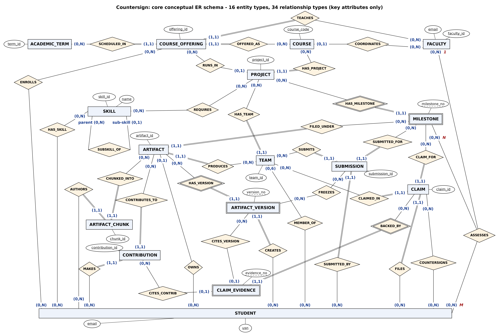
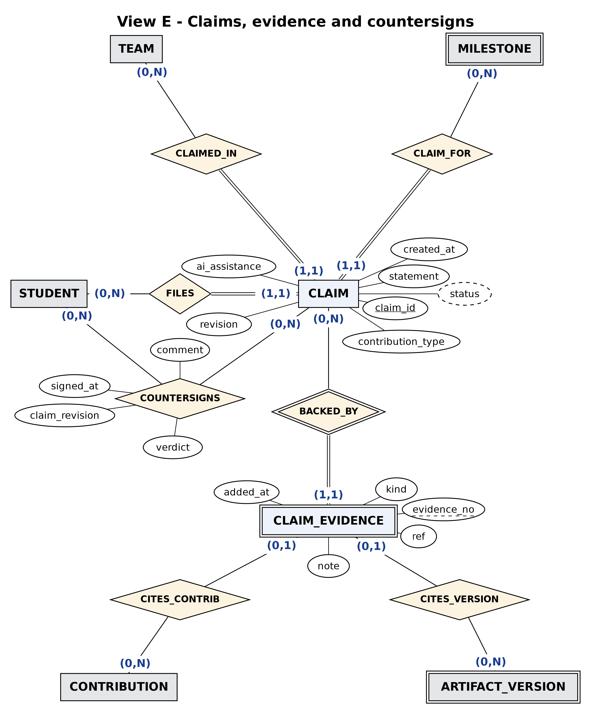
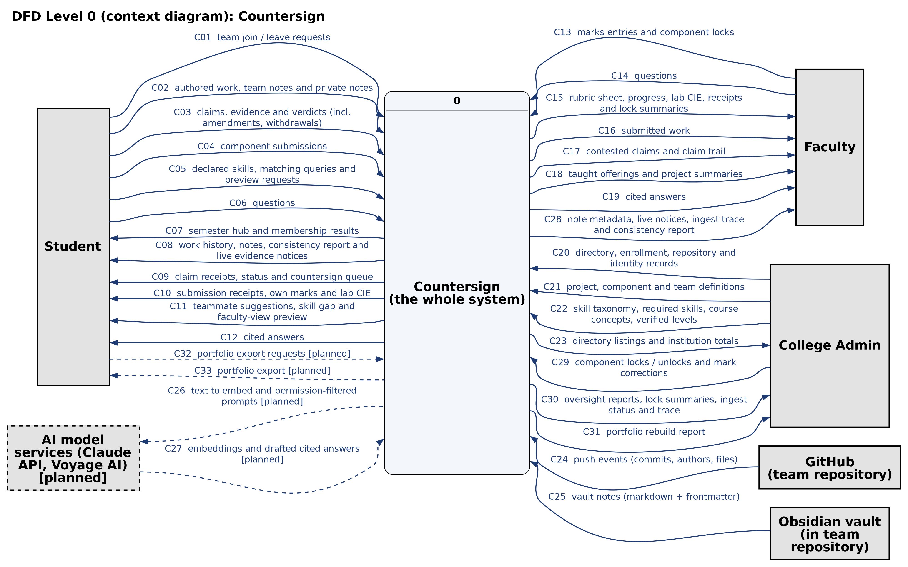
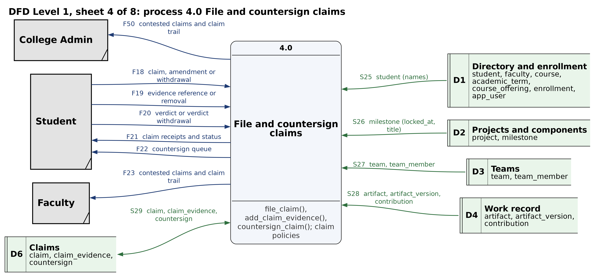
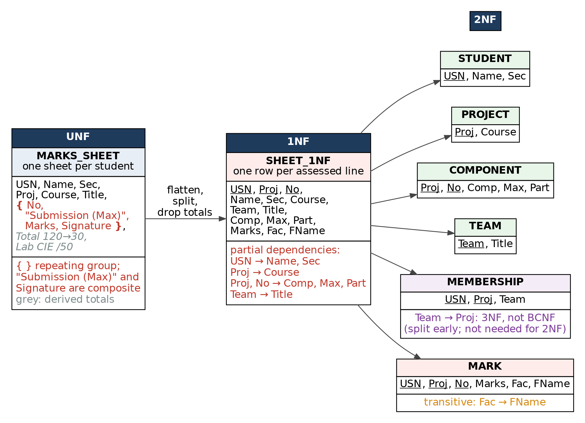
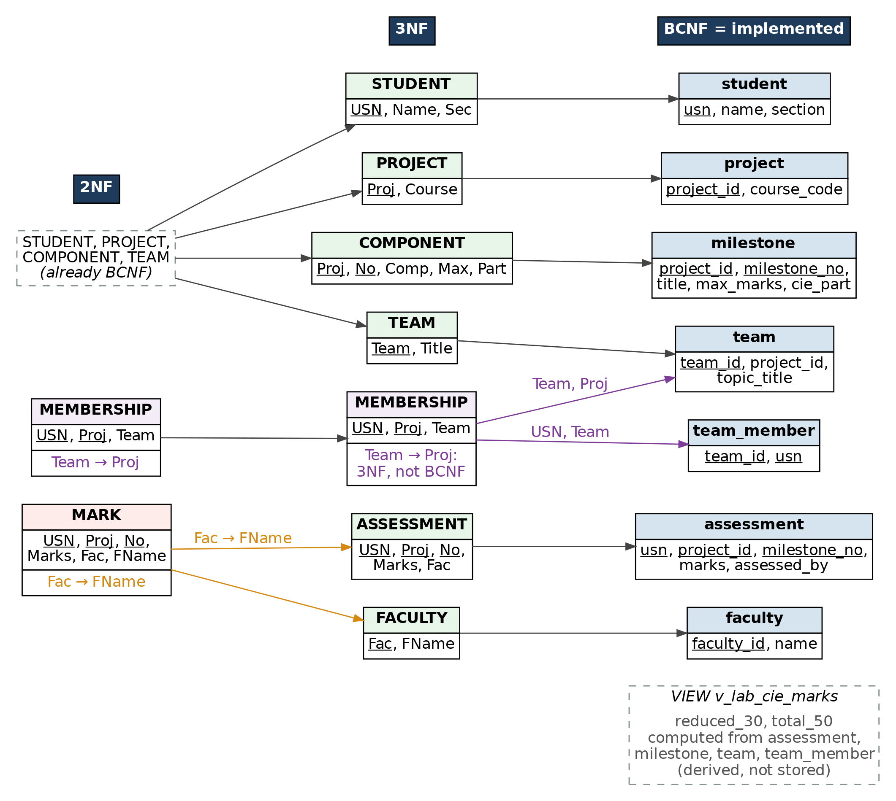

::: cover
**RV College of Engineering®, Bengaluru – 59**

**Department of Computer Science and Engineering**

**DATABASE MANAGEMENT SYSTEMS (CD252IA)**

**Lab Component 7: Midterm Report**

&nbsp;

**MIDTERM REPORT**

**Unified Experiential Learning and Project Intelligence Platform**

(product name: Countersign)

&nbsp;

| USN | Name |
|:--|:--|
| 1RV24CY047 | S Arun Sanjay |
| 1RV24CY051 | Sanvid Razdan |

&nbsp;

Academic year 2026–27, Semester V

Version 1.0, 5 November 2026

Implementation status frozen as of 5 November 2026 (see §10)
:::

::: toc
:::

# Document control

| | |
|:--|:----------|
| **Institution** | RV College of Engineering, Bengaluru 560059. Department of Computer Science and Engineering |
| **Course** | Database Management Systems (CD252IA), Semester V. Lab Component 7: Midterm Report (20 raw marks) |
| **Official title** | Unified Experiential Learning and Project Intelligence Platform |
| **Product name** | Countersign ("every mark has a receipt") |
| **Authors** | S Arun Sanjay (1RV24CY047); Sanvid Razdan (1RV24CY051) |
| **What this report is** | The consolidated midterm report. It brings the Synopsis (C1), the Software Requirements Specification (C2), the ER diagram and relational schema (C3), the Test (C4), the data flow diagrams (C5) and the normalization (C6) into one document, and adds what those components do not contain: the implementation status at midterm with its evidence, a preview of the Innovative Experiment (C10), and the plan for the remaining weeks. Each summary section names the component document that holds the full detail. |
| **Source** | Generated from `docs/lab/C7_Midterm_Report.md` by `docs/lab/build_c7.sh` (pandoc and Graphviz in Docker), with the same conventions as the C2 SRS: RVCE cover, Times New Roman, A4. Figures that come from earlier components are reused unchanged from their build outputs. |
| **Declaration of tool use** | Parts of the code and of the documents were drafted with an AI coding assistant and then reviewed, tested and corrected by the team. This matches the project's own rule (C2 NG1): AI assistance is declared, not hidden. |

# Abstract

Experiential Learning (EL) projects at RVCE are assessed on a paper marks sheet that the faculty signs on trust: the sheet records a mark per student per component, but nothing behind the mark shows which student did which part of the work. **Countersign**, the database system behind the *Unified Experiential Learning and Project Intelligence Platform*, replaces that trust with records. The rubric becomes the schema: each component of the lab marks sheet is a row of `milestone`, and each mark is a row of `assessment` at the grain *student × component*. A student files a **claim** against a component, backs it with typed **evidence** (a recorded contribution, a frozen artifact version, a commit, a URL or a file), and a teammate **countersigns** it (confirm or dispute). The faculty member reads the rubric sheet and can follow every cell to its claims, evidence and countersigns.

The system is built as a "fat database, thin API": PostgreSQL 17 on Supabase holds 30 tables (29 in `public` and `private.note`), with row-level security (RLS) on every table, six `security_invoker` views, stored procedures (RPCs) and integrity triggers; MongoDB Atlas holds the raw GitHub event log, team notes with immutable versions, and portfolios; a small FastAPI service runs the ingestion worker and a permission-aware, cited question-answering endpoint. Retrieval is one SQL function that runs as the requesting user and fuses a full-text ranking with an optional vector ranking by reciprocal rank fusion.

At midterm, migrations 0001–0006 are applied to the live project `countersign-dbms` (AWS ap-south-1). The automated evidence is: 657 pgTAP assertions, the graded Test fixture (Q1–Q37 37/37, M1–M25 25/25), 47 API tests and 38 browser end-to-end tests. A concurrency experiment of 72,000 races (2,556,000 attempts) found that the textbook "lock the parent row, then count" capacity trigger over-admits in **every** race at REPEATABLE READ, while a trigger that writes the parent row, a conditional counter, declarative seat keys and SERIALIZABLE are correct at every level tested.

# 1. Introduction

## 1.1 Background

Every course in the RVCE Experiential Learning scheme ends in a team project: the DBMS mini project, and the projects of other courses. The record of that work is scattered across WhatsApp groups, Google Drive folders, Google Classroom submissions and personal GitHub accounts. Assessment happens on a paper sheet per student, with one line per component (Synopsis, Requirement Specification, ER Diagram, Test, DFD, Normalized tables, Midterm Report, Forms, Demo and Draft Report, Innovative Experiment, Final Demo), and a signature of the lab faculty on each line.

## 1.2 Motivation

The faculty member who signs a line cannot see individual contribution. One student may have done most of the work; a report may have been written with or without AI help; the ER diagram may have been drawn on a whiteboard that left no trace. The evaluators of this very project live this problem while grading it, which is why the project grades its own marks sheet: the CD252IA lab is project P06 in the demo data, and the team's own components are its milestones.

## 1.3 The idea in one sentence, and what follows from it

*Every mark has a receipt.* Four design decisions follow from it, and they shape the rest of this report.

1. **The rubric is the schema.** Components are rows of `milestone`; marks are rows of `assessment` keyed by (student, project, component). The totals (120 raw → 30, plus 10 and 10, giving 50) are derived by a view, never stored (C6 §A.15).
2. **The claim is the unit of contribution.** Commit counts are gameable (the commit author e-mail is self-asserted, line counts reward commit spam) and much real work leaves no commit. So a student claims a component, and commits, versions, URLs and files are *evidence* for the claim.
3. **Peer verification is bound to one claim revision.** A countersign carries the revision of the claim that the teammate read; a later edit makes the signature stale (optimistic concurrency control).
4. **Privacy is enforced in the database.** Three visibility tiers (`private`, `team`, `submitted`) are enforced by RLS, so the web client, the API and the assistant all see exactly what the signed-in user may see.

## 1.4 Organisation of this report

§2 surveys the literature and the existing systems; §3 states the problem; §4 the objectives; §5 the methodology and architecture. §6–§9 summarise the SRS, the ER design and its relational mapping, the DFDs and the normalization. §10 reports what is built at midterm, with its evidence. §11 previews the Innovative Experiment, §12 plans the remaining weeks and §13 concludes. The references follow; Appendix A maps the report to the earlier components and Appendix B records the legibility of every figure.

# 2. Literature survey and existing systems

## 2.1 Contribution and peer assessment in team projects

Two established tools address individual contribution in team work. **CATME** (Team-Maker and Peer Evaluation) forms teams from survey criteria and collects behavioural peer ratings; **WebPA** collects numerical peer scores and uses them to weight a group mark into individual marks [10]. Both measure *perceived* contribution through ratings of the whole person, not of a specific piece of work, and neither links a rating to evidence. Code-hosting analytics such as GitHub's contributors graph count commits and lines per author [10], but the author of a commit is whatever the committer configured (`git commit --author`), so the count is self-asserted, and work that is not code (an ER diagram, a literature survey) does not appear at all. Countersign takes the peer-verification idea from CATME and WebPA but attaches it to *specific, evidenced claims*, and it credits a commit only to the authenticated pusher (C2 §2.1.1; `docs/INGESTION.md` §2).

## 2.2 Database design: the ER model, mapping and normalization

Elmasri and Navathe [1] give the methods used in C3 and C6: Chen-notation ER modelling with (min,max) structural constraints, weak entity types and n-ary relationship types (Ch. 3); the seven-step ER-to-relational mapping algorithm (Ch. 9); functional dependencies, closures, minimal covers, the normal forms up to BCNF, and the nonadditive-join and dependency-preservation tests (Ch. 14–15); and the three-schema architecture with logical and physical data independence (Ch. 2). The project applies them to a real artefact, the paper marks sheet, treated as an unnormalized relation (C6 Part A).

## 2.3 Access control inside the DBMS

PostgreSQL's row security policies [2] attach a predicate to each table and command; a view created with `security_invoker` evaluates the base tables' policies as the calling user instead of the view owner [2]. Supabase exposes the database through PostgREST with the user's JWT, so the same policies govern every client [3]. This is what lets a retrieval function for an AI assistant be "permission-aware" without a second copy of the permission rules: the function runs as the requesting user, and RLS filters every candidate row (§5, §10.4).

## 2.4 Isolation levels, write skew and serializable snapshot isolation

Berenson et al. [6] showed that the ANSI SQL isolation levels, defined by the phenomena P1–P3, do not characterise snapshot isolation, and named the anomalies it permits, including **write skew** (A5B): two transactions read an overlapping set, then each writes a different row, jointly violating a constraint that spans rows. A team-capacity rule ("at most `max_size` members") is exactly such a constraint, and its read is a *predicate* (the members of the team), so a concurrent insert is a phantom that row locks cannot cover. Cahill, Röhm and Fekete [7] made snapshot isolation serializable by tracking read-write antidependencies and aborting a transaction that forms a "dangerous structure" of two consecutive rw-antidependencies; Ports and Grittner [8] describe how PostgreSQL implements this as its SERIALIZABLE level (SIREAD predicate locks that never block, a commit-ordering refinement, read-only optimisations). PostgreSQL's REPEATABLE READ is snapshot isolation without that check [2]. These three papers explain the result of the Innovative Experiment (§11).

## 2.5 Retrieval: full-text, vector and rank fusion

Hybrid retrieval combines a lexical ranking with a semantic (vector) ranking. Reciprocal rank fusion (RRF) [5] scores a document by Σ 1/(k + rank) over the input rankings (k = 60 in the original paper) and was shown to outperform more elaborate fusion methods; it needs only ranks, not comparable scores. Approximate nearest-neighbour search over embeddings commonly uses HNSW graphs [9], which the pgvector extension provides inside PostgreSQL. Keeping vectors in the same database as the permissions is the design choice that lets RLS apply to retrieval (C2 constraint C4).

## 2.6 Document stores and polyglot persistence

MongoDB stores semi-structured documents, validates them with `$jsonSchema` validators, and offers multi-document transactions and an aggregation pipeline with `$merge` and `$unionWith` [4]. The project uses it for data whose natural unit is a document: raw webhook payloads, Markdown notes with their versions, and one portfolio aggregate per student (C2 FR11). The two stores are linked by shared keys and reconciled by a consistency report (§10.3).

## 2.7 Existing systems compared

The cells describe each product's documented default behaviour [10]; configurations and plug-ins can differ. This is the C2 §2.1.1 comparison, with the last row updated to midterm status.

| Capability | GitHub Classroom | GitHub Insights (Contributors) | Google Classroom / Moodle | CATME | WebPA | **Countersign** |
|:--|:--|:--|:--|:--|:--|:--|
| Unit of record | A repository per student or per team | Commits per author | A submission per assignment (Moodle also supports group submissions) | A peer-evaluation survey | A peer-assessment score sheet | A claim per student per rubric component |
| Individual attribution | Git history of the repository | Commit and line counts, attributed through the commit author e-mail, which is self-asserted | A group submission is typically graded as one; Moodle allows an individual override | Peer ratings | Peer scores weight a group mark into individual marks | Claim + typed evidence + teammate countersign; a commit is credited only to its authenticated pusher |
| Non-code work (reports, ER, slides) | Only if committed as files | Only as commits | Uploaded as files, not attributed to a member by default | Indirect (ratings) | Indirect (scores) | Yes: version, URL and file evidence |
| Peer verification | Not built in | Not built in | Moodle Workshop peer-grades submissions, not contributions | Yes, behavioural ratings | Yes, numerical ratings | Yes, bound to one claim and one claim revision |
| Rubric / marks sheet as data | Autograding tests | Not built in | Rubrics attached to assignment grades | Not built in | Group mark → individual marks | Rubric = schema; 120 → 30 + 10 + 10 = 50 computed by a view |
| Evidence linked to each mark | Not by default | Not built in | Not by default | Not built in | Not built in | Yes (rubric cell → claims → evidence) |
| Privacy enforced in the database | Repository visibility | Repository visibility | Course roles | The instructor sees all ratings | The tutor sees all scores | `private` / `team` / `submitted`, enforced by RLS |
| Team formation | Students create or join teams | Not built in | Groups made by the teacher | Team-Maker (survey criteria) | Not built in | Complementary-skill finder (relational division) |
| Permission-aware assistant | Not built in | Not built in | Not built in by default | Not built in | Not built in | Built: retrieval as the requesting user, extractive cited answers; generative answers coded, not yet enabled |

## 2.8 Limitations identified in the existing systems

- **L1. Attribution without evidence.** Ratings (CATME, WebPA) and commit counts (Insights) measure something other than "who did this component", and commit authorship is self-asserted.
- **L2. Non-code work is invisible.** A literature survey, an ER diagram or a report leaves no record unless someone uploads a file, and an upload is not attributed to a team member.
- **L3. The marks sheet is not data.** Learning management systems attach rubrics to grades, but no system stores the course's own component sheet so that each mark can be traced to the work behind it, and the totals derived rather than typed.
- **L4. Privacy is coarse.** Instructors see all ratings or whole repositories; there is no notion of a student's private draft that becomes visible to the faculty only when it is submitted.
- **L5. Concurrency is not considered.** Team-capacity and similar rules are typically checked in application code; the literature (§2.4) shows that such checks are unsafe below SERIALIZABLE unless the conflict is materialised.

# 3. Problem statement

Design and build a database system that lets a college assess team projects at the grain of the paper marks sheet (student × component) such that:

1. every mark can be traced to the specific claims of work behind it, each claim to typed evidence, and each claim to a teammate's verdict on the exact revision they read;
2. the record is permanent (history cannot be erased by a cascade) and the totals are derived, never stored;
3. who may read what is decided by the database itself (RLS), so that private work stays private, faculty read submitted content and metadata, and any assistant built on top retrieves only what the asking user may read;
4. integrity rules that span rows (team capacity, one team per project, "a countersigner must be a teammate") hold under concurrent use at every isolation level the system may run at;
5. the frozen Test fixture (Q1–Q37, M1–M25) keeps producing its verified outputs while the schema grows.

# 4. Objectives

| ID | Objective | Measure of success | Status at midterm |
|:-|:--------|:--------|:------|
| O1 | Model the EL domain and the marks sheet in a normalized relational schema | ER schema with every (min,max); seven-step mapping; every table's normal form stated and every deviation justified | Done (C3, C6) |
| O2 | Implement claims, evidence, countersigns, submissions and marks with their integrity rules in the database | Each rule refused by a failing statement in the constraint gallery and abuse-case tests | Done (pgTAP 01, 03, 04) |
| O3 | Enforce privacy and roles with RLS and `security_invoker` views only | Persona × relation matrix equal to the expected visibility; anon has no privilege | Done (pgTAP 02) |
| O4 | Capture evidence from GitHub pushes idempotently, keeping MongoDB and PostgreSQL reconcilable | Replay and redelivery change nothing; the consistency report is "all consistent" | Done for replayed deliveries (pgTAP 05, 06; live: 16 replay fixtures) |
| O5 | Answer questions over project text with citations, under the asker's permissions | Same question, different personas, different row sets; cited $\subseteq$ retrieved | Partly done (keyword retrieval and extractive answers; embeddings and generative answers not yet enabled) |
| O6 | Show that the integrity rules are correct under concurrency, and measure the cost | Over-admission rate per strategy × isolation × N, precedence graphs in SQL | Experiment run (72,000 races); write-up and live demo page pending (§11) |
| O7 | Keep the graded fixture working while the schema evolves | Q1–Q37 37/37 and M1–M25 25/25 on every change | Partial: 37/37 and 25/25 on every change so far, run by hand (`scripts/test_fixture.sh`, `scripts/test_mongo_fixture.sh`); the CI workflow is written but not pushed, so it is not active (C2 defect D9) |
| O8 | Give students, faculty and the administrator a usable web interface | Browser end-to-end tests per persona | Done for the core flows (38 e2e tests) |

# 5. Methodology

## 5.1 Design process

The design follows the database design process of Elmasri and Navathe [1], one lab component per step, with each later step checked against the database as it is actually built:

1. **Requirements (C1, C2).** The Synopsis requirements FR1–FR11 were refined into sub-requirements with measurable non-functional targets, traced to database objects and to tests (C2 §3.3).
2. **Conceptual design (C3).** A Chen-notation ER schema, derived from stated data requirements DR1–DR*n* of the miniworld, with every structural constraint justified.
3. **Logical design (C3, C6).** The seven-step mapping to relations, then a normal-form check of every table, starting from the paper marks sheet as the unnormalized relation.
4. **Process view (C5).** Data flow diagrams at Levels 0, 1 and 2, whose data stores are named after the actual tables and collections.
5. **Physical design and implementation.** SQL migrations, indexes, RLS policies, views, RPCs and triggers; MongoDB validators and indexes.

## 5.2 Engineering rules

- **The graded fixture is frozen.** `supabase/fixture/01_schema.sql`, `02_seed.sql`, `03_queries.sql` and `mongo/04_mongo.js` are never edited; a regression harness diffs Q1–Q37 and M1–M25 against the verified outputs (PROJECT_MASTER Appendix H).
- **Schema evolution is append-only.** Migrations add tables, columns, constraints and indexes, and never drop or rename a fixture column. This is the project's working example of logical data independence (C2 §2.1).
- **Fat database, thin API.** Business rules live in constraints, triggers and SECURITY INVOKER RPCs; the web client talks to PostgREST with the user's JWT and the publishable key only. The API never uses the service role for user requests.
- **Test-gated releases.** Every change runs the gates of `docs/PROTOTYPE_PLAN.md` §2 on a local Supabase stack before it is pushed to the cloud project: fixture regression, migrations, RLS matrix, constraint gallery, concurrency, RPCs, advisors, web, and an adversarial review.
- **Secrets stay out of the repository** (git-ignored `*.env` files), and personas use synthetic `@example.edu` addresses; self sign-up is disabled.

## 5.3 Architecture

{width=100%}

| Tier | Technology | Role |
|:--|:--|:----------|
| Relational core | PostgreSQL 17.11 on Supabase (project `countersign-dbms`, ap-south-1) | All structured data, marks, claims; RLS; RPCs; triggers; pgvector and full-text indexes; queue `github_ingest` (pgmq) |
| Webhook inbox | Supabase Edge Function `github-webhook` | Verifies the GitHub HMAC signature, then one RPC writes the inbox row and the queue message in one transaction |
| Document store | MongoDB 8.0 on Atlas, database `elp` | Raw GitHub events (`_id` = delivery id), notes and immutable `note_versions`, portfolios; `$jsonSchema` validators |
| Service layer | FastAPI (Python 3.12) | Notes API, ingestion worker (raw log, then projection), consistency report, ingestion trace, `/ask` |
| Client | React 19, TypeScript, Vite, Tailwind CSS, shadcn/ui, supabase-js, zod | Student, faculty and admin pages; a "Show the SQL" drawer on every data panel |

The ingestion path is **inbox → log → projection** (`docs/INGESTION.md`): the Edge Function only verifies and enqueues (GitHub times out after 10 s); the worker stores the raw event in MongoDB and then projects it into `artifact`, `artifact_version`, `contribution` and `artifact_chunk` rows. Every step is idempotent on a natural key (delivery id, commit SHA, path), so delivery can be at-least-once, and the projection can be rebuilt from the MongoDB log.

## 5.4 Experimental method (summary)

The concurrency experiment (§11) runs a load generator (asyncpg, N clients released together by a barrier) against a throwaway PostgreSQL 17 container loaded with the frozen fixture. It measures six capacity-enforcement strategies × three isolation levels × N $\in$ {2, 8, 32, 100}, 1,000 trials per cell, records a logical client-side schedule for N = 2, and builds and tests precedence graphs in SQL with a recursive CTE. The SQL that builds the graphs is itself checked on hand-solved textbook schedules.

# 6. Software Requirements Specification: summary

The full SRS is Component 2 (`docs/lab/C2_SRS.md`, ISO/IEC/IEEE 29148 layout). Its revision 1.2 of 5 November 2026 re-derived every status after migrations 0005 (ingestion, search, Realtime) and 0006 (ingestion worker failure handling); the tables below summarise that revision.

## 6.1 Users

| Class | Main tasks | Privileges (enforced by RLS, column grants and triggers) |
|:--|:----------|:----------|
| Student | Join a team, file claims with evidence, countersign teammates' claims, submit components, read own marks | Own team's content; never another student's private items; own marks only |
| Faculty | Read the rubric sheet, follow claims to evidence, record marks, lock components | For the projects they teach: claims, evidence, countersigns, contributions and non-private artifacts; chunk text only once submitted; marks in their own name; may lock, not unlock |
| Administrator | Maintain the directory, terms, offerings, projects and components; correct marks; unlock components | Everything faculty can read, on every project; no `faculty_id`, so cannot record marks through the RPC |
| Anonymous | none | No table, view or function privilege |

## 6.2 Functional requirements and status

| FR | Requirement (refined) | Status, 5 Nov 2026 | Evidence |
|:-|:--------|:-----------|:------|
| FR1 | Academic records: students, faculty, courses, terms, offerings, enrolments | Implemented | pgTAP 01 §A, 02 §A |
| FR2 | Projects whose milestones are the rubric components; lock a component | Implemented | pgTAP 03 §H, 04 |
| FR3 | Semester hub driven by enrolment | Implemented | pgTAP 03 §C; e2e 02 |
| FR4 | Team formation under capacity and one-team-per-project rules; complementary teammate finder (division) | Implemented | pgTAP 01, 03 §D–E, 04; race harness; e2e 04 |
| FR5 | Capture work as artifacts, versions, contributions and notes (editor, GitHub, Obsidian vault) | Implemented for the editor, notes and signed push replays; a live repository push with file-content fetch is tested only against a mocked GitHub API | pgTAP 05, 06; `api/tests/test_worker.py`; e2e 09, 10; live project (§10.3) |
| FR6 | Claims, typed evidence, teammate countersigns bound to a claim revision | Implemented | pgTAP 03 §G, 04 §2–4; e2e 02, 03 |
| FR7 | Submission (frozen versions), marks, locks, rubric sheet, lab CIE view; live updates to the sheet | Implemented, including the metadata-only Realtime broadcast added by 0005 | pgTAP 02, 03 §F, H; e2e 05–07, 10 |
| FR8 | Declared and verified skill levels, skill gap, skill tree | Partial: automatic derivation of verified levels from confirmed claims is planned | pgTAP 03 §D, J |
| FR9 | Permission-aware assistant with citations | Partial: `search_chunks()` (full-text + optional vector, RRF, as the caller) and extractive cited answers are built and tested; embeddings and generative answers are coded and stub-tested, not yet enabled (no API keys) | pgTAP 05; `api/tests` |
| FR10 | Permanent record (RESTRICT history), portfolio | Partial: RESTRICT keys and absence of DELETE policies are in place, and the portfolio rebuild (`$merge`) runs; the student-facing export and the erasure procedure are planned | pgTAP 01 §B, 04 §7; scripted portfolio run |
| FR11 | Structured data in PostgreSQL, semi-structured in MongoDB, linked by shared keys and reconciled | Implemented | `GET /consistency`; `scripts/check_mongo_validators.sh`; M1–M25 |

## 6.3 Non-functional requirements (summary)

| Area | Requirement (C2 §3.5) | Verified by |
|:--|:----------|:-------|
| Security | Default deny: RLS on every table and at least one policy; anon has no privilege; every view is `security_invoker`; every RPC pins `search_path`; only the private-note RPCs (and the service-role pipeline RPCs) run as definer | pgTAP 02 §B, 03 §A; live check on 5 Nov: 30 of 30 tables have RLS enabled |
| Integrity | Every cross-row rule (capacity, one team per project, membership required for any recorded work, marks ≤ max, frozen after lock, countersigner is a teammate and not the claimant) is refused by the database | pgTAP 01, 04 (abuse cases replayed as direct table writes) |
| Concurrency | Team capacity never exceeded at RC, RR or SER; countersign of a stale revision refused | Race harness (§11); `membership_skew_check.sh` |
| Reliability | `submit_milestone()` is one transaction; ingestion is idempotent and resumable; failed deliveries are retried and dead-lettered after 5 attempts | pgTAP 03 §F, 05, 06; `test_worker.py` |
| Privacy | Private items never leave their owner; faculty read chunk text only once submitted; Realtime payloads carry ids and times only | pgTAP 02, 04 §6; e2e 07, 10 |
| Explainability | Every assistant answer cites retrieved chunks; a "Show the SQL" drawer shows the SQL, relational algebra and policies behind each panel | `api/tests`; e2e 08 |

## 6.4 Software and hardware

**Software:** PostgreSQL 17.11 (Supabase) with pgvector and pgmq; Supabase Auth, PostgREST, Edge Functions and Realtime; MongoDB 8.0 (Atlas); Python 3.12 with FastAPI; Node.js 24, React 19, TypeScript, Vite, Tailwind CSS 4, shadcn/ui; Playwright; pgTAP; Docker for the verification environment; Graphviz and pandoc for the documents. Planned: Voyage AI embeddings and the Anthropic Claude API (keys not yet provisioned), Vercel hosting. **Hardware (development):** Intel Core i3 or equivalent, 8 GB RAM (16 GB recommended to run the local Supabase stack and the race harness together), 20 GB free storage, Internet connection. Full tables: C2 §3.6–3.7.

# 7. ER design and relational mapping: summary

The full design is Component 3 (`docs/lab/C3_ER.md`, revision 2).

## 7.1 The conceptual schema

The core ER schema has **16 entity types** (13 strong, 3 weak) and **34 relationship types** (3 identifying, 6 binary M:N, 1 ternary, 1 recursive, 23 other binary 1:N), drawn in Chen notation with a (min,max) pair on every line (Figure 2). The values drawn are those the database enforces; where a business rule is stronger, C3 §6 states the difference.

The key modelling decisions:

- **ASSESSES is a genuine ternary** with cardinality ratio STUDENT : MILESTONE : FACULTY = M : N : 1 (as in C3): for one (student, component) pair there is exactly one signing faculty member. The mark belongs to the triple; three binaries could pair a student and component with the wrong faculty member. Mapping step 7 therefore keys `assessment` by (usn, project_id, milestone_no) and leaves `assessed_by` outside the key, encoding the functional dependency (student, component) → faculty that (min,max) cannot express.
- **Three weak entity types:** MILESTONE (owner PROJECT, partial key `milestone_no`), ARTIFACT_VERSION (owner ARTIFACT, `version_no`) and CLAIM_EVIDENCE (owner CLAIM, `evidence_no`).
- **CONTRIBUTION and CLAIM are entity types**, not relationships: the same student may record several contributions to one artifact, and a claim owns evidence and takes part in COUNTERSIGNS.
- **SUBSKILL_OF is recursive** with role names "parent (0,N)" and "sub-skill (0,1)"; the skill tree is queried with `WITH RECURSIVE`.
- **The suggested ternary STUDENT–ARTIFACT–MILESTONE is rejected**, because the milestone is functionally determined by the artifact (FILED_UNDER).
- **Rules the notation cannot express** (a countersigner is a teammate, marks ≤ max, one team per project) are enforced by triggers and listed in C3 §5.4.

::: {page=a3l}

:::

::: {page=a4p}

:::

## 7.2 Mapping to relations

| Step (Elmasri & Navathe) | Applied to | Result |
|:--|:----------|:----------|
| 1. Strong entity types | 13 types (ACADEMIC_TERM, COURSE, FACULTY, COURSE_OFFERING, STUDENT, PROJECT, TEAM, SKILL, ARTIFACT, CONTRIBUTION, ARTIFACT_CHUNK, SUBMISSION, CLAIM) | One relation each; secondary keys become UNIQUE; composite attributes flattened; derived attributes not stored except the trigger-maintained `claim.status` and GENERATED columns |
| 2. Weak entity types | MILESTONE, ARTIFACT_VERSION, CLAIM_EVIDENCE | Key = owner key + partial key; owner FK ON DELETE CASCADE (existence dependency) |
| 3. Binary 1:1 | none in the core (identity mapping `app_user` in the physical appendix) | — |
| 4. Binary 1:N (incl. recursive) | e.g. HAS_TEAM, FILED_UNDER, SUBSKILL_OF | FK on the N side; NOT NULL where participation is total; composite FKs onto superkeys enforce "same project" |
| 5. Binary M:N | ENROLLS, MEMBER_OF, HAS_SKILL, REQUIRES, FREEZES, COUNTERSIGNS | Relationship relations keyed by both FKs |
| 6. Multivalued attributes | none (the naive {skills} was replaced by the entity type SKILL) | — |
| 7. n-ary | ASSESSES | `assessment`, key from the M and N participants only |

The result is **23 relations**; four infrastructure relations (identity mapping, course concepts, skill evidence, private notes) give the 27 relations and 54 foreign keys of the schema as of migration 0004. Migration 0005 adds three more infrastructure relations for ingestion (`student_identity`, `team_repo`, `ingest_event`), which, like the other four, stay outside the core ER diagram: 30 tables in all at midterm.

**Referential actions** follow one stated policy (C3 §7.1): CASCADE only for existence-dependent rows (weak entity owners, M:N rows describing a participant, derived data); SET NULL for optional links whose child outlives the parent; RESTRICT on every foreign key from a history relation, so that the permanent record cannot be erased by a cascade. Six fixture foreign keys that were CASCADE (for example `contribution.usn`) were changed to RESTRICT by migration 0002.

**Controlled redundancy.** `artifact`, `submission` and `claim` carry `project_id` although team_id → project_id holds. The copy is pinned by composite foreign keys onto the superkeys `team(team_id, project_id)` and `milestone(project_id, milestone_no)`, so it can never disagree, and it lets a plain foreign key express "the component belongs to the team's project" (C3 §7.3, C6 B.2).

::: {page=a3l}

:::

# 8. Data flow diagrams: summary

The full DFDs are Component 5 (`docs/lab/C5_DFD.md`, revision 3), in Gane–Sarson notation and generated from one machine-readable model that also checks balancing between levels.

- **Level 0** (Figure 5): the whole system as process 0, six external entities (Student, Faculty, College Admin, GitHub, Obsidian vault, AI model services) and 33 context flows.
- **Level 1:** eight processes, fifteen data stores, 59 external flows and 62 store flows, printed one sheet per process (Figure 6 shows process 4.0):

| Process | Name | Mechanism (RPC, view or service) |
|:--|:--|:----------|
| 1.0 | Manage directory and enrollment | directory tables under admin policies |
| 2.0 | Form teams | `join_team()`, `leave_team()`, capacity and one-team triggers |
| 3.0 | Capture work and evidence | artifact and version writes, notes API, private-note RPCs; Edge Function, `ingest_receive()`, worker, `project_push()` |
| 4.0 | File and countersign claims | `file_claim()`, `add_claim_evidence()`, `countersign_claim()` |
| 5.0 | Submit and assess components | `submit_milestone()`, `record_assessment()`, `lock_milestone()`, `v_rubric_sheet`, `v_lab_cie_marks` |
| 6.0 | Maintain skills and recommend teammates | `find_teammates()`, `skill_gap()`, `skill_subtree()` |
| 7.0 | Answer questions with citations | `search_chunks()`, `POST /ask`; the flows to the AI model services are planned |
| 8.0 | Build portfolio | `export_pg.py`, `portfolio_merge.js` |

- **Level 2** explodes the two processes of the thesis. 4.0 becomes 4.1 file, amend and withdraw claims; 4.2 attach and remove evidence; 4.3 record and withdraw verdicts (with the claim-revision check); 4.4 derive claim status (triggers); 4.5 build claim queues and trails. 5.0 becomes 5.1 submit component (one transaction, frozen versions); 5.2 record marks; 5.3 lock and unlock components; 5.4 compile the rubric sheet and team progress; 5.5 compute lab CIE marks (derived, never stored).

**Revision 3 of C5 (5 November 2026)** brought the diagrams up to the system after migrations 0005 and 0006: GitHub and Obsidian ingestion and process 7.0 are drawn solid; a new store D15 *Ingest registry* (`team_repo`, `student_identity`) is written by the administrator and read by 3.0; Realtime notices and the ingestion trace are new flows. Still dashed, deliberately: the AI model services (no API keys are configured), the student-facing portfolio export and the derivation of verified skill levels.

::: {page=a3l}

:::

::: {page=a4l}

:::

# 9. Normalization: summary

The full analysis is Component 6 (`docs/lab/C6_Normalization.md`).

## 9.1 The marks sheet, from UNF to BCNF

The paper lab evaluation sheet is taken as the unnormalized relation: a header (USN, Name, Section, Mini Project Title), a repeating group (No, Submission(Max), Marks, Signature) and derived totals. Three facts that are implicit on paper are made explicit: the lab project (Proj), the team (Team, because both teammates' sheets carry the same title) and the signing faculty member (Fac).

{width=100%}

- **1NF.** One tuple per *assessed* line; composite values split (Comp, Max; Fac, FName); the totals removed as derived. Candidate keys {USN, Proj, No} (primary) and {USN, Team, No}.
- **Minimal cover** $G$ of 12 FDs, including USN $\to$ Name, Sec; Proj $\to$ Course; Team $\to$ Proj, Title; USN, Proj $\to$ Team; Proj, No $\to$ Comp, Max, Part; USN, Proj, No $\to$ Marks, Fac; Fac $\to$ FName.
- **2NF** removes the partial dependencies on the key (student, project, team and component facts); **3NF** removes Fac $\to$ FName; **BCNF** removes Team $\to$ Proj from the membership relation, which loses USN, Proj $\to$ Team; that one FD is enforced by a trigger (one team per project).
- **Lossless join** is proved by a chase tableau and cross-checked with the binary test; **dependency preservation** holds for the 3NF synthesis result and for every FD except USN, Proj $\to$ Team in the BCNF result.
- **The result is the implemented schema:** STUDENT, PROJECT, TEAM, TEAM_MEMBER, MILESTONE, ASSESSMENT and FACULTY are projections of the real tables with the same keys. The totals 120 → 30 and /50 are derived by `v_lab_cie_marks`.


{width=100%}

## 9.2 Every implemented table

C6 Part B checks all 27 tables that existed after migration 0004:

| Classification | Count | Tables |
|:--|:--|:----------|
| BCNF on all columns | 20 | the directory, team, skill, enrolment, version, assessment, evidence and countersign tables, among others |
| BCNF once DBMS-derived (GENERATED) columns are excluded | 2 | `milestone` (`counts_in_reduced`), `artifact_chunk` (`tsv`) |
| Deliberately 2NF | 4 | `project`, `artifact`, `claim`, `skill_evidence` |
| Deliberately 1NF under the general 2NF definition | 1 | `submission` ({team_id, milestone_no, attempt_no} is a candidate key and team_id → project_id) |

Every value that is duplicated below 3NF is pinned by a composite foreign key onto a superkey or computed by the DBMS, so none can become inconsistent. C6 Part C works through a relation that is in 3NF but not BCNF (team assignment) and its textbook form from the enrolment domain. The three ingestion tables added by migration 0005 are not yet in C6; their analysis will be added to the final report.

# 10. Implementation status at midterm

All counts in this section describe the repository and the live project on **5 November 2026**. The live-project figures were read that day through the Supabase Management API with a read-only query.

## 10.1 Database layer

| Migration | Content |
|:--|:----------|
| 0001 `core_schema` | The 13 fixture relations, with RLS switched on |
| 0002 `app_core` | 14 tables (13 in `public` plus `private.note`): terms, offerings, enrolment, identity mapping, artifact versions, submissions, submission artifacts, assessment, claims, evidence, countersigns, skill evidence, course skills, private notes; integrity triggers (capacity v2, one team per project, membership required, marks ≤ max, frozen after lock, countersign rules); FK actions moved to RESTRICT for history |
| 0003 `security` | Helper functions (`app.current_usn()`, `app.is_team_member()`, `app.teaches_project()`, …), RLS policies per role, six `security_invoker` views (`v_semester_hub`, `v_what_faculty_sees`, `v_rubric_sheet`, `v_faculty_team_progress`, `v_contested_claims`, `v_lab_cie_marks`) |
| 0004 `rpc` | RPCs for teams, submissions, claims, marks, locks, skills and the hub, returning JSON, SECURITY INVOKER except the private-note RPCs |
| 0005 `ingest` | pgmq queue, `student_identity`, `team_repo`, `ingest_event`; inbox, raw-log and projection RPCs (service role only); `search_chunks()`; Realtime broadcast trigger; two foreign-key indexes reported by the performance advisor (C2 defect D3) |
| 0006 `ingest_worker` | `ingest_fail()`: retries and dead-lettering for failures before the projection |

The demo seed adds project **P06 "CD252IA Lab 2026-27"** with eleven milestones (milestone_no = component number), team **T00 "Countersign"** (Arun and Sanvid), a second P06 team with a contested claim, and illustrative marks for C1 and C4. All marks in the demo data are sample values, not real grades.

## 10.2 Application layer

- **Web client** (`web/`): login with persona buttons; semester hub; team page with join, complementary teammate finder, skill gap and skill tree; project page with milestones, artifacts, claims with evidence, countersign queue and submission; team notes and private notes; "what my faculty sees" preview; faculty rubric sheet with marks entry and a cell drawer (claims → evidence → countersigns); contested-claim queue; lab CIE marks; search and Ask; admin pages including ingestion status and Mongo ↔ Postgres consistency. Every data panel has a "Show the SQL" drawer with the SQL, the relational algebra and the RLS policies that apply.
- **API** (`api/`): `/notes` with immutable `note_versions` (a stale save gets HTTP 409), `/consistency`, `/ingest/drain`, `/ingest/trace`, `/ingest/status`, `/ask`, `/health`. Tokens are verified against the project's JWKS; user requests never use a service key.

::: {page=a3l}
![Figure 9. The faculty rubric sheet of project P06 (web client against the local Supabase stack, demo seed; recaptured on 5 November 2026 from the current build). The paper marks sheet as live tables, with a Sl. No. column: C1–C9 reduce 120 → 30, C10 and C11 add 10 each, Lab CIE /50. The glyph under a mark is the claim status (tick: confirmed; clock: pending countersign; triangle: contested); a red "no claim" marker flags a mark with no claim behind it; a hatched column is locked, and the last row is the signature line. The marks are illustrative.](diagrams/c7/c7_rubric_sheet.png)
:::

{width=55%}

```{=latex}
\clearpage
```

## 10.3 Live project and ingestion

| Item | State on 5 Nov 2026 |
|:--|:----------|
| Supabase project | `countersign-dbms`, AWS ap-south-1, PostgreSQL 17.11 |
| Migrations applied | 20261104000001 to 20261105000006 (0001–0006) |
| Tables and RLS | 29 tables in `public` and `private.note`; RLS enabled on all 30 |
| Auth | Seven persona logins (`app_user` rows): students arun, sanvid, nikhil, meera; faculty ramesh (teaches CD252IA), lakshmi; admin. Self sign-up disabled |
| Edge Function | `github-webhook` deployed |
| Ingestion | The 16 replay fixtures (`ingest/fixtures/manifest.json`) were replayed against the live project: 9 pushes were projected and 1 delivery is stored as `ignored`; a GitHub redelivery and a captured body re-sent under a new delivery id were absorbed as duplicates by the inbox keys; a wrong-secret and a tampered request were rejected (HTTP 401); a ping and a non-push event were acknowledged. Result: 10 `ingest_event` rows, 29 `contribution` rows with source `github`, 58 rows in `artifact_chunk` |
| MongoDB Atlas | Database `elp` with `$jsonSchema` validators, `notes` and `note_versions` |
| Not yet set up | Vercel hosting; Voyage AI and Anthropic keys (so `/ask` answers extractively, with citations, and the embedding path is unused); a real repository webhook with verified GitHub identities |

## 10.4 Test evidence

| Suite | Tests | What it checks |
|:-------|--:|:----------|
| pgTAP `01_constraints.sql` | 45 | Constraint gallery: every rule's violating statement raises the expected SQLSTATE |
| pgTAP `02_rls_matrix.sql` | 298 | Persona × relation visibility matrix; default deny; anon has nothing; every view `security_invoker` |
| pgTAP `03_rpc.sql` | 126 | Each RPC's happy path and permission-denied path per persona |
| pgTAP `04_abuse_cases.sql` | 53 | Attacks replayed as direct table writes, refused with a specific SQLSTATE and leaving no effect |
| pgTAP `05_ingest.sql` | 119 | Inbox idempotency, push key, trust model (commit spoofing, unverified pusher), projection, search under RLS, Realtime privacy |
| pgTAP `06_ingest_worker.sql` | 16 | Failure handling, retries, dead letters |
| **pgTAP total** | **657** | Run on a freshly reset database (the tests assume the seed state) |
| Fixture SQL (Q1–Q37) | 37/37 | Outputs diffed against PROJECT_MASTER Appendix H on plain PostgreSQL 17 |
| Fixture MongoDB (M1–M25) | 25/25 | Outputs compared with Appendix H on `mongo:8` |
| API (`pytest`) | 47 | 24 in `test_api.py` (token checks, team access, notes and their versions, consistency); 23 in `test_worker.py` (projection, retries, dead letters, crash repair, re-projection from the log, `/ask` scoping and citation checks, trace) |
| Web end-to-end (Playwright) | 38 | Ten specs: login, claim, countersign, team, rubric sheet and marks, RLS across faculty, privacy, SQL drawer, notes, live ingestion |
| Race harness | 72,000 races | §11 |

A GitHub Actions workflow that runs the two fixture regressions on every push is written (`.github/workflows/fixture.yml`) but not yet pushed, because pushing workflow files needs a token with the `workflow` scope.

## 10.5 Open defects carried forward

The known-defects register of C2 (§3.8) is carried forward. D3 (unindexed composite foreign keys of `skill_evidence`) was closed by migration 0005. The others are scheduled for Component 8 (§12): D1 duplicate commit, URL or file evidence on one claim; D2 an administrator's direct INSERT may name any faculty member in `assessed_by`; D4 the hub may show a locked component as "next"; D5 no FK from `artifact_chunk.version_no` (deliberate for fixture rows); D6 leaked-password protection in the Auth settings; D7 `note_versions` immutability enforced by API contract, not by an Atlas role; D8 missing automated tests (refused-submission row counts, administrator unlock, a pass/fail script for the portfolio merge); D9 the CI workflow is written but not active.

# 11. Innovative Experiment: preview

Component 10 is "the last team slot": declarative versus procedural integrity under concurrency. Full method and results: `experiments/race/README.md`, `FINDINGS.md` and `results/results.md`.

**Set-up.** Team Beta (T02) has `max_size` 4 and 3 members, so exactly one seat is free. N students try to take it at the same instant. Six strategies enforce the capacity rule:

| | Strategy | Where the rule lives |
|:--|:----------|:----------|
| S1 | Naive check-then-insert (`SELECT count(*)`, then `INSERT`) | application, no lock |
| S2 | The fixture trigger of Q35: lock the team row `FOR UPDATE`, then `COUNT(*)` | procedural, in the database |
| S3 | Conditional counter: `UPDATE … SET member_count = member_count + 1 WHERE member_count < max_size RETURNING` | one statement that checks and writes |
| S4 | S1 + retry on SQLSTATE 40001 | application |
| S6 | Declarative seat keys: a seat table with a primary key per (team, seat_no), and a deferred FK from `team_member` | keys and foreign keys |
| S7 | Write the parent row (the product's capacity v2): a no-op `UPDATE team …`, then count | procedural, in the database |

Each strategy runs at READ COMMITTED (RC), REPEATABLE READ (RR) and SERIALIZABLE (SER), with N = 2, 8, 32 and 100 and 1,000 trials per cell: 72 cells, 72,000 races, 2,556,000 attempts, PostgreSQL 17.11 in Docker (4 November 2026).

::: {page=a4l}


| Over-admission (share of races ending above 4/4; worst final size) | RC | RR | SER |
|:----------|:--|:--|:--|
| S1 naive, S4 naive + retry | **100%** (103/4) | **100%** (103/4) | 0% |
| S2 fixture trigger Q35 (lock the parent row, never write it) | 0% | **100%** (103/4) | 0% |
| S3 conditional counter; S6 declarative seats; S7 write the parent row | 0% | 0% | 0% |
:::

**Headline.** *A correct-looking lock-then-check trigger is only correct at READ COMMITTED.* The fixture trigger (S2) over-admitted in 1,000 of 1,000 races at REPEATABLE READ for every N; at N = 100 the worst race ended at 103/4. Under RR the snapshot is taken by the transaction's first statement, *before* it waits for the row lock; the winner only locked the team row and never changed it, so the waiter gets no serialization error (40001) and its `COUNT` still sees 3 members. This is write skew through a phantom (§2.4), not a lost update.

**What the data shows.**

1. **SERIALIZABLE (SSI) alone fixes all six strategies, including the naive one**: 0 of 24,000 races over-admitted. Without a retry loop the losers see 40001 instead of "team full"; with one (S4) they get a clean refusal after one retry.
2. **A retry loop does nothing below SERIALIZABLE**: S4 at RC and RR is identical to S1, because nothing ever raises 40001.
3. **Turning the conflict into a write on one row makes a procedural rule safe at every level** (S3, S7): waiters either re-check the newest row version (RC) or fail with 40001 (RR, SER). **The declarative design (S6)** gets the same from a primary key, and no client can bypass it.
4. **Cost:** p95 latency per attempt at N = 100 is 6–7 ms for the abort-based paths and 8–17 ms for the RC lock queues, on one machine (relative costs, not production numbers).
5. **Precedence graphs**, built from a logical client-recorded schedule in SQL with `WITH RECURSIVE`, have a cycle T1 → T2 → T1 in exactly the N = 2 races that over-admitted. This is a consistency check of the model rather than independent evidence; the graph SQL is verified separately on six hand-solved textbook schedules (all PASS).

**Consequence for the product.** Capacity v2 (S7) is the enforced rule in migration 0002; on the local Supabase stack it never exceeded max_size at any level, and a control run with the fixture trigger reproduced 5/4 (pair) and 11/4 (burst of 8) at RR. The same lesson ("a lock is not a write") was applied to the membership-history rule and to countersigning (claim row lock plus a claim-revision check).

**Remaining for C10:** the experiment report; a "Race Arena" page in the web client that runs a small race live and shows the `pg_locks` $\bowtie$ `pg_blocking_pids()` wait-for graph; and an EXPLAIN before/after comparison for an index on the bench data.

# 12. Plan for the remaining weeks

The course dates for Components 8–11 have not yet been announced to the team, so the plan is given in weeks after the midterm and will be mapped onto the calendar when the dates are known. Arun builds; Sanvid owns the documents, the diagrams and the test runs, and is the owner, for the viva, of the RLS policies, the MongoDB validators and the experiment analysis.

| Week | Work | Feeds | Done when |
|:--|:----------|:--|:----------|
| 1 | **Forms, security and validation.** Forms catalogue: for every form, the zod rule, the RPC or Pydantic check, the database CHECK or trigger, and the SQLSTATE → field-error mapping. Migration 0007 for defects D1, D2, D4 (and D7 via an Atlas role with only `find` and `insert` on `note_versions`); leaked-password protection on (D6); Supabase advisors re-run on 0001–0007. Push the CI workflow | C8 | Gallery test per new rule; advisors 0 ERROR; C8 document built |
| 2 | **Assistant and skills.** Provision the Voyage and Anthropic keys within the USD 10 budget; embed the chunks once and cache the vectors; enable generative answers with server-checked citations; permission test with three personas and a prompt-injection set. Derive verified skill levels from confirmed claims (`skill_evidence`) | C9, C11 | Same question as arun, sanvid and ramesh returns three different row sets; every citation $\subseteq$ retrieved |
| 3 | **Innovative Experiment.** C10 report; Race Arena page with the live lock graph; EXPLAIN before/after an index. **Dogfooding:** register the team repository, verify both members' GitHub identities, and file real claims for C1–C11 with countersigns | C10, C11 | Report built; a real `git push` appears on the rubric sheet within seconds |
| 4 | **Demo and draft report.** Deploy the web client and the API (Vercel); run the worker against the cloud project and Atlas with an app-only Atlas user; rehearse the demo arc (paper sheet → rubric grid → claim trail → live push → assistant with a permission-denied moment → race → normalization → marks); record a fallback video | C9 | Draft report; end-to-end suite green against a fresh reset; demo checklist run twice |
| 5 | **Trust and portfolio.** Student-facing portfolio export, and a pass/fail test of the portfolio merge (D8); hash-chained audit log with a verify query; consent records; add the three ingestion tables to the C6 table check | C11 | Tamper test breaks the chain; portfolio test passes |
| 6 | **Final demo and report.** Freeze, full regression (fixture, pgTAP, API, e2e), backups (`pg_dump`, `mongodump`), final report | C11 | All gates green on the frozen build |

**Risks and mitigations.**

| Risk | Mitigation |
|:----------|:----------|
| Free-tier limits: the Supabase project pauses when idle; Atlas shared tier | Keep-alive job; a local Docker stack (Supabase CLI and `mongo:8`) as the offline plan B; large experiments only on local Docker |
| AI keys or budget unavailable | Everything works without them: keyword retrieval and extractive, cited answers |
| Network at the demo venue | Recorded video of every live step; replay fixtures for the ingestion moment (signed replays work offline against the local stack) |
| A schema change breaks the graded queries | Append-only migrations; fixture regression on every change, in CI once the workflow is pushed |
| End-to-end tests change seed data | Reset before every gate run (`scripts/reset_local.sh`) |

# 13. Conclusion

At midterm the database that carries the project's thesis is built and verified: the marks sheet is a normalized schema in which every mark can be followed to claims, evidence and countersigns; privacy is enforced by RLS on all 30 tables and by `security_invoker` views; evidence from GitHub enters through an idempotent inbox → log → projection pipeline that keeps PostgreSQL and MongoDB reconcilable; and the graded fixture still produces its verified outputs. The concurrency experiment turned a textbook trigger into the project's main finding: a lock-then-check rule that looks correct over-admits at REPEATABLE READ in every race, and the fix is to make the conflict a write (or a key), or to run at SERIALIZABLE with retries. The remaining weeks complete the forms and security document, enable the AI services within budget, write up the experiment, deploy, and dogfood the system on this project's own components.

# References

1. R. Elmasri and S. B. Navathe, *Fundamentals of Database Systems*, 7th ed. Pearson, 2016. Ch. 2 (three-schema architecture, data independence), Ch. 3 and 9 (ER model, ER-to-relational mapping), Ch. 5–8 (relational model, algebra, SQL), Ch. 14–15 (functional dependencies, normalization, design algorithms), Ch. 20–21 (transactions, concurrency control).
2. The PostgreSQL Global Development Group, *PostgreSQL 17 Documentation*: §5.9 Row Security Policies; CREATE VIEW (`security_invoker`); Ch. 13 Concurrency Control (§13.2 Transaction Isolation, §13.3 Explicit Locking); Ch. 12 Full Text Search. https://www.postgresql.org/docs/17/
3. Supabase, *Supabase Documentation*: Row Level Security; Database Functions; Edge Functions; Queues (pgmq); Realtime Broadcast and Authorization; Testing your database (pgTAP); Database Advisors; pgvector. https://supabase.com/docs
4. MongoDB, Inc., *MongoDB 8.0 Manual*: Schema Validation (`$jsonSchema`); Transactions; Aggregation Pipeline (`$merge`, `$unionWith`); Indexes. https://www.mongodb.com/docs/manual/
5. G. V. Cormack, C. L. A. Clarke and S. Büttcher, "Reciprocal rank fusion outperforms Condorcet and individual rank learning methods," in *Proc. 32nd Int. ACM SIGIR Conf. on Research and Development in Information Retrieval*, 2009, pp. 758–759.
6. H. Berenson, P. Bernstein, J. Gray, J. Melton, E. O'Neil and P. O'Neil, "A critique of ANSI SQL isolation levels," in *Proc. 1995 ACM SIGMOD Int. Conf. on Management of Data*, 1995, pp. 1–10.
7. M. J. Cahill, U. Röhm and A. D. Fekete, "Serializable isolation for snapshot databases," in *Proc. 2008 ACM SIGMOD Int. Conf. on Management of Data*, 2008, pp. 729–738.
8. D. R. K. Ports and K. Grittner, "Serializable snapshot isolation in PostgreSQL," *Proceedings of the VLDB Endowment*, vol. 5, no. 12, pp. 1850–1861, 2012.
9. Y. A. Malkov and D. A. Yashunin, "Efficient and robust approximate nearest neighbor search using Hierarchical Navigable Small World graphs," *IEEE Transactions on Pattern Analysis and Machine Intelligence*, vol. 42, no. 4, pp. 824–836, 2020.
10. Vendor documentation for §2.1 and §2.7 (product behaviour as documented, not independently tested): GitHub Docs, *GitHub Classroom* and *Viewing a repository's contributors*; Moodle Docs, *Assignment settings* and *Workshop activity*; Google for Education Help, *Google Classroom*; CATME (catme.org), *Team-Maker* and *Peer Evaluation*; WebPA (Loughborough University), *Online peer assessment*.
11. ISO/IEC/IEEE 29148:2018, *Systems and software engineering — Life cycle processes — Requirements engineering* (structure of the SRS, C2).
12. C. Gane and T. Sarson, *Structured Systems Analysis: Tools and Techniques*. Prentice-Hall, 1979 (DFD notation, C5).
13. Team documents: *DBMS Synopsis* (C1); `docs/lab/C2_SRS.md`, `C3_ER.md`, `C5_DFD.md`, `C6_Normalization.md`; `PROJECT_MASTER.md`; `docs/PLAN.md`; `docs/INGESTION.md`; `experiments/race/README.md`, `FINDINGS.md`, `results/results.md`.

# Appendix A. Where each part comes from

| Section of this report | Source component and document | Updated here |
|:------|:------|:----------|
| §2 Literature survey, existing systems | C1 Synopsis §2; C2 §2.1.1 | Survey of the database literature added; last comparison row updated |
| §3 Problem statement | C1 Synopsis; PROJECT_MASTER §1; PLAN §1 | Sharpened to the five properties the database must guarantee |
| §6 SRS summary | C2 (revision 1.2, 5 Nov 2026) | Condensed; evidence column names the test files |
| §7 ER and mapping | C3 (revision 2) | Note on the three ingestion relations |
| §8 DFD | C5 (revision 3, 5 Nov 2026) | Condensed |
| §9 Normalization | C6 | Note on the three ingestion tables |
| §10 Implementation status | Repository and live project, 5 Nov 2026 | New |
| §11 Experiment preview | `experiments/race/` (run of 4 Nov 2026) | New (C10 preview) |
| §12 Plan | PLAN §6 phases P2–P5 | Re-planned from the midterm state |

The lab manual's sub-rubric for Component 7 is not in the repository (PLAN §8 lists it as still to be supplied); this report therefore follows the content asked for in PROJECT_MASTER §6.4 ("≈ synopsis + SRS + ER + DFD + normalization") and adds the implementation status and plan.

# Appendix B. Figure legibility

Each figure is printed at the size below. "Smallest text" is the smallest font size used anywhere in the figure's source, converted to its printed size on the PDF page; most labels are larger. The ER and schema figures are on A3 landscape pages exactly as in C3, and C3 remains the full-size reference for them.

<!-- BEGIN generated: legibility -->
| Figure | Placed on | Printed width (PDF) | Smallest text | Smallest text as printed |
|:--|:--|--:|:--|:--|
| Figure 1 | A4 portrait, in the text | 17.0 cm | 13 pt in the Graphviz source | 8.7 pt |
| Figure 2 | A3 landscape page | 36.3 cm | 15 pt in the Graphviz source | 6.6 pt |
| Figure 3 | A4 portrait page | 18.6 cm | 15 pt in the Graphviz source | 8.1 pt |
| Figure 4 | A3 landscape page | 39.3 cm | 13 pt in the Graphviz source | 8.0 pt |
| Figure 5 | A3 landscape page | 39.0 cm | 14 pt in the Graphviz source | 10.8 pt |
| Figure 6 | A4 landscape page | 27.3 cm | 14 pt in the Graphviz source | 8.3 pt |
| Figure 7 | A4 portrait, in the text | 17.0 cm | 13 pt in the Graphviz source | 8.5 pt |
| Figure 8 | A4 portrait, in the text | 17.0 cm | 13 pt in the Graphviz source | 8.2 pt |
| Figure 9 | A3 landscape page | 40.0 cm | 10.3 pt (14 px body text) | 7.4 pt at 10 px |
| Figure 10 | A4 portrait, in the text | 9.4 cm | 9.7 pt (14 px body text) | 6.9 pt at 10 px |
| Figure 11 | A4 landscape page | 27.3 cm | 9 pt in the matplotlib source | 8.7 pt |
<!-- END generated -->
