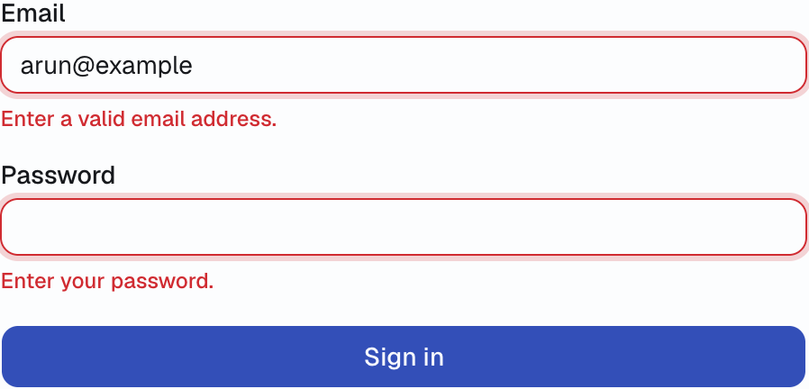
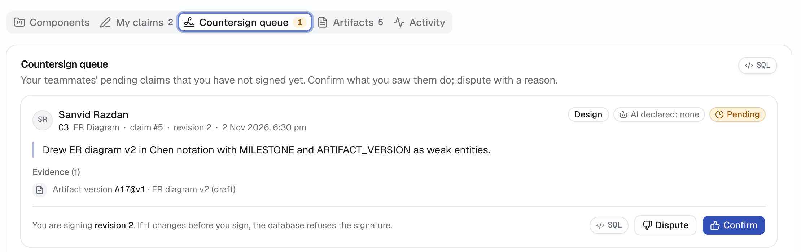
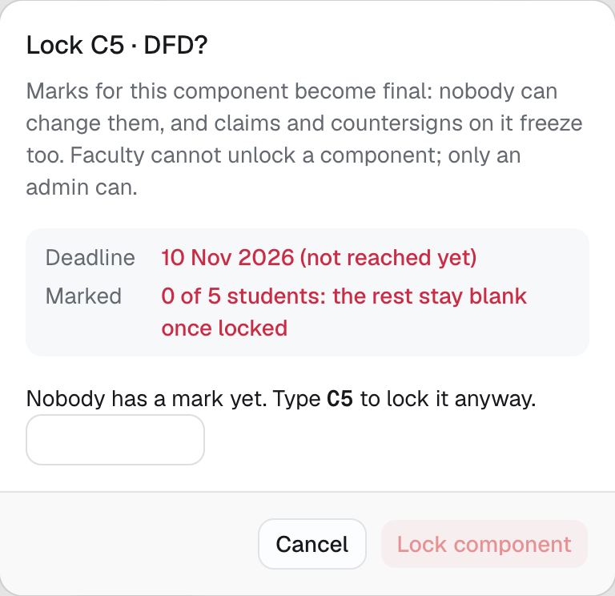
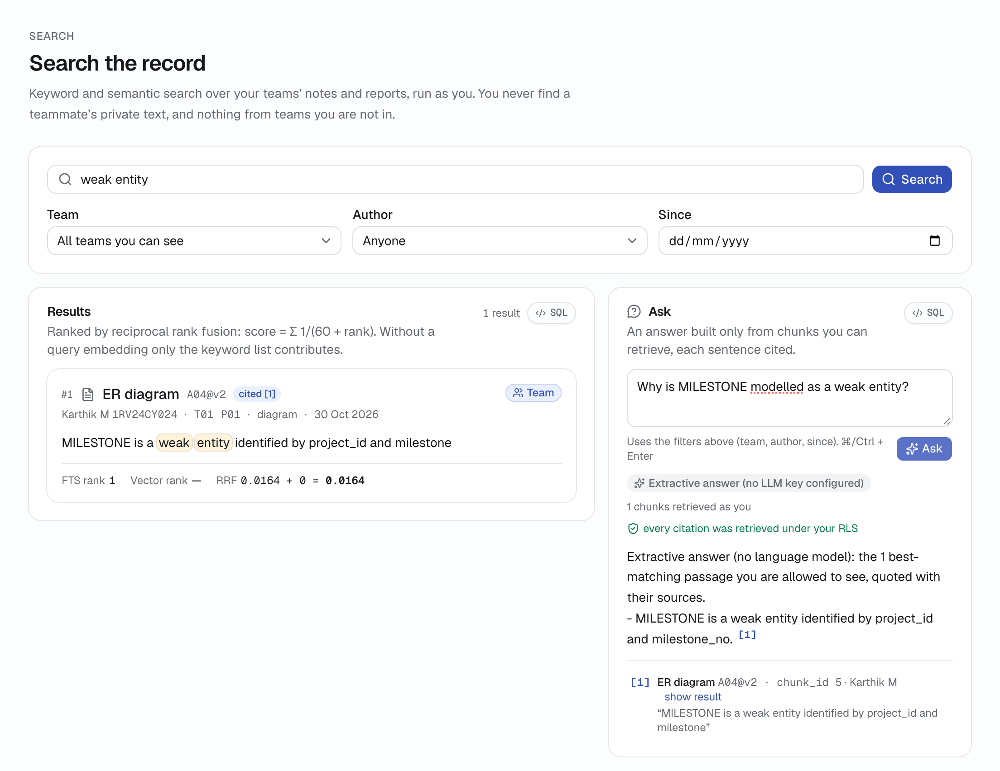
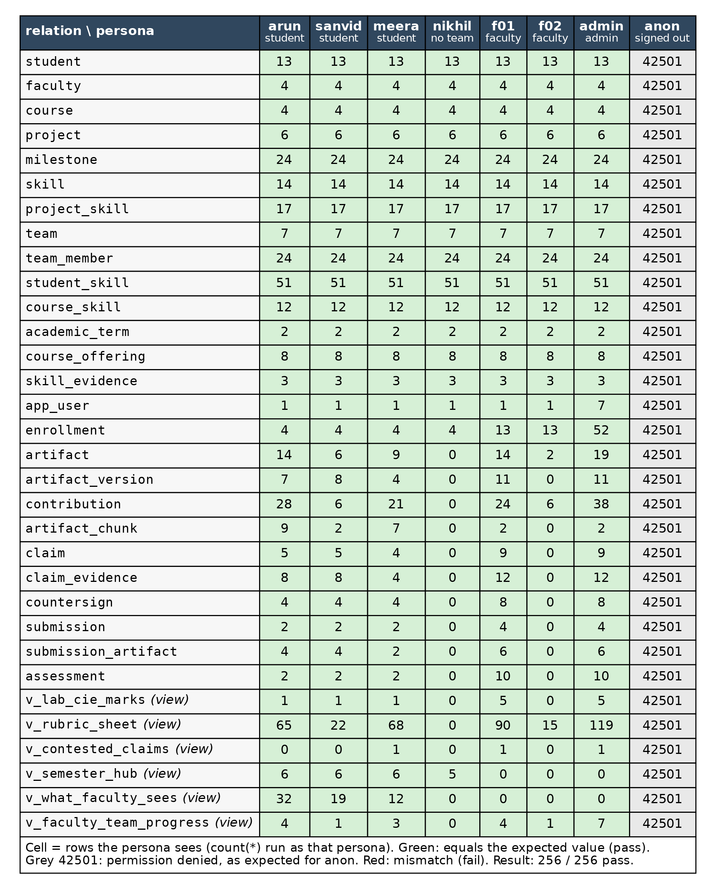
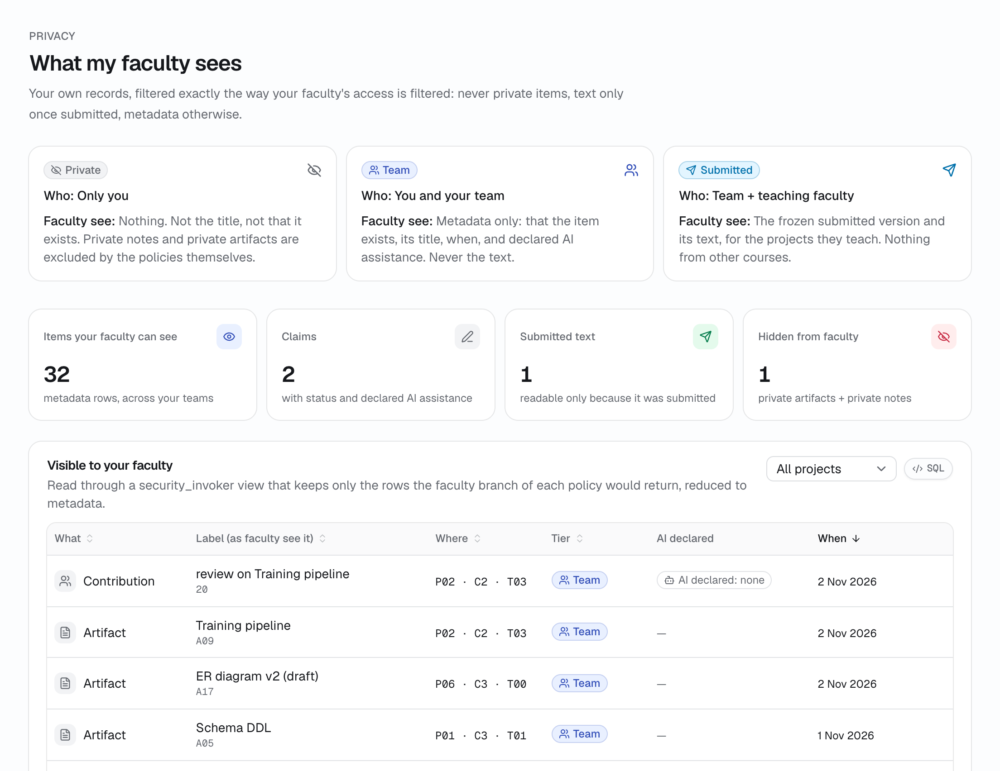
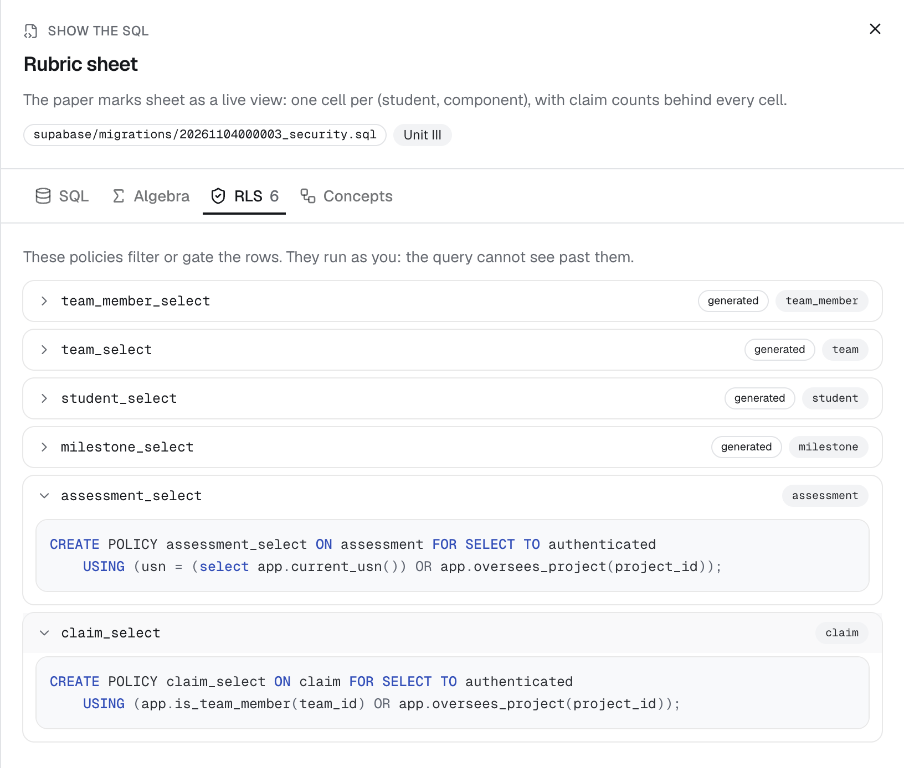
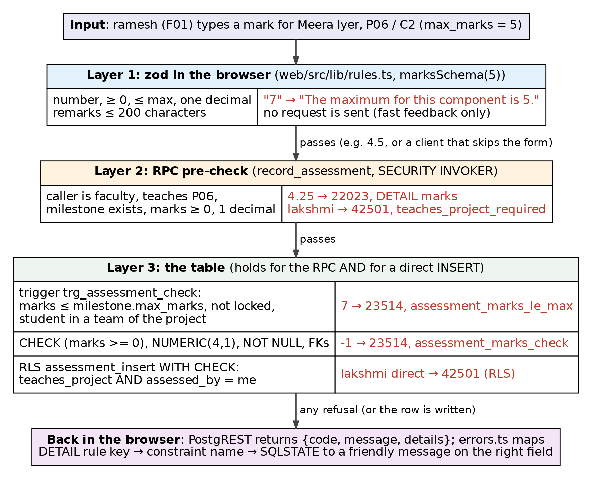

::: cover
**RV College of Engineering®, Bengaluru – 59**

**Department of Computer Science and Engineering**

**DATABASE MANAGEMENT SYSTEMS (CD252IA)**

**Lab Component 8: Design of Forms, Security and Validation**

&nbsp;

**FORMS, SECURITY AND VALIDATION**

**Unified Experiential Learning and Project Intelligence Platform**

(product name: Countersign)

&nbsp;

| USN | Name |
|:--|:--|
| 1RV24CY047 | S Arun Sanjay |
| 1RV24CY051 | Sanvid Razdan |

&nbsp;

Semester V, 2026-27

Revision 1.1, 5 November 2026
:::

::: toc
:::

# 0. Scope, sources and how to read this document

This is the Component 8 submission, *Design of Forms, Security and Validation* (10 marks). The course rubric in the project master file (§6.2, §6.4) names three things for this component, and the document has one part for each:

* **Part A, Forms.** Every form in the web app (`web/`): its fields and types, the client rule (zod), the server or database rule (CHECK constraint, trigger, RLS policy or RPC check, by name), the message the user sees, and a screenshot.
* **Part B, Security.** Authentication, the authorization model, the RLS policies of every table, column-level grants, `security_invoker` views, the SECURITY DEFINER inventory, the private schema, Realtime, the webhook signature, the API's use of keys, and secrets handling. It ends with the results of the RLS matrix test and the abuse-case suite.
* **Part C, Validation.** The three layers (zod in the browser, then the RPC pre-check, then CHECK/FK/trigger in the table), one worked example traced through all three layers, and the constraint-violation gallery.

The lab manual's sub-rubric for C5 to C11 is not in the repository (open item 2 in `docs/PLAN.md` §8), so the three parts follow the master file's own description of this component: "Forms, security (RBAC, RLS, private schema), validation".

**Evidence, and where it comes from.** Every table marked *generated* was produced by `docs/lab/diagrams/c8/gen_c8.py` from the **local** Supabase stack (PostgreSQL 17) on 5 November 2026, directly after `scripts/reset_local.sh` (migrations 0001 to 0006, fixture and demo seed, the seven personas). The generator only reads. Each test file runs in its own `BEGIN ... ROLLBACK`. Every REST call in the worked example is a request that the database refuses. The screenshots were taken the same day with Playwright (installed Chrome) against `npm run dev` on the same local stack. No form was actually submitted while the screenshots were taken: each shows an input being refused, or a dialog before its confirm button. So the seed state was not changed. Full-page screenshots are cropped to the page content (the navigation sidebar is removed) so that they stay legible in print. The live project and MongoDB Atlas were not touched.

| Test suite (where run) | Result |
|---|---|
| pgTAP, `supabase/tests/01` to `06` (re-run for this document, local stack) | 657 / 657 pass |
| of which `01_constraints.sql` (constraint gallery) | 45 / 45 |
| of which `02_rls_matrix.sql` (persona × relation matrix) | 298 / 298 |
| of which `04_abuse_cases.sql` (attacks replayed as direct writes) | 53 / 53 |
| Graded fixture Q1 to Q37 (plain PG17), M1 to M25 (MongoDB) | 37 / 37, 25 / 25 (latest project run, not re-run here) |
| API pytest, web end-to-end (Playwright) | 47, 38 (latest project run, not re-run here) |

**Deployment status.** The live Supabase project `countersign-dbms` (ap-south-1) has migrations 0001 to 0006 applied. The seven personas exist (password `Countersign@2026`; demo accounts only), sign-ups are disabled, and the `github-webhook` Edge Function is deployed. Sixteen signed webhook deliveries were replayed: 9 were projected, 1 was ignored (a feature-branch push), and 6 were not stored (one `ping`, one `issues` event, two signature failures answered 401, and two duplicates). The projected deliveries gave 29 GitHub contributions and 58 chunks. Atlas database `elp` has its `$jsonSchema` validators, `notes` and `note_versions`. No Anthropic or Voyage key is configured yet, so `/ask` runs in its extractive mode (quoted sentences with citations) and the embedding path, although built, is unused. A CI workflow exists in `.github/` but has not been pushed, because pushing it needs a GitHub token with the `workflow` scope.

**Terms.** *anon* and *authenticated* are the two PostgreSQL roles that PostgREST switches to for a request without and with a valid user JWT. *service_role* is the role used by the server-side pipeline only. *RLS* is row-level security. *USING* decides which existing rows a command may see or touch. *WITH CHECK* decides which new or changed rows it may write. A *SECURITY DEFINER* function runs with its owner's privileges. A *SECURITY INVOKER* function (or a view with `security_invoker = true`) runs with the caller's privileges, so the caller's RLS applies.

# Part A - Forms catalogue

## A.1 How every form is built

Each form uses the same three pieces, so the behaviour is uniform:

1. **`FormField`** (`web/src/components/FormField.tsx`) draws the label, the control, a hint and an error line. It gives the control `aria-invalid` and `aria-describedby`, and the error line `role="alert"`, so a screen reader announces the message.
2. **A zod schema** from `web/src/lib/rules.ts`, attached with `react-hook-form` and `zodResolver`. Each schema mirrors a CHECK constraint or an RPC input check, and its doc comment names that constraint. Zod is only for fast feedback. It is never the guarantee.
3. **`applyServerError`** (`web/src/lib/notify.ts`) passes any server error through `toAppError` (`web/src/lib/errors.ts`). If the database named the field that was wrong, the message goes under that field. Otherwise it is shown as a toast, with a technical line such as `SQLSTATE 23514 · team_capacity`.

`toAppError` relies on a contract with the database (migrations 0002 to 0004). Every rule raises a real SQLSTATE, which PostgREST returns as `code`. Every trigger and RPC puts a stable **rule key** in DETAIL, which PostgREST returns as `details`. A plain CHECK, UNIQUE or FK violation names its constraint inside `message`. So the lookup order is: **rule key in `details`, then the constraint name in `message`, then the SQLSTATE fallback**. The table `RULES` in `errors.ts` holds 74 rule keys and constraint names, each with a title, a sentence and the form field it belongs to. Supabase Auth errors have their own map (`AUTH_CODES`).

## A.2 The forms at a glance

| # | Form | Route, role | Write path | Client schema | Figure |
|--:|:---------|:----------|:--------------|:----------|:--|
| 1 | Sign in | `/login`, anyone | Supabase Auth `signInWithPassword` | `signInSchema` (LoginPage.tsx) | 1, 2 |
| 2 | Join a team | `/team`, student | RPC `join_team(p_team_id)` | none (one button per team) | 3, 4 |
| 3 | File a claim, with evidence | `/projects/:id`, student | RPCs `file_claim`, then `add_claim_evidence` per extra row | `fileClaimSchema`, `addEvidenceSchema` | 5 |
| 4 | Countersign: confirm or dispute | `/projects/:id` → **Countersign queue** tab, student | RPC `countersign_claim` | `countersignSchema` | 6, 7, 8 |
| 5 | Submit a component | `/projects/:id`, student | RPC `submit_milestone` | `submitSchema` | 9 |
| 6 | Private note | `/notes`, student | RPCs `save_private_note`, `delete_private_note` | `noteSchema` | 10 |
| 7 | Marks entry (drawer, and the grid's entry mode) | `/sheet/:id`, faculty | RPC `record_assessment` | `marksSchema(max)` | 11 |
| 8 | Lock a component | `/sheet/:id`, faculty or admin | RPC `lock_milestone` | none (type-to-confirm) | 12 |
| 9 | Search and ask | `/search`, signed-in users | RPC `search_chunks`; API `POST /ask` | none (button disabled when empty) | 13 |

Every write goes through a SECURITY INVOKER RPC that runs as the caller. So the RLS policies of Part B and the triggers of Part C apply to every statement inside it, exactly as they would to a direct table write. Section C.4 shows the same refusals for direct writes.

## A.3 Form 1: Sign in

| Field | Control, type | Client rule (zod) | Server rule | Message shown |
|---|---|---|---|---|
| email | `<input type=email>`, text | `z.email()` | Supabase Auth: the account must exist; sign-ups are disabled (`enable_signup = false`), so only accounts an admin created exist | "Enter a valid email address." |
| password | `<input type=password>`, text | `min(1)` | Auth checks the bcrypt hash; `minimum_password_length = 6` | "Enter your password." |
| (both) | | | `invalid_credentials` (HTTP 400). Auth deliberately does not say which of the two was wrong. | **Wrong email or password:** "Check your email and password and try again." (under *password*) |

The demo persona buttons on the same page call the same `signIn` with the shared demo password, and `VITE_SHOW_PERSONAS=false` hides them. After sign-in, `AuthProvider` reads the caller's own `app_user` row (RLS lets each user read only that row) to learn their role and USN or faculty id. A login that has no `app_user` row gets the message "This login is not linked to a profile" and reads nothing (see B.2).

{width=55%}

{width=55%}

## A.4 Form 2: Join a team

The team page shows one card per team of the chosen project, with the members and a capacity bar. The only input is the team the student clicks (`p_team_id`, `VARCHAR(5)`). A full team still offers **Join anyway**. This is deliberate: the database, not the button, decides, and the user sees why.

| Rule | Layer, object | SQLSTATE · rule key | Message shown |
|---|---|---|---|
| Caller is a signed-in student | RPC `join_team` | 42501 · `student_required` | Students only |
| Team exists | RPC `join_team` | P0002 · `team_not_found` | Team not found |
| Not already a member | RPC `join_team`; PK `team_member_pkey` behind it | 23505 · `already_member` | Already a member |
| A student adds only themself | RLS `team_member_insert`: `usn = app.current_usn() OR app.is_admin()` | 42501 | Not allowed: row-level security |
| Columns a student may supply: `team_id, usn, role` (`joined_at` is server-owned) | column GRANT | 42501 | Not allowed |
| Role is chosen by the server (the first member leads) | trigger `trg_team_member_role` | (silently set) | — |
| Capacity: never above `max_size`, also on UPDATE, race-safe | trigger `trg_team_capacity_v2` → `private.enforce_team_capacity_v2()` | 23514 · `team_capacity` | **Team is full:** "This team already has 4 of 4 members. Pick another team." |
| One team per student per project | trigger `trg_team_one_per_project` | 23505 · `one_team_per_project` | Already in a team |
| Enrolled in the project's course offering | same trigger function | 23514 · `team_member_enrolled_required` | Enrollment required |

The capacity trigger *writes* the team row before counting ("serialize by writing the parent row"). Under READ COMMITTED a second joiner therefore waits and is then refused. Under REPEATABLE READ or SERIALIZABLE it receives 40001 and the client retries. The earlier fixture trigger (Q35) only *locked* the row and over-admitted under REPEATABLE READ; that is the Component 10 finding (`experiments/race/FINDINGS.md`). The `errors.ts` entry for 40001 reads "Someone else changed this at the same moment. Please try again."

{width=42%}

{width=42%}

## A.5 Form 3: File a claim, with evidence

"I did X for component C", backed by receipts. The form is a dialog on the project page. On submit, `file_claim` creates the claim in one transaction, together with the cited artifact's latest version as evidence #1. Each extra evidence row is then sent with `add_claim_evidence`. If an extra row is refused, the claim already exists. The dialog then closes with the toast "Claim #n filed, evidence k refused", naming the row (`EvidenceAfterClaimError` in `web/src/data/projects.ts`).

| Field | Control, type | Client rule (zod, `rules.ts`) | Server / database rule | Message shown |
|---|---|---|---|---|
| milestone_no | select, INT | `int().positive()`; locked components are disabled in the list | RPC: `milestone_not_found` (P0002), `milestone_locked` (55000); trigger `trg_claim_guard` → `milestone_locked`; FK `claim_project_id_milestone_no_fkey` | "Pick a component." / Component is locked |
| contribution_type | select | `enum(research, design, code, documentation, review)` | RPC: 22023 `contribution_type`; CHECK `claim_contribution_type_check` | "Pick the kind of work." |
| statement | textarea, `VARCHAR(500)` | `trim().min(10).max(500)` | RPC: 22023 `statement`; CHECK `claim_statement_check` (`length(btrim(statement)) >= 10`) | "Describe the work in at least 10 characters." |
| ai_assistance | select | `enum(none, assisted, generated)` | RPC: 22023 `ai_assistance`; CHECK `claim_ai_assistance_check` | "Declare AI assistance as none, assisted or generated." |
| artifact_id | select (optional) | `max(5)`; only artifacts of this component that have a saved version | RPC: `artifact_not_found` (P0002; RLS hides a teammate's private artifact), `artifact_no_version` (55000) | Artifact not found / Nothing saved yet |
| evidence[i].kind | select | `enum(contribution, artifact_version, commit, url, file)` | RPC: 22023 `kind`; CHECK `claim_evidence_kind_check`, `claim_evidence_kind_matches` | "Pick a kind of evidence." |
| evidence[i].ref | text | per kind: `^[0-9]{1,9}$`, `^[A-Za-z0-9]{1,5}(@v[0-9]{1,6})?$`, `^[0-9a-f]{7,40}$`, `^https?://\S+$` | RPC: the same regular expressions (22023 `ref`); CHECK `claim_evidence_ref_format`; trigger `trg_claim_evidence_check` → `claim_evidence_same_team`, `claim_evidence_own_contribution`; UNIQUE `claim_evidence_once_contribution` / `_once_version` | "A URL starts with http:// or https://." and others |
| evidence[i].note | text | `max(200)` | `VARCHAR(200)` | "Keep the note under 200 characters." |
| (whole form) | | at least one receipt: a cited artifact or ≥ 1 evidence row; at most 10 rows | — | "Attach at least one receipt ..." |
| (who) | | — | RPC: 42501 `student_required`, `project_member_required`; RLS `claim_insert` (`usn = me AND is_team_member(team_id)`); trigger `trg_claim_member_required`; column GRANT (no `claim_id`, `status`, `revision`, `created_at`) | Join a team first |

The team is never sent: `file_claim` derives it from the caller's membership (one team per project). The status is never sent either: `trg_claim_status_derived` sets it to pending, confirmed or contested from the countersigns, and overwrites a hand-written value (gallery happy path 42). A URL such as `javascript:alert(...)` is refused by the CHECK even when the RPC is bypassed (abuse case 29).

**Adding evidence later** (`AddEvidenceForm` on a pending claim in *My claims*) uses the same `addEvidenceSchema` and `add_claim_evidence`. The RPC first locks the claim row, so two concurrent adds get evidence numbers n and n+1. Only the claimant may add (`claim_owner_required`, 42501), and only while the claim is pending (`claim_not_pending`, 55000). Each added row raises `claim.revision` (trigger `trg_claim_evidence_revision`). This is what binds a countersign to the text it endorsed (Form 4).

{width=80%}

## A.6 Form 4: Countersign, confirm or dispute

A teammate's pending claim appears in the **Countersign queue** tab of the project page, with its revision. **Confirm** opens a confirmation dialog with no fields. **Dispute** opens a form with one field.

| Field | Control, type | Client rule | Server / database rule | Message shown |
|---|---|---|---|---|
| verdict | button (confirm / dispute) | `enum(confirm, dispute)` | RPC: 22023 `verdict`; CHECK `countersign_verdict_check` | "Confirm or dispute." |
| comment | textarea, `VARCHAR(300)` | `max(300)`; required when verdict = dispute (`refine`) | RPC: 22023 `comment`; CHECK `countersign_dispute_needs_comment` | "A dispute needs a comment saying what is wrong." |
| claim_revision | hidden, INT (the revision on screen) | — | trigger `trg_countersign_check`: 55000 `countersign_stale_revision` if the claim changed since | **The claim changed:** "The claim was edited after you opened it. Read the latest version, then sign again." |
| (who) | — | — | RPC: 42501 `student_required`, P0002 `claim_not_found` (RLS: own teams only), 23514 `countersign_not_self`; trigger: `countersign_teammate_required`, `milestone_locked`; RLS `countersign_insert` (`endorser_usn = me`) | Not your own claim / Teammates only / Component is locked |

The claim's status is re-derived by trigger after every countersign: any dispute makes it *contested*, which puts it in the faculty queue `v_contested_claims`. A confirm makes it *confirmed*, and from then on its text and evidence are frozen: RLS `claim_update` allows only pending claims, and `trg_claim_guard` refuses with 55000 `claim_not_pending` even for a superuser (abuse case 27).

{width=100%}

{width=48%}

{width=48%}

## A.7 Form 5: Submit a component

The dialog lists the artifacts filed under the component. A private artifact, or one with no saved version, is shown disabled. Submitting freezes the latest version of each chosen artifact (`submission` + `submission_artifact`) and publishes those artifacts to the teaching faculty (visibility team → submitted), all in one transaction.

| Field | Control | Client rule | Server / database rule | Message shown |
|---|---|---|---|---|
| artifact_ids | checkboxes, `TEXT[]` | `submitSchema`: `array(string).min(1)` | RPC: 22023 `artifacts_required` | **Nothing selected:** "Choose at least one artifact to submit." |
| (each artifact) | — | private / unversioned disabled | RPC: P0002 `artifact_not_found`, 55000 `artifact_private`, 55000 `artifact_no_version`; trigger `trg_submission_artifact_check` → `submission_artifact_same_team`, `_same_component`, `_not_private` | Private artifact / Wrong component |
| milestone_no | fixed by the row | `int().positive()` | RPC: `milestone_not_found`, `milestone_locked`; trigger `trg_submission_open` → `milestone_locked` | Component is locked |
| attempt_no | server-computed | — | `pg_advisory_xact_lock` on (team, component), then max + 1; UNIQUE `submission_attempt_key` as the backstop | Submitted at the same moment |
| (who, when) | — | — | RPC: 42501 `team_member_required`; RLS `submission_insert` (`submitted_by = me AND is_team_member`); column GRANT leaves out `submitted_at` (no backdating); trigger `trg_submission_artifact_same_txn` → 55000 `submission_frozen` | Submission is frozen |

{width=60%}

## A.8 Form 6: Private note

Private notes live in `private.note`, a table in a schema that the API does not expose and on which no API role has any privilege. The only way in is through three SECURITY DEFINER RPCs that filter on `owner_usn = app.current_usn()` in every statement.

| Field | Control, type | Client rule (`noteSchema`) | Server / database rule | Message shown |
|---|---|---|---|---|
| title | text, `VARCHAR(120) NOT NULL` | `trim().min(1).max(120)` | RPC `save_private_note`: 22023 `title`; column type and NOT NULL | "Add a title." |
| body | textarea, `TEXT NOT NULL DEFAULT ''` | `string()` | coalesced to `''` | — |
| team_id | select (optional) | `string().optional()` | RPC: 42501 `team_member_required` if not the caller's team; FK `ON DELETE SET NULL` | Team members only |
| note_id (edit / delete) | hidden | — | RPC: the owner filter; a note that is not yours is reported exactly like a missing one, P0002 `note_not_found`, so the RPC does not reveal that the id exists | Note not found |

{width=75%}

## A.9 Form 7: Marks entry

The faculty rubric sheet `/sheet/:projectId` looks like the paper lab sheet. Clicking a cell opens a drawer with the claims, evidence and countersigns behind the mark, and the mark form. *Enter marks* mode turns each open cell into an input instead. Both use `marksSchema(max)` and the RPC `record_assessment`, which upserts one cell signed in the caller's name.

| Field | Control, type | Client rule (`marksSchema(max)`) | Server / database rule | Message shown |
|---|---|---|---|---|
| marks | number, `NUMERIC(4,1) NOT NULL` | number, `min(0)`, `max(max_marks)`, at most one decimal | RPC: 22023 `marks` (negative or more than one decimal); CHECK `assessment_marks_check` (`marks >= 0`); trigger `trg_assessment_check` → 23514 `assessment_marks_le_max` (`marks <= milestone.max_marks`), 55000 `milestone_locked`, 23514 `assessment_member_required` | "The maximum for this component is 5." / Marks exceed the maximum |
| remarks | textarea, `VARCHAR(200)` | `trim().max(200)` | column type | "Keep remarks under 200 characters." |
| (who) | — | — | RPC: 42501 `faculty_required`, `teaches_project_required`; RLS `assessment_insert` / `_update` (`teaches_project AND assessed_by = me`, or admin); `assessed_by` is set by the RPC to `app.current_faculty_id()` | Faculty only / Not your project |

Part C traces this form through all three layers.

{width=45%}

## A.10 Form 8: Lock a component

Locking makes a component's marks final. It also freezes the claims, countersigns and submissions on that component. For faculty, locking is one-way. The dialog shows the deadline and how many students are marked. If nobody has a mark yet, or the deadline has not passed, the lock button stays disabled until the component code (here `C5`) is typed. This is a UI guard against slips; the database rules are below.

| Rule | Layer, object | SQLSTATE · rule key |
|---|---|---|
| Only the teaching faculty or an admin | RPC `lock_milestone`; RLS `milestone_update` (`is_admin() OR teaches_project(project_id)`) | 42501 · `teaches_project_required` (a non-overseer's UPDATE matches no row) |
| Faculty may change `locked_at` only | trigger `trg_milestone_faculty_lock_only` | 42501 · `milestone_faculty_lock_only` |
| One-way for faculty (only an admin unlocks) | same trigger | 55000 · `milestone_locked` |
| No double lock, even concurrently | RPC: `UPDATE ... WHERE locked_at IS NULL`, then `NOT FOUND` | 55000 · `milestone_locked` |
| After the lock, nothing about the component changes | `private.assert_milestone_open` (FOR SHARE) inside the claim, countersign, submission and assessment triggers | 55000 · `milestone_locked` |

{width=48%}

## A.11 Form 9: Search and ask

| Field | Control, type | Client rule | Server rule |
|---|---|---|---|
| query (`p_query`) | text | Search disabled while empty | `search_chunks` is SECURITY INVOKER. The text is a bound parameter, parsed by `websearch_to_tsquery`, so any text is safe (no SQL is built from it). `p_limit` is clamped to 1..50. |
| team (`p_team_id`) | select of the caller's teams | from RLS-visible teams only | RLS on `artifact_chunk` / `artifact` decides; another team's chunks simply do not exist for the caller |
| author (`p_author_usn`) | select | members of the chosen teams | as above |
| since (`p_since`) | date | browser date input | `TIMESTAMPTZ` parameter |
| question (`POST /ask`) | textarea | Ask disabled under 3 characters | FastAPI `AskIn` (Pydantic): `question` 3..500 characters, `team_id` `^T[0-9]{2,3}$`, `author_usn` `^[0-9A-Z]{10}$`, `since` a date, `limit` 1..10, else 422. A team the caller is not in, or does not teach, gives 403 `team_access_denied`. Retrieval runs as the caller; every citation must be one of the retrieved chunks (cited ⊆ retrieved). |

{width=100%}

# Part B - Security

{width=100%}

## B.1 Authentication

* **Supabase Auth, email and password.** Sign-ups are disabled (`enable_signup = false` in `supabase/config.toml`; the same switch is off on the live project). Anonymous sign-ins and manual linking are off too. Accounts are created only by an admin, through the Auth Admin API (`scripts/create_personas.py`). In `config.toml`, access tokens expire after 3600 s and refresh-token rotation is on.
* **Personas** (synthetic `@example.edu` accounts, demo password `Countersign@2026`): students `arun` (1RV24CY047), `sanvid` (1RV24CY051), `nikhil` (1RV24CY077, in no team of P06's offering) and `meera` (1RV24CY033); faculty `ramesh` (F01, teaches CD252IA) and `lakshmi` (F02, teaches only CD253IA); and `admin`. The shared password is acceptable only because these are demo accounts in a sign-up-disabled project. Before real use, each user sets their own password, or GitHub OAuth is used (the planned identity binding, `docs/PLAN.md` §1 item 2).
* **The JWT** carries `sub` (the `auth.users` id) and `role = authenticated`. PostgREST verifies it and then runs the request as `SET ROLE authenticated`, with the claims available to `auth.uid()`. Without a JWT, the request runs as `anon`, which has no privileges (B.5).
* **The API** (FastAPI) verifies the same token offline against the project's JWKS (asymmetric keys), checking issuer, audience and expiry. It never holds a JWT secret.

## B.2 Authorization model: roles, `app_user` and the helper functions

There are three application roles: **student**, **faculty** and **admin**. They are rows, not PostgreSQL roles, because every signed-in user is the same PostgreSQL role (`authenticated`). The bridge is the table `app_user(user_id → auth.users, role, usn, faculty_id)`. Its CHECK `app_user_role_consistency` requires a student to have a USN, a faculty member to have a faculty id, and an admin neither (gallery row 5).

The policies never read `app_user` directly. They call small helper functions in schema `app`, which the Data API does not expose:

| Helper | Returns | Used for |
|---|---|---|
| `app.current_usn()`, `app.current_faculty_id()`, `app.current_app_role()` | the caller's own ids or role (NULL for anon, service role, or a login with no profile) | "is this my row?", "do I have a profile at all?" |
| `app.is_admin()` | boolean | admin-only writes |
| `app.is_team_member(team_id)`, `app.is_project_member(project_id)` | boolean | team content |
| `app.teaches_project(project_id)` | boolean: the project's offering's faculty (or, for the fixture projects, the course's) | faculty writes (marks, lock) |
| `app.oversees_project(project_id)` | `is_admin() OR teaches_project()` | staff reads |
| `app.is_eligible_for_project(usn, project_id)` | boolean: enrolled in the project's offering | teammate finder |
| `app.can_watch_topic(topic)` | boolean | Realtime channels |

All of them are `SECURITY DEFINER`, `STABLE`, with `SET search_path = ''` and schema-qualified names. This is needed because a policy on `team_member` that asks "is the caller in this team?" would otherwise query `team_member` under its own RLS and recurse. The functions return only a boolean or the caller's own id, so running as the owner leaks nothing. A non-correlated helper call is written `(select app.f())` in the policies, so the planner evaluates it once per statement (an InitPlan) instead of once per row.

A login without an `app_user` row has `current_app_role() IS NULL`. It therefore reads no student, roster or skill rows: every directory policy requires a profile, so signing up alone (were it enabled) would not expose the student directory (abuse case 49).

**Access summary.** S = student, F = faculty, A = admin; R = read, W = write. "Overseen" means the projects a faculty member teaches, or every project for an admin. This summary is read off the generated policy table in B.3, and the RLS matrix in B.11 checks it with real row counts.

| Table(s) | Student | Faculty | Admin |
|---|---|---|---|
| `student`, `faculty`, `course`, `project`, `skill`, `project_skill`, `team`, `course_skill`, `academic_term`, `course_offering`, `skill_evidence` | R all | R all | R all, W |
| `milestone` | R all | R all; W own projects (lock only, by trigger) | R, W |
| `team_member` | R all; insert / delete **self** (triggers decide) | R all | R, W |
| `student_skill` | R all; W own rows | R all | R, W |
| `app_user` | R own row | R own row | R, W |
| `enrollment` | R own | R rolls of offerings taught | R, W |
| `artifact`, `artifact_version`, `contribution` | R own teams' (a private artifact: owner only); W in own team, as self | R overseen, never private; no W | R overseen, never private; no W |
| `artifact_chunk` (the text) | R own teams' non-private, plus own private; W own | R overseen, **only `submitted` text** | same as faculty |
| `claim`, `claim_evidence`, `countersign` | R own teams'; file / edit / withdraw own *pending* claim; sign as self | R overseen; no W | R overseen; no W |
| `submission`, `submission_artifact` | R own teams'; insert as self | R overseen | R overseen |
| `assessment` (marks) | R **own marks only** | R overseen; W in own name | R, W, delete |
| `student_identity`, `team_repo` | R own / own teams' | R students and teams of overseen projects | R, W |
| `ingest_event` | none | R own projects' deliveries | R |
| `private.note` | only through the owner RPCs | none | none |
| `realtime.messages` | join `team:<own team>` | join `team:` / `project:` of overseen projects | same as faculty |

Anon (signed out) has nothing at all: 42501 on every relation (B.5).

## B.3 RLS policies of every table (generated from `pg_policies`)

RLS is enabled on every table in `public` (default deny). There is at most one permissive policy per (table, command), so "who may INSERT a claim?" has a single answer. Every policy is `TO authenticated`.

<!-- BEGIN generated: diagrams/c8/generated/rls_policies.md -->

Generated from `pg_policies` on the local database: **102 policies on 30 tables**, roles {authenticated}, kind PERMISSIVE. Tables whose policies are identical are listed together. For reading, the InitPlan wrapper `( SELECT app.f() AS f)` is printed as `app.f()`, and casts such as `::text` are dropped.

| Table(s) | Cmd | USING (which existing rows) | WITH CHECK (which new rows) |
|:----------|:-----|:------------------------|:------------------------|
| `academic_term`, `course`, `course_offering`, `course_skill`, `faculty`, `project`, `project_skill`, `skill`, `skill_evidence`, `student`, `team` | SELECT | `app.current_app_role() IS NOT NULL` | - |
|  | INSERT | - | `app.is_admin()` |
|  | UPDATE | `app.is_admin()` | `app.is_admin()` |
|  | DELETE | `app.is_admin()` | - |
| `app_user` | SELECT | `(user_id = auth.uid()) OR app.is_admin()` | - |
|  | INSERT | - | `app.is_admin()` |
|  | UPDATE | `app.is_admin()` | `app.is_admin()` |
|  | DELETE | `app.is_admin()` | - |
| `artifact` | SELECT | `CASE WHEN (visibility = 'private') THEN (owner_usn = app.current_usn()) ELSE (app.is_team_member(team_id) OR app.oversees_project(project_id)) END` | - |
|  | INSERT | - | `app.is_team_member(team_id) AND ((owner_usn IS NULL) OR (owner_usn = app.current_usn()))` |
|  | UPDATE | `app.is_team_member(team_id) AND ((visibility <> 'private') OR (owner_usn = app.current_usn()))` | `app.is_team_member(team_id) AND ((visibility <> 'private') OR (owner_usn = app.current_usn()))` |
| `artifact_chunk` | SELECT | `EXISTS ( SELECT 1 FROM artifact a WHERE ((a.artifact_id = artifact_chunk.artifact_id) AND ((app.is_team_member(a.team_id) AND ((artifact_chunk.visibility <> 'private') OR (artifact_chunk.author_usn = app.current_usn()))) OR ((artifact_chunk.visibility = 'submitted') AND app.oversees_project(a.project_id)))))` | - |
|  | INSERT | - | `(author_usn = app.current_usn()) AND (EXISTS ( SELECT 1 FROM artifact a WHERE ((a.artifact_id = artifact_chunk.artifact_id) AND app.is_team_member(a.team_id))))` |
| `artifact_version` | SELECT | `EXISTS ( SELECT 1 FROM artifact a WHERE (a.artifact_id = artifact_version.artifact_id))` | - |
|  | INSERT | - | `(created_by = app.current_usn()) AND (EXISTS ( SELECT 1 FROM artifact a WHERE ((a.artifact_id = artifact_version.artifact_id) AND app.is_team_member(a.team_id))))` |
| `assessment` | SELECT | `(usn = app.current_usn()) OR app.oversees_project(project_id)` | - |
|  | INSERT | - | `app.is_admin() OR (app.teaches_project(project_id) AND (assessed_by = app.current_faculty_id()))` |
|  | UPDATE | `app.is_admin() OR app.teaches_project(project_id)` | `app.is_admin() OR (app.teaches_project(project_id) AND (assessed_by = app.current_faculty_id()))` |
|  | DELETE | `app.is_admin()` | - |
| `claim` | SELECT | `app.is_team_member(team_id) OR app.oversees_project(project_id)` | - |
|  | INSERT | - | `(usn = app.current_usn()) AND app.is_team_member(team_id)` |
|  | UPDATE | `(usn = app.current_usn()) AND (status = 'pending')` | `(usn = app.current_usn()) AND app.is_team_member(team_id)` |
|  | DELETE | `(usn = app.current_usn()) AND (status = 'pending')` | - |
| `claim_evidence` | SELECT | `(EXISTS ( SELECT 1 FROM claim c WHERE (c.claim_id = claim_evidence.claim_id))) AND ((artifact_id IS NULL) OR (EXISTS ( SELECT 1 FROM artifact a WHERE (a.artifact_id = claim_evidence.artifact_id)))) AND ((contribution_id IS NULL) OR (EXISTS ( SELECT 1 FROM contribution k WHERE (k.contribution_id = claim_evidence.contribution_id))))` | - |
|  | INSERT | - | `EXISTS ( SELECT 1 FROM claim c WHERE ((c.claim_id = claim_evidence.claim_id) AND (c.usn = app.current_usn()) AND (c.status = 'pending')))` |
|  | DELETE | `EXISTS ( SELECT 1 FROM claim c WHERE ((c.claim_id = claim_evidence.claim_id) AND (c.usn = app.current_usn()) AND (c.status = 'pending')))` | - |
| `contribution` | SELECT | `EXISTS ( SELECT 1 FROM artifact a WHERE (a.artifact_id = contribution.artifact_id))` | - |
|  | INSERT | - | `(usn = app.current_usn()) AND (EXISTS ( SELECT 1 FROM artifact a WHERE ((a.artifact_id = contribution.artifact_id) AND app.is_team_member(a.team_id))))` |
| `countersign` | SELECT | `EXISTS ( SELECT 1 FROM claim c WHERE (c.claim_id = countersign.claim_id))` | - |
|  | INSERT | - | `(endorser_usn = app.current_usn()) AND (EXISTS ( SELECT 1 FROM claim c WHERE (c.claim_id = countersign.claim_id)))` |
|  | UPDATE | `endorser_usn = app.current_usn()` | `endorser_usn = app.current_usn()` |
|  | DELETE | `endorser_usn = app.current_usn()` | - |
| `enrollment` | SELECT | `(usn = app.current_usn()) OR app.is_admin() OR (EXISTS ( SELECT 1 FROM course_offering o WHERE ((o.offering_id = enrollment.offering_id) AND (o.faculty_id = app.current_faculty_id()))))` | - |
|  | INSERT | - | `app.is_admin()` |
|  | UPDATE | `app.is_admin()` | `app.is_admin()` |
|  | DELETE | `app.is_admin()` | - |
| `ingest_event` | SELECT | `app.is_admin() OR (EXISTS ( SELECT 1 FROM team t WHERE ((t.team_id = ingest_event.team_id) AND app.teaches_project(t.project_id))))` | - |
| `milestone` | SELECT | `app.current_app_role() IS NOT NULL` | - |
|  | INSERT | - | `app.is_admin()` |
|  | UPDATE | `app.is_admin() OR app.teaches_project(project_id)` | `app.is_admin() OR app.teaches_project(project_id)` |
|  | DELETE | `app.is_admin()` | - |
| `student_identity` | SELECT | `(usn = app.current_usn()) OR app.is_admin() OR (EXISTS ( SELECT 1 FROM (team_member tm JOIN team t ON ((t.team_id = tm.team_id))) WHERE ((tm.usn = student_identity.usn) AND app.teaches_project(t.project_id))))` | - |
|  | INSERT | - | `app.is_admin()` |
|  | UPDATE | `app.is_admin()` | `app.is_admin()` |
|  | DELETE | `app.is_admin()` | - |
| `student_skill` | SELECT | `app.current_app_role() IS NOT NULL` | - |
|  | INSERT | - | `(usn = app.current_usn()) OR app.is_admin()` |
|  | UPDATE | `(usn = app.current_usn()) OR app.is_admin()` | `(usn = app.current_usn()) OR app.is_admin()` |
|  | DELETE | `(usn = app.current_usn()) OR app.is_admin()` | - |
| `submission` | SELECT | `app.is_team_member(team_id) OR app.oversees_project(project_id)` | - |
|  | INSERT | - | `(submitted_by = app.current_usn()) AND app.is_team_member(team_id)` |
| `submission_artifact` | SELECT | `(EXISTS ( SELECT 1 FROM submission s WHERE (s.submission_id = submission_artifact.submission_id))) AND (EXISTS ( SELECT 1 FROM artifact a WHERE (a.artifact_id = submission_artifact.artifact_id)))` | - |
|  | INSERT | - | `EXISTS ( SELECT 1 FROM submission s WHERE ((s.submission_id = submission_artifact.submission_id) AND app.is_team_member(s.team_id)))` |
| `team_member` | SELECT | `app.current_app_role() IS NOT NULL` | - |
|  | INSERT | - | `(usn = app.current_usn()) OR app.is_admin()` |
|  | UPDATE | `app.is_admin()` | `app.is_admin()` |
|  | DELETE | `(usn = app.current_usn()) OR app.is_admin()` | - |
| `team_repo` | SELECT | `app.is_team_member(team_id) OR app.oversees_project(project_id)` | - |
|  | INSERT | - | `app.is_admin()` |
|  | UPDATE | `app.is_admin()` | `app.is_admin()` |
|  | DELETE | `app.is_admin()` | - |
| `realtime.messages` | SELECT | `(extension = 'broadcast') AND ((topic ~~ 'project:%') OR (topic ~~ 'team:%')) AND app.can_watch_topic(topic)` | - |

<!-- END generated -->

Three design points can be read off the table:

1. **Visibility composes.** Child tables reuse the parent's policy by writing `EXISTS (SELECT 1 FROM artifact a WHERE ...)`. That subquery is itself filtered by `artifact`'s RLS, so a version, contribution or chunk of an invisible artifact is invisible too, without repeating the rule.
2. **Content versus metadata.** Faculty see artifact rows (title, version, time) of the projects they teach, but chunk *text* only when `visibility = 'submitted'`. The text becomes `submitted` only when the team submits it (`trg_artifact_chunk_visibility_sync`). A `private` artifact is visible to its owner alone, and to nobody else, not even an admin (RLS matrix check 298).
3. **Deliberately missing policies.** `artifact`, `artifact_version`, `contribution` and `submission` have no DELETE policy, and some have no UPDATE policy: they are history. For an API user, RLS then denies the command outright.

## B.4 Column-level grants (generated)

RLS decides *which rows* a user may write. Column grants decide *which columns*. On the tables below, `authenticated` has no table-level INSERT or UPDATE, only the listed columns. Identity ids, timestamps and derived columns are therefore server-owned. A client cannot pick an id (squatting the next sequence value so that later inserts fail with 23505), cannot backdate a record (`submitted_at`, `signed_at`, `joined_at`), and cannot set a derived value (`claim.status`, `claim.revision`, `artifact_chunk.visibility`). Abuse cases 6, 37, 44 and 45 try exactly this and get 42501.

<!-- BEGIN generated: diagrams/c8/generated/column_grants.md -->

Generated from `has_column_privilege('authenticated', ...)`: the tables on which `authenticated` holds **no table-level INSERT**, only column-level grants.

| Table | INSERT allowed on | Never client-supplied (server-owned) | UPDATE allowed on |
|:------|:------------------|:-----------------|:------------|
| `artifact` | artifact_id, team_id, project_id, milestone_no, title, type, source, visibility, owner_usn, external_ref | created_at | milestone_no, title, visibility, owner_usn, external_ref |
| `artifact_chunk` | artifact_id, version_no, author_usn, content, embedding, embedding_model, content_hash | chunk_id, created_at, visibility, tsv, chunk_no | (none: append-only) |
| `artifact_version` | artifact_id, version_no, created_by, content_hash, mongo_ref, ai_assistance | created_at, source_ref | (none: append-only) |
| `claim` | usn, team_id, project_id, milestone_no, statement, contribution_type, ai_assistance | claim_id, status, revision, created_at | milestone_no, statement, contribution_type, ai_assistance |
| `claim_evidence` | claim_id, evidence_no, kind, contribution_id, artifact_id, version_no, ref, note | added_at | (none: append-only) |
| `contribution` | usn, artifact_id, contribution_type, description, source, source_ref, occurred_at, ai_assisted | contribution_id, created_at | (none: append-only) |
| `countersign` | claim_id, endorser_usn, verdict, comment, claim_revision | signed_at | verdict, comment, claim_revision |
| `ingest_event` | (none) | delivery_id, source, event_type, repo_full_name, team_id, received_at, status, attempts, error, mongo_id, msg_id, commit_count, contribution_count, projected_at, push_ref, push_after, sender_login, followups_at | (none: append-only) |
| `submission` | team_id, project_id, milestone_no, submitted_by, attempt_no | submission_id, submitted_at | (none: append-only) |
| `submission_artifact` | submission_id, artifact_id, version_no | (none) | (none: append-only) |
| `team_member` | team_id, usn, role | joined_at | team_id, role |

<!-- END generated -->

`authenticated` also has no TRUNCATE, REFERENCES, TRIGGER or MAINTAIN privilege on any table. TRUNCATE in particular is not subject to RLS. Default privileges are revoked as well, so a view or table created later (for example the fixture's Q27/Q28 views) is not readable until it is granted explicitly (abuse case 50).

## B.5 Privilege facts, `security_invoker` views and the private schema (generated)

<!-- BEGIN generated: diagrams/c8/generated/privileges.md -->

| Catalog check (local database) | Result |
|:--------------------------|:------------|
| Public tables with RLS enabled | 29 of 29 |
| Public tables/views on which anon has SELECT, INSERT, UPDATE or DELETE | 0 |
| Public functions anon may EXECUTE | 0 |
| Public tables authenticated may TRUNCATE (TRUNCATE bypasses RLS) | 0 |
| USAGE on schema app (anon / authenticated) | false / true |
| USAGE on schema private (anon / authenticated) | false / false |
| USAGE on schema pgmq (anon / authenticated) | false / false |
| Tables in schema private (RLS enabled; policies) | note (true; 0) |
| Public views, and how many are security_invoker | 6, 6 |
| Policies not scoped TO authenticated | 0 |
| SECURITY INVOKER RPCs callable by authenticated | 14: add_claim_evidence, countersign_claim, file_claim, find_full_cover, find_teammates, join_team, leave_team, lock_milestone, record_assessment, search_chunks, semester_hub, skill_gap, skill_subtree, submit_milestone |

| View | `reloptions` |
|:------|:------|
| `v_contested_claims` | `security_invoker=true` |
| `v_faculty_team_progress` | `security_invoker=true` |
| `v_lab_cie_marks` | `security_invoker=true` |
| `v_rubric_sheet` | `security_invoker=true` |
| `v_semester_hub` | `security_invoker=true` |
| `v_what_faculty_sees` | `security_invoker=true` |

<!-- END generated -->

* **`security_invoker` views.** A default PostgreSQL view runs with its *owner's* privileges and bypasses the caller's RLS, which is the classic Supabase data leak. All six views are created `WITH (security_invoker = true)`, so the base tables' policies filter every row they read. Some views also repeat a policy predicate on their driving table, so that, for example, a student does not get an empty mark row for every other student. `v_faculty_team_progress` has no content column at all (counts and timestamps only). `v_what_faculty_sees` lets a student check the privacy promise: it shows the student's own rows filtered by the faculty branch of each policy (Figure 17).
* **The private schema.** Schema `private` holds `private.note` and every trigger function. It is not in PostgREST's exposed schemas (`[api] schemas = ["public", "graphql_public"]`). `anon` and `authenticated` have no USAGE on it and no privilege on any object in it, including through default privileges. A direct `SELECT` from `private.note` fails with 42501 (RLS matrix check 267).
* **Anon.** `anon` has no privilege on any table, view or function in `public`, and no USAGE on `app`, `private` or `pgmq`. The API's `/health` check depends on this: it queries a table as anon and expects 42501.

## B.6 SECURITY DEFINER inventory, with justification (generated)

SECURITY DEFINER is the exception. Every *write path* that the app uses (`join_team`, `file_claim`, `countersign_claim`, `submit_milestone`, `record_assessment`, `lock_milestone`, and the others listed in B.5) is SECURITY INVOKER, so RLS applies inside it. The functions below must run as the owner, each for the reason given.

<!-- BEGIN generated: diagrams/c8/generated/secdef.md -->

Generated from `pg_proc` (`prosecdef = true`) on the local database: **52 SECURITY DEFINER functions**, all owned by `postgres`; **52 of 52** pin `search_path = ''`; **0** are executable by `anon`.

| Category | Functions | EXECUTE granted to | Why it must be SECURITY DEFINER |
|:--------|:--------------------------|:------|:------------------------|
| Policy helpers (9) | `app.current_app_role`, `app.current_faculty_id`, `app.current_usn`, `app.is_admin`, `app.is_eligible_for_project`, `app.is_project_member`, `app.is_team_member`, `app.oversees_project`, `app.teaches_project` | authenticated, service_role | Identity/membership helper called inside RLS policies. Reads `app_user` / `team_member` as the owner, so a policy on `team_member` can call it without recursing into its own RLS. Returns only a boolean or the caller's own id; STABLE. |
| Realtime topic check (1) | `app.can_watch_topic` | authenticated, service_role | Realtime join check for `team:<id>` / `project:<id>` topics: the same rule as artifact/contribution RLS. |
| Private-note RPCs (3) | `public.delete_private_note`, `public.my_private_notes`, `public.save_private_note` | authenticated, service_role | Private-note RPC. Schema `private` has no grants, so the function is the only door; every statement filters `owner_usn = app.current_usn()`, and a foreign note is reported as "not found". |
| Pipeline RPCs (5) | `public.ingest_fail`, `public.ingest_mark_raw`, `public.ingest_read`, `public.ingest_receive`, `public.project_push` | service_role | Ingestion pipeline RPC. EXECUTE for `service_role` only (Edge Function / worker); writes tables and the pgmq queue that API users cannot. All 0002 integrity triggers still fire. |
| Integrity triggers (24) | `broadcast_contribution` (contribution); `bump_claim_revision` (claim_evidence); `check_assessment` (assessment); `check_claim_evidence` (claim_evidence); `check_countersign` (countersign); `check_submission_artifact` (submission_artifact); `check_submission_open` (submission); `derive_claim_status` (claim); `enforce_one_team_per_project` (team_member); `enforce_team_capacity_v2` (team_member); `fill_team_repo_project` (team_repo); `guard_artifact_write` (artifact); `guard_claim` (claim); `guard_member_history` (team_member); `guard_milestone_faculty_update` (milestone); `guard_milestone_max_marks` (milestone); `guard_team_project` (team); `guard_team_shrink` (team); `member_role_for_caller` (team_member); `require_artifact_team_member` (artifact_chunk, artifact_version, contribution); `require_team_member` (artifact, claim, submission); `submission_artifact_same_txn` (submission_artifact); `sync_chunk_visibility` (artifact); `sync_claim_status` (countersign) | none (owner only) | Integrity trigger. Must see rows the writer cannot (e.g. the full member count, the claimant's team) so the rule holds for every caller. Not executable by any API role; fires automatically. |
| Internal helpers (10) | `private.assert_milestone_open`, `private.assert_team_member`, `private.claim_status`, `private.ingest_actor`, `private.ingest_archive`, `private.ingest_credit`, `private.ingest_milestone`, `private.is_restricted_caller`, `private.next_github_artifact_id`, `private.resolve_author` | none (owner only) | Internal helper of a definer trigger or pipeline RPC. No EXECUTE grant to any API role. |

<!-- END generated -->

Every one of them is owned by `postgres`, pins `search_path = ''` and uses schema-qualified names, so a caller cannot hijack a name through a planted object. None is executable by `anon`. All `private.*` functions have EXECUTE revoked from PUBLIC, `anon` and `authenticated`. Triggers fire whether or not the writer could call the trigger function. The integrity triggers are definers on purpose: a capacity check must count *all* members of the team, including rows the writer's RLS would hide, otherwise the rule would be only as strong as the writer's view.

## B.7 Realtime: metadata-only broadcasts on private topics

A new contribution is announced live (a toast on the faculty sheet and on the team's project page). The design avoids the two usual leaks:

* **No row payloads.** `postgres_changes` would ship whole rows to every subscriber. Instead, the AFTER INSERT trigger `trg_contribution_broadcast` calls `realtime.send()` with metadata only: `contribution_id, team_id, usn, artifact_id, occurred_at, source`. It never sends the description or any text. Contributions to a **private** artifact are not broadcast at all.
* **Private topics with RLS.** It sends on two private channels, `team:<team_id>` and `project:<project_id>`. Realtime checks the RLS policy `countersign_broadcast_select` on `realtime.messages` when a client joins: `extension = 'broadcast'`, a `team:` or `project:` topic, and `app.can_watch_topic(topic)`. That means the team's members or the project's staff for `team:`, and the project's staff for `project:`. These are the same people that `artifact` / `contribution` RLS shows these rows to. There is no INSERT policy, so clients cannot broadcast on these topics; only the database trigger can.

## B.8 The GitHub webhook: HMAC signature, then a service-role inbox

The Edge Function `github-webhook` is the only public entry point that does not carry a user JWT (`verify_jwt` is off for it, because GitHub cannot send a Supabase JWT). It authenticates the request itself:

1. It computes HMAC-SHA256 over the **raw body** with `GITHUB_WEBHOOK_SECRET` and compares the result with `X-Hub-Signature-256` in **constant time** (`timingSafeEqual`). A mismatch gets 401 `invalid_signature`, before any parsing. Bodies over 5 MB are refused, and the delivery id and event name are checked against strict patterns.
2. Only then does it call `ingest_receive()` with the service role. That RPC is SECURITY DEFINER, and EXECUTE is granted to `service_role` only. In one transaction it inserts `ingest_event` (`delivery_id` primary key, `ON CONFLICT DO NOTHING`) and queues one pgmq message.
3. **Replays are no-ops.** A redelivery with the same delivery id changes nothing. The signature covers only the body, so a captured body could be re-sent under a new delivery header; the key (repository, ref, after) makes that a no-op too.
4. **Credit needs a verified pusher.** GitHub authenticates only the pusher (`sender`). Commit author names and e-mails are self-asserted. A commit is credited as evidence only when its author resolves (through the admin-maintained `student_identity`) to the same student as the verified sender. Any other commit is logged in MongoDB and listed as unverified, never counted.

## B.9 The API never uses a service key for user reads

FastAPI forwards the caller's own JWT to PostgREST for every user request (`/notes`, `/consistency`, `/ask`, `/ingest/trace`). Who the caller is comes from their own `app_user` row, read under RLS. Which teams they may see comes from `v_faculty_team_progress`, a `security_invoker` view. `/ask` retrieves through `search_chunks` *as the caller*, so the AI layer can only quote what the user may read; Figure 13 shows "every citation was retrieved under your RLS". The one service-role path is the ingestion worker (`POST /ingest/drain` after an admin check, or the CLI), because the pipeline RPCs are service-role-only by design. The worker writes as service role, but every 0002 integrity trigger still fires on every row it writes.

## B.10 Secrets handling

| Secret | Where it lives | Who uses it |
|---|---|---|
| Publishable (anon) key | `web/.env.local` (local), `web/.env.remote` (cloud); both git-ignored | the browser; useless without a user JWT, because anon has no privileges |
| Service-role key | local stack: read from `supabase status` at start-up. Cloud: **never on disk**; fetched into the worker's shell from the Management API, or pasted into a silent `read -s` prompt (`docs/RUNBOOK.md` §1.2 and §6, C9 §4 step 5), and gone when the shell closes | the ingestion worker only (and `POST /ingest/drain`, only if the API was started with it); never in the browser bundle, never in `api/.env` |
| `GITHUB_WEBHOOK_SECRET` | `supabase/functions/.env` locally; `supabase secrets set` in the cloud | the Edge Function |
| `SUPABASE_ACCESS_TOKEN`, DB password | `supabase/.env` (git-ignored) | migrations and the CLI |
| Atlas URI | `atlas-credentials.env` (git-ignored) | setup scripts; read at start-up without printing it |

`.gitignore` ignores `*.env`, `*.env.*`, `.env*` and `*.pem` (except `*.env.example`), and the subfolders add their own rules. `git check-ignore` confirms that every file in the table is ignored. Scripts read keys from files or from `supabase status` and never print them. The generator for this document reads `web/.env.local` the same way. The web README states the rule: the browser only ever holds the publishable key.

**Known gaps (honest list).** These are the security-relevant open items of the C2 known-defects register (§3.8) plus three found while writing this document.

| # | Gap | Effect | Planned fix | State |
|--:|:--------|:--------|:--------|:--|
| 1 | **D2:** a direct INSERT or UPDATE of `assessment` by an **administrator** may name any faculty member in `assessed_by` (the RPC and the faculty policy pin it to the caller, the admin policy does not) | an admin could record a mark "signed" by someone else | forbid admin INSERT and keep only admin UPDATE/DELETE, or add an `entered_by` audit column | open |
| 2 | **D6:** leaked-password protection is off in the cloud project's Auth settings (security advisor WARN) | a persona could be given a known-breached password | switch it on in the dashboard | open |
| 3 | **D1:** one claim can cite the same `commit`, `url` or `file` reference more than once (only contribution and version pointers have partial UNIQUE indexes) | duplicate evidence rows inflate "Evidence (n)" | partial UNIQUE index on `(claim_id, kind, ref) WHERE ref IS NOT NULL` | open |
| 4 | **Migration 0007**, scheduled for C8 in C7 §12 (D1, D2, D4, and an Atlas role for D7) | – | – | **deferred**: not written for C8; the live project stays at 0001–0006, and C11 carries it as future work |
| 5 | The Atlas connection uses the setup (`atlasAdmin`) user; a least-privilege `elp_app` user (`readWrite@elp`) is planned but not created (`docs/PROTOTYPE_PLAN.md` §5); D7 (`note_versions` append-only by contract, not by role) follows from it | the API could do more in Atlas than it needs | separate Atlas user and role | open |
| 6 | The demo personas share one public password (B.1) | anyone who reads the repository can sign in to the demo | rotate before any public hosting (`docs/RUNBOOK.md` §7) | accepted for the demo |
| 7 | The CI workflow is not pushed (D9), so the tests in §0 are run by hand, not on every push | a regression is found only when someone runs the suites | push with a `workflow`-scoped token | open |
| 8 | The Supabase security and performance advisors were last checked during the database build (gate G7) and on 5 November for C2; they were not re-run for this document | – | re-run after 0007 | – |

## B.11 RLS matrix test (`supabase/tests/02_rls_matrix.sql`)

The test creates seven test personas inside its transaction (four students, two faculty, one admin); the eighth column of the matrix is `anon`, which has no user. For each of 32 relations (26 tables and 6 views) it runs `count(*)` *as* each persona (`SET role authenticated` with that persona's JWT claims, or `anon`), and compares the count with the expected value from the seed. The expected values are what the policies should let each persona see. For example, Arun sees 14 artifacts but not Sanvid's private A18; F02 (Lakshmi) sees none of P06's claims; and only the admin sees all 7 `app_user` rows. Rows that the GitHub pipeline adds are left out of the counts, so the test holds after a webhook replay too.

{width=95%}

<!-- BEGIN generated: diagrams/c8/generated/rls_other.md -->

Run of `supabase/tests/02_rls_matrix.sql` on the local stack: **298 / 298 pass** (256 matrix cells + 42 targeted checks).

| # | Targeted check (test description) | Result |
|--:|:--------------------------------|:--|
| 257 | every public table has RLS enabled | pass |
| 258 | every public table has at least one policy | pass |
| 259 | every public view is security_invoker | pass |
| 260 | anon holds no SELECT/INSERT privilege on any public table or view | pass |
| 261 | authenticated cannot TRUNCATE (TRUNCATE bypasses RLS) | pass |
| 262 | every policy is scoped TO authenticated | pass |
| 263 | private artifact A18 is invisible to its owner's teammate (Arun) | pass |
| 264 | versions of a private artifact are invisible to a teammate | pass |
| 265 | a student cannot read a teammate's marks | pass |
| 266 | rubric sheet shows a teammate's cells but not their marks | pass |
| 267 | private notes are not readable directly (schema private has no grants) | pass |
| 268 | "what faculty sees" never lists a private artifact | pass |
| 269 | the owner sees their own private artifact A18 | pass |
| 270 | ...but it is absent from the owner's "what faculty sees" view | pass |
| 271 | faculty never see a private artifact, even in a project they teach | pass |
| 272 | faculty read chunk text only once it is submitted | pass |
| 273 | lab CIE: (5+19)*30/120 = 6.0 and (4.5+18)*30/120 = 5.625 -> 5.6 | pass |
| 274 | F02 (does not teach CD252IA) sees no P06 claims | pass |
| 275 | F02 sees no P06 marks | pass |
| 276 | a student cannot write marks (not even their own) | pass |
| 277 | a student cannot file a claim in a teammate's name | pass |
| 278 | a student cannot file a claim for another team | pass |
| 279 | a student files their own claim for their own team | pass |
| 280 | a teammate countersigns a pending claim | pass |
| 281 | ...and the derived claim status becomes confirmed | pass |
| 282 | a student cannot countersign in someone else's name | pass |
| 283 | a confirmed claim cannot be edited (only pending claims are) | pass |
| 284 | a student cannot lock a milestone (no row is updatable) | pass |
| 285 | a student cannot create a private artifact owned by someone else | pass |
| 286 | a student cannot TRUNCATE | pass |
| 287 | a teamless student joins a team as themself | pass |
| 288 | a student cannot add someone else to a team | pass |
| 289 | faculty cannot file claims | pass |
| 290 | the teaching faculty enters a mark in their own name | pass |
| 291 | faculty cannot sign a mark in another faculty's name | pass |
| 292 | the teaching faculty locks a milestone | pass |
| 293 | faculty may change nothing on a milestone except locked_at | pass |
| 294 | faculty cannot unlock a locked milestone | pass |
| 295 | faculty cannot mark a project they do not teach | pass |
| 296 | faculty cannot lock a milestone of a project they do not teach | pass |
| 297 | an admin can unlock a milestone | pass |
| 298 | even an admin does not see private artifacts | pass |

<!-- END generated -->

{width=100%}

{width=100%}

{width=70%}

## B.12 Abuse-case suite (`supabase/tests/04_abuse_cases.sql`)

These are the findings of the security review round, each replayed the way an attacker would try it: a direct table write with the API role, not the friendly RPC. Each must now be refused *by the database*. The suite also checks the cases that *should* work (a student may make their own solo draft private, for example), so the rules are not simply "deny everything".

<!-- BEGIN generated: diagrams/c8/generated/abuse.md -->

Run of `supabase/tests/04_abuse_cases.sql` on the local stack: **53 / 53 pass**. Each attack is made the way an attacker would make it (a direct table write with the API role, not the friendly RPC); the expected result is the SQLSTATE and rule key the database must return.

| # | Attack or rule (test description) | Result |
|--:|:--------------------------------|:--|
| | **1. Team membership: enrollment, history, role** | |
| 1 | enrollment: an outsider cannot join a P06 team directly | pass |
| 2 | enrollment: ... nor through join_team | pass |
| 3 | enrollment: so T06's claims stay invisible to him | pass |
| 4 | role: a student joins T02 asking to be lead ... | pass |
| 5 | role: ... and is made a member (T02 already has a lead) | pass |
| 6 | joined_at is server-owned (no column privilege): no backdated membership | pass |
| 7 | history: a member with no recorded work may leave with a plain DELETE | pass |
| 8 | history: a direct DELETE cannot skip leave_team's rule | pass |
| 9 | history: ... Arun is still in T00 | pass |
| 10 | laundering: Ananya joins T06 (4/4) | pass |
| 11 | laundering: ... confirms Meera's claim | pass |
| 12 | laundering: ... and can no longer leave, so the confirm is always a teammate's | pass |
| 13 | one team per project: a staffed team cannot move project | pass |
| 14 | role: at most one lead per team (partial UNIQUE index) | pass |
| 15 | role: lead or member only (CHECK) | pass |
| | **2. Locked components: nothing about a locked claim changes, on any path** | |
| 16 | lock: a direct claim INSERT on locked C1 is refused | pass |
| 17 | evidence: none can be added to a confirmed claim (direct INSERT) | pass |
| 18 | lock: a countersign on a locked claim cannot be withdrawn | pass |
| 19 | lock: ... nor flipped to a dispute | pass |
| 20 | lock: a pending claim cannot be moved onto a locked component | pass |
| 21 | lock: Arun's C1 receipt is unchanged | pass |
| | **3. Countersign is bound to the revision the signer read** | |
| 22 | revision: editing the statement bumps claim.revision | pass |
| 23 | revision: a confirm of the text he read is refused after the edit | pass |
| 24 | revision: re-reading and signing the current revision works | pass |
| 25 | finality: an UPDATE of a confirmed claim matches no row (RLS: pending only) ... | pass |
| 26 | ... so the confirmed text is unchanged | pass |
| 27 | finality: even outside RLS a countersigned claim's content cannot change | pass |
| | **4. Evidence: own contributions only, typed refs, no duplicates** | |
| 28 | evidence: cannot cite a teammate's contribution as your own | pass |
| 29 | evidence: a url must be http(s) (no javascript: links) | pass |
| 30 | evidence: a commit must be a hex SHA | pass |
| 31 | evidence: cite A17@v1 once ... | pass |
| 32 | ... but not twice | pass |
| 33 | skill_evidence: usn must be the claim's claimant (composite FK on a superkey) | pass |
| | **5. Artifacts: no hijacking, hiding, moving or un-submitting** | |
| 34 | artifact: a submitted artifact cannot be made private | pass |
| 35 | artifact: ... nor un-submitted or moved to another component | pass |
| 36 | artifact: a teammate's shared draft cannot be taken over and hidden | pass |
| 37 | artifact: team_id / project_id are not updatable (no column privilege) | pass |
| 38 | artifact: cannot be created as submitted (only submitting does that) | pass |
| 39 | artifact: making your OWN solo draft private is allowed | pass |
| 40 | ... and sharing it again | pass |
| 41 | artifact: no path moves an artifact to another team | pass |
| 42 | artifact: faculty still see submitted A13 | pass |
| | **6. Submissions: frozen, never backdated, same component, chunks follow** | |
| 43 | submission: an earlier submission cannot gain artifacts later | pass |
| 44 | submission: submitted_at is server-owned (no backdating) | pass |
| 45 | ids are server-owned: a client cannot pick claim_id | pass |
| 46 | submission: a C4 artifact cannot be frozen into C3 | pass |
| 47 | chunks: Sanvid submits A17 for C3 | pass |
| 48 | chunks: ... and its text becomes visible to the teaching faculty with it | pass |
| | **7. Directory, default privileges, CIE layout, history FKs** | |
| 49 | directory: a login with no profile reads no students, rosters or skills | pass |
| 50 | default privileges: a view created later is not readable until granted | pass |
| 51 | CIE: one final component per project | pass |
| 52 | CIE: innovative/final components are out of 10 | pass |
| 53 | history: deleting a project no longer cascades through its teams' work (RESTRICT, was CASCADE) | pass |

<!-- END generated -->

# Part C - Validation

## C.1 Three layers, and why all three

| Layer | Where | What it checks | Can it be bypassed? | What it is for |
|---|---|---|---|---|
| **1. zod** | browser, `web/src/lib/rules.ts` (and `signInSchema`) | types, required fields, lengths, enumerations, formats (regular expressions), simple cross-field rules (a dispute needs a comment) | yes: any client can call the API directly | instant feedback on the right field, no round trip |
| **2. RPC pre-check** | SECURITY INVOKER functions in migration 0004 (and Pydantic on the API) | who the caller is (role, team, teaches), that referenced rows exist and are visible, state (locked, pending), and the same domains as the CHECKs | yes: a client can write the table directly (if RLS and grants allow) | readable messages with a rule key naming the field (DETAIL), and the right SQLSTATE |
| **3. The table** | CHECK, NOT NULL, FK, UNIQUE, EXCLUDE, column types; SECURITY DEFINER triggers for cross-row rules; RLS WITH CHECK for "who" | everything above that must hold for **every** writer: the app, a direct PostgREST call, the worker, a seed | no | the guarantee |

Layers 1 and 2 are copies of layer 3 kept for usability; they are not extra security. Each zod schema names, in its doc comment, the constraint it mirrors, so a change in one place is easy to follow to the others. MongoDB has its own layer 3: `$jsonSchema` validators (`mongo/validators.js`, `validationLevel: "strict"`, `validationAction: "error"`) on `notes`, `note_versions`, `github_events` and `portfolios`. They enforce the same patterns, for example the USN `^[0-9A-Z]{10}$`, `status` draft or final, `ai_assistance` none, assisted or generated, and a 64-hex `content_hash`.

## C.2 Worked example: one mark traced through the three layers

The input is a mark for Meera Iyer on P06, component C2 (Requirement Specification, `max_marks = 5`), entered by Dr. Ramesh Babu (F01, who teaches P06).

{width=85%}

**Layer 1 (browser).** The drawer's form uses `marksSchema(5)`: `z.number().min(0).max(5)` plus a one-decimal refinement. Typing 7 shows "The maximum for this component is 5." under the field (Figure 11), and no request is sent. The maximum comes from the milestone row the page already loaded, so this layer is a copy of the database's rule, not its source.

**Layers 2 and 3 (database).** To show that the database does not rely on the form, the generator sent these requests straight to PostgREST, with the anon key and each persona's own access token, exactly as the browser would but with the form skipped. Rows 3, 4, 6 and 9 skip the RPC as well and write the table directly. Every request was refused, and the last line confirms that nothing was written.

\smalltablestrue

<!-- BEGIN generated: diagrams/c8/generated/trace.md -->

| # | Caller, attempt and request (PostgREST) | Layer that refused | HTTP · SQLSTATE · DETAIL | Database message | Web message (title: text) |
|--:|:--------------------|:-------|:---------|:--------------|:-----------|
| 1 | **ramesh**: two decimals, through the RPC. `POST /rest/v1/rpc/record_assessment {"p_usn":"1RV24CY033","p_project_id":"P06","p_milestone_no":2,"p_marks":4.25}` | 2 RPC pre-check | 400 · 22023 · `marks` | Marks must be a non-negative number with at most one decimal | **Check the marks:** Marks must be a non-negative number with at most one decimal. |
| 2 | **ramesh**: above the maximum (5), through the RPC. `POST /rest/v1/rpc/record_assessment {"p_usn":"1RV24CY033","p_project_id":"P06","p_milestone_no":2,"p_marks":7}` | 3 trigger (reached via RPC) | 400 · 23514 · `assessment_marks_le_max` | Marks 7.0 exceed the maximum 5 for milestone P06/2 | **Marks exceed the maximum:** 7.0 is more than this component's maximum of 5. |
| 3 | **ramesh**: above the maximum, direct INSERT (RPC bypassed). `POST /rest/v1/assessment {"usn":"1RV24CY033","project_id":"P06","milestone_no":2,"marks":7,"assessed_by":"F01"}` | 3 trigger | 400 · 23514 · `assessment_marks_le_max` | Marks 7.0 exceed the maximum 5 for milestone P06/2 | **Marks exceed the maximum:** 7.0 is more than this component's maximum of 5. |
| 4 | **ramesh**: negative, direct INSERT. `POST /rest/v1/assessment {"usn":"1RV24CY033","project_id":"P06","milestone_no":2,"marks":-1,"assessed_by":"F01"}` | 3 CHECK | 400 · 23514 · `-` | new row for relation "assessment" violates check constraint "assessment_marks_check" | **Marks cannot be negative:** Enter marks of 0 or more. |
| 5 | **lakshmi**: valid mark by a faculty member who does not teach P06 (RPC). `POST /rest/v1/rpc/record_assessment {"p_usn":"1RV24CY033","p_project_id":"P06","p_milestone_no":2,"p_marks":4}` | 2 RPC pre-check | 403 · 42501 · `teaches_project_required` | You do not teach project P06 | **Not your project:** Only the faculty member who teaches this project, or an admin, can do this. |
| 6 | **lakshmi**: the same, direct INSERT. `POST /rest/v1/assessment {"usn":"1RV24CY033","project_id":"P06","milestone_no":2,"marks":4,"assessed_by":"F02"}` | 3 RLS WITH CHECK | 403 · 42501 · `-` | new row violates row-level security policy for table "assessment" | **Not allowed:** Row-level security blocked this: it is not your row to write. |
| 7 | **arun**: a student marking himself (RPC). `POST /rest/v1/rpc/record_assessment {"p_usn":"1RV24CY047","p_project_id":"P06","p_milestone_no":2,"p_marks":5}` | 2 RPC pre-check | 403 · 42501 · `faculty_required` | Only faculty can record marks | **Faculty only:** Only faculty can record marks. |
| 8 | **arun**: claim statement of 3 characters (RPC). `POST /rest/v1/rpc/file_claim {"p_project_id":"P06","p_milestone_no":5,"p_contribution_type":"design","p_description":"DFD"}` | 2 RPC pre-check | 400 · 22023 · `statement` | Describe the work in at least 10 characters | **Say a little more:** Describe the work in at least 10 characters. |
| 9 | **arun**: the same, direct INSERT. `POST /rest/v1/claim {"usn":"1RV24CY047","team_id":"T00","project_id":"P06","milestone_no":5,"statement":"DFD"}` | 3 CHECK | 400 · 23514 · `-` | new row for relation "claim" violates check constraint "claim_statement_check" | **Say a little more:** Describe the work in at least 10 characters. |

Afterwards, ramesh reads Meera's P06/C2 row: `[]`: every attempt was refused and nothing was written.

<!-- END generated -->

\smalltablesfalse

Reading the trace:

* **Rows 1 and 2 show the order of the layers.** 4.25 is caught by the RPC (layer 2, `marks`). 7 passes the RPC's checks (it is non-negative, with one decimal) and is caught by the trigger (layer 3, `assessment_marks_le_max`). The RPC does not compare with `max_marks`; the trigger is the single place that rule lives. A CHECK cannot express it, because the maximum is in another table (`milestone`). For the same reason, the trigger `trg_milestone_max_marks_guard` refuses to lower a `max_marks` below an existing mark (gallery row 32).
* **Row 3 is row 2 without the RPC**: the same refusal, word for word. **Row 4** shows a plain CHECK (`assessment_marks_check`, `marks >= 0`).
* **Rows 5 to 7 are about who may write, not what.** The RPC refuses Lakshmi (`teaches_project_required`) and Arun (`faculty_required`). Lakshmi's direct INSERT is refused by RLS (`assessment_insert` WITH CHECK). Faculty also cannot sign in another faculty member's name (RLS matrix check 291).
* **Rows 8 and 9** repeat the pattern for the claim statement: `file_claim` returns `statement`, and the direct INSERT hits CHECK `claim_statement_check`. Both map to the same message, "Describe the work in at least 10 characters."
* **One honest gap.** The column type `NUMERIC(4,1)` rounds a value with two decimals (4.25 is stored as 4.3) instead of rejecting it. Only layer 2 (the RPC) refuses 4.25. A direct INSERT of 4.25 by the teaching faculty would be stored as 4.3. This is harmless (the stored value is still within one decimal and the maximum), but strictly the "one decimal" rule is enforced by layers 1 and 2 only.

**Back in the browser.** For each refusal, PostgREST returns `{code, message, details, hint}`. `toAppError` finds the rule key in `details` (rows 1, 2, 3, 5, 7, 8), or the constraint name in `message` (rows 4, 9), or falls back to the SQLSTATE (row 6, where it recognises the RLS message). The last column of the trace table was produced by running each response through the real `errors.ts`.

## C.3 Constraint-violation gallery (`supabase/tests/01_constraints.sql`)

One violating statement per integrity rule, each run as `postgres` inside the test's transaction, so that only the table layer (layer 3) is tested. The table was generated from this run.

\smalltablestrue

<!-- BEGIN generated: diagrams/c8/generated/gallery.md -->

Generated by re-running every `throws_ok` statement of `supabase/tests/01_constraints.sql` in a rolled-back transaction and capturing the error (`GET STACKED DIAGNOSTICS`), then passing the error, as PostgREST would return it, through `toAppError()` in `web/src/lib/errors.ts`. **35 of 35** statements fail with the SQLSTATE the test expects. Rows are numbered as in the test's TAP output.

| # | Rule and the violating statement | SQLSTATE · constraint / rule key | Database message | Message the web shows (title: text) |
|--:|:----------------------------|:----------|:--------------|:--------------|
| 1 | CHECK: team.max_size must be 1..6 (fixture Q34): `INSERT INTO team (team_id, project_id, team_name, max_size, created_at) VALUES ('T99', 'P01', 'Team Overflow', 10, '2026-10-15')` | 23514 · `team_max_size_check` | new row for relation "team" violates check constraint "team_max_size_check" | **Not allowed:** That value breaks one of the rules. |
| 2 | CHECK: student.semester must be 1..8: `INSERT INTO student (usn, name, email, department, section, semester, joined_at) VALUES ('1RV24CY099', 'X', 'x@rvce.edu.in', 'CSE', 'A', 9, '2024-09-01')` | 23514 · `student_semester_check` | new row for relation "student" violates check constraint "student_semester_check" | **Not allowed:** That value breaks one of the rules. |
| 3 | CHECK: artifact.type is an enumerated domain: `INSERT INTO artifact (artifact_id, team_id, project_id, milestone_no, title, type, source) VALUES ('A99', 'T01', 'P01', 1, 'Clip', 'video', 'editor')` | 23514 · `artifact_type_check` | new row for relation "artifact" violates check constraint "artifact_type_check" | **Not allowed:** That value breaks one of the rules. |
| 4 | CHECK: a private artifact needs an owner: `INSERT INTO artifact (artifact_id, team_id, project_id, milestone_no, title, type, source, visibility) VALUES ('A99', 'T01', 'P01', 1, 'Secret', 'note', 'editor', 'private')` | 23514 · `artifact_private_needs_owner` | new row for relation "artifact" violates check constraint "artifact_private_needs_owner" | **Private needs an owner:** A private artifact must have an owner. |
| 5 | CHECK: app_user role must match its identifier (faculty with a USN): `INSERT INTO app_user (user_id, role, usn) VALUES (gen_random_uuid(), 'faculty', '1RV24CY047')` | 23514 · `app_user_role_consistency` | new row for relation "app_user" violates check constraint "app_user_role_consistency" | **Profile is inconsistent:** A student profile needs a USN and a faculty profile needs a faculty id. |
| 6 | CHECK: evidence kind must match the pointer that is filled: `INSERT INTO claim_evidence (claim_id, evidence_no, kind, ref) SELECT claim_id, 9, 'contribution', 'abc' FROM claim WHERE usn = '1RV24CY051' AND milestone_no = 3 AND project_id = 'P06'` | 23514 · `claim_evidence_kind_matches` | new row for relation "claim_evidence" violates check constraint "claim_evidence_kind_matches" | **Check the reference:** The reference does not match the kind of evidence chosen. (field `ref`) |
| 7 | CHECK: a dispute needs a comment: `INSERT INTO countersign (claim_id, endorser_usn, verdict) SELECT claim_id, '1RV24CY047', 'dispute' FROM claim WHERE usn = '1RV24CY051' AND milestone_no = 3 AND project_id = 'P06'` | 23514 · `countersign_dispute_needs_comment` | new row for relation "countersign" violates check constraint "countersign_dispute_needs_comment" | **Say what is wrong:** A dispute needs a comment saying what is wrong. (field `comment`) |
| 8 | CHECK: a claim statement needs at least 10 characters: `INSERT INTO claim (usn, team_id, project_id, milestone_no, statement) VALUES ('1RV24CY047', 'T00', 'P06', 5, 'did it')` | 23514 · `claim_statement_check` | new row for relation "claim" violates check constraint "claim_statement_check" | **Say a little more:** Describe the work in at least 10 characters. (field `statement`) |
| 9 | CHECK: marks cannot be negative: `INSERT INTO assessment (usn, project_id, milestone_no, marks, assessed_by) VALUES ('1RV24CY047', 'P06', 5, -1, 'F01')` | 23514 · `assessment_marks_check` | new row for relation "assessment" violates check constraint "assessment_marks_check" | **Marks cannot be negative:** Enter marks of 0 or more. (field `marks`) |
| 10 | EXCLUDE: academic terms cannot overlap: `INSERT INTO academic_term (term_id, name, start_date, end_date) VALUES ('2026-X', 'Overlapping term', '2026-12-01', '2027-01-31')` | 23P01 · `academic_term_no_overlap` | conflicting key value violates exclusion constraint "academic_term_no_overlap" | **Overlaps:** That overlaps an existing record. |
| 11 | FK: team_member.usn must be an existing student: `INSERT INTO team_member (team_id, usn, role) VALUES ('T02', '1RV24CY999', 'member')` | 23503 · `team_member_usn_fkey` | insert or update on table "team_member" violates foreign key constraint "team_member_usn_fkey" | **Linked record missing:** This refers to something that does not exist, or that you cannot see. |
| 12 | Composite FK: a T03 (P02) artifact cannot be filed under a P01 milestone: `INSERT INTO artifact (artifact_id, team_id, project_id, milestone_no, title, type, source) VALUES ('A99', 'T03', 'P01', 1, 'Misfiled', 'report', 'editor')` | 23503 · `artifact_team_project_fkey` | insert or update on table "artifact" violates foreign key constraint "artifact_team_project_fkey" | **Linked record missing:** This refers to something that does not exist, or that you cannot see. |
| 13 | Composite FK: a project's offering must be of the same course: `INSERT INTO project (project_id, course_code, title, start_date, end_date, offering_id) SELECT 'P99', 'CD253IA', 'Wrong offering', '2026-09-01', '2026-12-01', offering_id FROM course_offering WHERE course_code = 'CD252IA' AND term_id = '2026-ODD' AND section = 'A'` | 23503 · `project_offering_fkey` | insert or update on table "project" violates foreign key constraint "project_offering_fkey" | **Linked record missing:** This refers to something that does not exist, or that you cannot see. |
| 14 | RESTRICT: a student with a login and recorded work cannot be deleted (the first RESTRICT key checked is the login, `app_user_usn_fkey`; `contribution_usn_fkey` is RESTRICT too): `DELETE FROM student WHERE usn = '1RV24CY047'` | 23503 · `app_user_usn_fkey` | update or delete on table "student" violates foreign key constraint "app_user_usn_fkey" on table "app_user" | **Linked record missing:** This refers to something that does not exist, or that you cannot see. |
| 15 | RESTRICT: a course with offerings and projects cannot be deleted (the first key checked is `course_offering_course_code_fkey`; `project_course_code_fkey` is RESTRICT too): `DELETE FROM course WHERE course_code = 'CD254TA'` | 23503 · `course_offering_course_code_fkey` | update or delete on table "course" violates foreign key constraint "course_offering_course_code_fkey" on table "course_offering" | **Linked record missing:** This refers to something that does not exist, or that you cannot see. |
| 16 | RESTRICT: a project with teams, submissions, claims and marks cannot be deleted (the first key checked is `team_project_id_fkey`): `DELETE FROM project WHERE project_id = 'P06'` | 23503 · `team_project_id_fkey` | update or delete on table "project" violates foreign key constraint "team_project_id_fkey" on table "team" | **Linked record missing:** This refers to something that does not exist, or that you cannot see. |
| 17 | UNIQUE: a redelivered commit cannot create a duplicate contribution: `INSERT INTO contribution (usn, artifact_id, contribution_type, source, source_ref) VALUES ('1RV24CY047', 'A15', 'code', 'github', '3f9c2ab')` | 23505 · `contribution_idempotency_key` | duplicate key value violates unique constraint "contribution_idempotency_key" | **Already exists:** That already exists. |
| 18 | UNIQUE: one submission per (team, component, attempt_no): `INSERT INTO submission (team_id, project_id, milestone_no, submitted_by) VALUES ('T00', 'P06', 4, '1RV24CY051')` | 23505 · `submission_attempt_key` | duplicate key value violates unique constraint "submission_attempt_key" | **Submitted at the same moment:** A teammate submitted this component at the same moment. Refresh and try again. |
| 19 | Capacity: Team Alpha T01 is full (fixture Q36): `INSERT INTO team_member (team_id, usn, role) VALUES ('T01', '1RV24CY077', 'member')` | 23514 · `team_capacity` | Team T01 is full (4 / 4) | **Team is full:** This team already has 4 of 4 members. Pick another team. (field `team_id`) |
| 20 | Capacity: moving into a full team via UPDATE is also refused: `UPDATE team_member SET team_id = 'T01' WHERE team_id = 'T02' AND usn = '1RV24CY041'` | 23514 · `team_capacity` | Team T01 is full (4 / 4) | **Team is full:** This team already has 4 of 4 members. Pick another team. (field `team_id`) |
| 21 | Capacity: max_size cannot shrink below the member count: `UPDATE team SET max_size = 2 WHERE team_id = 'T01'` | 23514 · `team_capacity` | Team T01 already has 4 members; max_size 2 is too small | **Team is full:** This team already has as many members as it allows. Pick another team. (field `team_id`) |
| 22 | One team per project: Arun (T01) cannot also join T02 (both P01): `INSERT INTO team_member (team_id, usn, role) VALUES ('T02', '1RV24CY047', 'member')` | 23505 · `one_team_per_project` | Student 1RV24CY047 is already in team T01 for project P01 | **Already in a team:** You are already in a team for this project. A student joins one team per project. (field `team_id`) |
| 23 | Membership: a non-member cannot record a contribution: `INSERT INTO contribution (usn, artifact_id, contribution_type) VALUES ('1RV24CY077', 'A01', 'code')` | 23514 · `contribution_member_required` | Student 1RV24CY077 is not a member of team T01 | **Team members only:** Only members of this team can record work in it. |
| 24 | Membership: a non-member cannot author a chunk: `INSERT INTO artifact_chunk (artifact_id, version_no, author_usn, content) VALUES ('A01', 3, '1RV24CY077', 'x')` | 23514 · `artifact_chunk_member_required` | Student 1RV24CY077 is not a member of team T01 | **Team members only:** Only members of this team can record work in it. |
| 25 | Membership: a non-member cannot file a claim: `INSERT INTO claim (usn, team_id, project_id, milestone_no, statement) VALUES ('1RV24CY077', 'T00', 'P06', 3, 'I drew the whole ER diagram.')` | 23514 · `claim_member_required` | Student 1RV24CY077 is not a member of team T00 | **Team members only:** Only members of this team can record work in it. |
| 26 | Membership: only a student in a team of the project can be assessed: `INSERT INTO assessment (usn, project_id, milestone_no, marks, assessed_by) VALUES ('1RV24CY077', 'P06', 4, 10, 'F01')` | 23514 · `assessment_member_required` | Student 1RV24CY077 is not in any team of project P06 | **Not in this project:** That student is not in any team of this project. (field `usn`) |
| 27 | Countersign: a student cannot countersign their own claim: `INSERT INTO countersign (claim_id, endorser_usn, verdict) SELECT claim_id, '1RV24CY051', 'confirm' FROM claim WHERE usn = '1RV24CY051' AND milestone_no = 3 AND project_id = 'P06'` | 23514 · `countersign_not_self` | Student 1RV24CY051 cannot countersign their own claim 5 | **Not your own claim:** You cannot countersign your own claim. A teammate has to. |
| 28 | Countersign: only a teammate of the claimant may countersign: `INSERT INTO countersign (claim_id, endorser_usn, verdict) SELECT claim_id, '1RV24CY011', 'confirm' FROM claim WHERE usn = '1RV24CY051' AND milestone_no = 3 AND project_id = 'P06'` | 23514 · `countersign_teammate_required` | Student 1RV24CY011 is not a member of team T00 | **Teammates only:** Only a teammate of the claimant can countersign this claim. |
| 29 | Evidence: a claim cannot cite another team's work: `INSERT INTO claim_evidence (claim_id, evidence_no, kind, artifact_id, version_no) SELECT claim_id, 9, 'artifact_version', 'A19', 1 FROM claim WHERE usn = '1RV24CY051' AND milestone_no = 3 AND project_id = 'P06'` | 23514 · `claim_evidence_same_team` | Evidence belongs to team T06, but claim 5 is for team T00 | **Evidence from another team:** Evidence must come from your own team's work. (field `ref`) |
| 30 | Submission: cannot submit another team's artifact: `INSERT INTO submission_artifact (submission_id, artifact_id, version_no) SELECT submission_id, 'A19', 1 FROM submission WHERE team_id = 'T00' AND milestone_no = 1` | 23514 · `submission_artifact_same_team` | Artifact A19 belongs to team T06, not the submitting team T00 | **Not your team's artifact:** You can only submit artifacts that belong to your own team. (field `artifact_ids`) |
| 31 | Marks: cannot exceed milestone.max_marks (ER Diagram = 10): `INSERT INTO assessment (usn, project_id, milestone_no, marks, assessed_by) VALUES ('1RV24CY047', 'P06', 3, 11, 'F01')` | 23514 · `assessment_marks_le_max` | Marks 11.0 exceed the maximum 10 for milestone P06/3 | **Marks exceed the maximum:** 11.0 is more than this component's maximum of 10. (field `marks`) |
| 32 | Marks: max_marks cannot drop below an existing mark (Arun has 19/20): `UPDATE milestone SET max_marks = 15 WHERE project_id = 'P06' AND milestone_no = 4` | 23514 · `assessment_marks_le_max` | Milestone P06/4 has marks above 15 | **Marks exceed the maximum:** That is more than this component's maximum. (field `marks`) |
| 33 | Locked milestone: C1 marks cannot be edited: `UPDATE assessment SET marks = 4 WHERE usn = '1RV24CY047' AND project_id = 'P06' AND milestone_no = 1` | 55000 · `milestone_locked` | Milestone P06/1 is locked (since 2026-09-20 11:30:00+00); marks can no longer change | **Component is locked:** Marks for this component are final, so its claims, countersigns and submissions can no longer change. |
| 34 | Locked milestone: C1 marks cannot be deleted: `DELETE FROM assessment WHERE usn = '1RV24CY047' AND project_id = 'P06' AND milestone_no = 1` | 55000 · `milestone_locked` | Milestone P06/1 is locked (since 2026-09-20 11:30:00+00); marks can no longer change | **Component is locked:** Marks for this component are final, so its claims, countersigns and submissions can no longer change. |
| 36 | Capacity: ... and the next joiner is refused: `INSERT INTO team_member (team_id, usn, role) VALUES ('T02', '1RV24CY082', 'member')` | 23514 · `team_capacity` | Team T02 is full (4 / 4) | **Team is full:** This team already has 4 of 4 members. Pick another team. (field `team_id`) |

The other 10 assertions of the file are happy paths and derived-value checks (run of the unmodified file: **45 / 45 pass**):

| # | Happy path / derived value (test description) | Result |
|--:|:--------------------------|:--|
| 35 | Capacity: Nikhil takes the last free seat of T02 (3/4 -> 4/4) | pass |
| 37 | Capacity: updating a non-team column of a full team is allowed | pass |
| 38 | Contribution: a member records work; the id comes from the identity column | pass |
| 39 | Identity sequence continues after the fixture and demo ids | pass |
| 40 | Idempotency: ON CONFLICT DO NOTHING turns a redelivery into a no-op | pass |
| 41 | Marks: a mark within max_marks on an unlocked milestone is accepted | pass |
| 42 | Claim status: a hand-written status is overwritten by the derived value | pass |
| 43 | Claim status: a teammate's confirm makes the claim confirmed | pass |
| 44 | Claim status: any dispute makes the claim contested | pass |
| 45 | Demo seed: T06's synopsis claim is contested | pass |

<!-- END generated -->

\smalltablesfalse

How to read the last column:

* **Rules on paths that users write** (rows 4 to 9, 18 to 34 and 36) have their own entry in `errors.ts`, and most name the field to mark, for example `team_capacity` on the team card, `countersign_dispute_needs_comment` on *comment*, and `assessment_marks_le_max` on *marks*. Where the message carries numbers, they are taken from the database message ("11.0 is more than this component's maximum of 10").
* **Rules only an admin, the seed or the pipeline can hit** (rows 1 to 3 and 10 to 17: `team.max_size`, `student.semester`, `artifact.type`, term overlap, foreign keys, delete restrictions, the commit idempotency key) fall back to the generic SQLSTATE sentence ("That value breaks one of the rules.", "Linked record missing", "Already exists"). No end-user form writes those columns, so no specific sentence was written for them.
* **Delete actions are part of validation.** Rows 14 to 16 show that `ON DELETE RESTRICT` refuses the delete, and the constraint column names the **first** RESTRICT key PostgreSQL checked, which is not always the one the history rule is about: deleting Arun fails on `app_user_usn_fkey` (his login) before `contribution_usn_fkey` is reached; deleting CD254TA fails on `course_offering_course_code_fkey` before `project_course_code_fkey`; deleting P06 fails on `team_project_id_fkey`. All of these keys are `ON DELETE RESTRICT` (checked in `pg_constraint.confdeltype` on the local stack, 5 November 2026), so removing the first blocker would only expose the next. Erasure is a procedure, not a cascade.

## C.4 Summary for the viva

1. **Forms.** Nine forms. Each field has a zod rule that mirrors a named CHECK or RPC check. Server errors come back as SQLSTATE + rule key and land on the right field, through one lookup table (`errors.ts`).
2. **Authentication.** Supabase Auth, sign-ups off, accounts created by an admin. A JWT becomes `SET ROLE authenticated` with `auth.uid()`.
3. **Authorization.** `app_user` maps a login to student, faculty or admin. SECURITY DEFINER helpers in schema `app` answer "is this mine / my team / my project?". 102 RLS policies (101 in `public` plus 1 on `realtime.messages`), all `TO authenticated`, at most one per table and command. Column grants make ids and timestamps server-owned. Six `security_invoker` views. A private schema with no grants, reached only through owner-filtering RPCs. Anon has nothing.
4. **SECURITY DEFINER** is used only where it must be (52 functions: policy helpers, integrity triggers, private-note and pipeline RPCs). All pin `search_path = ''`; none is executable by anon.
5. **Validation** is three layers: zod, the RPC pre-check, and CHECK/FK/trigger. Only the third is a guarantee, as the worked example shows by sending the same bad input past each layer in turn.
6. **Evidence.** pgTAP 657/657: the constraint gallery 45/45, the RLS matrix 298/298 (256 persona × relation cells), the abuse cases 53/53.
