::: cover
**RV College of Engineering®, Bengaluru – 59**

**Department of Computer Science and Engineering**

**DATABASE MANAGEMENT SYSTEMS (CD252IA)**

**Lab Component 9: Demo and Draft Report**

&nbsp;

**DEMO SCRIPT AND DRAFT PROJECT REPORT**

**Unified Experiential Learning and Project Intelligence Platform**

(product name: Countersign)

&nbsp;

| USN | Name |
|:--|:--|
| 1RV24CY047 | S Arun Sanjay |

&nbsp;

Semester V, 2026-27

Draft 1.0, 19 November 2026
:::

::: toc
:::

# Document control

| Item | Value |
|:--|:--|
| Component | 9, Demo and Draft Report (30 raw marks, part of the 120 that is reduced to 30) |
| Version | Draft 1.0, 19 November 2026: the demo rewritten for a solo project (see the note below); Draft 0.95 (5 November 2026) was corrected after the read-only rehearsal on the live project and the lab panel's review |
| Author | S Arun Sanjay (1RV24CY047) |
| Product | Countersign: "every mark has a receipt" |
| Builds on | C2 SRS (rev. 1.2), C3 ER diagram, C5 DFD, C6 normalization, C10 experiment (`experiments/race/`) |
| Continued in | C11 Final Report (`C11_Final_Report.md`): evaluation, limitations, future work, appendices |

This document has two parts.

* **Part I, the demo script**, is what the presenter follows during the 12-minute demonstration: which screen shows what, every click, which persona is signed in, what to say, which "Show the SQL" drawer to open, the live push, the "try to break it" segment, the concurrency race and the normalization of the paper sheet. It ends with a pre-flight checklist and a fallback for each live moment.
* **Part II, the draft report**, describes what is built: the architecture, each module, the tests and the results.

**How the facts were checked.** The demo data in this version were read on the local stack on 19 November 2026, after `scripts/reset_local.sh`, with the current migrations (0001 to 0007) and the current demo seed: P06 has 8 claims. Team Countersign (T00) is a solo team, so Arun's three claims (#1 C1, #2 C4, #3 C3) have no countersign and are *pending*. In Team Sigma (T06), Aditi Rao's C1 claim #4 is *contested*, and her C4 review claim #8 is *pending* with two pieces of evidence and no countersign, so it waits in Meera's countersign queue. C1 is locked, and Team Beta (T02) has 3 of 4 members. Migrations 0001 to 0007 are all applied to the cloud project (checked on 19 November 2026); the solo-team demo seed has to be applied there before the demo, and pre-flight step 8 checks that it was. **Where each screenshot comes from is stated in its caption.** Figures 13 to 16 come from the read-only rehearsal on the live project on 5 November 2026 (badge *Cloud*, §14). The other screenshots are from local runs.

**Draft 1.0.** The project is now the work of one student, so the demo has one presenter and no student teammate in T00. The countersign is shown on Team Sigma (T06): Meera Iyer confirms her teammate Aditi Rao's pending C4 claim. Arun's own claims show how a solo team's claim rests on its evidence and the faculty review. Two presenter workarounds were dropped because the code no longer needs them: the rubric sheet and its drawer now refetch when the faculty window gets focus (no reload), and at 100 % zoom the grid fits a 1440-pixel window, with the Live chip repeated in the page header (no sideways scroll, no scrolling down to find the chip).

# Part I. Demo script

# 1. The demo in one paragraph

Every RVCE lab component is marked on a paper sheet that the lab faculty signs on trust. Countersign turns that sheet into the database schema. A student **claims** what they did for a component, backs the claim with **evidence** (commits, artifact versions, links), and a teammate **countersigns** it. In a solo team there is no teammate to countersign, so the claim rests on its evidence and the faculty review. The faculty sees the sheet as a live grid, and every cell opens the claims and receipts behind the mark. The demo shows the sheet, a claim and a countersign, a real webhook push that arrives as evidence in about a second, the database refusing every attempt to cheat, the concurrency race behind the "last team slot", and the normalization that turned the paper sheet into these tables.

# 2. Roles, screens and personas

The demo has one presenter, S Arun Sanjay, on one laptop connected to the projector. The three screens are three macOS desktops; switch between them with Ctrl+← and Ctrl+→.

| Screen | Desktop and window | Signed in as | Used for |
|:--|:--|:--|:--|
| **S, student** | desktop 1, Chrome profile **CS-Student**, full screen | `arun@example.edu` (S Arun Sanjay, 1RV24CY047, solo team T00), later `meera@example.edu` (Meera Iyer, 1RV24CY033, team T06) | hub, claims, countersign queue, Activity tab, search |
| **F, faculty** | desktop 2, Chrome profile **CS-Faculty**, full screen | `ramesh@example.edu` (Dr. Ramesh Babu, F01), later `lakshmi@example.edu` (F02) | rubric sheet, claim drawer, live toast, trace sheet, RLS, Race arena |
| **T, terminal** | desktop 3, font size 18 | no persona; shell in the repository root | live push, "try to break it", race |

**Why two Chrome profiles.** supabase-js keeps the session in the browser's `localStorage`, one per origin. Two windows of one profile share it, so signing in as ramesh in one window would sign the student out in the other. Separate profiles (or `http://localhost:5173` on one screen and `http://127.0.0.1:5173` on the other, which are different origins) keep the two sessions apart.

All personas use the password `Countersign@2026`. The login page has a one-click button for each, so no typing is needed.

| Persona | Role | What it shows in the demo |
|:--|:--|:--|
| arun | student, lead of the solo team T00 (P06) | files a claim backed by evidence; his C1, C3 and C4 claims stay pending because no teammate exists to countersign them; receives the live push; owns the private artifact A18 and two private notes |
| meera | student, in T01, T03 and T06 | the teammate countersign: confirms Aditi Rao's pending C4 claim on T06 (she can also file her own claims); "no recorded evidence yet" on the P06 sheet (never "ghost") |
| nikhil | student, no team in P01 | (backup) the Team Beta (T02) join, and the "team is full" refusal on T01. Not the teammate finder: he already holds every skill P01 requires, so his finder shows nobody |
| ramesh | faculty F01; teaches CD252IA (P01, P06) and also P05 (his sidebar lists P06, P05 and P01) | the rubric sheet, the claim drawer, the live toast, a live race in the Race arena |
| lakshmi | faculty F02, teaches only P02 | the same URL returns no rows (RLS) |
| admin | college admin | (backup) the **Ingestion** panel on the admin **Directory** page (`/admin`): inbox and consistency. **Sync now** works only if the API was started with the service key; the API of §4 step 4 runs without it, so the button answers 503 `worker_unconfigured` |

# 3. Run of show (12 minutes)

| Time | Segment | Screen S | Screen F / terminal T |
|:--|:--|:--|:--|
| 0:00 to 0:45 | 3.1 The paper sheet | `/hub` as arun | `/sheet/P06` as ramesh |
| 0:45 to 2:00 | 3.2 The sheet is the schema (normalization) | idle | SQL drawer of the rubric sheet; `/marks/P06` |
| 2:00 to 3:30 | 3.3 File a claim with evidence (solo team) | `/projects/P06` as arun, File a claim | idle |
| 3:30 to 4:45 | 3.4 Countersign, and a contested claim | meera: Countersign queue tab, Confirm | sheet refetches on focus; Arun's C3 and Aditi's C1 cells |
| 4:45 to 7:00 | 3.5 The live push | arun: Activity tab, then `/search` | T: replay; F: toast, trace sheet |
| 7:00 to 9:00 | 3.6 Try to break it (RLS) | faculty URL, "What my faculty sees" | T: curl as arun, ramesh, anon; F: lakshmi |
| 9:00 to 11:00 | 3.7 The last team slot (C10) | idle | T: `demo_locks.sh S2 RR`, then `S7 RR`; F: `/race` |
| 11:00 to 12:00 | 3.8 Closer | `/hub` | `/sheet/P06` as ramesh |

## 3.1 The paper sheet (0:00 to 0:45)

**Before:** Screen F shows `/sheet/P06` as ramesh (sidebar: P06, Rubric sheet). Screen S shows Arun's `/hub`.

1. Hold up the printed RVCE lab evaluation sheet.
2. Point to the column "Signature of Lab Faculty".

**Say:** "This is the sheet you will sign for this project. Nine components, 120 marks reduced to 30, plus 10 and 10. Each signature is given on trust: nothing on paper says who did the ER diagram. Countersign makes this sheet the database. Every mark has a receipt." Then switch to Screen F: "That is the same sheet, as live tables."

## 3.2 The sheet is the schema: normalization (0:45 to 2:00)

**Screen F, as ramesh on `/sheet/P06`:**

1. Point at the grid: columns C1 to C9 (raw /120, reduced /30), C10 and C11 (+10 each), Lab CIE /50. At 100 % zoom the whole grid fits a 1440-pixel window, so every column is on screen. The C1 column is hatched: it is locked.
2. Click the **SQL** pill on the **Rubric sheet** panel. The drawer *Show the SQL: Rubric sheet* opens on the **SQL** tab: the view `v_rubric_sheet`, verbatim from the migrations.
3. Click the **Algebra** tab: the join of TeamMember, Team, Student and Milestone, left outer joined with Assessment and with the claim counts. Say: "unmarked cells stay NULL; that is the outer join."
4. Click the **Concepts** tab: "Normalization: the marks sheet (UNF) rebuilt from BCNF tables". Close the drawer (Esc).
5. Click **Lab CIE marks** (top right). On `/marks/P06`, click the **SQL** pill on `v_lab_cie_marks`.

**Say:** "I normalized this sheet in Component 6. The paper sheets form one unnormalized relation, MARKS_SHEET, with one tuple per sheet and a repeating group of eleven lines, C1 to C11. 1NF flattens the group, so the key becomes USN, project and component number. 2NF removes the partial dependencies on the USN, the project and the team, and splits off MEMBERSHIP. 3NF removes Faculty → FacultyName. The 3NF result is not yet BCNF: in MEMBERSHIP, Team → Project has a left side that is not a key. The BCNF step splits on Team → Project, and that loses USN, Project → Team, so a trigger enforces it: one team per project. The chase tableau proves the join is lossless. The BCNF relations are projections of exactly the tables I implemented: student, project, team, team_member, milestone, assessment and faculty. The totals are not stored anywhere. 120 → 30 is computed by this view on every read, so it can never disagree with the marks." Point at the rounding note at the bottom of `/marks/P06`: "The rounding rule is one line of the view; if the department rounds differently, no stored mark changes. The marks themselves are strict: since migration 0007 a mark with a second decimal is refused on every write path, never rounded."

## 3.3 File a claim with evidence, in a solo team (2:00 to 3:30)

**Screen S, as arun:**

1. Sidebar, under **P06 · CD252IA Lab 2026-27**: **Team Countersign (T00)** (`/projects/P06`). The member list has one name: T00 is a solo team.
2. Click **File a claim** (top right). In the dialog:
   * Component: **C3 ER Diagram**.
   * Kind of work: **Design**.
   * What did you do?: *Wrote the 7-step ER-to-relational mapping table and checked every (min,max) against the schema.*
   * AI assistance: **Assisted** (say why, below).
   * Cite an artifact: **A17 ER diagram v2 (draft)**.
   * **Add evidence**: a row *#1 kind* **Link** appears; paste into *Reference*:

     ```text
     https://github.com/Arun-Sanjay/countersign-dbms/blob/main/docs/lab/C3_ER.md
     ```

3. Before filing, click the **SQL** pill at the bottom left of the dialog: *Show the SQL: File a claim* opens on `file_claim()` (SECURITY INVOKER); then the **RLS** tab: `claim_insert`, `claim_evidence_insert`. Press Esc **once**: only the drawer closes, and the filled-in dialog stays as it was.
4. Click **File claim**. Toast: "Claim #9 filed for C3" (the number is the next identity value; it may differ), with "2 pieces of evidence attached. Solo team: no teammate to countersign, so it rests on its evidence and faculty review."
5. Open the **My claims** tab: the new card is *Pending*, "Evidence (2)", and in place of a countersign it carries the note "Solo team: no teammate to countersign. This claim rests on its evidence and faculty review." The seeded C1, C3 and C4 claims carry the same note. (The SQL pill on this panel shows the read query, claim left-outer-joined with claim_evidence and countersign, under `claim_select`, not `file_claim()`.)
6. Open the **Countersign queue** tab: it is empty and says "You are the only member of this team, so no teammate claim will wait for your countersign."

**Say:** "A claim is a row, not a feeling. The RPC runs as me, so the database checks that I am in team T00, that C3 is still open, and that the evidence belongs to my team. I declared AI assistance, because I built this with Claude Code. It is a declaration, never a detection, and the faculty never sees it next to a viva score. My team has one member, so nobody can countersign this claim: it stays pending, and it rests on its evidence and on the faculty's review. I did not add a special case to the schema for that; the same trigger that derives every claim's status simply never sees a countersign."

## 3.4 Countersign, and a contested claim (3:30 to 4:45)

The countersign is shown on Team Sigma (T06) of the same project: Aditi Rao (lead), Karthik M and Meera Iyer.

**Screen S:**

1. User menu (the name at the bottom of the sidebar) → **Sign out** → one-click **meera**. Sidebar, under **P06**: **Team Sigma (T06)** (`/projects/P06`).
2. Open the **Countersign queue** tab (badge 1). The card is Aditi Rao's C4 claim #8: "Reviewed the SQL answers of the Test and corrected the GROUP BY and HAVING queries before submission.", "Evidence (2)": her review contribution on A20 (`A20@review`) and version 2 of A20 *Test answer sheet*, the submitted answer sheet.
3. Point at the footer: "You are signing **revision 3**. If it changes before you sign, the database refuses the signature."
4. Click **Confirm**, then **Confirm claim** in the dialog. Toast: "Confirmed claim #8 ... confirmed". The card leaves her queue.

**Say:** "Meera is Aditi's teammate, so she may countersign. The countersign carries the revision she read. If Aditi had edited the claim a second earlier, the database would refuse the signature: optimistic concurrency control. The claim's status is derived by a trigger; nobody types 'confirmed'. Meera can still file claims of her own; her teammates would countersign those."

**Screen F, as ramesh:**

5. Switch to desktop 2 and click anywhere in the window: the sheet refetches when the window gets focus, so no reload is needed. Aditi Rao's C4 cell had a tick and an amber clock (one confirmed claim, one pending); now it shows a tick with the count 2 (both confirmed). Arun's C3 cell shows an amber clock with the count 2: the seeded ER diagram claim and the one just filed, both pending.
6. Click **S Arun Sanjay's C3 cell**. The drawer lists both claims with their evidence; where a countersign would be, each says "Solo team: no teammate to countersign. This claim rests on its evidence and faculty review." Close (Esc).
7. Click **Aditi Rao's C1 cell** (4 /5, red warning triangle: contested). The drawer shows: Mark 4 /5, signed by Dr. Ramesh Babu, *Locked*; claim #4 *Contested*: "Wrote the entire synopsis, including the literature survey"; timeline: "Karthik M disputed revision 2: 'I wrote the literature survey (see version 2)'".
8. Click the **SQL** pill next to "Claims behind this cell". Close (Esc).

**Say:** "This is the faculty's review queue. Instead of a group mark, the teacher sees one disputed sentence, the version it points to, and who disagrees. For a solo team the drawer says plainly that nobody could countersign, so the teacher reads the evidence instead. Meera's row says *no recorded evidence yet*: it opens the claim flow; it is never a verdict."

## 3.5 The live push (4:45 to 7:00)

**Before (pre-flight, §4):** the API and the worker run against the cloud; the fresh push file was built with `make_demo_push.py` and its unique word is on a sticky note (example: `demoxauirh`).

**Screen S:** sign out meera, one-click **arun**, and open the **Activity** tab of `/projects/P06` (`/projects/P06?tab=activity`).
**Screen F:** ramesh on `/sheet/P06`. The Realtime chip in the page header, next to *Enter marks*, must say **Live** (it shows *Connecting* for about a second after a load). Click the chip: the page scrolls to the **Live activity** panel (below the sheet, right of *Team progress*), so the new feed row will be visible.

**Terminal T, one command:**

```bash
uv run --python 3.12 python scripts/replay_webhooks.py \
  --manifest /tmp/countersign-demo/manifest.json \
  --url https://oowtsesgkhhbojjmmlgk.supabase.co/functions/v1/github-webhook
```

Expected output: `live-demo-push  202  ok  status=queued`. The worker window prints one JSON line with `"projected"`.

1. Within about a second (worker poll 1 s, broadcast about 100 ms), both screens show the toast `New evidence: 1RV24CY047 · <title of the new file> · github`, and a new row in the feed.
2. **Screen F:** click the **underlined file name** in the new feed item (only the name is a link; the rest of the row is not clickable). The **trace sheet** opens: on the left the MongoDB raw event (`elp.github_events`: `_id` = the delivery id, repo and ref, `after`, the sender, `logged_at`), on the right the Postgres `ingest_event` row (delivery id, status, pusher, `mongo_id` = the same delivery id, commits → rows, the `artifact_version`s); below both, per commit, the SHA, the credited USN and the `contribution` rows matched by SHA. Open the **SQL** pill next to *Trace this push* (or **Show the SQL / Mongo query that ran** at the bottom of the sheet). Close with Esc once per sheet, pausing in between (a quick double Esc closes only the drawer), or with the ×. Point out: the faculty sees ids, times and paths, never the file's text.
3. **Screen S:** go to `/search`, type the unique word, Enter. One result card: the new file, version 1, author 1RV24CY047, with the score breakdown (FTS rank, RRF). Click the **SQL** pill: `search_chunks()`.
4. In **Ask**, type "What does the <word> note record?" and press Ask. The answer quotes the sentence with a citation marker `[1]` linked to the card. Say that it is extractive: no AI key is configured, so nothing is generated; with a key, every citation is checked on the server.

**Say:** "That was a GitHub push, signed with the webhook secret, exactly the bytes GitHub sends. The Edge Function verified the signature and wrote one row and one queue message in one transaction. The worker logged the raw event in MongoDB, keyed by the delivery id, and then projected it into Postgres with idempotent inserts. If GitHub sends it twice, nothing doubles. The commit is credited to me only because the authenticated pusher is my verified GitHub account; `git commit --author` cannot move credit. A commit by a GitHub login that is not linked to any student, like `outside-dev` in one of the replayed T01 pushes, is logged in MongoDB but credits nobody."

## 3.6 Try to break it (7:00 to 9:00)

**Screen S (arun):** type `/sheet/P06` in the address bar. The page says "This page is for faculty / admin accounts". **Say:** "That is only the UI. The security is in the database, so let us skip the UI."

**Terminal T.** The helpers were defined in pre-flight (§4, step 9); each call signs in as a persona and calls PostgREST directly with that persona's token, exactly as a malicious client would:

```bash
asuser arun "$U/rest/v1/assessment?select=usn,milestone_no,marks"
asuser arun -X POST "$U/rest/v1/assessment" \
  -d '{"usn":"1RV24CY047","project_id":"P06","milestone_no":2,
       "marks":5,"assessed_by":"F01"}'
asuser arun -X POST "$U/rest/v1/rpc/countersign_claim" \
  -d '{"p_claim_id":1,"p_verdict":"confirm"}'
asuser arun -X POST "$U/rest/v1/rpc/join_team" -d '{"p_team_id":"T06"}'
asuser ramesh -X POST "$U/rest/v1/rpc/record_assessment" \
  -d '{"p_usn":"1RV24CY047","p_project_id":"P06","p_milestone_no":1,"p_marks":4}'
asuser lakshmi "$U/rest/v1/v_rubric_sheet?select=usn&project_id=eq.P06"
curl -s "$U/rest/v1/assessment?select=usn" -H "apikey: $K"; echo
```

| # | Attempt | What the database answers (checked on the local stack) |
|:-:|:--|:--|
| 1 | arun reads every mark of P06 | only his own two rows (C1 5.0, C4 19.0): policy `assessment_select` |
| 2 | arun gives himself 5 marks for C2 | `42501` new row violates row-level security policy for table "assessment" |
| 3 | arun countersigns his own claim #1 (a solo student's only way to get a countersign) | `23514 countersign_not_self` "You cannot countersign your own claim" |
| 4 | arun joins a second P06 team | `23505 one_team_per_project` "Student 1RV24CY047 is already in team T00 for project P06" |
| 5 | ramesh changes a locked C1 mark | `55000 milestone_locked` "Milestone P06/1 is locked ...; marks can no longer change" |
| 6 | lakshmi (teaches P02) reads the P06 sheet | `[]`: zero rows, no error |
| 7 | anonymous read of the marks | `42501` permission denied for table assessment. PostgREST adds the hint "GRANT SELECT ON public.assessment TO anon": that is PostgREST's generic advice for a missing privilege, not a gap. Say: "anon has no privilege on any table, by design; the hint is what I deliberately did not do." |

Every attempt fails, so nothing is written.

**Screen F:** user menu (the name at the bottom of the sidebar) → **Sign out** → one-click **lakshmi** (she lands on `/teaching`; her sidebar has only P02) → type `/sheet/P06` in the address bar. The sheet says "No rows visible to you. Hidden by row-level security: you do not teach P06, so the sheet returns no rows to you.", *Team progress* is hidden the same way, *Enter marks* is disabled, and after a few seconds the Realtime chip turns to **Not authorised**: RLS on `realtime.messages` refuses her the private channel `project:P06`.

**Screen S (arun):** sidebar **What my faculty sees**. Point at the stat card *Hidden from faculty: 3* (private artifacts + private notes), then press **End** (Cmd+↓): the "Never shown to faculty" panel is at the very bottom, after the table of metadata rows. It lists the private artifact A18 *Cardinality doubts* and says "2 private notes". **Say:** "A18 is a private artifact: only I can see it, not even a teammate could. My private notes exist, on my Private notes page, but they live in a schema the API does not even expose."

**Invite the examiner:** "Name any row you think a student should not see, and I will query it as arun." (Likely asks and the answer: another student's marks → attempt 1; a private note → `private.note` is not in the API schema, PGRST205; someone else's claim in another team → `claim_select` returns nothing.)

## 3.7 The last team slot, the Innovative Experiment (9:00 to 11:00)

**Terminal T.** The throwaway container `elp-race-pg` runs locally; this is never the cloud database.

1. Switch to Screen F, sign out lakshmi, one-click **ramesh**, and open **Race arena** in the sidebar (`/race`). Give the headline from the over-admission matrix: 72,000 recorded races, 6 strategies × 3 isolation levels × N = 2, 8, 32, 100.
2. Back on Terminal T, run the fixture trigger at REPEATABLE READ:

   ```bash
   experiments/race/demo_locks.sh S2 RR
   ```

   While it runs (4 s), section 1 prints the wait-for graph: race-B waits for race-A on a `transactionid ShareLock`, race-C queues behind race-B on a `tuple` lock of the team row. The last line: **`T02 after the race: 6/4`**.

3. Run the product's trigger (capacity v2) at the same level:

   ```bash
   experiments/race/demo_locks.sh S7 RR
   ```

   The last line: **`T02 after the race: 4/4`**; the losers got `40001` (could not serialize access due to concurrent update).

4. (If time allows.) Screen F, panel **Run a live race**: strategy **S2**, isolation **REPEATABLE READ**, N = **2**, **Run**. The panel animates both clients, reports T02 at 5/4 (both admitted), and draws this race's precedence graph with the cycle T1 → T2 → T1. The API runs the race with the harness's own code in `elp-race-pg`, writes nothing to the recorded results, and puts T02 back to 3/4 afterwards.

**Say:** "Three students take the last seat of a 3-of-4 team at once. The fixture trigger locks the team row with FOR UPDATE and then counts. At READ COMMITTED that works. At REPEATABLE READ the snapshot was taken before the lock wait, so the waiter still counts three members and is admitted: 6 out of 4. A lock is not a write. That is write skew through a phantom, not a lost update. My trigger writes the team row before counting, so a waiter gets a serialization failure instead. Over 72,000 races it never went above 4 of 4 at any isolation level, and neither did the declarative version, where capacity is a set of seat keys and the rule is a primary key. I also built the precedence graph of every two-client race in SQL with a recursive CTE: the over-admitting races are exactly the ones with the cycle T1 → T2 → T1."

## 3.8 Closer (11:00 to 12:00)

**Screen F:** ramesh, open `/sheet/P06`. **Screen S:** `/hub`.

**Say:** "Every mark on this sheet now has a receipt: a claim, the evidence behind it, and, where the team has more than one member, the teammate who signed it. The database enforces it: 30 tables with row-level security on every one, 710 pgTAP tests, the graded Test fixture still 37 of 37 SQL and 25 of 25 MongoDB, 66 API tests, 44 browser tests, and 72,000 measured races. I don't detect AI. I make every mark traceable and every claim defensible. Thank you."

# 4. Pre-flight checklist

Run in this order. Commands run from the repository root of the demo laptop. No step prints a secret: keys are read into the environment, never echoed.

**T−60 minutes (setup)**

1. The laptop on a reliable network (hotspot preferred over college Wi-Fi). Notifications off, Do Not Disturb on, battery above 80 %, charger in. Display resolution 1440×900 or larger; browser zoom 100 % (at 1440 pixels and 100 % the whole rubric grid and the header chip fit, which e2e spec 05 checks).
2. Chrome profiles **CS-Student** (desktop 1) and **CS-Faculty** (desktop 2) exist and have no other tabs; the terminal is on desktop 3.
3. Start the web app in cloud mode and open `http://localhost:5173/login` in both profiles; the badge in the top bar must say **Cloud**, not *Local*:

   ```bash
   cd web && npm run dev:remote
   ```

4. Terminal window 1: the API against the cloud project and Atlas, then its health check (it must print `"postgres":"ok"` and `"mongo":"ok"`). It needs no service key: every user request runs with the caller's own token. `atlas-credentials.env` is an admin URI and stays on this laptop only (CLAUDE.md). The same API serves **Ask** (§3.5 step 4) and the live race of the Race arena (§3.7 step 4), which it runs in the local container `elp-race-pg` (port 55433):

   ```bash
   cd api && SUPABASE_TARGET=remote MONGO_TARGET=atlas \
     uv run uvicorn app.main:app --port 8000
   curl -s localhost:8000/health
   ```

   Without the service key, **Sync now** in the admin panel answers 503 `worker_unconfigured`; the worker of step 5 drains the queue instead.

5. Terminal window 2: the worker. The service key is fetched from the Management API into this shell only, never written to a file or echoed (the same command as `docs/RUNBOOK.md` §1.2; pasting it into a silent `read -s SUPABASE_SERVICE_ROLE_KEY` prompt is equivalent). With `--loop` a Postgres or MongoDB outage does not stop the worker: it logs one `drain_failed` line, retries with a backoff from 1 s up to 30 s, and logs `drain_recovered` when a drain succeeds again:

   ```bash
   set -a; . supabase/.env; set +a
   export SUPABASE_SERVICE_ROLE_KEY="$(curl -s \
     -H "Authorization: Bearer $SUPABASE_ACCESS_TOKEN" \
     "https://api.supabase.com/v1/projects/$SUPABASE_PROJECT_REF/api-keys" \
     | jq -r '.[] | select(.name=="service_role") | .api_key')"
   cd api && SUPABASE_TARGET=remote MONGO_TARGET=atlas \
     uv run python -m app.worker --loop --interval 1 -v
   ```

6. Webhook secret check. A ping is answered and dropped, so this stores nothing. It must print `ping 200 ok` (checked on 5 Nov 2026: 200):

   ```bash
   FN=https://oowtsesgkhhbojjmmlgk.supabase.co/functions/v1/github-webhook
   uv run --python 3.12 python scripts/replay_webhooks.py --only ping --url $FN
   ```

7. Build the fresh push (sends nothing). Save Appendix 1 as `/tmp/countersign-demo/make_demo_push.py`, run it, and write the printed unique word on a sticky note. Then dry-run the live command; it must print `dry push demo-...`:

   ```bash
   python3 /tmp/countersign-demo/make_demo_push.py . /tmp/countersign-demo
   uv run --python 3.12 python scripts/replay_webhooks.py --dry-run \
     --manifest /tmp/countersign-demo/manifest.json --url $FN
   ```

**T−30 minutes (state)**

8. Cloud state, read only (Supabase SQL editor, or the Management API with `"read_only": true`). It checks that the solo-team demo seed is the one on the cloud:

   ```sql
   SELECT claim_id, usn, team_id, milestone_no, contribution_type, status, revision
   FROM claim WHERE project_id = 'P06' ORDER BY claim_id;
   -- fresh seed: 8 rows; #1-#3 by 1RV24CY047 (T00) pending, #4 contested,
   -- #8 (1RV24CY011, T06, C4, review) pending at revision 3
   SELECT usn FROM team_member WHERE team_id = 'T00';     -- only 1RV24CY047
   SELECT count(*) FROM team_member WHERE team_id = 'T02';           -- 3
   SELECT milestone_no FROM milestone
   WHERE project_id = 'P06' AND locked_at IS NOT NULL;               -- 1
   SELECT status, count(*) FROM ingest_event GROUP BY status;  -- no queued/failed
   ```

   If Aditi's C4 review claim is already confirmed (for example after a rehearsal on the cloud), switch §3.4 to the backup in §5.

9. Terminal T helpers (keep this window open; the publishable key is public by design, but it is still not printed):

   ```bash
   set -a; . web/.env.remote; set +a
   U=$VITE_SUPABASE_URL; K=$VITE_SUPABASE_ANON_KEY
   tok() { curl -s "$U/auth/v1/token?grant_type=password" -H "apikey: $K" \
     -H 'content-type: application/json' \
     -d "{\"email\":\"$1@example.edu\",\"password\":\"Countersign@2026\"}" \
     | jq -r .access_token; }
   asuser() { local t; t=$(tok "$1"); shift
     curl -s -H "apikey: $K" -H "Authorization: Bearer $t" \
       -H 'content-type: application/json' "$@"; echo; }
   asuser arun "$U/rest/v1/assessment?select=usn,milestone_no,marks"  # test: 2 rows
   ```

10. Race container: start it if it is absent (about 5 s), rehearse once (the last line must be `4/4`; the script resets T02 itself), and check that the Race arena's live panel answers (ramesh, `/race`, one S7 RC race with N = 2):

    ```bash
    docker ps | grep elp-race-pg || experiments/race/setup.sh
    experiments/race/demo_locks.sh S7 RR
    ```

11. Screen S: sign in as **arun**, open `/hub`. Screen F: sign in as **ramesh**, open `/sheet/P06`; the Realtime chip in the page header must say **Live**.
12. Paper: the printed RVCE lab evaluation sheet; this script; the C6 PDF open at Part A as a backup visual.

**T−10 minutes (fallbacks warm)**

13. Local stack ready as plan B (then `npm run dev` replaces `npm run dev:remote`, the API and worker use `SUPABASE_TARGET=local MONGO_TARGET=local`, and the replay drops `--url`). `scripts/reset_local.sh` also restores the seeded pending claim of §3.4:

    ```bash
    npx -y supabase@latest status          # the local stack is running
    scripts/reset_local.sh                  # seed state, the 6 personas, local pipeline
    scripts/mongo_local.sh                  # local Mongo container
    npx -y supabase@latest functions serve  # spare window: the local webhook
    ```

14. Fallback media: the folders `docs/screenshots/` and `web/screenshots/` open in Finder; the recorded run of §3.5 (record it during the rehearsal on the local stack) on the desktop.

**T−2 minutes**

15. Close every other app; terminal font 18; browser at 100 %; phone silent; a timer visible on the laptop.

# 5. Fallback plan for each live moment

| Live moment | Symptom | First fix (under 20 s) | Fallback | What to say |
|:--|:--|:--|:--|:--|
| Any page (cloud) | login spinner, "network" toast, project paused | reload once; switch to the hotspot | plan B: the local stack (step 13); every step of §3 works the same, the badge says *Local* | "Same migrations, same seed, running locally." |
| 3.2 SQL drawer | drawer empty | close and reopen | open the C6 PDF, Part A figures | the C6 summary |
| 3.3 File a claim | toast with an error | read the error aloud: it is a database rule (that is a demo too) | file the claim on C2 instead of C3, or show Figure 2 | "The error you see is the trigger's DETAIL key." |
| 3.4 Countersign | Meera's queue is empty (Aditi's C4 review claim was already confirmed on the cloud) | none | switch Screen S to the local stack (plan B, step 13), where `reset_local.sh` restored the pending claim, and run §3.4 there; or have an administrator remove that countersign by id first (`docs/RUNBOOK.md` §5.2) | "Same migrations, same seed, running locally." |
| 3.4 Sheet | the C4 glyphs unchanged (still a clock) | click inside the faculty window once more (the refetch runs on window focus) | open the cell drawer: it reads fresh | |
| 3.5 Live push | `401 invalid_signature` | wrong secret in the environment: rerun step 6 | plan B: replay to the local function (no `--url`) with the local worker | |
| 3.5 Live push | `202` but no toast after 5 s | look at the worker window: is it running and polling? | in a spare terminal, with the service key fetched as in step 5: `cd api && SUPABASE_TARGET=remote MONGO_TARGET=atlas uv run python -m app.worker --once`; the toast follows. (**Sync now** on the Ingestion panel of the admin Directory page works only if the API of step 4 was also started with the service key; without it the button answers "Sync failed ... (worker_unconfigured)", as the rehearsal showed.) | "The inbox answered in 150 ms; the projection is asynchronous by design." |
| 3.5 Live push | `duplicate: true` | the push file was used before: build a new one (Appendix 1; new SHA and word) | | "That is the replay defence: the same push twice is a no-op." |
| 3.5 Live push | the worker logs `drain_failed` mentioning Mongo | Atlas not reachable from this network | the worker keeps running and retries with a backoff of up to 30 s, and the message itself is retried after 60 s; meanwhile show the trace sheet of an earlier push (any older feed row) | the failure table in `docs/INGESTION.md` §1 |
| 3.5 Ask | "Ask API offline" | API window crashed: restart step 4 | search still works (it runs in Postgres); skip Ask | |
| 3.6 Break it | `curl` hangs, or the token is `null` | network: source `web/.env.local` instead and rerun | open the RLS matrix test (301 assertions) and the screenshot of lakshmi's empty sheet | |
| 3.7 Race | container missing or Docker stopped | run `setup.sh` (5 s) | show the saved outputs `demo_locks_S2_RR.txt` and `demo_locks_S7_RR.txt` in `results/`; the Race arena still shows the recorded matrix (its live panel then answers *Race lab offline* with the start command) | |
| 3.7 Race | the script refuses, or the live panel says a race is already running (409 `race_busy`) | wait for the other race to finish, or restart the container | saved outputs | "One race at a time; a refused request never resets the lab." |
| Time overrun | past 9:30 at the start of 3.7 | skip step 4 of 3.7 (live race) | skip §3.8 lines after the numbers | |

# 6. Questions to expect, and where the answer is

| Question | Short answer | Evidence |
|:--|:--|:--|
| What if GitHub sends the same delivery twice? | inbox key `delivery_id`; a second POST returns `duplicate: true` | `05_ingest.sql` §B; manifest row `t01-push-01-redelivery` |
| Can a student claim a teammate's commit with `git commit --author`? | no: only the verified pusher's own commits are credited | `docs/INGESTION.md` §2; `05_ingest.sql` (spoofing test) |
| What happens to a commit by someone who is not a student? | it is logged in MongoDB and credits nobody: commit a4c0452 by the unlinked GitHub login `outside-dev` (in Meera's T01 push `t01_push_02`) has no `student_identity` row, so it gets no contribution row and an "unknown author" warning | `ingest/README.md`; `ingest/fixtures/manifest.json` (`t01-push-02`); `05_ingest.sql` §E |
| Your team has one member: who countersigns your claims? | nobody. The countersign is a teammate's confirmation, so a solo team's claims stay *pending* by the same trigger and rest on their evidence and the faculty's review; the UI says so on the claim card and in the faculty drawer. No schema change was made for solo teams. The countersign itself is shown on T06 | §3.3, §3.4; e2e spec 03; `01_constraints.sql`, `03_rpc.sql` (T00 is solo; nothing waits in Arun's queue) |
| Why is the capacity trigger not enough with FOR UPDATE? | the RR snapshot predates the lock wait; a lock is not a write | C10, `experiments/race/FINDINGS.md` |
| Is your schema in BCNF? | the sheet's decomposition is BCNF, at the price of one FD (USN, Project → Team) enforced by a trigger. Five implemented tables are deliberately below 3NF: `project`, `artifact`, `claim` and `skill_evidence` in 2NF, `submission` in 1NF; each copied column is pinned by a composite FK | C6 Part A, B.1 and B.2; C7 §9.2 |
| Can faculty read drafts? | no: drafts, private artifacts and private notes are never visible to them. They read claim statements, evidence, dispute comments and *submitted* text of the projects they oversee | `02_rls_matrix.sql` §C; `v_what_faculty_sees`; C8 B.2 |
| Where is the AI? | retrieval is one SQL function under RLS; generation is optional and citation-checked; no key is configured | §10.8 |
| Why MongoDB? | the raw push log, immutable note versions, portfolios ($merge): append-only documents | §10.9 |
| The T00 consistency row shows unequal Mongo and Postgres counts, yet "consistent"? | one Mongo commit touched only untracked files, so it is not projected by design; two seeded Postgres rows (3f9c2ab and 8d41e07) have a `source_ref` that is not a full SHA, so they are outside the pipeline; nothing is missing on either side | `api/app/consistency.py`; Figure 16 |

# 7. What the demo changes in the cloud database

The demo itself writes, as the signed-in personas and through the normal RPCs: one claim with two evidence rows (§3.3), one countersign (§3.4), and one projected push (§3.5: one `ingest_event`, one artifact, one `artifact_version`, one contribution, its chunks, and one Mongo `github_events` document). The "try to break it" calls write nothing, and a live race in the Race arena runs only in the local container `elp-race-pg`. These rows are kept. History tables have no delete path in the app once work is recorded: `ON DELETE RESTRICT` keys (FR10), and a countersign, a mark or a projected push cannot be withdrawn by its author. The one user-level delete is narrow: the claimant may withdraw their own claim **while it is still pending** (policy `claim_delete`); a countersigned claim cannot be withdrawn. Undoing demo writes is an administrator's job, by id, with the recipes in `docs/RUNBOOK.md` §5.2. A second performance therefore needs a new push file (`make_demo_push.py` again) and uses the backup in §5 for the countersign.

# Part II. Draft report

# 8. Introduction

**Problem.** In RVCE's experiential-learning (EL) labs, work is scattered across WhatsApp, Drive and personal GitHub accounts; faculty grade team projects on paper rubrics and sign each component on trust; individual contribution is invisible; teammates are found through friends, not skills; and no record of the work survives the semester (C1 Synopsis, C2 SRS §1).

**Thesis.** "Every mark has a receipt." The lab rubric becomes the schema. Each rubric cell links to student claims; each claim is backed by evidence rows; teammates countersign each claim; the faculty sees the sheet as a live view and reads the receipts behind any mark. Contribution is recorded where the work happens (GitHub pushes, artifact versions, notes) and is never inferred by AI detection, which is an explicit non-goal (C2 §2.7).

**Objectives of this build.**

1. A normalized PostgreSQL schema that implements the paper sheet, claims, evidence, countersigns, teams, skills and evidence ingestion, with the graded Test fixture (Q1–Q37, M1–M25) still passing unchanged.
2. Security in the database: row-level security on every table, `security_invoker` views, RPCs that run as the caller, a private schema for personal notes.
3. Integrity under concurrency, measured: the "last team slot" experiment (C10).
4. A real MongoDB component: the raw event log, immutable note versions and portfolios, kept consistent with Postgres by contract.
5. A web application that shows the SQL behind every panel.

# 9. System architecture

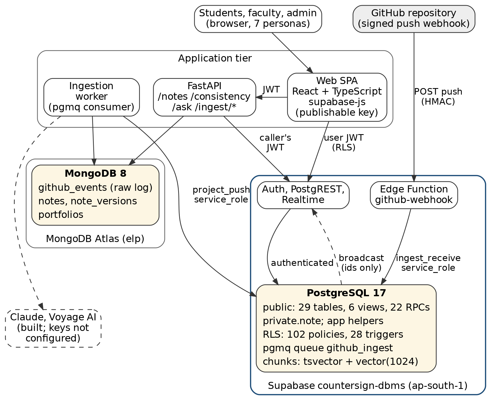{width=100%}

| Tier | Component | Runs as | Notes |
|:--|:--|:--|:--|
| Client | Web SPA (`web/`): Vite, React 19, TypeScript, Tailwind, shadcn/ui, supabase-js, TanStack Query, zod | the signed-in user (publishable key + user JWT) | every query is filtered by RLS; the "Show the SQL" drawer shows the verbatim SQL of each panel |
| API | FastAPI (`api/`): `/notes`, `/consistency`, `/ask`, `/ingest/trace`, `/ingest/status`, `/ingest/drain`, `/race/run`, `/health` | the caller's JWT, forwarded to PostgREST | never uses the service key for a user request; `/race/run` (faculty and admins) runs one race in the race-lab container only |
| Worker | `app.worker`: pgmq consumer | `service_role` (the pipeline RPCs are service-only) | Mongo raw log, then the Postgres projection; `--loop` survives Postgres and MongoDB outages (backoff 1 s to 30 s) |
| Inbox | Supabase Edge Function `github-webhook` | `service_role`, after verifying the HMAC signature | answers 202 in about 150 ms |
| Database | PostgreSQL 17.11 on Supabase (ap-south-1): 29 tables in `public`, `private.note`, 6 views, 74 functions in `public`/`private`/`app`, 102 policies, 29 triggers; extensions pgvector 0.8.2, pgmq 1.5.1 and pgcrypto 1.3 (versions read on the local stack) | `authenticated` (users), `service_role` (pipeline) | migrations 0001 to 0007, all applied to the cloud project (checked 19 November 2026) |
| Documents | MongoDB 8 on Atlas, database `elp`: `github_events`, `notes`, `note_versions`, `portfolios`, with `$jsonSchema` validators | API and worker only | the browser never talks to MongoDB |
| Experiment | local `postgres:17` container `elp-race-pg` | the API (`/race/run`) or the harness | 72,000 recorded races; single live races from the Race arena page; never the cloud project |

**Identity rules** (C2 §3.5.1). The browser only holds the publishable key. Users sign in with Supabase Auth; `app_user` maps `auth.users` to a student USN or a faculty id, and the role-consistency CHECK makes the mapping exact. Helper functions in schema `app` (`current_usn()`, `current_faculty_id()`, `is_team_member()`, `teaches_project()`, `oversees_project()`) are used inside the policies. The only `service_role` paths are the Edge Function and the worker.

# 10. Implementation of each module

## 10.1 Core schema (migrations 0001, 0002 and 0007)

Migration 0001 is the frozen fixture schema (13 tables, Appendix A of the master file) with RLS switched on. Migration 0002 adds the application model as append-only columns, constraints and new tables, so Q1–Q37 still return the outputs of Appendix H:

* **Terms and offerings:** `academic_term` (with an EXCLUDE constraint against overlapping terms), `course_offering`, `enrollment`; `project.offering_id`.
* **Identity:** `app_user` with the role-consistency CHECK; `student_identity` (verified GitHub accounts, migration 0005).
* **Work:** `artifact` gains `visibility` (private, team, submitted), `owner_usn`, `external_ref` and a composite FK `(team_id, project_id) → team`; the weak entity `artifact_version`; `contribution` gains `source`, `source_ref`, `occurred_at`, `ai_assisted` and an idempotency key.
* **Assessment:** `milestone.counts_in_reduced` and `locked_at`; `submission`, `submission_artifact`; `assessment` at component grain (one row per student and component, `assessed_by` the signing faculty). Migration 0007 (strict marks) makes `assessment.marks` an unconstrained NUMERIC with the CHECK `assessment_marks_one_decimal` (`marks = round(marks, 1)`) and a range CHECK, so a mark with a second decimal is refused on every write path instead of being rounded, as the old `NUMERIC(4,1)` did on a direct INSERT (C8 B.10); a trigger stores accepted marks at scale 1, so stored values read as before.
* **Claims:** `claim`, the weak entity `claim_evidence`, `countersign` (C3 Figure C3-2 shows the ER diagram).
* **Skills:** `skill_evidence`, `course_skill`, `project_skill.min_level`.
* **Private vault:** `private.note`, in a schema PostgREST does not expose.

History is protected by `ON DELETE RESTRICT` foreign keys on every table that records work (FR10). Integrity rules that span rows are triggers, each with a stable rule key in the error DETAIL that the web app maps to a field message: team capacity v2 (writes the team row, then counts), one team per project (writes the student row), membership required for every contributor, claimant, chunk author and assessed student, marks not above the maximum, no change after a component is locked, countersign by a teammate who is not the claimant and on the revision they read.

## 10.2 Security (migration 0003)

* RLS is enabled on all 30 tables; `authenticated` gets no default privileges on new relations; `anon` can read nothing.
* Directory tables are readable by any signed-in user; team content only by the team's members; staff read, for the projects they oversee, contribution metadata, claim statements, evidence, dispute comments and *submitted* content (never drafts or private items); marks are written only by the teaching faculty (or an admin) in their own name; a student reads only their own marks; private artifacts and notes only by their owner.
* Six `security_invoker` views, so the caller's RLS applies inside them: `v_rubric_sheet`, `v_lab_cie_marks`, `v_contested_claims`, `v_faculty_team_progress`, `v_semester_hub`, `v_what_faculty_sees`.
* Realtime: the contribution trigger broadcasts ids and a time to private topics `team:<id>` and `project:<id>`; RLS on `realtime.messages` decides who may join (migration 0005).

## 10.3 RPC layer (migration 0004)

| RPC | Security | What it does | Concept |
|:--|:--|:--|:--|
| `semester_hub()` | invoker | the landing page for whoever is signed in | joins over enrollment, offering, team, milestone |
| `join_team`, `leave_team` | invoker | membership with capacity, enrolment and history guards | triggers, write-the-parent locking |
| `find_teammates`, `find_full_cover` | invoker | complementary finder: Missing = Required(P) − Mine, then students ranked by how many Missing skills they cover (a partial division, with a `covers_all` flag); `find_full_cover` is the thresholded full division | relational division |
| `skill_gap`, `skill_subtree` | invoker | required minus shown skills; recursive skill tree with CYCLE | EXCEPT, WITH RECURSIVE |
| `submit_milestone` | invoker | freezes artifact versions into a submission in one transaction | atomicity |
| `file_claim`, `add_claim_evidence`, `countersign_claim` | invoker | claim, evidence, countersign with revision check | weak entities, OCC |
| `record_assessment`, `lock_milestone` | invoker | marks within bounds; one-way lock | `SELECT … FOR SHARE`, conditional UPDATE |
| `my_private_notes`, `save_private_note`, `delete_private_note` | definer, explicit owner check | the private vault | schema isolation |
| `search_chunks` (0005) | invoker | keyword (idf-weighted) and vector lists fused by RRF in one statement | hybrid retrieval under RLS |

## 10.4 Claims, evidence and countersign

The student project page (`/projects/:id`) has five tabs: Components, My claims, **Countersign queue** (teammates' pending claims), Artifacts and Activity. A claim states what one student did for one component, its kind of work and a declared AI assistance (none, assisted, generated). Evidence rows are typed (`contribution`, `artifact_version`, `url`, `file`, `commit`) and must belong to the claimant's team; a cited contribution must be the claimant's own. A countersign is a confirm or a dispute (a dispute needs a comment) by a teammate, bound to the claim revision the signer read. The claim status is derived by trigger: any dispute makes it *contested*, a confirm without a dispute makes it *confirmed*; evidence is frozen once the claim is no longer pending. A solo team (T00 in the demo seed) has nobody who may countersign, so its claims stay *pending* by the same rule and rest on their evidence and the faculty review; no schema change was made for it. The student's claim cards, the empty countersign queue and the faculty claim drawer say so in one sentence (`SOLO_TEAM_NOTE`, `web/src/lib/course.ts`): "Solo team: no teammate to countersign. This claim rests on its evidence and faculty review."

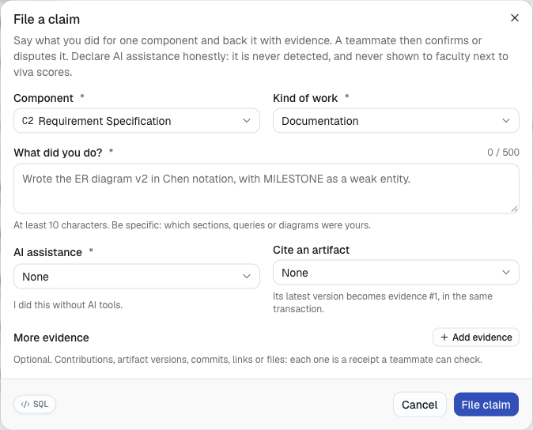{width=70%}

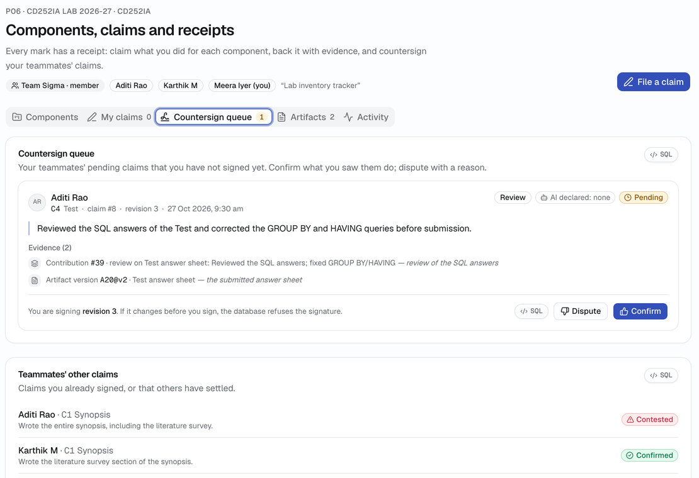{width=100%}

## 10.5 The rubric sheet and Lab CIE marks

The faculty's `/sheet/:projectId` renders `v_rubric_sheet`: one row per student with a Sl. No., one cell per (student, component), the mark, a glyph for the claim status (a tick for confirmed, a clock for a pending countersign, a triangle for contested), a red "no claim" marker for a mark with no claim behind it, hatching for locked components, a signature row, and the raw /120, reduced /30, C10, C11 and /50 columns. Clicking a cell opens the drawer with the mark, its signer and lock, and the claims → evidence → countersigns behind it. `v_lab_cie_marks` derives the /50 total on every read (round(raw × 30 / 120, 1) + C10 + C11; the rounding rule is still to be confirmed with the course faculty). The sheet and the cell drawer refetch whenever the faculty window gets focus, so a countersign given elsewhere shows without a reload; Realtime broadcasts only new contributions. Below 1600 pixels the columns use a compact layout, so the grid fits a 1440-pixel window at 100 % zoom, and the Realtime chip is repeated in the page header. The normalization that leads from the paper sheet to these tables is C6 Part A (Figure 6).

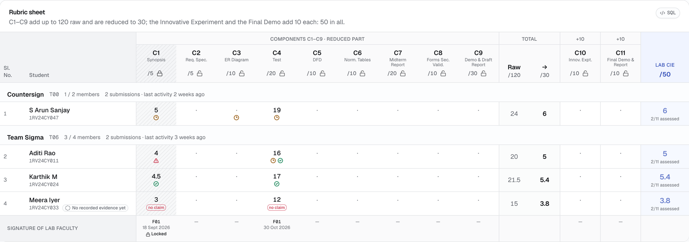{width=100%}

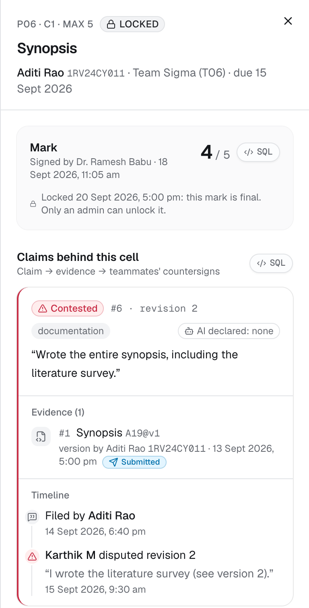{width=45%}

{width=100%}

## 10.6 Teams and skills

`/team` lists the teams of a project with their capacity, the teammate finder (complements, not clones: students outside any team of the project who hold the skills the caller lacks), the skill gap (declared versus verified levels; *verified* is `max(level)` over all `skill_evidence` rows of the caller for that skill, with no filter on claim status, and those rows are seeded today: deriving them from confirmed claims is planned, C2 FR8 and C11 FR8) and the skill tree (WITH RECURSIVE over `skill.parent_skill_id`, SEARCH DEPTH FIRST, CYCLE).

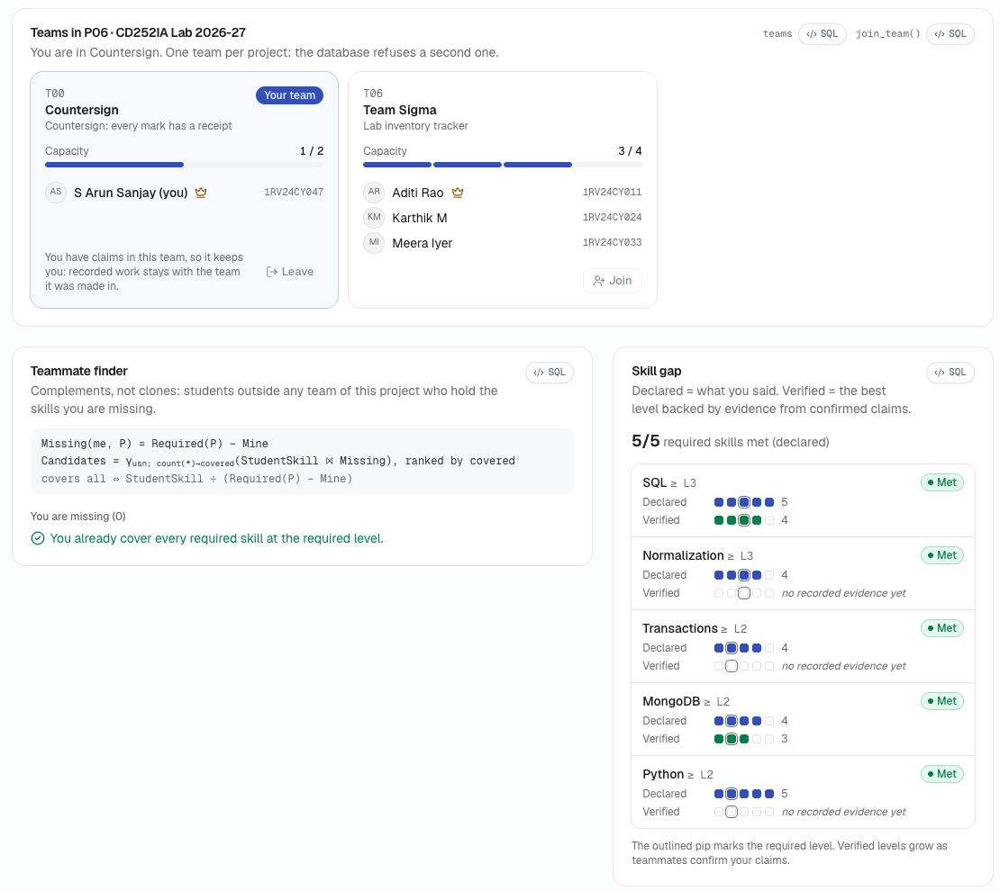{width=100%}

## 10.7 Ingestion: inbox → log → projection (migrations 0005 and 0006)

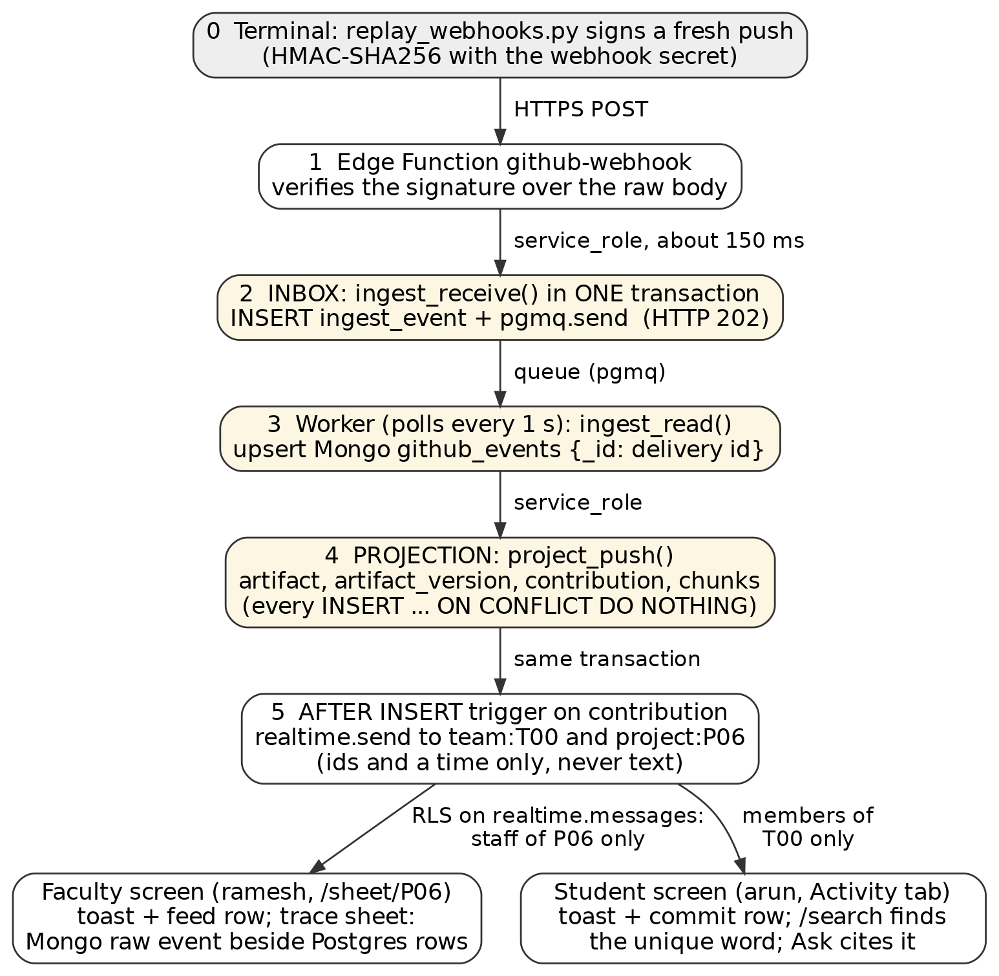{width=85%}

The design is `docs/INGESTION.md`. In short: the Edge Function verifies `X-Hub-Signature-256` in constant time and calls `ingest_receive()`, which inserts the `ingest_event` row and sends the pgmq message in one transaction. The worker reads the queue oldest first, upserts the raw push into Mongo `github_events` with `_id` = the delivery id (e-mail addresses replaced by their sha256), marks the event `raw_stored`, and calls `project_push()`, which writes artifacts, versions, contributions and chunks with `ON CONFLICT DO NOTHING` on an idempotency key at every level. Failures are counted (`ingest_fail`, migration 0006); after 5 attempts a message is dead-lettered. Credit goes only to commits whose claimed author is the authenticated, verified pusher and a member of the repository's team; everything else is logged but not credited. `GET /consistency` checks per team and author that every credited commit in the raw log is in the projection and the reverse.

**Replay results.** The 16 fixture deliveries give 9 projected deliveries and 1 ignored (feature branch); the other 6 are a ping, an `issues` event, two signature failures (401) and two duplicates. On the cloud on 5 November 2026 they produced 29 GitHub contributions and 58 chunks. On the local stack on 19 November 2026 all 16 deliveries behaved as expected; commit a4c0452, authored inside Meera's T01 push by the unlinked GitHub login `outside-dev` (no `student_identity` row), was logged in Mongo `github_events` and produced no contribution row. The worker's `--loop` keeps running through a Postgres or MongoDB outage: a failed drain logs one JSON `drain_failed` line and is retried with a backoff from 1 s to 30 s.

## 10.8 Search and Ask

`search_chunks()` is a SECURITY INVOKER SQL function, so RLS filters every candidate. It searches only the newest snapshot of each projected artifact, ranks keyword matches by Σ idf² over the query words (a rare word outweighs common ones), adds a vector list when a query embedding is passed, and fuses both by reciprocal rank fusion, score Σ 1/(60 + rank), in the same statement. `POST /ask` retrieves as the caller and, with no `ANTHROPIC_API_KEY` configured (the current state), returns an extractive answer: the best-matching sentence of each of the top three chunks, each cited. The generative path (Claude with citations, server-side check that every cited chunk is among the retrieved ones and that every quote occurs in its chunk) and the embedding path (Voyage, 1024 dimensions, HNSW) are built and unit-tested with stubs, but have never been run against the real services.

## 10.9 MongoDB

Database `elp` on Atlas holds `notes` (the current state of each note), `note_versions` (one immutable receipt per save, `_id = "<note_id>:<n>"`, so a version number is single-use), `github_events` (the raw log) and `portfolios` (built by one aggregation with `$unionWith`, `$group` and `$merge`). `mongo/validators.js` adds strict `$jsonSchema` validators and unique indexes, and `scripts/check_mongo_validators.sh` shows that they accept the fixture's own writes and reject six malformed ones. `POST /notes` saves a note version and bumps the note in one multi-document transaction; a stale base version gets 409. The graded queries M1–M25 still pass on the validated collections.

## 10.10 Web application

Pages: login (one-click personas), about, student (`/hub`, `/team`, `/projects/:id`, `/notes`, `/faculty-view`), faculty (`/teaching`, `/sheet/:id`, `/contested`, `/marks/:id`), admin (`/admin` with the Ingestion panel), and `/search` and `/race` (the Race arena, §10.11) for everyone. Route guards are convenience only; the database decides. Every data panel has a **SQL** pill that opens the *Show the SQL* drawer with four tabs: the verbatim SQL (extracted from the migrations by `npm run sql:extract`, so it cannot drift), the relational algebra, the RLS policies that apply, and the syllabus concepts (Units I to V). Forms use zod rules that mirror the CHECK constraints; every database error's DETAIL key is mapped to a field message (three layers: zod, the RPC's pre-check, the constraint or trigger).

{width=75%}

## 10.11 Innovative Experiment harness (C10)

`experiments/race/` loads the fixture schema and the verbatim Q35 trigger into a throwaway container, then races N clients (N = 2, 8, 32, 100, released by an asyncio barrier) for Team Beta's last seat, for six strategies at three isolation levels, 1000 trials per cell. Results are stored in `exp.experiment_run`, `exp.experiment_attempt` and `exp.schedule_log`; `analysis.sql` builds the precedence graph of each two-client race and finds cycles with WITH RECURSIVE; `analysis_selftest.sql` checks that SQL on six hand-solved textbook schedules (all PASS); `demo_locks.sh` prints the live wait-for graph from `pg_locks` joined with `pg_blocking_pids()`. The **Race arena** page (`/race`) brings the experiment into the product: it replays the recorded results (the over-admission matrix of the 72,000 races, p95 latency per strategy, each strategy's SQL and two worked precedence graphs), and faculty and admins can run one live race (strategy, isolation level, N) through `POST /race/run`, which imports the harness and races in `elp-race-pg`, writes nothing to the recorded results, and draws the precedence graph of an N = 2 race. One race runs at a time (409 `race_busy`), and only the request that owns the lab resets T02 afterwards, so a refused request never resets another race.

# 11. Testing summary

Counts verified on the local stack on 19 November 2026.

| Suite | Count | Result | What it covers |
|:--|--:|:--|:--|
| pgTAP `01_constraints.sql` | 48 | pass | one violating statement per integrity rule, with the expected SQLSTATE |
| pgTAP `02_rls_matrix.sql` | 301 | pass | persona × relation → visible rows; privacy; write permissions |
| pgTAP `03_rpc.sql` | 129 | pass | every RPC: happy path and refusal paths per persona |
| pgTAP `04_abuse_cases.sql` | 53 | pass | review findings replayed as an attacker would, through direct table writes |
| pgTAP `05_ingest.sql` | 120 | pass | inbox idempotency, projection, trust model, search under RLS, Realtime topics |
| pgTAP `06_ingest_worker.sql` | 16 | pass | failure bookkeeping and dead letters |
| pgTAP `07_strict_marks.sql` | 43 | pass | migration 0007: a two-decimal mark is refused on every write path, never rounded |
| **pgTAP total** | **710** | **pass** | 7 files |
| Fixture SQL Q1–Q37 | 37 | 37/37 | outputs diffed against master Appendix H (plain PG17, C collation) |
| Fixture MongoDB M1–M25 | 25 | 25/25 | outputs checked on `mongo:8` |
| API `test_api.py` | 24 | pass | auth, team access, privacy tiers, notes history, consistency |
| API `test_worker.py` | 29 | pass | worker idempotency, Mongo and projection failures, the resilient `--loop`, `/ask` permissions |
| API `test_race.py` | 13 | pass | `/race/run`: staff only, body validation, race lab offline (503), counts, a busy request never resets the lab |
| **API total** | **66** | **pass** | needs the race lab `elp-race-pg` running; without it 65 pass and 1 is skipped |
| Web e2e (Playwright, 11 specs) | 44 | pass | login per persona, claim (solo team), countersign on T06, team, sheet and marks, RLS as lakshmi, privacy and role guard, SQL drawer, notes, live ingestion, Race arena |
| Webhook replay | 16 deliveries | 16/16 as expected | signature, duplicates, branch filter, unlinked author |
| Race experiment | 72,000 races | as reported | over-admission per strategy × isolation × N |

How to run each suite (repository root; the local stack must be in its seed state, so run `scripts/reset_local.sh` first and nothing else at the same time):

```bash
npx -y supabase@latest test db                        # pgTAP, 710
scripts/test_fixture.sh                               # Q1-Q37 against Appendix H
scripts/test_mongo_fixture.sh                         # M1-M25
experiments/race/setup.sh                             # race lab, for test_race.py
(cd api && SUPABASE_TARGET=local MONGO_TARGET=local uv run pytest -q)  # API, 66
(cd web && npm run e2e)                               # Playwright, 44
uv run --python 3.12 --with asyncpg experiments/race/harness.py --fresh --trials 1000
```

The test scripts start `mongosh` as `mongosh@2.14.1` through npx (override with `MONGOSH_NPX`), because the npm release 2.14.2 fails at start with "Cannot find module 'mongodb-redact'".

The web gate (G8) also runs `tsc` (strict), `oxlint --max-warnings 0` and `vite build` before the e2e suite. A CI workflow (`.github/workflows/fixture.yml`) that reruns the fixture comparison exists in the repository but has not been pushed, because the GitHub token lacks the `workflow` scope.

# 12. Results

**Functional.** Two different levels of evidence, kept apart:

* **Exercised end to end by the local e2e suite** (44 tests on the local stack, §11): signing in as every persona, filing a claim with evidence in a solo team (it stays pending, with the solo-team note), countersigning a teammate's claim on T06, joining a team with the capacity and enrolment refusals, entering marks within and above the maximum, locking a component, private notes, the role guards, and a live signed push through the Edge Function and the worker to the toast, the feed, the trace sheet and search (spec 10), and the Race arena with its live panel against a mocked API (spec 11).
* **Checked on the cloud project, read-only**, in the rehearsal of 5 November 2026 (§14), with the earlier demo seed: every persona signs in; every screen of §3 loads with real data (hub, rubric sheet and drawer, Lab CIE marks, the File a claim and Confirm dialogs up to the last button, the countersign queue, the Activity tab and the staff feed, the trace sheet of an earlier push, search and extractive Ask, the role guard, Lakshmi's empty sheet, "What my faculty sees", the contested queue, the admin inbox and the consistency panel, which reads *all consistent*). The 16 replayed deliveries were projected on the cloud earlier (§10.7).
* **Not yet exercised on the cloud:** filing a claim, countersigning, joining, entering marks, locking, and a live push with its toast. The first live push and the first countersign on the cloud will be the demo itself.

**Security.** Every attempt in §3.6 fails in the database, not in the UI, and the RLS matrix (301 assertions) pins the visible row count of every persona on every relation.

**Concurrency (C10).** Over-admission rate per strategy and isolation level, all N pooled (1000 races per cell and N):

| Strategy | READ COMMITTED | REPEATABLE READ | SERIALIZABLE |
|:--|:-:|:-:|:-:|
| S1 naive check-then-insert | 100 % (worst 103/4) | 100 % (103/4) | 0 % |
| S2 fixture trigger Q35 (lock team row, then count) | 0 % | **100 % (103/4)** | 0 % |
| S3 conditional counter UPDATE | 0 % | 0 % | 0 % |
| S4 naive + retry on 40001 | 100 % | 100 % | 0 % |
| S6 declarative seat keys | 0 % | 0 % | 0 % |
| S7 write-the-parent (product capacity v2) | 0 % | 0 % | 0 % |

{width=100%}

**Ingestion.** 16 deliveries → 9 projected, 1 ignored, 0 failed on the cloud; the same replay on the local stack is checked by `/consistency` as *all consistent*, and `--reproject-from-log` rebuilds an identical projection from the Mongo log.

# 13. Further screenshots

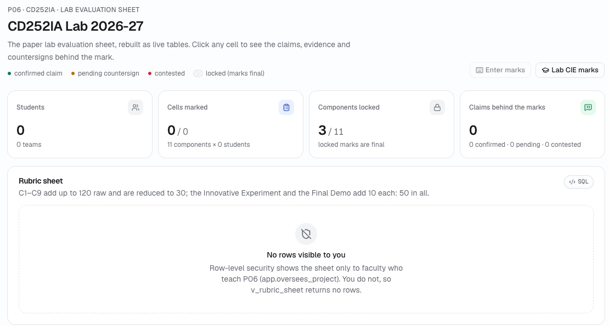{width=100%}

{width=100%}

{width=45%}

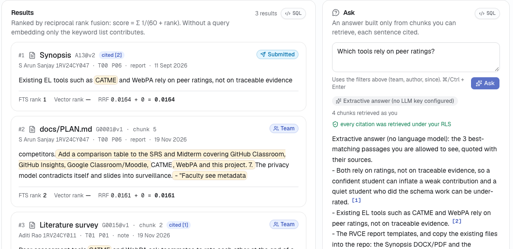{width=100%}

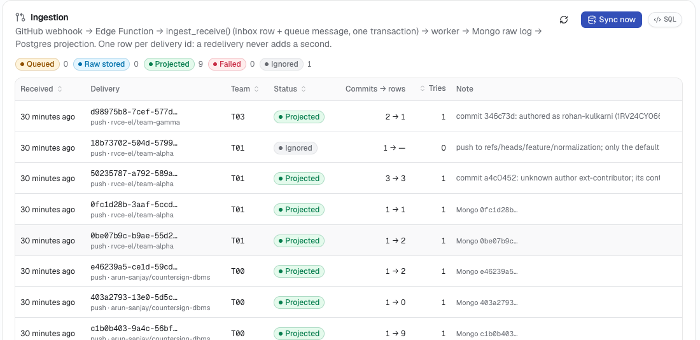{width=100%}

{width=100%}

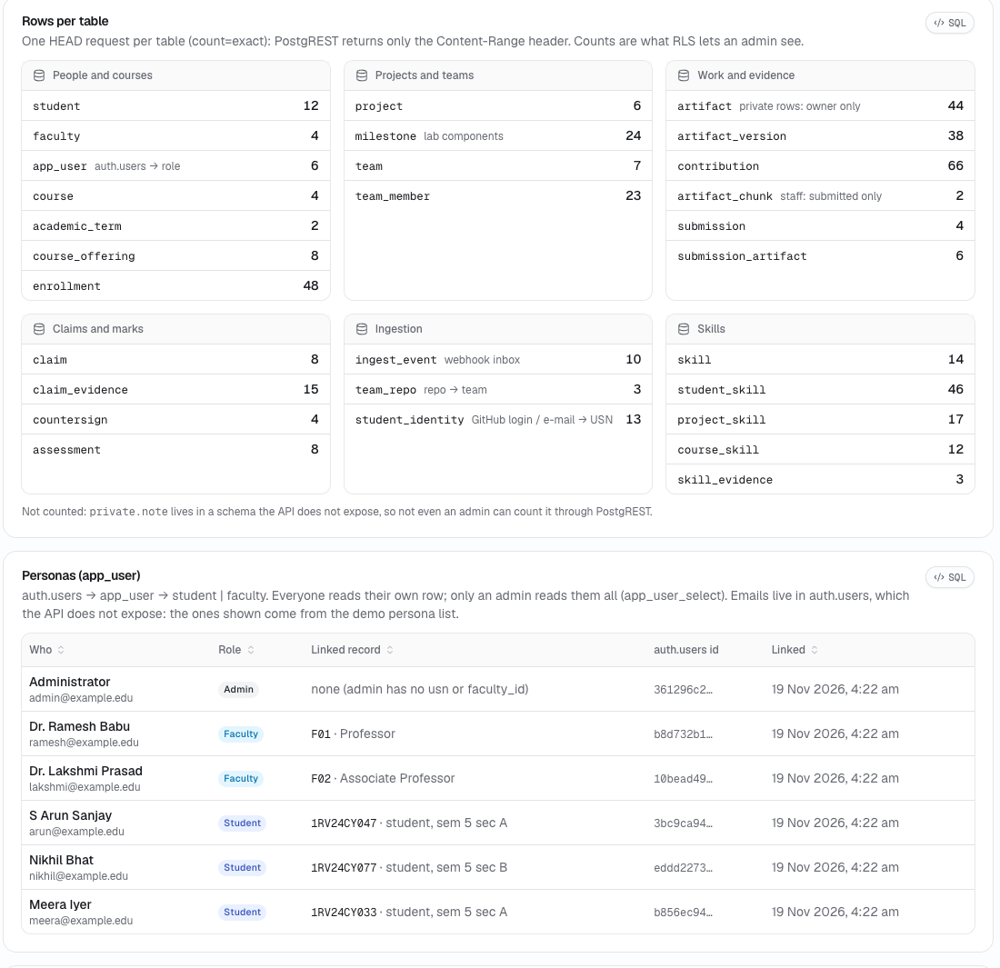{width=100%}

**Not captured:** the live toast. It needs the one-time live push of §3.5 (Appendix 1), which the read-only rehearsal deliberately did not send; the toast is checked by e2e spec 10 on the local stack.

# 14. Status and next steps to C11

| Area | State on 19 Nov 2026 |
|:--|:--|
| Database (0001 to 0007), RLS, RPCs, ingestion | built, tested; all 7 migrations applied to the cloud project (checked 19 November 2026). 0007 strict marks is done: a two-decimal mark is refused, never rounded |
| Demo seed | solo team T00 and the T06 countersign story, verified on the local stack; still to be applied to the cloud project before the demo (pre-flight step 8 checks it) |
| Web app and API | built, tested; run locally (Vercel deployment needs a login). The rubric sheet refetches on window focus and fits a 1440-pixel window; the Race arena (`/race`) replays the 72,000 recorded races and runs single live races through `/race/run` |
| Worker | `--loop` survives Postgres and MongoDB outages (logged `drain_failed`, backoff 1 s to 30 s) |
| MongoDB on Atlas | validators, notes and note versions applied |
| Cited assistant | extractive only: no Anthropic or Voyage key configured |
| GitHub integration | a repository webhook with replayed, signed fixtures; no GitHub App; identity verification is set by an admin |
| CI | workflow file written, not pushed (missing `workflow` scope) |
| Demo rehearsal | **done once, read-only, on the live project** (5 November 2026, web in cloud mode, API without a service key), with the demo seed of that date: every persona signed in; every screen of §3 passed (§12); break-it attempts 1, 6 and 7 and the race demo passed; the consistency panel read *all consistent*. Nothing was written: the claim and Confirm dialogs were cancelled; one signed `ping` stored nothing; one click on **Sync now** answered 503 `worker_unconfigured` because the API had no service key (the §5 fallback is therefore the worker with `--once`). **To repeat** on the cloud after the solo-team seed is applied: §3.3 to §3.4 (Arun's solo claim, Meera's countersign) and the Race arena of §3.7. **Not verified on the cloud:** the live toast, the worker's `"projected"` line, and search and Ask on the demo word; they need the one-time push of Appendix 1 and pass locally in e2e spec 10. Break-it attempts 2 to 5 are writes and were not run on the cloud (pgTAP `04_abuse_cases` covers them) |

C11 extends this report with the evaluation against the SRS, the limitations, future work and the appendices (full schema listing, test inventory, user manual).

# References

1. R. Elmasri and S. B. Navathe, *Fundamentals of Database Systems*, 7th ed., Pearson, 2016.
2. PostgreSQL Global Development Group, *PostgreSQL 17 Documentation*: Chapter 13 (Concurrency Control) and Chapter 5.9 (Row Security Policies).
3. D. R. K. Ports and K. Grittner, "Serializable Snapshot Isolation in PostgreSQL", *Proc. VLDB Endowment* 5(12), 2012.
4. Supabase documentation: Row Level Security, Realtime Authorization, Edge Functions, Queues (pgmq).
5. GitHub documentation: Webhook events and payloads; Validating webhook deliveries.
6. MongoDB 8.0 Manual: Schema Validation; Transactions; `$merge`.
7. Project documents: C2 SRS rev. 1.2, C3 ER, C5 DFD, C6 Normalization, `docs/INGESTION.md`, `experiments/race/README.md` and `FINDINGS.md`.

# Appendix 1. `make_demo_push.py` (builds the push for §3.5; sends nothing)

Save it outside the repository (for example `/tmp/countersign-demo/`). It copies the repository, pusher and sender blocks of the real fixture `ingest/fixtures/t00_push_01.json` (T00's repository, pushed by Arun's verified GitHub account) and adds one new commit with a random SHA that adds `docs/demo-<word>.md`, its text inline as `x_contents`, exactly as `web/e2e/ingest.ts` does for e2e spec 10. A random SHA makes the push key `(repository, ref, after)` new, so the inbox does not treat it as a duplicate. The file goes under `docs/`, a tracked path of T00, and is filed under T00's default component C9.

```python
"""Build ONE fresh push for the live demo (stdlib only). Sends nothing.
Usage: python3 make_demo_push.py <repo root> <output dir>"""
import datetime, json, pathlib, secrets, sys, uuid

root, out = pathlib.Path(sys.argv[1]), pathlib.Path(sys.argv[2])
out.mkdir(parents=True, exist_ok=True)
base = json.loads((root / "ingest/fixtures/t00_push_01.json").read_text())
word = "demo" + "".join(secrets.choice("abcdefghijklmnopqrstuvwxyz")
                        for _ in range(6))
sha, before = secrets.token_hex(20), base.get("after") or secrets.token_hex(20)
now = datetime.datetime.now(datetime.timezone.utc).strftime("%Y-%m-%dT%H:%M:%SZ")
path = f"docs/demo-{word}.md"
who = {"name": "Arun Sanjay", "username": "Arun-Sanjay",
       "email": "228202223+Arun-Sanjay@users.noreply.github.com"}
repo = base["repository"]["html_url"]
text = (f"# {word}\n\nThe {word} note records why a countersign is refused "
        "when the claim revision changed.\n")
commit = {"id": sha, "tree_id": secrets.token_hex(20), "distinct": True,
          "message": f"docs: {word} demo note", "timestamp": now,
          "url": f"{repo}/commit/{sha}", "author": who, "committer": who,
          "added": [path], "removed": [], "modified": [],
          "x_contents": {path: text}}
head = {k: v for k, v in commit.items() if k != "x_contents"}
payload = {**base, "before": before, "after": sha, "created": False,
           "deleted": False, "forced": False,
           "compare": f"{repo}/compare/{before[:12]}...{sha[:12]}",
           "commits": [commit], "head_commit": head}
(out / "push.json").write_text(json.dumps(payload, indent=1))
row = {"name": "live-demo-push", "file": "push.json", "event": "push",
       "delivery": f"demo-{uuid.uuid4()}", "sign": "valid",
       "expect": {"http": 202, "status": "queued", "duplicate": False}}
(out / "manifest.json").write_text(json.dumps({"deliveries": [row]}, indent=1))
print("unique word:", word)
```

Checked on 5 November 2026: the script ran, and `replay_webhooks.py --dry-run` with its manifest and the cloud URL printed `live-demo-push - dry push demo-... 2831 bytes, sign=valid`. It has not been delivered to the cloud (that is the live moment); the same payload shape is delivered and projected by e2e spec 10 on the local stack.
