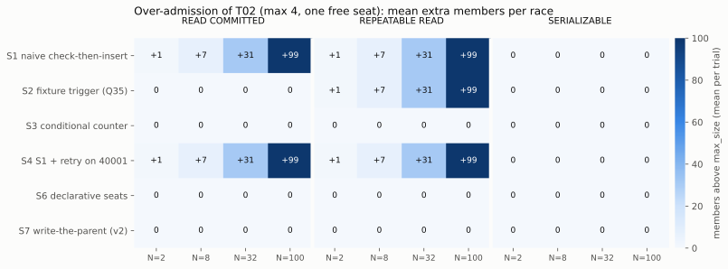
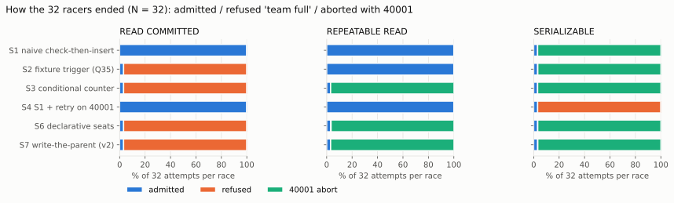
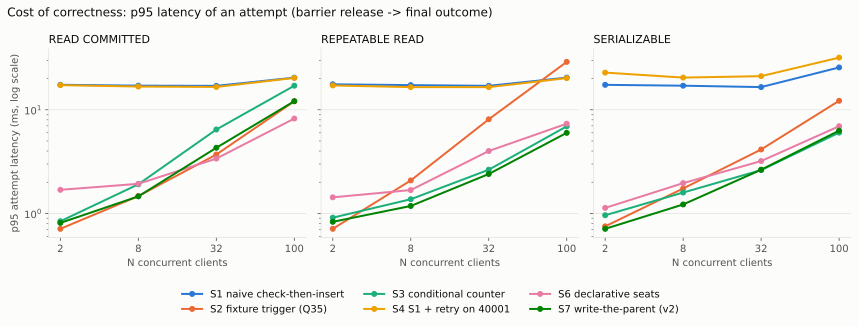

# Component 10 results — the last team slot (generated by report.py)

Data: 72,000 races (1000 trials per cell, 72 cells), 2,556,000 attempts,
120,558 logged schedule operations. PostgreSQL 17.11 (Debian 17.11-1.pgdg13+2),
Docker container `elp-race-pg` (default server settings except `max_connections=300`),
client asyncpg on the same machine. Runs from 2026-11-04 17:15 to 17:28 UTC.
Target: Team Beta (T02), `max_size` 4, 3 members, so exactly **one** seat is free.

## Headline

**"A correct-looking lock-then-check trigger is only correct at READ COMMITTED."**
The fixture trigger (S2, Q35) over-admitted in **1000 of 1000** races at REPEATABLE READ for
every N. 141,989 of 142,000 racers were admitted, and the worst race ended at **103/4**. At RC
and SER the same trigger never went above 4/4.

| | RC | RR | SER |
|---|---|---|---|
| Procedural, application-level (S1 naive, S4 naive + retry) | **over-admits 100%** | **over-admits 100%** | 0% |
| Procedural, lock a parent row it never writes (S2, fixture Q35) | 0% | **over-admits 100%** | 0% |
| Procedural, write the parent row (S7, product v2) | 0% | 0% | 0% |
| Single-statement conditional counter (S3) | 0% | 0% | 0% |
| Declarative seat keys (S6) | 0% | 0% | 0% |

72,000 races, 2,556,000 attempts. Every cell marked 0% admitted **exactly one** racer in
every race. There were no deadlocks and no other errors. An independent re-run of the whole
matrix (verification pass, same machine) gave the same over-admission rate and worst size in
all 72 cells; only timing-dependent counts (late refusals, retries, latencies) moved.

## Conclusions

1. **SERIALIZABLE (SSI) alone fixes all six strategies, including the naive one**: 0 of 24,000
   races over-admitted. In S1, 99 of 100 racers got 40001 and exactly one committed in every
   race. SSI never aborted the whole group. It is not free, though. Without a retry loop
   (S1) the losers see 40001 rather than "team full". With one (S4), every loser needed at
   least one retry (238 of 138,000 needed two) and then got a clean refusal. That costs
   about +5 ms p95 at N = 2 and +6 ms at N = 100 compared with S1 at SER.
2. **A retry loop does nothing below SERIALIZABLE.** S4 at RC/RR is identical to S1: 100%
   over-admission and 0 retries, because nothing ever raises 40001. Retries are only useful
   together with SSI.
3. **What makes a procedural rule safe at every level is turning the conflict into a write on
   one row.** S3 (counter row) and S7 (no-op UPDATE of the team row) make the losers either
   re-check the newest row version (RC, EvalPlanQual) or fail with 40001 (RR/SER,
   first-updater-wins). S6 gets the same effect from a unique key. S2 only *locks* the row. Under RR the waiter's snapshot is older than
   the winner's insert, and a lock-only conflict raises no error, so the waiter counts 3
   members again.
4. **The declarative design (S6) is correct at every level, and nobody can bypass it.** Two
   joins collide on a primary key, and a unique index ignores snapshots. While S6 is active, a
   deferred FK from `team_member` to `team_seat` means no client, buggy or not, can add a
   member without holding one of the `max_size` seat keys (checked: a seatless INSERT fails
   at COMMIT with the FK violation). Only someone with DDL rights can switch it off.
5. **Precedence graphs are consistent with the outcomes. This is a check of the model, not
   independent evidence.** For all 18,000 N = 2 races, the LOGICAL client-recorded schedule
   has a cycle `T1 → T2 → T1` **iff** the race over-admitted (5,000 runs that are not
   conflict-serializable, all over-admitted; 13,000 conflict-serializable runs, none
   over-admitted). This is close to true by construction: a correct race commits one
   transaction, so its committed graph has a single node, and two committed joiners both read
   the member set before the other's insert. The cycles also exist with r–w conflicts alone,
   so modelling the member set as one item (which adds w–w edges between two inserts) changes
   no verdict. The informative part is the graph *including aborted transactions*. For S1/S4
   at SER it had the cycle in 753 and 805 of 1000 runs, and in every one of them a transaction
   on the cycle was killed with 40001: SSI broke it. In the other runs SSI raised 40001 on the
   loser's INSERT, so the write never happened and no cycle formed. The S6/RC losers are on a
   cycle too (1000 of 1000), but only through their own two reads of the seat set, one before
   and one after the winner's commit (an RC non-repeatable read). They wrote nothing and rolled
   back on their own, so no DBMS abort was involved. `analysis_selftest.sql` checks the graph
   SQL on hand-solved schedules (a non-trivial acyclic one, a 3-cycle, lost update, write skew):
   all PASS.
6. **Cost (p95 per attempt, N = 100):** the abort-based paths are fastest (S7 RR 6.0 ms, S3 SER
   6.0 ms, S7 SER 6.3 ms, S3 RR 6.9 ms, S6 SER 6.9 ms) because losers fail as soon as the
   winner commits. The RC lock queues are slower (S6 RC 8.2, S2 RC 12.1, S7 RC 12.1,
   S3 RC 17.1 ms) because the waiters leave the row-lock queue one at a time: each one holds
   the row lock until its own ROLLBACK.
   For scale, S1 and S4 include 10 ms of deliberate think time.

## Surprises

- **SSI never produced a zero-winner race.** All 4,000 S1/SER races had exactly one commit,
  even with 100 simultaneous writers. In PostgreSQL a dangerous structure only forces an
  abort if the transaction at its end commits first, so a winner is expected. But "exactly one winner,
  never zero" is an observation, not a guarantee.
- **S2 at RR depends on timing, not on N.** 11 of 142,000 RR racers *were* refused correctly
  (24 in the first full run). Their snapshot was taken late enough to include a winner's
  commit, so a few N = 100 races ended at 97, 100 or 102 instead of 103. Below SERIALIZABLE,
  whether the rule holds depends on when each snapshot was taken.
- **At RR and SER, a few losers were *refused* instead of aborted** (SER: S7 659, S2 134,
  S3 83, S6 39; RR: S6 246, S3 24, S7 18; all of 138,000). These racers took their snapshot
  after the winner's commit, so they saw 4/4 and wrote nothing. There was no rw-antidependency
  to act on and no write-write conflict. At N = 100 the barrier releases the clients over
  about 1–1.5 ms, and the server runs 100 backends on a few cores, so "late" is common.
- **S3 at RC has the worst p95 of the correct strategies at N = 100 (17 ms, 19 ms in the first
  run). The cause is not established.** One fact is verified: an RC loser whose
  `UPDATE … WHERE member_count < max_size` re-check fails (0 rows) *still holds the row lock*
  it took for the EvalPlanQual re-check until it rolls back. A third session's
  `FOR UPDATE NOWAIT` fails while that loser is open. So, as with S2 and S7, S3's losers leave
  the queue one at a time. The winner holding the lock for one extra round trip (UPDATE,
  INSERT, COMMIT instead of INSERT, COMMIT) adds that cost only once per race, so it cannot
  explain a ~5 ms gap with 99 waiters. Profiling would be needed.
- **The live lock graph shows a queue, not a crowd.** The second waiter does not wait for the
  lock holder. It waits for the *first waiter* on a `tuple` lock, and only the first waiter
  waits on the holder's `transactionid` (`results/demo_locks_S2_RC.txt`). Row locks are not
  listed in `pg_locks` while they are merely held: they live in the row header.
- **At SER the predicate lock on `team_member` is relation-level** (`demo_locks_S1_SER.txt`).
  The table is tiny, so the COUNT is a sequential scan, and SSI locks the whole relation. That
  is how the phantom insert is caught. The commit failure names the reason: *"Canceled on
  identification as a pivot, during commit attempt."*

## 1. Over-admission rate (all N pooled; worst final size in brackets)

| strategy | READ COMMITTED | REPEATABLE READ | SERIALIZABLE |
|---|---|---|---|
| S1 naive check-then-insert | 100% (worst 103/4) | 100% (worst 103/4) | 0% (4/4) |
| S2 fixture trigger (Q35) | 0% (4/4) | 100% (worst 103/4) | 0% (4/4) |
| S3 conditional counter | 0% (4/4) | 0% (4/4) | 0% (4/4) |
| S4 S1 + retry on 40001 | 100% (worst 103/4) | 100% (worst 103/4) | 0% (4/4) |
| S6 declarative seats | 0% (4/4) | 0% (4/4) | 0% (4/4) |
| S7 write-the-parent (v2) | 0% (4/4) | 0% (4/4) | 0% (4/4) |

## 2. Full matrix (per strategy x isolation x N)

`over` = share of races that ended above 4/4; `adm` = mean attempts admitted per race (1 is
correct); `40001` = mean serialization failures per race (S4 counts every retried one too);
`ref` = mean attempts refused "team is full"; latency = per attempt, barrier release to final
outcome, including retries, in ms.

| strategy | iso | N | trials | over | worst | adm | 40001 | ref | retries | p50 ms | p95 ms |
|---|---|---|---|---|---|---|---|---|---|---|---|
| S1 | RC | 2 | 1000 | 100.0% | 5/4 | 2.00 | 0.00 | 0.00 | 0.00 | 13.34 | 17.42 |
| S1 | RC | 8 | 1000 | 100.0% | 11/4 | 8.00 | 0.00 | 0.00 | 0.00 | 13.50 | 17.09 |
| S1 | RC | 32 | 1000 | 100.0% | 35/4 | 32.00 | 0.00 | 0.00 | 0.00 | 14.60 | 17.01 |
| S1 | RC | 100 | 1000 | 100.0% | 103/4 | 100.00 | 0.00 | 0.00 | 0.00 | 18.13 | 20.43 |
| S1 | RR | 2 | 1000 | 100.0% | 5/4 | 2.00 | 0.00 | 0.00 | 0.00 | 13.43 | 17.61 |
| S1 | RR | 8 | 1000 | 100.0% | 11/4 | 8.00 | 0.00 | 0.00 | 0.00 | 13.43 | 17.29 |
| S1 | RR | 32 | 1000 | 100.0% | 35/4 | 32.00 | 0.00 | 0.00 | 0.00 | 14.47 | 17.02 |
| S1 | RR | 100 | 1000 | 100.0% | 103/4 | 100.00 | 0.00 | 0.00 | 0.00 | 18.15 | 20.44 |
| S1 | SER | 2 | 1000 | 0.0% | 4/4 | 1.00 | 1.00 | 0.00 | 0.00 | 13.11 | 17.40 |
| S1 | SER | 8 | 1000 | 0.0% | 4/4 | 1.00 | 7.00 | 0.00 | 0.00 | 13.40 | 17.07 |
| S1 | SER | 32 | 1000 | 0.0% | 4/4 | 1.00 | 31.00 | 0.00 | 0.00 | 15.07 | 16.55 |
| S1 | SER | 100 | 1000 | 0.0% | 4/4 | 1.00 | 99.00 | 0.00 | 0.00 | 21.78 | 25.61 |
| S2 | RC | 2 | 1000 | 0.0% | 4/4 | 1.00 | 0.00 | 1.00 | 0.00 | 0.52 | 0.71 |
| S2 | RC | 8 | 1000 | 0.0% | 4/4 | 1.00 | 0.00 | 7.00 | 0.00 | 1.03 | 1.47 |
| S2 | RC | 32 | 1000 | 0.0% | 4/4 | 1.00 | 0.00 | 31.00 | 0.00 | 2.36 | 3.70 |
| S2 | RC | 100 | 1000 | 0.0% | 4/4 | 1.00 | 0.00 | 99.00 | 0.00 | 7.12 | 12.08 |
| S2 | RR | 2 | 1000 | 100.0% | 5/4 | 2.00 | 0.00 | 0.00 | 0.00 | 0.48 | 0.71 |
| S2 | RR | 8 | 1000 | 100.0% | 11/4 | 8.00 | 0.00 | 0.00 | 0.00 | 1.16 | 2.08 |
| S2 | RR | 32 | 1000 | 100.0% | 35/4 | 32.00 | 0.00 | 0.00 | 0.00 | 4.37 | 8.09 |
| S2 | RR | 100 | 1000 | 100.0% | 103/4 | 99.99 | 0.00 | 0.01 | 0.00 | 14.55 | 28.98 |
| S2 | SER | 2 | 1000 | 0.0% | 4/4 | 1.00 | 1.00 | 0.00 | 0.00 | 0.52 | 0.75 |
| S2 | SER | 8 | 1000 | 0.0% | 4/4 | 1.00 | 7.00 | 0.00 | 0.00 | 1.11 | 1.74 |
| S2 | SER | 32 | 1000 | 0.0% | 4/4 | 1.00 | 30.96 | 0.04 | 0.00 | 2.57 | 4.14 |
| S2 | SER | 100 | 1000 | 0.0% | 4/4 | 1.00 | 98.91 | 0.09 | 0.00 | 7.28 | 12.21 |
| S3 | RC | 2 | 1000 | 0.0% | 4/4 | 1.00 | 0.00 | 1.00 | 0.00 | 0.59 | 0.84 |
| S3 | RC | 8 | 1000 | 0.0% | 4/4 | 1.00 | 0.00 | 7.00 | 0.00 | 1.12 | 1.91 |
| S3 | RC | 32 | 1000 | 0.0% | 4/4 | 1.00 | 0.00 | 31.00 | 0.00 | 3.47 | 6.45 |
| S3 | RC | 100 | 1000 | 0.0% | 4/4 | 1.00 | 0.00 | 99.00 | 0.00 | 9.72 | 17.07 |
| S3 | RR | 2 | 1000 | 0.0% | 4/4 | 1.00 | 1.00 | 0.00 | 0.00 | 0.63 | 0.91 |
| S3 | RR | 8 | 1000 | 0.0% | 4/4 | 1.00 | 7.00 | 0.00 | 0.00 | 1.02 | 1.37 |
| S3 | RR | 32 | 1000 | 0.0% | 4/4 | 1.00 | 31.00 | 0.00 | 0.00 | 2.06 | 2.64 |
| S3 | RR | 100 | 1000 | 0.0% | 4/4 | 1.00 | 98.98 | 0.02 | 0.00 | 4.88 | 6.92 |
| S3 | SER | 2 | 1000 | 0.0% | 4/4 | 1.00 | 1.00 | 0.00 | 0.00 | 0.64 | 0.96 |
| S3 | SER | 8 | 1000 | 0.0% | 4/4 | 1.00 | 7.00 | 0.00 | 0.00 | 1.06 | 1.59 |
| S3 | SER | 32 | 1000 | 0.0% | 4/4 | 1.00 | 31.00 | 0.00 | 0.00 | 2.01 | 2.62 |
| S3 | SER | 100 | 1000 | 0.0% | 4/4 | 1.00 | 98.92 | 0.08 | 0.00 | 4.57 | 6.02 |
| S4 | RC | 2 | 1000 | 100.0% | 5/4 | 2.00 | 0.00 | 0.00 | 0.00 | 13.18 | 17.28 |
| S4 | RC | 8 | 1000 | 100.0% | 11/4 | 8.00 | 0.00 | 0.00 | 0.00 | 13.31 | 16.75 |
| S4 | RC | 32 | 1000 | 100.0% | 35/4 | 32.00 | 0.00 | 0.00 | 0.00 | 14.36 | 16.60 |
| S4 | RC | 100 | 1000 | 100.0% | 103/4 | 100.00 | 0.00 | 0.00 | 0.00 | 17.93 | 20.30 |
| S4 | RR | 2 | 1000 | 100.0% | 5/4 | 2.00 | 0.00 | 0.00 | 0.00 | 12.89 | 17.17 |
| S4 | RR | 8 | 1000 | 100.0% | 11/4 | 8.00 | 0.00 | 0.00 | 0.00 | 13.31 | 16.54 |
| S4 | RR | 32 | 1000 | 100.0% | 35/4 | 32.00 | 0.00 | 0.00 | 0.00 | 14.32 | 16.53 |
| S4 | RR | 100 | 1000 | 100.0% | 103/4 | 100.00 | 0.00 | 0.00 | 0.00 | 17.92 | 20.21 |
| S4 | SER | 2 | 1000 | 0.0% | 4/4 | 1.00 | 1.00 | 1.00 | 0.50 | 16.75 | 22.83 |
| S4 | SER | 8 | 1000 | 0.0% | 4/4 | 1.00 | 7.00 | 7.00 | 0.88 | 16.94 | 20.44 |
| S4 | SER | 32 | 1000 | 0.0% | 4/4 | 1.00 | 31.02 | 31.00 | 0.97 | 18.58 | 21.10 |
| S4 | SER | 100 | 1000 | 0.0% | 4/4 | 1.00 | 99.22 | 99.00 | 0.99 | 27.29 | 31.87 |
| S6 | RC | 2 | 1000 | 0.0% | 4/4 | 1.00 | 0.00 | 1.00 | 0.00 | 0.82 | 1.69 |
| S6 | RC | 8 | 1000 | 0.0% | 4/4 | 1.00 | 0.00 | 7.00 | 0.00 | 1.34 | 1.93 |
| S6 | RC | 32 | 1000 | 0.0% | 4/4 | 1.00 | 0.00 | 31.00 | 0.00 | 2.57 | 3.38 |
| S6 | RC | 100 | 1000 | 0.0% | 4/4 | 1.00 | 0.00 | 99.00 | 0.00 | 6.47 | 8.23 |
| S6 | RR | 2 | 1000 | 0.0% | 4/4 | 1.00 | 1.00 | 0.00 | 0.00 | 0.88 | 1.43 |
| S6 | RR | 8 | 1000 | 0.0% | 4/4 | 1.00 | 7.00 | 0.00 | 0.00 | 1.22 | 1.68 |
| S6 | RR | 32 | 1000 | 0.0% | 4/4 | 1.00 | 30.88 | 0.12 | 0.00 | 2.50 | 4.00 |
| S6 | RR | 100 | 1000 | 0.0% | 4/4 | 1.00 | 98.88 | 0.12 | 0.00 | 5.50 | 7.34 |
| S6 | SER | 2 | 1000 | 0.0% | 4/4 | 1.00 | 1.00 | 0.00 | 0.00 | 0.70 | 1.13 |
| S6 | SER | 8 | 1000 | 0.0% | 4/4 | 1.00 | 7.00 | 0.00 | 0.00 | 1.12 | 1.96 |
| S6 | SER | 32 | 1000 | 0.0% | 4/4 | 1.00 | 30.97 | 0.03 | 0.00 | 2.32 | 3.20 |
| S6 | SER | 100 | 1000 | 0.0% | 4/4 | 1.00 | 98.99 | 0.01 | 0.00 | 5.36 | 6.94 |
| S7 | RC | 2 | 1000 | 0.0% | 4/4 | 1.00 | 0.00 | 1.00 | 0.00 | 0.53 | 0.81 |
| S7 | RC | 8 | 1000 | 0.0% | 4/4 | 1.00 | 0.00 | 7.00 | 0.00 | 1.06 | 1.46 |
| S7 | RC | 32 | 1000 | 0.0% | 4/4 | 1.00 | 0.00 | 31.00 | 0.00 | 2.62 | 4.30 |
| S7 | RC | 100 | 1000 | 0.0% | 4/4 | 1.00 | 0.00 | 99.00 | 0.00 | 6.71 | 12.10 |
| S7 | RR | 2 | 1000 | 0.0% | 4/4 | 1.00 | 1.00 | 0.00 | 0.00 | 0.53 | 0.83 |
| S7 | RR | 8 | 1000 | 0.0% | 4/4 | 1.00 | 7.00 | 0.00 | 0.00 | 0.91 | 1.18 |
| S7 | RR | 32 | 1000 | 0.0% | 4/4 | 1.00 | 31.00 | 0.01 | 0.00 | 1.89 | 2.40 |
| S7 | RR | 100 | 1000 | 0.0% | 4/4 | 1.00 | 98.99 | 0.01 | 0.00 | 4.62 | 5.99 |
| S7 | SER | 2 | 1000 | 0.0% | 4/4 | 1.00 | 1.00 | 0.00 | 0.00 | 0.53 | 0.71 |
| S7 | SER | 8 | 1000 | 0.0% | 4/4 | 1.00 | 7.00 | 0.00 | 0.00 | 0.92 | 1.22 |
| S7 | SER | 32 | 1000 | 0.0% | 4/4 | 1.00 | 30.96 | 0.04 | 0.00 | 1.95 | 2.64 |
| S7 | SER | 100 | 1000 | 0.0% | 4/4 | 1.00 | 98.38 | 0.62 | 0.00 | 4.61 | 6.29 |

## 3. Conflict serializability of the N = 2 runs (LOGICAL client-recorded schedule)

Precedence graph built in SQL from `exp.schedule_log` (committed projection), cycles found
with `WITH RECURSIVE`. `cycle only with aborted` = runs whose graph *including aborted
transactions* has a cycle that the committed projection does not. `broken by DBMS abort` =
the subset where a transaction on that cycle was killed by the DBMS (40001), i.e. SSI broke
the cycle. The rest are RC losers that read the seat set twice (before and after the
winner's commit, a non-repeatable read) and then rolled back on their own after "no free
seat". **Consistency check, not independent evidence:** a correct race commits one
transaction, so its committed graph has one node and is acyclic by construction; see README
"Logical schedule". `analysis_selftest.sql` tests the graph SQL on non-trivial schedules.

| strategy | iso | runs | CS | not CS | over-admitted | verdict = outcome | cycle only with aborted | broken by DBMS abort |
|---|---|---|---|---|---|---|---|---|
| S1 | RC | 1000 | 0 | 1000 | 1000 | 1000 | 0 | 0 |
| S1 | RR | 1000 | 0 | 1000 | 1000 | 1000 | 0 | 0 |
| S1 | SER | 1000 | 1000 | 0 | 0 | 1000 | 753 | 753 |
| S2 | RC | 1000 | 1000 | 0 | 0 | 1000 | 0 | 0 |
| S2 | RR | 1000 | 0 | 1000 | 1000 | 1000 | 0 | 0 |
| S2 | SER | 1000 | 1000 | 0 | 0 | 1000 | 0 | 0 |
| S3 | RC | 1000 | 1000 | 0 | 0 | 1000 | 0 | 0 |
| S3 | RR | 1000 | 1000 | 0 | 0 | 1000 | 0 | 0 |
| S3 | SER | 1000 | 1000 | 0 | 0 | 1000 | 0 | 0 |
| S4 | RC | 1000 | 0 | 1000 | 1000 | 1000 | 0 | 0 |
| S4 | RR | 1000 | 0 | 1000 | 1000 | 1000 | 0 | 0 |
| S4 | SER | 1000 | 1000 | 0 | 0 | 1000 | 805 | 805 |
| S6 | RC | 1000 | 1000 | 0 | 0 | 1000 | 1000 | 0 |
| S6 | RR | 1000 | 1000 | 0 | 0 | 1000 | 0 | 0 |
| S6 | SER | 1000 | 1000 | 0 | 0 | 1000 | 0 | 0 |
| S7 | RC | 1000 | 1000 | 0 | 0 | 1000 | 0 | 0 |
| S7 | RR | 1000 | 1000 | 0 | 0 | 1000 | 0 | 0 |
| S7 | SER | 1000 | 1000 | 0 | 0 | 1000 | 0 | 0 |

Example schedule per cell (first trial). Notation `r1(x)` = T1 reads x; `a1[40001]` = T1
aborted by the DBMS, `a1[refused]` = T1 rolled back after "team is full"; `members:T02` is the
predicate "members of T02" (what COUNT reads and INSERT changes).

| strategy | iso | size | logical schedule | edges | cycle / serial order | cycle incl. aborted |
|---|---|---|---|---|---|---|
| S1 | RC | 5/4 | r2(team:T02) r2(members:T02) r1(team:T02) r1(members:T02) w1(members:T02) c1 w2(members:T02) c2 | T1->T2, T2->T1 | T1 -> T2 -> T1 | T1 -> T2 -> T1 |
| S1 | RR | 5/4 | r2(team:T02) r2(members:T02) r1(team:T02) r1(members:T02) w2(members:T02) c2 w1(members:T02) c1 | T1->T2, T2->T1 | T1 -> T2 -> T1 | T1 -> T2 -> T1 |
| S1 | SER | 4/4 | r1(team:T02) r1(members:T02) r2(team:T02) r2(members:T02) w1(members:T02) c1 a2[40001] | (none) | T1 | - |
| S2 | RC | 4/4 | r2(team:T02) r2(members:T02) w2(members:T02) c2 r1(team:T02) r1(members:T02) a1[refused] | (none) | T2 | - |
| S2 | RR | 5/4 | r2(team:T02) r2(members:T02) r1(team:T02) r1(members:T02) w2(members:T02) c2 w1(members:T02) c1 | T1->T2, T2->T1 | T1 -> T2 -> T1 | T1 -> T2 -> T1 |
| S2 | SER | 4/4 | r2(team:T02) r2(members:T02) w2(members:T02) c2 a1[40001] | (none) | T2 | - |
| S3 | RC | 4/4 | r1(counter:T02) w1(counter:T02) w1(members:T02) c1 r2(counter:T02) a2[refused] | (none) | T1 | - |
| S3 | RR | 4/4 | r2(counter:T02) w2(counter:T02) w2(members:T02) c2 a1[40001] | (none) | T2 | - |
| S3 | SER | 4/4 | r2(counter:T02) w2(counter:T02) w2(members:T02) c2 a1[40001] | (none) | T2 | - |
| S4 | RC | 5/4 | r1(team:T02) r1(members:T02) r2(team:T02) r2(members:T02) w1(members:T02) w2(members:T02) c1 c2 | T1->T2, T2->T1 | T1 -> T2 -> T1 | T1 -> T2 -> T1 |
| S4 | RR | 5/4 | r2(team:T02) r2(members:T02) r1(team:T02) r1(members:T02) w1(members:T02) w2(members:T02) c1 c2 | T1->T2, T2->T1 | T1 -> T2 -> T1 | T1 -> T2 -> T1 |
| S4 | SER | 4/4 | r2(team:T02) r2(members:T02) r1(team:T02) r1(members:T02) w2(members:T02) w1(members:T02) a1[40001] c2 r1.1(team:T02) r1.1(members:T02) a1.1[refused] | (none) | T2 | T1 -> T2 -> T1 |
| S6 | RC | 4/4 | r2(seats:T02) r1(seats:T02) w2(seats:T02) w2(members:T02) c2 r1(seats:T02) a1[refused] | (none) | T2 | T1 -> T2 -> T1 |
| S6 | RR | 4/4 | r2(seats:T02) w2(seats:T02) w2(members:T02) c2 a1[40001] | (none) | T2 | - |
| S6 | SER | 4/4 | r2(seats:T02) w2(seats:T02) w2(members:T02) c2 a1[40001] | (none) | T2 | - |
| S7 | RC | 4/4 | w2(team:T02) r2(members:T02) w2(members:T02) c2 w1(team:T02) r1(members:T02) a1[refused] | (none) | T2 | - |
| S7 | RR | 4/4 | r2(members:T02) w2(team:T02) w2(members:T02) c2 a1[40001] | (none) | T2 | - |
| S7 | SER | 4/4 | r2(members:T02) w2(team:T02) w2(members:T02) c2 a1[40001] | (none) | T2 | - |

Files: `cell_summary.csv`, `over_admission_by_cell.csv`, `outcome_mix.csv`,
`serializability_n2.csv`, `schedule_examples_n2.csv`, `experiment_run.csv.gz`,
`analysis_output.txt` (psql output of analysis.sql), `analysis_selftest_output.txt`
(precedence-graph SQL on hand-solved schedules), `harness_log.txt`, `demo_locks_*.txt`.
